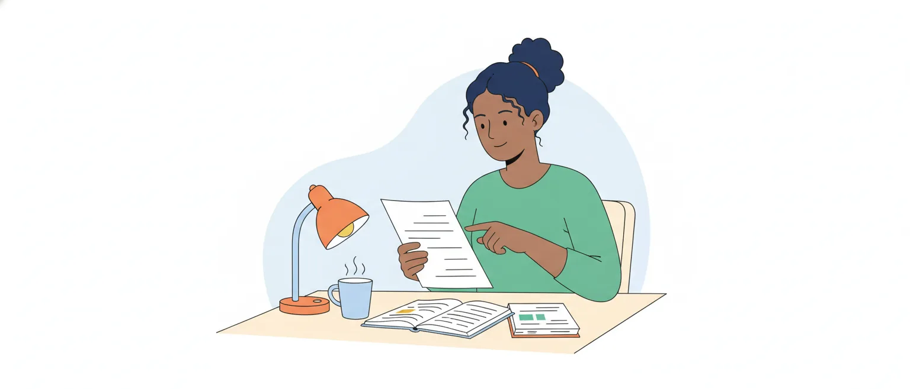

# Inglês: compreensão de textos

O edital pede, em Língua Inglesa (item 1, p. 51): "Compreensão de textos variados: domínio do vocabulário e da estrutura da língua, ideias principais e secundárias, explícitas e implícitas, relações intratextuais e intertextuais". Em resumo: ler um texto em inglês e julgar afirmações sobre ele.

Esta aula não ensina inglês do zero. Ela ensina a **ler para julgar itens**: o que fazer com a palavra desconhecida, como achar a ideia principal, como separar o que o texto diz do que o item acrescenta e como descobrir a que se refere um *this* ou um *them*. A gramática (tempos verbais, conectivos como classe) fica para outra aula, a de Inglês: gramática e usos.

## Como a prova de inglês é feita

Na prova de nível superior do concurso anterior da Câmara (edital de 2025, aplicada em março de 2026), que aqui chamamos de Câmara 2025, o inglês teve **dez itens sobre dois textos curtos**, de um a três parágrafos. Os dois eram trechos adaptados de textos sobre o trabalho legislativo: um artigo de revista jurídica e um relato em primeira pessoa.

O texto, o comando e os itens vêm **em inglês**. Nas provas que lemos, o comando é uma variação de *judge the following items* (julgue os itens a seguir). O julgamento é o de sempre: C ou E.

Pela nossa leitura dos nove itens válidos (um foi anulado), quase todos eram deste tópico: sentido de uma expressão, referência de um pronome, ideia geral, ideia principal, conclusão autorizada pelo texto, informação parafraseada e atitude do autor. Só um tratava de tempo verbal.

> [!IMPORTANT]
> Em 2026, cada item errado **anula** um certo (+1 e −1). Em inglês, isso muda a conta: item que você não consegue provar no texto fica em branco.

## Antes de ler: o que os itens pedem

A expressão que abre o item diz que tipo de leitura ele exige. Vale a pena reconhecer de longe expressões como estas (as de inferência, de ideia principal, de retomada e de troca apareceram nas provas de 2025):

| O item diz | O que ele quer | Onde está nesta aula |
| --- | --- | --- |
| *The text states / mentions / According to the text* | informação que está escrita, com outras palavras | Ideias explícitas |
| *It is correct to infer / to conclude from the text* | conclusão que o texto autoriza | Ideias implícitas |
| *The main point / the main idea of the text is* | a ideia que organiza o texto inteiro | Ideia principal |
| *"X" refers to / is referring back to* | o que um pronome ou uma expressão retoma | Relações intratextuais |
| *"X" can be replaced with "Y" without changing the meaning* | sentido de uma palavra naquele contexto | Vocabulário |
| *The author believes / shows / condemns* | a opinião ou a atitude de quem escreve | Vozes do texto |

O item também aponta o lugar pelo número de ordem: *the second sentence of the third paragraph* é a segunda frase do terceiro parágrafo. Os ordinais são *first*, *second*, *third*, *fourth*, *fifth* e *last* (a última).

> [!TIP]
> Conte as frases pelo ponto final e marque o trecho a lápis antes de julgar. Metade do erro em item com endereço é ler a frase errada.

## Duas leituras: a rápida e a de busca

O livro de inglês instrumental da CAPES/UAB, base desta aula, descreve duas técnicas que economizam tempo:

- ***skimming***: leitura rápida, para pegar o assunto geral. Olhe o título, a fonte no pé do texto e a primeira e a última linha de cada parágrafo;
- ***scanning***: busca de uma informação específica (um nome, uma data, uma expressão), sem reler tudo.

Na prova, as duas se combinam assim:

1. passe os olhos pelo texto (30 segundos) e diga para si mesmo, em português, de que ele trata;
2. leia o texto inteiro uma vez, sem parar nas palavras que não conhece;
3. leia um item, **volte ao trecho** que ele aponta e julgue com o texto na frente.

A linha da fonte, no pé do texto, ajuda: o nome da revista ou do livro indica o gênero, e *adapted* avisa que o texto foi modificado pela banca.

> [!WARNING]
> Não traduza o texto palavra por palavra. Custa tempo e não é o que o item mede: ele mede se a afirmação combina com o trecho.

## O texto desta aula

Os exemplos das próximas partes saem deste texto, escrito para a aula. Leia uma vez, sem dicionário.

> Most parliaments publish their debates. Although it is often described as verbatim, the official report is rarely a word-for-word transcript. Reporters remove repetitions and obvious slips, and they correct grammatical mistakes when leaving them in would distract readers. This does not mean that they are free to improve a speech: its meaning must stay exactly the same.
>
> Some legislatures now use speech recognition software to produce a first draft. Supporters argue that these tools save time, since reporters no longer type every word. Critics, however, point out that the software still struggles with overlapping voices and regional accents. For now, human reporters still review every draft before it is published.

Em uma frase: o registro oficial dos debates é editado sem mudar o sentido, e a tecnologia ajuda, mas não dispensa a revisão humana. *Reporters*, aqui, são os profissionais que registram os debates, como os taquígrafos.

## Vocabulário: os cognatos trabalham a seu favor

**Cognatos** são palavras de mesma origem, parecidas na forma e no sentido nas duas línguas. O livro da CAPES/UAB os separa em idênticos (*social*, *crime*), bastante parecidos (*impact*, *factor*) e vagamente parecidos (*possible*, *pressure*).

No texto da aula, muitas das palavras de conteúdo são cognatas: *parliaments*, *publish*, *debates*, *official*, *transcript*, *repetitions*, *obvious*, *correct*, *grammatical*, *legislatures*, *recognition*, *software*, *produce*, *critics*, *regional*, *human*.

Textos acadêmicos e jurídicos, como os da Câmara 2025, usam muito vocabulário de origem latina. Por isso, em geral, são **mais transparentes** para quem lê português do que um diálogo informal.

> [!TIP]
> Na primeira leitura, sublinhe os cognatos e os nomes próprios. Com eles, você já tem o esqueleto do assunto antes de se preocupar com o resto.

## Falsos cognatos: parecem, mas não são

**Falso cognato** é a palavra parecida com uma do português, mas de sentido diferente. O livro da CAPES/UAB lembra que os cognatos verdadeiros são muito mais numerosos: o falso cognato é exceção, mas é a exceção que a banca escolhe.

| Em inglês | Significa | Não é | Que seria |
| --- | --- | --- | --- |
| *actually* | na verdade, de fato | atualmente | *currently*, *nowadays* |
| *eventually* | por fim, com o tempo | eventualmente | *occasionally* |
| *ultimately* | por fim, em última análise | ultimamente | *lately* |
| *to attend* | comparecer a, estar presente | atender | *to answer*, *to serve* |
| *to assist* | ajudar | assistir (ver) | *to watch* |
| *to pretend* | fingir | pretender | *to intend* |
| *to realize* | perceber, dar-se conta (o sentido mais comum) | realizar (fazer) | *to carry out* |
| *to resume* | retomar, recomeçar | resumir | *to summarize* |
| *comprehensive* | abrangente, completo | compreensivo | *understanding* |
| *policy* | política (diretriz), norma de conduta | polícia; a política como atividade | *police*; *politics* |
| *agenda* (de reunião) | pauta, lista de assuntos | só a agenda de compromissos | *diary*, *planner* |
| *minutes* (de reunião) | ata | só "minutos" | — |
| *legislature* | o órgão legislativo, o parlamento | legislatura (período) | *term*, *legislative term* |

Um trecho inventado, com seis deles:

> The House eventually passed the bill, but only a few members actually attended the sitting. The Speaker then resumed the debate on the next item of the agenda, and the clerk recorded the decision in the minutes.

A Câmara **por fim** aprovou o projeto, mas só alguns membros **de fato compareceram** à sessão. O presidente então **retomou** o debate do item seguinte da **pauta**, e o servidor registrou a decisão na **ata**. *Speaker*, com maiúscula, é quem preside a casa, e não um orador qualquer; *bill* é o projeto de lei, e *sitting*, a sessão.

> [!CAUTION]
> Algumas palavras têm os dois sentidos, e só o contexto decide. *Discretion* é discrição, mas, em textos jurídicos, *to have discretion* é ter **liberdade para decidir** (discricionariedade). A Câmara 2025 teve um item errado que trocava uma expressão por outra de som parecido para o leitor brasileiro.

## Palavra desconhecida: use as pistas do contexto

O Online Writing Lab da Excelsior University lista seis tipos de pista para deduzir uma palavra pelo contexto. A lista abaixo é uma adaptação nossa, com exemplos próprios:

| Pista | Como aparece | Exemplo |
| --- | --- | --- |
| Definição | *is defined as*, *means*, *refers to*, parênteses | *A quorum is the minimum number of members who must be present.* |
| Sinônimo | *or*, *in other words*, *that is to say*, travessões | *The record is verbatim — word for word.* |
| Contraste | *but*, *however*, *whereas*, *unlike*, *although* | *The first speaker was concise, but the second was long-winded.* |
| Exemplo | *such as*, *for example*, *for instance*, *like* | *Minor slips, such as a wrong date or a mispronounced name, are corrected.* |
| Experiência | algo que você já conhece do mundo | *After six hours of debate, the members looked weary.* |
| Frase vizinha | a explicação vem na frase anterior ou seguinte | *The sitting was adjourned. Members will meet again on Tuesday.* |

Pelo contraste, *long-winded* é o oposto de conciso: prolixo. Pela frase vizinha, *adjourned* é suspensa ou encerrada até outro dia. Pela experiência, quem debate seis horas fica *weary*: cansado.

No texto da aula, *slips* vem ao lado de *repetitions* e de *grammatical mistakes*: são pequenos erros de fala, lapsos. E *verbatim* se explica pelo contraste com a frase seguinte: o registro é descrito assim, mas raramente é *word-for-word*, palavra por palavra.

> [!NOTE]
> Leitura nossa: nos itens de troca de palavra, a banca não mede dicionário, mede contexto. Antes de julgar, ponha a palavra proposta na frase e releia. *Rarely* pode dar lugar a *seldom* (raramente), mas não a *never* (nunca).

## Prefixos e sufixos

O livro da CAPES/UAB chama de **morfologia do vocábulo** outra saída para a palavra desconhecida: reconhecer as peças. Segundo ele, o prefixo acrescenta um sentido sem mudar a classe da palavra; o sufixo, em geral, muda a classe e mantém o sentido ligado ao radical.

- Prefixos de negação ou oposição: *un-* (*unclear*, pouco claro), *dis-* (*disagree*, discordar), *in-/im-/ir-* (*irrelevant*), *mis-* (*misunderstand*, entender mal), *non-* (*non-partisan*, apartidário).
- Outros prefixos comuns: *re-* (*reopen*), *over-* (em excesso: *overestimate*), *under-* (abaixo: *underrepresented*), *pre-* e *post-*.
- Sufixos que formam substantivos: *-tion* (*legislation*), *-ment* (*amendment*, emenda), *-er/-or* (quem faz: *drafter*, *legislator*), *-ness* (*fairness*).
- Sufixos que formam adjetivos: *-ful* (com: *lawful*, legal) e *-less* (sem: *lawless*, sem lei; *nameless*, anônimo), *-able* (*debatable*).
- Sufixo de advérbio: *-ly* (*rarely*, *exactly*).

Cuidado com dois advérbios em *-ly* que não seguem o adjetivo: *hardly* é "quase não" (e não "duramente"), e *lately* é "ultimamente" (e não "tardiamente").

## Estrutura da língua: o grupo nominal

Em inglês, os modificadores vêm **antes** do substantivo principal. O livro da CAPES/UAB chama o conjunto de **grupo nominal**: um núcleo (o último substantivo) e as palavras que o modificam. Para entender, leia **de trás para a frente**.

![Três grupos nominais em inglês, cada um com uma seta da direita para a esquerda, que mostra a ordem de leitura. Speech recognition software: o núcleo é software, a última palavra; lê-se software de reconhecimento de fala. Committee meeting minutes: o núcleo é minutes; lê-se atas das reuniões da comissão. The official parliamentary record: o núcleo é record; lê-se o registro parlamentar oficial. No pé, o cuidado: speech recognition software é um software, e não uma fala; committee meeting minutes são atas, e não uma comissão.](imagens/grupo-nominal.svg "Grupo nominal: comece pelo último substantivo")

*Speech recognition software* não é uma "fala" de alguma coisa: é um *software*. *Committee meeting minutes* são atas (das reuniões da comissão), e não uma comissão.

Em frase longa, ache primeiro o **sujeito e o verbo principal**; o resto é detalhe. Em *The bill that the committee amended last week was rejected by the House*, o esqueleto é *The bill was rejected* (o projeto foi rejeitado). Quem emendou foi a comissão; quem rejeitou foi a Câmara.

> [!CAUTION]
> Trocar **quem faz o quê** é molde antigo: aparece na prova de inglês da Câmara de 2012. Na voz passiva (*was rejected by*), quem age vem depois de *by*.

## Palavras pequenas que decidem o item

Algumas palavras curtas calibram a afirmação. O item errado costuma mexer justamente nelas:

- **quantidade**: *all* (todos), *most* (a maioria), *many* (muitos), *some* (alguns), *few* (poucos, quase nenhum), *a few* (alguns), *none* (nenhum);
- **frequência**: *always*, *often* (com frequência), *sometimes*, *rarely* e *seldom* (raramente), *never*;
- **certeza**: *must* (dever, com certeza), *will*, *can*, *may* e *might* (poder, talvez), *likely* (provável).

O texto da aula diz *Some legislatures now use speech recognition software*. Um item que afirmasse *Most legislatures use speech recognition software* estaria errado: *some* virou *most*.

Do mesmo jeito, o texto diz que os taquígrafos corrigem os erros de gramática *when leaving them in would distract readers* (quando deixá-los distrairia o leitor). Dizer que eles corrigem **todo** erro de gramática apaga a condição.

## Ideia principal e ideias secundárias

A ideia principal de um parágrafo costuma vir numa frase, o **tópico frasal** (*topic sentence*); as outras frases a desenvolvem, com exemplos, causas e detalhes. O livro da CAPES/UAB avisa que essa frase é comum no começo, mas pode vir no meio ou no fim, e que há parágrafos sem ela: aí o leitor precisa formulá-la.

No primeiro parágrafo do texto da aula, o tópico frasal é a **segunda** frase: o registro oficial raramente é uma transcrição palavra por palavra. A primeira só apresenta o assunto (os parlamentos publicam seus debates); a terceira e a quarta explicam o que se muda e o que não se pode mudar.

Para o texto inteiro, junte as ideias dos parágrafos numa frase. Aqui: o registro é editado sem mudar o sentido, e o programa de reconhecimento de fala ajuda sem substituir a revisão humana.

Agora, dois candidatos a *main point*:

- *The text explains how parliamentary records are edited and why human review is still needed.* Cobre os dois parágrafos: serve.
- *The main point of the text is to show that speech recognition software cannot transcribe parliamentary debates.* Pega uma ideia secundária (a dificuldade com vozes e sotaques), exagera e a promove a tema: não serve.

> [!CAUTION]
> Na Câmara 2025, um item de *main point* estava errado por exagero: o texto falava de uma influência, e o item a transformou em manipulação deliberada. Detalhe verdadeiro não vira ideia principal; ideia principal exagerada deixa de ser a do texto.

## Ideias explícitas: a paráfrase e o detalhe trocado

**Explícito** é o que está escrito. O item certo quase nunca copia o texto: diz o mesmo com outras palavras. *Reporters remove repetitions* pode voltar como *Repeated words are taken out of the report*: mudaram o vocabulário e a voz do verbo, e o conteúdo é o mesmo.

O item errado deste tipo, na Câmara 2025, não negava o texto de frente. Ele pegava um detalhe verdadeiro e o punha na **circunstância errada**: outro momento, outro lugar, outra pessoa, outra condição.

Com o texto da aula:

- *Speech recognition software is used to prepare a first version of the record in some legislatures.* Certo: *first draft* virou *first version*.
- *Reporters type every word before the software produces the draft.* Errado: o texto diz que, com o programa, eles **não precisam mais** digitar tudo (*no longer*).
- *Critics say that the software has difficulty with regional accents.* Certo: *struggles with* virou *has difficulty with*, e a afirmação continua na voz dos críticos.

> [!TIP]
> Em item de informação explícita, ache a frase do texto e compare **pedaço por pedaço**: quem, o quê, quando, onde, em que condição. O erro costuma estar num pedaço só.

## Ideias implícitas: a inferência

**Implícito** é o que o texto não escreve, mas autoriza a concluir. A Excelsior define inferência como a conclusão tirada a partir de evidências, de raciocínio e de conhecimento prévio: "ler nas entrelinhas", mas com as linhas na mão.

O texto da aula termina assim: *For now, human reporters still review every draft before it is published.*

![No alto, a frase do texto: For now, human reporters still review every draft before it is published. Abaixo, três quadros. Primeiro, está escrito: o item Human reporters review every draft é certo, porque é paráfrase da frase. Segundo, o texto autoriza: o item The software has not replaced human reporters é certo, porque, se eles ainda revisam todo rascunho, não foram substituídos. Terceiro, vai além do texto: o item The software will replace human reporters soon é errado, porque for now deixa o futuro em aberto e não diz o que virá nem quando. No pé, o teste: o texto pode ser verdadeiro e o item, falso? Se pode, o item não se infere do texto.](imagens/dito-inferido-alem.svg "O que está escrito, o que o texto autoriza e o que vai além")

- *Human reporters review every draft.* Está escrito.
- *The software has not replaced human reporters.* Não está escrito, mas decorre: quem ainda revisa todos os rascunhos não foi substituído. É inferência.
- *The software will replace human reporters soon.* Vai além. *For now* (por enquanto) deixa o futuro em aberto, mas não diz o que virá nem quando.

A aula de Compreensão e interpretação de textos, de Português, deu o teste que vale também aqui: o texto pode ser verdadeiro e o item, falso? Se pode, o item não se infere.

## Cinco perguntas para testar uma inferência

A Excelsior propõe cinco perguntas para conferir se uma inferência é lógica. Em tradução e adaptação nossas:

1. Ela se apoia em **palavras e frases do texto**?
2. Ela se apoia mais nas palavras do autor do que na **sua opinião**?
3. Ela evita **contradizer** outras afirmações do texto?
4. Ela combina com a **atitude ou o tom** do autor sobre o assunto?
5. Ela poderia servir de tese ou de tópico frasal? (Vale para a inferência da ideia principal.)

Segundo a fonte, basta um "não" para desconfiar da inferência e voltar ao texto.

Aplique ao item *It is correct to infer that the author opposes the use of speech recognition software in parliaments*. A pergunta 1 já falha: nenhuma frase mostra o autor contra. A 4 também: o tom é de relato, com os dois lados.

> [!WARNING]
> A pergunta 2 é a que mais pega em temas do cargo. Você sabe muito sobre taquigrafia e sobre a Câmara; o item pergunta o que **aquele texto** autoriza, e não o que é verdade no seu trabalho.

## Relações intratextuais: quem retoma quem

Relações intratextuais são as ligações **dentro** do texto. A que mais aparece nas provas que lemos é a referência: o item afirma que um pronome ou uma expressão retoma certo trecho. Na Câmara 2025 houve um item assim; na prova do TCU aplicada em 2026 (edital de 2025), dois.

As palavras que retomam:

- *it*, *its*: uma coisa ou uma ideia no **singular**;
- *they*, *them*, *their*: um **plural**, de pessoas ou de **coisas** (em português, "eles" faz pensar em gente; em inglês, não);
- *this*, *that*: sozinhos, muitas vezes retomam **uma ideia inteira**, e não uma palavra só;
- *these* / *those* / *such* + substantivo (*these tools*, *such measures*): um nome geral que reembala algo já dito;
- *the former* (o primeiro citado) e *the latter* (o último citado);
- *who*, *which*, *that*: em geral, o nome que vem logo antes.

![Quadro com sete linhas; em cada uma, um trecho do texto da aula com a palavra de retomada sublinhada e, à direita, o que ela retoma. Although it is often described as verbatim: it aponta para a frente, para the official report, que vem depois na mesma frase. And they correct grammatical mistakes: they retoma Reporters, plural. When leaving them in would distract readers: them retoma grammatical mistakes, plural. This does not mean that they are free: This retoma a frase anterior inteira, o fato de os taquígrafos editarem. Its meaning must stay exactly the same: its retoma a speech, singular. Supporters argue that these tools save time: these tools retoma speech recognition software, um nome geral que reembala o termo. Review every draft before it is published: it retoma every draft, singular. No pé, os passos: veja o número, procure os candidatos, troque e releia; se nenhum nome serve, teste a frase inteira.](imagens/quem-retoma-quem.svg "As retomadas do texto da aula")

Duas diferenças em relação ao português ajudam:

- o inglês **não marca gênero** nos substantivos, então o que elimina candidatos é o **número** (singular ou plural) e o sentido;
- *his* e *her* concordam com o **dono**, e não com a coisa possuída: *her speech* é o discurso **dela**.

> [!NOTE]
> Esta parte e a seguinte são construção nossa, a partir do modo como a banca cobrou a referência nas provas de 2025 e da gramática geral do inglês: as fontes de leitura que consultamos não tratam do assunto.

## Achar o referente em inglês: quatro passos

É o roteiro da aula de Coesão textual, ajustado ao inglês:

1. **Veja o número.** *It* e *its* pedem singular; *they*, *them*, *their* e *these* pedem plural.
2. **Procure para trás**, na mesma frase e na anterior, os candidatos que combinam.
3. **Troque e releia.** Ponha o candidato no lugar do pronome: a frase tem de fazer sentido.
4. **Nenhum nome serve?** Teste a ideia inteira da frase anterior (comum com *this* e *that*) ou olhe para a frente.

No texto da aula:

- *they correct grammatical mistakes when leaving **them** in*: plural. Candidatos: *reporters*, *repetitions*, *slips*, *mistakes*. Só *mistakes* faz sentido: deixar **os erros** no texto.
- ***This** does not mean that they are free*: nenhuma palavra isolada serve. *This* é o fato, dito na frase anterior, de que os taquígrafos cortam e corrigem.
- ***its** meaning must stay*: singular. É o sentido de *a speech*, o discurso.
- *Although **it** is often described as verbatim, the official report*: aqui o pronome vem **antes** do nome. A frase anterior não tem nenhum singular; *it* é *the official report*, que aparece logo depois.

Há ainda o *it* que não retoma nada: em *It is important to review every draft*, ele só ocupa o lugar do sujeito.

> [!CAUTION]
> Dois desvios a esperar: o item que dá ao pronome o candidato **mais próximo** quando o sentido pede outro, e o que diz que uma expressão retoma **dois** termos quando retoma um só (este apareceu na prova do TCU). O gabarito sai do passo 3.

## Outras ligações dentro do texto

Além da referência, o texto se amarra por conectivos e pela ordem das frases.

No texto da aula, *since reporters no longer type every word* dá a **causa** (já que, uma vez que). *Since* também pode marcar tempo (desde), e a banca já explorou essa dupla leitura: na prova do TCU, estava errado o item que lia como tempo um *since* de causa. *However* marca oposição entre *supporters* e *critics*. O valor de cada conectivo é assunto da aula de gramática.

A ordem também conta. *For now, human reporters still review every draft* só faz sentido **depois** da frase sobre as falhas do programa: é a consequência dela. Trocar frases de lugar pode quebrar a coerência ou deixá-la intacta, e o item pode afirmar uma coisa ou outra: releia o parágrafo com a troca feita.

## Relações intertextuais e as vozes do texto

Relação intertextual é a ligação do texto com **outros textos**: o que ele cita, resume ou comenta. Os textos da prova são trechos de artigos, que citam autores, pesquisas e documentos. As marcas mais comuns:

- aspas e *according to* (segundo), *as X puts it* e *in the words of X* (nas palavras de X);
- verbos de relato: *X argues* (defende), *claims* (alega), *points out* (aponta), *suggests*, *observes*;
- a linha da fonte, com autor, título e *adapted*.

Um trecho inventado:

> In a recent survey of reporting offices, most respondents described editing as "a service to the reader". One senator disagreed. In her words, the edited record "makes us sound wiser than we are". The survey's author takes neither side.

Há três vozes: a maioria dos entrevistados, a senadora e o autor da pesquisa. O item *According to the author of the survey, editing makes members sound wiser than they are* está errado: a frase é da senadora, e o autor **não toma partido** (*takes neither side*).

O mesmo vale para o texto da aula. *The author argues that these tools save time* está errado: quem defende isso são os *supporters*.

> [!NOTE]
> Leitura nossa: nas provas que lemos (Câmara 2025 e TCU 2025), nenhum item pedia para comparar dois textos. O que aparece é a voz trocada e a atitude dada ao autor: na Câmara 2025, estava errado o item que via ceticismo quanto à tecnologia num autor que só relatava a resistência de outras pessoas a ela. Os tipos de intertextualidade (citação, alusão, paráfrase) são da aula de Linguística sobre intertextualidade.

## Os moldes do item errado em inglês

Na Câmara 2025, nenhum dos quatro itens errados de inglês negava o texto de frente: o erro estava num desvio pequeno. Os moldes que vimos nessa prova e na do TCU, com exemplos sobre o texto da aula:

1. **Exagero.** *Reporters are free to rewrite speeches.* O texto diz que eles cortam e corrigem; daí a reescrever vai um exagero, que a quarta frase afasta.
2. **Detalhe na circunstância errada.** *Reporters correct every grammatical mistake.* Falta a condição.
3. **Quantificador trocado.** *Most legislatures use the software.* O texto diz *some*.
4. **Voz ou atitude trocada.** *The author is sceptical about technology in parliaments.* O autor relata; não avalia.
5. **Referente trocado.** *"These tools" refers to "reporters".* Refere-se ao programa.
6. **Troca de palavra que muda o sentido.** *"Rarely" can be replaced with "never".* Raramente não é nunca. Na Câmara 2025, a troca usava uma palavra parecida com outra do português.
7. **Extrapolação.** *Human reporters will soon be replaced.* O texto para em *for now*.

O item certo, por sua vez, costuma ser uma paráfrase fiel, uma inferência curta ou a descrição correta de uma retomada.

## Um roteiro para o dia da prova

1. Leia a linha da fonte e passe os olhos pelo texto: qual é o assunto?
2. Leia o texto inteiro uma vez. Sublinhe nomes, números e palavras de oposição (*but*, *however*, *although*).
3. Para cada item, descubra pelo comando o que ele pede e **volte ao trecho**.
4. Compare pedaço por pedaço: quem, o quê, quanto, quando, em que condição, na voz de quem.
5. Em item de inferência, passe as cinco perguntas. Em item de pronome, troque e releia.
6. Não achou o trecho ou travou numa palavra que decide o item? **Deixe em branco** e siga.

> [!TIP]
> Para treinar, leia um parágrafo por dia de um texto em inglês sobre parlamento ou leis e faça três coisas: diga a ideia principal em português, ache o referente de dois pronomes e marque uma palavra que deduziu pelo contexto.

## Fontes

- Inglês Instrumental (livro do Bacharelado em Biblioteconomia a distância). Mariangela Braga Norte, CAPES/UAB e UFRJ, 2018, unidades 1 a 4: tópico frasal, skimming e scanning, cognatos e falsos cognatos, inferência lexical, afixos e grupos nominais. Licença CC BY-NC-SA. https://educapes.capes.gov.br/handle/capes/717878
- Inferencing (Online Reading Comprehension Lab). Excelsior University Online Writing Lab, licença Creative Commons Atribuição 4.0 Internacional: a definição de inferência e a lista de cinco perguntas, traduzida e adaptada. https://owl.excelsior.edu/orc/what-to-do-while-reading/inferencing/
- Context Clues (Online Reading Comprehension Lab). Excelsior University Online Writing Lab, licença Creative Commons Atribuição 4.0 Internacional: os seis tipos de pista de contexto, adaptados, com exemplos nossos. https://owl.excelsior.edu/orc/what-to-do-while-reading/vocabulary-strategies/context-clues/
- Falsos Cognatos em Inglês (False Friends). Carla Muniz (Toda Matéria): banco de pares, conferidos em dicionário. https://www.todamateria.com.br/falsos-cognatos-no-ingles-false-friends/
- Wiktionary (dicionário livre, em inglês), verbetes das palavras dos quadros de vocabulário, para conferir os sentidos. https://en.wiktionary.org/
- Cebraspe. Câmara dos Deputados, Edital nº 1/2025 (nível superior), caderno de Conhecimentos Gerais, aplicado em 8/3/2026 (itens 27 a 36, Língua Inglesa), e gabarito definitivo. https://cdn.cebraspe.org.br/concursos/cd_25_ns/arquivos/E61A04B682ABA7AF746F702D22B1516C4A4BC005855CE5CFFF5D2280F3E790CE.pdf
- Cebraspe. TCU, Auditor Federal de Controle Externo, Edital nº 1/2025, prova objetiva de Conhecimentos Básicos, aplicada em 22/2/2026 (itens 21 a 30, Língua Inglesa), e gabarito definitivo. https://cdn.cebraspe.org.br/concursos/TCU_25_AUFC/arquivos/E853346980B6093207C3ECF8630F11E71C8F39D74F9D7881E2AB5DE760FB5366.pdf
- CESPE/UnB. Câmara dos Deputados 2012, Analista Legislativo, Taquígrafo Legislativo, caderno de Conhecimentos Básicos (itens 1 a 13, Língua Inglesa), e gabarito definitivo. https://cdn.cebraspe.org.br/concursos/CD_12_AT/arquivos/CAMARA12_CB3_05.pdf
