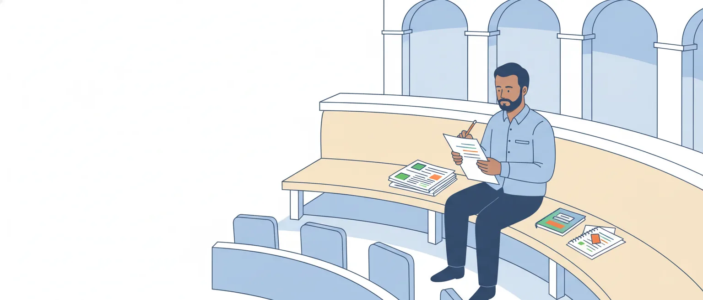

# Compreensão e interpretação de textos; tipos e gêneros textuais

O edital abre o programa de Português da P1 com dois itens: "1 Compreensão e interpretação de textos de gêneros variados. 2 Reconhecimento de tipos e gêneros textuais" (p. 50). Na prova, isso vira três perguntas: o que o texto diz, o que se pode tirar dele e que tipo de texto ele é.

Esta aula é a prática da P1: como o Cebraspe transforma a leitura em itens de certo ou errado e onde estão as armadilhas. A teoria volta na P2, em duas aulas de Linguística: Compreensão interpretativa e crítica (propósito do autor, fato e opinião, organização retórica) e Gêneros do discurso e tipos textuais (com macro e microestrutura).

## O que a banca faz com este tópico

Na prova de nível superior do concurso anterior da Câmara (edital de 2025, aplicada em março de 2026), que aqui chamamos de Câmara 2025, nove dos 26 itens de Português eram deste tópico, pela nossa contagem, e seis deles tinham gabarito E. Os quatro textos eram de gêneros diferentes: um trecho de manual da própria Câmara, uma reportagem de divulgação científica, uma notícia e um trecho de livro.

Cada item é uma afirmação sobre o texto. Não há alternativa melhor ou pior: você decide se aquela frase, inteira, se sustenta no texto. Na Câmara 2025, os itens remetiam ao trecho por período e parágrafo ("no segundo período do terceiro parágrafo"); na prova de 2012 para taquígrafo legislativo, por linha. Conte os períodos com cuidado antes de julgar; o treino desta aula usa as duas formas.

> [!IMPORTANT]
> No seu concurso, cada item errado anula um certo. **A resposta se prova com o texto**: se você não consegue apontar o trecho (ou os trechos) que sustenta a afirmação, ela não está certa.

## Compreender, interpretar, extrapolar

Três operações diferentes, que a banca mistura nos itens:

- **Compreender** é reconhecer o que o texto diz, ainda que com outras palavras. O item certo é uma paráfrase.
- **Interpretar** é tirar do texto o que ele não diz com todas as letras, mas autoriza com segurança. O item certo é uma inferência.
- **Extrapolar** é ir além: acrescentar causa, consequência, intenção ou dado que o texto não dá. O item está errado, ainda que a afirmação seja verdadeira no mundo.

Uma notícia fictícia:

> Por 19 votos a 17, a comissão aprovou ontem o parecer favorável ao projeto. A matéria segue agora para o Plenário.

- "O parecer foi aprovado por uma diferença de dois votos." Compreensão: certo.
- "A decisão da comissão não foi unânime." Interpretação: certo, porque houve 17 votos contrários.
- "O projeto deve ser aprovado também no Plenário." Extrapolação: errado. O texto diz para onde a matéria vai, não o que acontecerá lá.

Um item pode somar desvios. Na Câmara 2025, um item de "infere-se" deu a uma entidade a defesa da "proteção masculina às mulheres", quando o texto só dizia que um dirigente dela defendia o "engajamento ativo de homens", e ainda tirou disso uma conclusão sobre o machismo na sociedade que o texto não dava. Gabarito: E.

> [!TIP]
> Para separar inferência de extrapolação, pergunte: **o texto pode ser verdadeiro e o item, falso?** Se puder, o item não se infere do texto.

## Pressuposto e subentendido

Parte do que um texto comunica fica implícito. Os estudos da linguagem distinguem dois tipos de implícito: o **pressuposto**, que vem de uma marca linguística da frase, e o **subentendido**, que vem da situação de comunicação.

O pressuposto está na frase e não depende da intenção de quem fala. Em "O relator **voltou a** pedir o adiamento", está pressuposto que ele já tinha pedido antes. A prova clássica, um dos critérios de Ducrot, é a negação: "O relator **não** voltou a pedir o adiamento" nega o pedido de agora, mas mantém o anterior. O pressuposto resiste também à pergunta: "O relator voltou a pedir o adiamento?".

O subentendido depende do contexto, e quem fala pode negá-lo. Um deputado que diz ao presidente, às 23h, "Já são onze da noite, Senhor Presidente" informa a hora e, conforme a situação, sugere que é hora de encerrar a sessão. Se cobrado, pode responder: "Só informei a hora".

![Quatro colunas sobre a frase “O relator voltou a pedir o adiamento da votação.”, numa régua que vai de dentro para fora do texto. Posto, o que a frase afirma: “O relator pediu o adiamento”; sustenta item C. Pressuposto, que vem da marca “voltou a”: “Ele já tinha pedido o adiamento antes”; sustenta item C e resiste à negação. Subentendido, que depende da situação e pode ser negado por quem fala: “Ele quer ganhar tempo”; só é C se o resto do texto der base firme. Extrapolação, que vai além do texto: “Ele é contra o projeto”; item E, ainda que seja verdade fora do texto. No pé, o teste da negação: em “O relator não voltou a pedir o adiamento”, o posto é negado (desta vez, ele não pediu), e o pressuposto continua (houve um pedido antes).](imagens/do-dito-ao-extrapolado.svg "Do que o texto diz ao que já está fora dele")

## As marcas do pressuposto

Saber onde o pressuposto costuma estar ajuda a achar o item certo de "infere-se". As marcas mais comuns, com base no quadro de Isabel Azevedo (UFS), que segue Ducrot:

- **Verbos de mudança ou de permanência de estado**: *deixar de*, *passar a*, *continuar*, *voltar a*, *tornar-se*. "A comissão **deixou de** se reunir às quartas" → antes, ela se reunia às quartas.
- **Verbos factivos**, que dão o complemento como fato: *lamentar*, *saber*, *perceber*. "**Lamento** que a sessão tenha sido suspensa" → a sessão foi suspensa.
- **Verbos implicativos**: *conseguir*, *esquecer*, *evitar*. "O relator **conseguiu** incluir a emenda" → ele tentou incluí-la.
- **Advérbios e partículas**: *ainda*, *já*, *também*, *de novo*. "**Ainda não** há data para a votação" → espera-se que venha a haver.
- **Conectivos de tempo no início do período**: "**Desde que** assumiu a liderança, o deputado..." → ele assumiu a liderança.
- **Orações adjetivas explicativas e adjetivos**: "Os taquígrafos, **que acompanham toda a sessão**, ..." → todos eles acompanham a sessão inteira.

> [!NOTE]
> Nem todo "infere-se" certo se apoia numa marca de pressuposto. Na prova de 2012, um item C dizia que a autora fazia a história do Brasil começar com a chegada dos colonizadores. Nenhuma marca do texto pressupõe isso: a conclusão vem da junção de passagens, porque os "primeiros séculos da história do Brasil" são, no texto, os dos documentos escritos aqui, quando a distância de Portugal dificultava obter papel e tinta. É inferência pelo cotexto, e não pressuposto.

## Os comandos não decidem sozinhos

Muitos materiais ensinam uma regra fixa: "de acordo com o texto", "segundo o texto" e "o texto informa" pediriam só o que está escrito; "infere-se", "depreende-se" e "conclui-se", só o implícito. O Cebraspe não segue essa divisão à risca:

- na prova de 2012, um item com "De acordo com o texto" estava certo, mas exigia juntar duas passagens e dizer com outras palavras o que o autor só sugeria ("cada qual no seu contexto" virou "adequação à situação");
- na mesma prova, um item com "Depreende-se" pedia apenas o sentido de uma palavra do texto ("solecismos");
- na Câmara 2025, um item sem comando nenhum pedia a paráfrase de uma palavra figurada.

O comando diz onde olhar, não qual é a resposta. Julgue o conteúdo: a afirmação é paráfrase, inferência segura ou extrapolação?

> [!WARNING]
> "Infere-se" não autoriza imaginação. Inferir, para a banca, é concluir o que decorre do texto com segurança, e não o que é apenas plausível.

## Seis moldes do item errado

Os materiais costumam falar em três erros clássicos de leitura: extrapolação, redução e contradição. Nos itens do Cebraspe, eles aparecem disfarçados em poucos moldes, que se repetem na prova da Câmara de 2012 e na Câmara 2025. Dar nome ao molde ajuda a achar o ponto exato do erro.

![Tabela com seis moldes de item errado, cada um com o que o texto diz e o que o item diz. 1. Generalização, ou troca de quantificador: o texto diz “Alguns líderes pediram o adiamento da votação”; o item, “Os líderes pediram o adiamento da votação”. 2. Hierarquia inventada: o texto diz “A sessão foi suspensa por falta de quórum e por uma falha no painel”; o item, “A sessão foi suspensa mais pela falha no painel do que pela falta de quórum”. 3. Voz trocada, ou opinião dada ao autor: o texto diz “Para o relator, a proposta reduz a burocracia”; o item, “O autor do texto defende que a proposta reduz a burocracia”. 4. Meio e fim invertidos: o texto diz “A edição tira as hesitações do discurso para dar clareza ao registro”; o item, “A clareza é uma técnica usada para tirar as hesitações do discurso”. 5. Escala exagerada: o texto diz “O uso do celular é desaconselhado durante as votações”; o item, “O uso do celular é proibido durante as votações”. 6. Troca de predicado: o texto diz “Os servidores novos relatam menos dificuldades com o sistema”; o item, “Os servidores novos têm menos dificuldades com o sistema”. Todos os itens têm gabarito E.](imagens/moldes-do-item-errado.svg "Seis maneiras de o item se afastar do texto")

1. **Generalização.** O item troca o quantificador: "alguns" vira "os", "em geral" vira "sempre", "parte" vira "todos". Basta uma palavra para o item sair do texto.
2. **Hierarquia inventada.** O texto enumera causas; o item diz que uma pesou mais ("deveu-se mais a X do que a Y"). Foi o erro de um item de 2012 sobre as razões das abreviaturas nos documentos do Brasil Colônia.
3. **Voz trocada.** O texto relata a opinião de alguém, e o item a atribui ao autor; ou o item dá ao autor uma defesa que ele não faz. Em 2012, um item dava à autora a defesa do "uso indiscriminado" de abreviaturas; outro, uma ideia que o texto atribuía às pessoas de uma sociedade competitiva.
4. **Meio e fim invertidos.** O texto diz que A serve para B; o item diz que B serve para A. Na Câmara 2025, a clareza, que o texto apresentava como a meta de uma técnica de redação, virou uma das ferramentas dessa técnica.
5. **Escala exagerada.** "Desaconselhado" vira "proibido", "importante" vira "indispensável", ou o item cria uma gradação que o texto não tem: na Câmara 2025, uma escala que ia de "importante" a "irrelevante".
6. **Troca de predicado.** O sujeito é o mesmo, o verbo muda pouco e o sentido muda muito: na Câmara 2025, quem "percebe menos" uma discriminação virou quem "é menos afetado" por ela.

> [!CAUTION]
> Palavra absoluta não é sinônimo de item errado. Se o texto diz "todos", o item que repete "todos" está certo. O erro está na diferença entre o texto e o item.

## Os moldes do item certo

O item C também tem formas recorrentes:

- **Paráfrase de palavra figurada.** O texto usa uma imagem, e o item a traduz. Na Câmara 2025, estava certo o item que leu como "desalentador", na visão de uma dirigente, o ritmo que ela chamou de "glacial". Do mesmo modo, se um orador diz que "a pauta desta semana é um campo minado", é certo afirmar que ele vê riscos na pauta.
- **Inferência de pressuposto.** O "infere-se" apoiado numa marca da frase: *voltou a*, *ainda*, *deixou de*.
- **Contradição percebida.** Na Câmara 2025, num texto sobre uma pesquisa em que quase todos os entrevistados negavam ter preconceito racial e quase todos diziam conhecer racistas, foi dado como certo inferir que eles, implicitamente, se punham fora do grupo de que faziam parte.
- **Aspecto do verbo.** Na Câmara 2025, de um texto que dizia que um bioma "está secando e ficando mais quente", com dados de quatro décadas, foi dado como certo que o fenômeno é um processo gradativo. Ritmo "acelerado" não é o contrário de processo gradual.

## Cinco tipos textuais

Tipo textual é o modo de organizar o texto por dentro, reconhecido por marcas linguísticas. Os materiais de concurso costumam trabalhar com cinco, com nomes que variam: o expositivo também é chamado de dissertativo-expositivo, e o argumentativo, de dissertativo-argumentativo.

| Tipo | O que faz | Marcas | Exemplo |
|---|---|---|---|
| Narrativo | conta fatos que se sucedem no tempo | ações em sequência, pretérito perfeito, marcadores de tempo | "Aberta a sessão, o presidente leu o expediente e, em seguida, deu a palavra ao primeiro orador inscrito." |
| Descritivo | faz o retrato de um ser, objeto ou lugar; o tempo "para" | adjetivos, verbos de estado, presente ou pretérito imperfeito | "O plenário estava cheio; nas galerias, estudantes de uniforme azul ocupavam as primeiras fileiras." |
| Expositivo | informa ou explica um assunto, sem tomar partido | conceitos, dados, comparações, presente atemporal | "A medida provisória tem força de lei e perde a eficácia se não for convertida em lei em 60 dias, prorrogáveis por mais 60." |
| Argumentativo | defende uma tese para convencer | opinião, juízo de valor, conectores de causa, de oposição e de conclusão | "O projeto deve ser rejeitado, porque cria despesa sem indicar a fonte dos recursos." |
| Injuntivo | orienta ou ordena uma ação | imperativo, infinitivo, futuro com valor de ordem, "deve", "é vedado" | "O orador deverá ater-se ao tema em discussão." |

O injuntivo tem duas faces: o **instrucional**, que ensina um procedimento (manual, roteiro, receita), e o **prescritivo**, que impõe uma conduta (lei, regimento, edital, contrato). No Legislativo, o prescritivo é o tipo da própria lei: "Fica instituído...", "É vedado...", "O Poder Executivo regulamentará esta Lei".

> [!IMPORTANT]
> Entre expositivo e argumentativo, a pergunta é uma só: **há uma tese a defender?** Texto que informa, ainda que cheio de dados, é expositivo; texto que quer convencer é argumentativo.

## Classifica-se pelo que predomina

Textos reais misturam sequências. O discurso argumenta, mas conta um caso para sustentar a tese; a notícia informa e reproduz opiniões; a justificação de um projeto expõe dados a serviço de um argumento. Por isso se pergunta qual tipo **predomina** no texto, ou num trecho dele, e a resposta vem da finalidade do conjunto.

Daí dois cuidados:

- um traço isolado não define o tipo: uma data não torna o texto narrativo, um imperativo não o torna injuntivo, e adjetivos não o tornam descritivo;
- desconfie de "exclusivamente", "puramente" e "sem nenhuma marca de" em item de tipologia: basta uma sequência de outro tipo para derrubar o item.

## Dado não é descrição

Na Câmara 2025, um item afirmava que predominava a tipologia descritiva num parágrafo de reportagem cheio de números: temperatura média por década, aumento acumulado, comparação do ritmo de aquecimento entre biomas. O gabarito foi E, e a leitura mais provável é esta: o parágrafo informa e compara, e isso é exposição.

A confusão vem do uso comum da palavra: dizemos que um relatório "descreve" os dados. Na tipologia, **descrever é retratar** (como algo é, como estava), em geral com adjetivos e com o tempo parado; **expor é informar e explicar**, com conceitos, números, comparações, causas e evolução.

- Descritivo: "O painel eletrônico ocupa a parede do fundo; os nomes aparecem em letras verdes sobre fundo escuro."
- Expositivo: "Em 2025, o painel registrou 412 votações nominais, 30% a mais que no ano anterior." (dados fictícios)

> [!CAUTION]
> Número não faz retrato. Parágrafo de dados, porcentagens e comparações tende a ser expositivo, ainda que trate das características de alguma coisa.

## Gênero: o texto como ele circula

Gênero textual é o texto como existe na vida social, com nome, finalidade e forma reconhecíveis: ata, parecer, projeto de lei, discurso, notícia, ofício, edital. Na distinção de Marcuschi (2008), muito difundida, o tipo é uma construção teórica, reconhecida por traços linguísticos (léxico, sintaxe, tempos verbais, relações lógicas); o gênero é o texto concreto, que circula em situações de comunicação recorrentes e se define pela função que cumpre. Os tipos são poucos (os cinco desta aula); os gêneros são muitos e mudam com o tempo. Para ele, tipo e gênero não se opõem: completam-se.

Para Bakhtin, cada campo da atividade humana, como o Parlamento ou a imprensa, elabora seus tipos relativamente estáveis de enunciados, os gêneros do discurso, que se reconhecem por três elementos: conteúdo temático, construção composicional e estilo. Os três termos estão no item 6.1 da P2 do edital e voltam na aula de Gêneros do discurso e tipos textuais.

Um gênero costuma combinar vários tipos, com um predominante. A figura mostra gêneros do dia a dia de uma casa legislativa:

![Tabela de gêneros do Legislativo, com o tipo que costuma predominar e o que também aparece. Projeto de lei, o articulado: injuntivo prescritivo, como em “Fica instituído…” e “É vedado…”; também aparece o expositivo nas definições. Justificação do projeto: argumentativo, porque defende a aprovação; também aparecem o expositivo (dados) e o narrativo (histórico). Parecer: no relatório, expositivo e narrativo; no voto, argumentativo; um tipo em cada parte. Discurso parlamentar: argumentativo, porque defende uma posição; também aparecem o narrativo (casos) e o injuntivo (apelos ao voto). Ata de reunião: narrativo, porque relata em ordem o que ocorreu; também aparece o expositivo (pauta, resultado das votações). Notícia institucional: expositivo e narrativo, porque informa o fato; também aparecem opiniões citadas, atribuídas a quem as deu. Nota taquigráfica: o tipo da fala registrada, seja discurso, aparte ou questão de ordem; a passagem da fala para a escrita é tema da P2. No pé: tendências, não regras; na prova, classifique o texto ou o trecho que o item indicar.](imagens/generos-do-legislativo.svg "Gêneros do Legislativo e os tipos que costumam predominar neles")

> [!NOTE]
> As classificações da figura são tendências, leitura nossa a partir das fontes desta aula, e não regra. Na prova, classifique o texto ou o trecho que o item indicar.

## Pegadinhas de tipo e gênero

- **Rótulo trocado**: "o tipo textual notícia", "o gênero argumentativo". Notícia é gênero; argumentativo é tipo.
- **Gênero textual × gênero literário**: lírico, narrativo (ou épico) e dramático são gêneros literários, que classificam só os textos artísticos.
- **Classificação certa, motivo errado**: "é argumentativo porque apresenta dados", "é narrativo porque traz uma data". Se o motivo está errado, o item inteiro está errado.
- **Forma × finalidade**: um ofício pode trazer, no corpo, um pedido bem argumentado. O gênero se reconhece pela forma e pela situação; o tipo predominante, pela finalidade do trecho.
- **Trecho × texto**: o item pode perguntar por um parágrafo só. Classifique aquele parágrafo, e não o texto inteiro.

## Um roteiro para o item

1. Leia o comando e os itens antes do texto, para saber o que procurar.
2. Leia o texto inteiro uma vez e responda: quem fala, para quem, com que finalidade, em que gênero.
3. Para cada item, localize o trecho indicado, contando períodos e parágrafos.
4. Quebre a afirmação em pedaços (quem, o quê, quanto, por quê) e confira cada um: quantificador, verbo, voz, relação entre as ideias.
5. Faça o teste: o texto pode ser verdadeiro e o item, falso?

> [!TIP]
> Com +1 por acerto e −1 por erro, um chute com 50% de chance vale, em média, zero, o mesmo que o branco. Marque quando puder apontar o trecho que decide o item; na dúvida real entre C e E, deixar em branco não tira ponto. É uma estratégia nossa, não regra do edital.

## Fontes

- Cebraspe, Câmara dos Deputados, Edital nº 1/2025 (cargos de nível superior), caderno de Conhecimentos Gerais (a Câmara 2025 desta aula, prova aplicada em 8/3/2026), itens 1 a 26 (referência de estilo; nenhum item foi reproduzido): https://cdn.cebraspe.org.br/concursos/cd_25_ns/arquivos/E61A04B682ABA7AF746F702D22B1516C4A4BC005855CE5CFFF5D2280F3E790CE.pdf
- Cebraspe, gabarito oficial definitivo do mesmo caderno: https://cdn.cebraspe.org.br/concursos/CD_25_NS/arquivos/BE7F1F9B1F3F90750D44E63070FDE8505D71F1BADD7F9A2096BB953B32081694.pdf
- CESPE/UnB (atual Cebraspe), Câmara dos Deputados 2012, Analista Legislativo, Taquígrafo Legislativo, caderno de Conhecimentos Específicos, itens 71 a 100 (referência de estilo; nenhum item foi reproduzido): https://cdn.cebraspe.org.br/concursos/CD_12_AT/arquivos/CAMARA12_006_22.pdf
- CESPE/UnB, gabarito oficial definitivo do mesmo caderno: https://cdn.cebraspe.org.br/concursos/CD_12_AT/arquivos/Gab_definitivo_CAMARA12_006_22.pdf
- Câmara dos Deputados e Cebraspe, Edital nº 1, de 2/10/2026, p. 50 e 64 (conteúdo programático): https://cdn.cebraspe.org.br/concursos/CD_26_ANALISTA/arquivos/BBE30D016054F40651E36AC7B302C3425BD148A39675CA840A5A0CCBFBB5F0F1.pdf
- Isabel Cristina Michelan de Azevedo, "Estratégias argumentativas em perspectiva linguística e discursiva", Letramento Acadêmico, aula 5, CESAD/UFS, 2021 (subentendido × pressuposto e o quadro dos marcadores de pressuposição): https://cesad.ufs.br/ORBI/public/uploadCatalago/11173922072021Aula_05.pdf
- Roberta Maria Garcia Blasque e Esther Gomes de Oliveira, "As mensagens implícitas do texto e o delineamento conceitual do contrassentido", *Signum: Estudos da Linguagem*, UEL, v. 23, n. 2, 2020, p. 119-121 (pressuposto e subentendido; os critérios de Ducrot, em *O dizer e o dito*, 1987, citado pelas autoras: o pressuposto se mantém na negação e na interrogação): https://ojs.uel.br/revistas/uel/index.php/signum/article/view/41731
- Rafaela Freitas, "Dicas de Interpretação textual – Português para iniciantes", Estratégia Concursos (extrapolação, redução e contradição): https://concursos.estrategia.com/portal/dicas-de-interpretacao-textual-portugues-para-iniciantes/
- Warley Souza, "Tipologia textual: quais são, características", Brasil Escola (os cinco tipos e a predominância): https://brasilescola.uol.com.br/redacao/tipologia-textual.htm
- Warley Souza, "Gêneros textuais: o que são, quais são, exemplos", Brasil Escola (função comunicativa; gênero textual × gênero literário): https://brasilescola.uol.com.br/redacao/generos-textuais.htm
- Quero Bolsa, "Tipologia textual" (injunção instrucional e prescritiva): https://querobolsa.com.br/enem/redacao/tipologia-textual
- Sandra Aparecida Lima Silveira Farias e Luciano Amaral Oliveira, "Gêneros textuais e o livro didático: enfoque formal ou sociocultural?", *Eutomia*, UFPE, n. 12, v. 1, 2013, p. 486-492 (o conceito de gênero do discurso de Bakhtin, em *Estética da criação verbal*, e a distinção entre tipo e gênero de Marcuschi, em *Produção textual, análise de gêneros e compreensão*, 2008, citados pelos autores): https://periodicos.ufpe.br/revistas/EUTOMIA/article/view/422

Os textos, as frases e os dados dos exemplos foram criados para esta aula e são fictícios.
