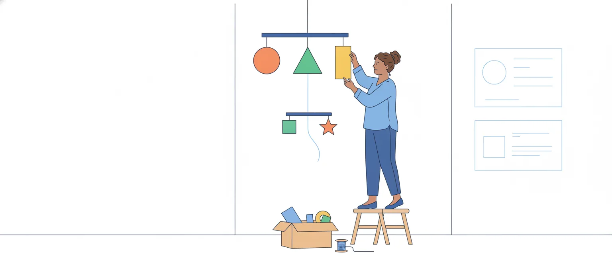

# Coordenação e subordinação entre orações e entre termos da oração

O edital pede duas linhas: "5.2 Relações de coordenação entre orações e entre termos da oração" e "5.3 Relações de subordinação entre orações e entre termos da oração". São duas relações (coordenar e subordinar) em dois níveis (o das orações e o dos termos dentro de uma oração): quatro combinações, e esta aula passa pelas quatro.

Ficam para as aulas vizinhas a vírgula e os demais sinais (pontuação), a preposição que cada verbo ou nome exige e a crase (regência, crase e colocação) e o verbo com sujeito composto (concordância). As conjunções como elos do texto já foram vistas na aula de coesão; aqui, interessa a estrutura que elas montam.

## Como a banca pergunta

Nas provas de nível superior aplicadas pelo Cebraspe em 2025 e 2026 (Câmara dos Deputados, TCU e STM), os itens deste assunto quase nunca pedem o nome completo de uma oração. Os formatos que se repetem:

- **mesma função**: "os termos 'X' e 'Y' desempenham a mesma função sintática";
- **classificação com justificativa**: "a vírgula se justifica por separar duas orações de mesmo sujeito"; "o 'e' liga por adição duas orações adjetivas";
- **circunstância**: "as orações 'para…' e 'para…' exercem função adverbial e expressam finalidade";
- **sujeito**: "o sujeito de referência da oração de gerúndio é 'X'";
- **valor da relação**: "a oração iniciada por 'Se' expressa hipótese";
- **paralelismo na reescrita**: "a substituição manteria a correção gramatical e o paralelismo sintático".

Em todos, há duas coisas a conferir: **a que palavra o segmento se liga** e **que papel ele cumpre ali**. O resto da aula dá um teste para cada caso.

> [!NOTE]
> Na sua prova, cada erro anula um acerto. Quando o item depender de uma classificação em que as gramáticas divergem (esta aula aponta algumas), deixar em branco é uma opção. Isso é estratégia nossa, não regra do edital.

## Duas relações, dois níveis

**Coordenar** é pôr lado a lado elementos de **mesma função**: nenhum deles é parte do outro. **Subordinar** é prender um elemento a outro, do qual ele depende e em relação ao qual cumpre uma função (completa, caracteriza, indica circunstância).

As gramáticas só costumam usar essas duas palavras quando chegam ao período composto. Flávia Carone, resumida em dois textos acadêmicos usados nesta aula, lembra que as mesmas relações já existem dentro da oração: há subordinação quando o elemento acrescentado tem função **diferente** da do termo a que se liga, e coordenação quando tem função **idêntica**. O edital segue essa visão ao falar em "orações" e em "termos da oração".

O quadro mostra as quatro combinações, com frases de uma sessão:

![Quadro de duas linhas e duas colunas. Nas colunas, entre termos da oração e entre orações; nas linhas, coordenação e subordinação. Coordenação entre termos: termos de mesma função, lado a lado; exemplo: o relator e a presidente assinaram a ata, com dois núcleos no sujeito; teste: deixe um de cada vez, sem a conjunção, e cada um cabe sozinho na mesma casa. Coordenação entre orações: orações em que nenhuma é termo da outra; exemplo: o relator leu o parecer, e o Plenário aprovou o texto; teste: nenhuma das duas é sujeito, complemento ou adjunto da outra. Subordinação entre termos: um termo regido depende de um termo regente; exemplos: aprovou o parecer, em que o verbo rege o objeto, e o parecer do relator, em que o nome rege o adjunto; teste: pergunte a que palavra o termo se liga. Subordinação entre orações: uma oração inteira funciona como termo de outra; exemplo: o relator disse que o prazo era curto, em que a segunda oração é o objeto direto de disse; teste: troque a oração por um termo simples, como isso. No pé: as duas relações convivem; no sujeito o relator e a presidente, os dois núcleos são coordenados entre si e, juntos, ligam-se ao verbo assinaram.](imagens/quatro-combinacoes.svg "As quatro combinações do edital")

Repare no pé do quadro: as duas relações convivem na mesma frase.

## Primeiro, conte as orações

Há uma oração para cada verbo ou locução verbal. Com uma só, o período é **simples**; com duas ou mais, **composto**. Antes de julgar qualquer item deste assunto, sublinhe os verbos:

> O presidente **abriu** a sessão, **leu** o expediente e **anunciou** que a pauta **havia sido alterada**.

São quatro orações. *Havia sido alterada* conta uma vez só, como *vai votar* ou *tinha pedido*: na locução verbal, os verbos formam um bloco.

Depois, ache o **sujeito de cada verbo**. O de *abriu*, *leu* e *anunciou* é *o presidente*, dito uma vez; o de *havia sido alterada* é *a pauta*. A banca cobra isso ao afirmar, por exemplo, que todas as orações de um período têm o mesmo sujeito (STM, prova de 2025): basta um verbo com outro sujeito para a afirmação cair.

> [!TIP]
> Numere os verbos no caderno de prova e escreva o sujeito ao lado de cada número. Leva poucos segundos e resolve os itens de sujeito, de vírgula entre orações e de "mesma função".

## Subordinação entre termos: quem rege e quem é regido

Dentro da oração, as palavras se organizam em torno de **núcleos**. O Manual de Redação da Presidência define regência como "sinônimo de dependência, subordinação": os **termos regentes ou subordinantes** (verbos, substantivos, adjetivos) regem os **termos regidos ou subordinados**, que lhes completam o sentido.

> A comissão aprovou ontem o parecer favorável do relator.

- O verbo *aprovou* rege o objeto direto (*o parecer favorável do relator*) e recebe o adjunto adverbial *ontem*.
- Dentro do objeto, o substantivo *parecer* é o núcleo: ligam-se a ele *o*, *favorável* e *do relator*, todos adjuntos adnominais.

Há, portanto, camadas: *do relator* depende de *parecer*, que depende de *aprovou*. O regente pode ser verbo ou nome, e o mesmo termo regido pode servir a regentes aparentados: *obedecer **ao Regimento***, *obediência **ao Regimento***, *obediente **ao Regimento***.

É por aí que se resolve o item de "mesma função sintática". Para cada termo apontado, responda:

1. **A que palavra ele se liga?** A um verbo, a um substantivo, a um adjetivo, a um advérbio?
2. **O que ele faz ali?** Completa o sentido (complemento), caracteriza (adjunto adnominal), indica circunstância (adjunto adverbial), pratica a ação de um verbo na voz passiva (agente da passiva)?

> [!CAUTION]
> Dois termos iniciados pela mesma preposição não têm, por isso, a mesma função. Em *O texto foi lido **pelo relator*** (agente da passiva) e *O Plenário optou **pelo adiamento*** (objeto indireto), a preposição é igual e a função é outra.

## Complemento nominal, adjunto adnominal e objeto indireto

São os três termos com preposição que a banca mais põe lado a lado. O primeiro corte é a classe do regente:

- ligado a **verbo**, completando-o: **objeto indireto** (*O líder insistiu **na votação nominal***);
- ligado a **adjetivo** ou a **advérbio**: só pode ser **complemento nominal** (*favorável **ao texto***; *contrariamente **ao parecer***);
- ligado a **substantivo**: pode ser complemento nominal ou adjunto adnominal. É aqui que se erra.

Para o substantivo, o critério do Só Português é o do valor: o **complemento nominal** tem valor **passivo** (é o alvo da ação que o nome exprime) e só aparece com nomes cujo sentido pede complemento; o **adjunto adnominal** tem valor **ativo** (é quem pratica a ação) ou apenas caracteriza o nome.

- *a aprovação **do projeto*** (o projeto é aprovado): complemento nominal;
- *a aprovação **do Plenário*** (o Plenário aprova): adjunto adnominal;
- *a insistência **na votação nominal*** (insiste-se nela): complemento nominal, como o objeto indireto de *insistir*;
- *o gabinete **do deputado***, *a ata **de ontem***: adjuntos adnominais (posse, caracterização).

## Coordenação entre termos

Termos coordenados ocupam **a mesma casa** da oração: dois núcleos no sujeito, dois objetos, dois adjuntos.

> O relator e a presidente assinaram a ata e o requerimento.

O teste parte de uma observação de Carone: deixe um elemento de cada vez, sem a conjunção. Se cada um cabe sozinho na mesma casa, com a mesma função (*O relator assinou a ata*; *A presidente assinou a ata*), eles são coordenados. Na subordinação, isso não acontece: em *assinaram a ata da sessão*, *a ata* cabe sozinha, mas *da sessão* não, porque depende dela.

Coordenam-se termos de qualquer função: sujeitos (*o relator e a presidente*), complementos (*leu o parecer e o voto em separado*), adjuntos (*discursou breve e claramente*), predicativos (*o texto é longo, porém claro*). Uma **enumeração** é uma coordenação com vários elementos, em geral com vírgulas e um *e* antes do último: *a pauta inclui dois projetos de lei, um requerimento e uma indicação*.

O *e*, o *ou* e o *mas* tanto ligam termos quanto ligam orações. Para saber qual é o caso, **conte os verbos**:

- *O deputado leu o relatório **e** o voto.* Um verbo: o *e* liga dois núcleos do objeto.
- *O deputado leu o relatório **e** pediu vista.* Dois verbos: o *e* liga duas orações de mesmo sujeito.
- *O deputado leu o relatório, **e** o Plenário aprovou o texto.* Dois verbos, dois sujeitos.

> [!WARNING]
> Quando a segunda oração tem outro sujeito, o leitor pode tomá-lo, à primeira vista, por mais um termo coordenado da oração anterior (*leu o relatório e o Plenário…*). A vírgula antes do *e* desfaz o engano; as regras estão na aula de pontuação.

## Paralelismo: funções iguais, formas iguais

Se os elementos coordenados têm a mesma função, a redação formal pede que tenham também a mesma **forma**. O Manual de Redação da Presidência chama a quebra dessa simetria de erro de paralelismo e dá os casos. Com exemplos nossos:

- **oração reduzida coordenada com oração desenvolvida**: *O presidente recomendou aos líderes **reduzir** os apartes e **que respeitassem** o tempo.* Correção: *reduzir… e respeitar…* ou *que reduzissem… e (que) respeitassem…*;
- **substantivo coordenado com oração**: *O requerimento pede **o adiamento** da votação e **que a comissão seja ouvida**.* Correção: *o adiamento da votação e a audiência da comissão* ou *que a votação seja adiada e que a comissão seja ouvida*;
- **"e que" sem "que" anterior**: *É um projeto antigo, **e que** já recebeu vinte emendas.* Correção: *é um projeto antigo, que já recebeu…* ou *é um projeto antigo e já recebeu…*.

O Manual aponta ainda o defeito inverso, o **falso paralelismo**: dar forma paralela a coisas de natureza diferente. O exemplo dele é *O Presidente visitou Paris, Bonn, Roma e o Papa*, em que três cidades e uma pessoa aparecem no mesmo nível.

## Correlações: cada metade no seu lugar

As expressões correlativas vêm em pares: *não só… mas (como) também*, *tanto… quanto*, *nem… nem*, *ou… ou*. Segundo o Manual da Presidência, o paralelismo entre as duas estruturas é obrigatório, e o erro típico é a primeira metade **fora de posição**.

A regra prática: o que vem logo depois de cada metade deve ter a mesma função e a mesma forma.

- Errado: *A emenda **não só** altera o prazo, **mas também** a multa.* (Depois de *não só*, um verbo; depois de *mas também*, um substantivo.)
- Certo: *A emenda altera **não só** o prazo, **mas também** a multa.*
- Errado: ***Ou** o relator apresenta o parecer hoje, **ou** amanhã.*
- Certo: *O relator apresenta o parecer **ou** hoje, **ou** amanhã.*

A correlação pode ligar termos (como acima) ou orações: ***Não só** leu o parecer, **como também** respondeu aos apartes.* Nos dois casos o valor é de **adição**: o *mas* de *mas também* não opõe nada.

> [!TIP]
> Cubra a primeira metade com um dedo e a segunda com outro. O que sobra à direita de cada dedo tem de ser do mesmo tipo: dois verbos, dois substantivos, duas expressões de tempo.

## Coordenação entre orações

No período composto por coordenação, **nenhuma oração é termo da outra**. A que vem com conjunção é **sindética**; a que vem sem conjunção, apenas justaposta, é **assindética**: *O presidente abriu a sessão, leu o expediente, anunciou a ordem do dia.*

As sindéticas recebem o nome da conjunção. São cinco tipos:

| Tipo | Ideia | Conjunções mais comuns | Exemplo |
| --- | --- | --- | --- |
| aditiva | soma | e, nem, não só… mas (como) também | *A comissão ouviu o ministro **e** aprovou o relatório.* |
| adversativa | oposição, contraste | mas, porém, contudo, todavia, entretanto, no entanto | *O texto foi aprovado, **mas** o destaque caiu.* |
| alternativa | alternância, exclusão | ou, ora… ora, quer… quer, seja… seja | ***Ou** o líder retira o requerimento, **ou** a sessão cai.* |
| conclusiva | conclusão | logo, portanto, por isso, por conseguinte, pois (depois do verbo) | *Não há quórum; a sessão está, **pois**, encerrada.* |
| explicativa | justificativa do que se disse | que, porque, pois (antes do verbo), porquanto | *Votem logo, **que** o prazo termina hoje.* |

> [!WARNING]
> "Oração coordenada tem sentido completo" é uma simplificação comum. O artigo de Sandra Bernardo mostra que os gramáticos oscilam entre esse critério de sentido e o critério sintático, e que orações como "mas ninguém o encontrou" não se sustentam sozinhas. Fique com o critério sintático: é coordenada a oração que **não exerce função sintática** em outra.

## O valor está na frase, não na conjunção

O nome da oração vem da relação que ela estabelece ali, e uma mesma conjunção pode montar relações diferentes:

- ***e*** com valor de oposição: *O líder pediu a palavra **e** não falou* (= mas não falou). A aula da UFS classifica como adversativa uma oração desse tipo;
- ***mas*** com valor de adição, na correlação *não só… mas também*. No *mas* que opõe duas ideias, a troca por *e* muda o sentido;
- ***pois*** antes do verbo explica; depois do verbo, entre vírgulas, conclui (está nas duas linhas da tabela);
- ***que*** e ***porque*** podem abrir coordenada explicativa ou subordinada causal, assunto de uma parte adiante.

> [!IMPORTANT]
> Diante de "a conjunção X liga por adição" ou "estabelece relação de oposição", releia as duas orações e dê nome à relação com as suas palavras. Só depois olhe para a conjunção.

## Subordinação entre orações: a oração no lugar de um termo

Na subordinação, uma oração inteira **funciona como termo** de outra, a **principal**. É a mesma relação de regente e regido da oração simples, com uma oração na casa do termo. A figura mostra a troca:

![Três pares de frases, cada um com um período simples à esquerda e um período composto à direita, em que uma oração ocupa o lugar de um termo. Primeiro par, oração substantiva: o relator pediu o adiamento, com um substantivo como objeto direto, passa a o relator pediu que a votação fosse adiada, com uma oração como objeto direto. Segundo par, oração adjetiva: o Plenário aprovou a emenda governista, com um adjetivo como adjunto adnominal, passa a o Plenário aprovou a emenda que o governo havia apresentado, com uma oração como adjunto adnominal. Terceiro par, oração adverbial: a sessão caiu por falta de quórum, com um adjunto adverbial de causa, passa a a sessão caiu porque faltou quórum, com uma oração como adjunto adverbial de causa. No pé: a função não muda, muda o que a ocupa; a oração subordinada vale por um substantivo, por um adjetivo ou por um advérbio, e daí vêm os nomes substantiva, adjetiva e adverbial.](imagens/oracao-no-lugar-do-termo.svg "A oração subordinada ocupa o lugar de um termo")

Daí as três famílias:

- **substantivas**: valem por um substantivo e são sujeito, objeto, complemento nominal, predicativo ou aposto da principal;
- **adjetivas**: valem por um adjetivo e são adjunto adnominal de um nome da principal;
- **adverbiais**: valem por um advérbio e são adjunto adverbial da principal.

## Orações substantivas

São introduzidas, em geral, pelas conjunções integrantes *que* e *se*; nas perguntas indiretas, por pronomes e advérbios interrogativos (*quem*, *qual*, *quando*, *por que*). O teste é trocar a oração por ***isso***: a função de *isso* é a função da oração.

| Tipo | Função | Exemplo |
| --- | --- | --- |
| subjetiva | sujeito | *É necessário **que o quórum seja verificado**.* (Isso é necessário.) |
| objetiva direta | objeto direto | *O relator afirmou **que o texto tinha lacunas**.* |
| objetiva indireta | objeto indireto | *O líder insistiu **em que a votação fosse nominal**.* |
| completiva nominal | complemento nominal | *O Plenário tinha certeza **de que o veto cairia**.* |
| predicativa | predicativo do sujeito | *A dúvida era **se haveria quórum**.* |
| apositiva | aposto | *O relator fez um pedido: **que a sessão fosse prorrogada**.* |

A diferença entre a objetiva indireta e a completiva nominal é a mesma dos termos simples: a primeira completa um **verbo** (*insistiu em*), a segunda completa um **nome** (*certeza de*).

A subjetiva é a que mais engana, porque vem depois do verbo. Aparece com *é* + adjetivo (*é necessário*, *é certo*), com verbos como *convir*, *constar* e *parecer* e com a voz passiva (*Sabe-se que…*, *Foi anunciado que…*).

> [!CAUTION]
> Em *Convém que os líderes se reúnam*, a oração não é objeto direto de *convém*: é o sujeito (*isso convém*). Verbo no singular seguido de *que* pede esse teste antes de qualquer classificação.

## Orações adjetivas

São introduzidas por **pronome relativo** (*que*, *o qual*, *cujo*, *onde*, *quem*), que retoma um nome da principal, o antecedente. A oração caracteriza esse nome, como faria um adjetivo.

Há dois tipos, e o sentido muda de um para o outro:

- **restritiva**, sem vírgulas: delimita uma parte do conjunto. *Os deputados **que votaram contra a emenda** deixaram o plenário* (só esses saíram);
- **explicativa**, entre vírgulas: acrescenta uma informação sobre o conjunto inteiro. *Os deputados, **que votaram contra a emenda**, deixaram o plenário* (todos votaram contra e todos saíram).

Por isso a banca pergunta se a retirada ou a inclusão das vírgulas "altera o sentido" ou "prejudica a coerência" (TCU, prova aplicada em 2026): quase sempre altera. O emprego da vírgula em si é da aula de pontuação.

O pronome relativo, além de ligar, **tem função dentro da oração adjetiva**. Para achá-la, reescreva a oração com o antecedente no lugar do pronome:

- *o projeto **que** o relator leu* → o relator leu *o projeto*: objeto direto;
- *o deputado **que** pediu a palavra* → *o deputado* pediu a palavra: sujeito;
- *a emenda **a que** o relator se referiu* → o relator se referiu *à emenda*: objeto indireto, e a preposição vai para antes do relativo.

> [!CAUTION]
> "Nas duas orações adjetivas, o 'que' exerce a função de sujeito" é molde de prova. Faça a reescrita em cada uma: o relativo pode ser sujeito numa e objeto na outra.

## Orações adverbiais

Indicam uma circunstância do que se diz na principal e levam o nome dessa circunstância. São nove tipos (há fontes que somam as modais, de modo):

| Tipo | Conjunções mais comuns | Exemplo |
| --- | --- | --- |
| causal | porque, já que, visto que, uma vez que, como (no início) | ***Como** faltou quórum, a sessão caiu.* |
| consecutiva | (tão, tanto) … que, de sorte que | *O debate foi **tão** longo **que** a pauta não terminou.* |
| condicional | se, caso, contanto que, desde que (com subjuntivo) | ***Se** houver acordo, a votação será simbólica.* |
| concessiva | embora, ainda que, mesmo que, conquanto, posto que | ***Embora** o prazo fosse curto, o parecer saiu.* |
| comparativa | como, mais (menos) … (do) que, tanto … quanto | *O Senado apreciou **mais** vetos **do que** a Câmara.* |
| conformativa | conforme, como, segundo, consoante | ***Conforme** prevê o Regimento, o autor falou primeiro.* |
| final | para que, a fim de que | *O relator cedeu **para que** o texto fosse votado.* |
| proporcional | à medida que, à proporção que, quanto mais… mais | ***À medida que** os destaques caíam, o plenário esvaziava.* |
| temporal | quando, enquanto, assim que, logo que | ***Assim que** o painel abriu, os líderes orientaram as bancadas.* |

Na **comparativa**, o verbo repetido costuma ficar subentendido: *mais vetos do que a Câmara (apreciou)*. Há oração sem verbo à vista, mas não sem conectivo (*que*, *do que*, *como*, *quanto*): em *O prazo da Câmara é superior ao do Senado*, o período é simples, e a comparação está num termo, o complemento de *superior*.

Os valores de cada conector e as trocas possíveis estão no quadro da aula de coesão textual.

> [!TIP]
> Para dar nome à adverbial, pergunte à principal: por quê? (causa), apesar de quê? (concessão), em que condição? (condição), para quê? (finalidade), quando? (tempo), de acordo com o quê? (conformidade).

## Explicativa ou causal: a fronteira

É o ponto em que coordenação e subordinação mais se confundem, porque *que*, *porque* e *pois* aparecem nas duas listas. A diferença de sentido:

- a **subordinada causal** diz a **causa do fato**: *A sessão terminou **porque faltou quórum***;
- a **coordenada explicativa** diz o **motivo de eu afirmar ou pedir** aquilo: *A sessão deve ter terminado, **porque as galerias estão vazias*** (as galerias vazias não causaram o fim da sessão; são o indício que justifica a afirmação).

A aula da UFS reproduz cinco recursos práticos de Adriano da Gama Kury para separar as duas:

1. se a oração aceita virar ***por* + infinitivo** sem mudar o sentido, é causal (*terminou por ter faltado quórum*); para Kury, é o teste mais eficiente;
2. se dá para pôr **dois-pontos ou ponto e vírgula** no lugar da conjunção, é explicativa (*Suspendam a votação: o painel travou*);
3. se dá para **omitir a conjunção**, é explicativa;
4. a oração anterior à explicativa costuma ter verbo no **imperativo** (*Suspendam a votação, que o painel travou*);
5. a causal aceita a troca por ***como*** (no início do período) ou ***uma vez que***; a explicativa, não.

> [!NOTE]
> Leitura nossa: se o item pede o **valor** ("expressa a causa de…", "justifica a ordem anterior"), aplique os testes e marque. Se o gabarito depender só do rótulo "coordenada" ou "subordinada" numa frase em que os testes não decidem, é item para deixar em branco.

## Orações reduzidas

A oração **reduzida** tem o verbo numa forma nominal (infinitivo, gerúndio ou particípio) e dispensa conjunção e pronome relativo; pode vir com preposição. A **desenvolvida** tem conectivo e verbo flexionado em tempo e modo. Para classificar a reduzida, desenvolva-a:

| Forma | Reduzida | Desenvolvida | Classificação |
| --- | --- | --- | --- |
| infinitivo | *É preciso **votar a matéria hoje**.* | que se vote a matéria hoje | substantiva subjetiva |
| infinitivo | ***Ao abrir a sessão**, o presidente registrou o quórum.* | quando abriu a sessão | adverbial temporal |
| gerúndio | ***Havendo acordo**, a votação será simbólica.* | se houver acordo | adverbial condicional |
| particípio | ***Encerrada a discussão**, passou-se à votação.* | depois que a discussão foi encerrada | adverbial temporal |

As substantivas só se reduzem de infinitivo; as adjetivas, de infinitivo, de gerúndio ou de particípio (*o texto **aprovado pela comissão*** = que foi aprovado pela comissão); as adverbiais, de qualquer das três formas.

Dois cuidados no estilo da banca:

- **o sujeito da reduzida**: em *O relator leu o parecer, **destacando** os pontos polêmicos*, quem destaca é o relator. Em *Encerrada a discussão*, o sujeito é *a discussão*, e o particípio concorda com ele;
- **a que termo ela se liga**: nem todo *para* + infinitivo é adjunto adverbial de finalidade. Em *O deputado correu **para votar***, a oração liga-se ao verbo (finalidade). Em *O Plenário rejeitou o pedido **para adiar a votação***, liga-se ao substantivo *pedido* (era um pedido de adiamento), e não indica a finalidade de *rejeitou*.

> [!CAUTION]
> "As duas orações exercem função adverbial e expressam finalidade": confira uma por uma a que palavra cada oração se liga. Se uma delas completa ou caracteriza um nome, a afirmação cai, ainda que as duas comecem por *para*.

## O período misto: tudo junto

Os textos de prova misturam as duas relações no mesmo período. Uma oração pode ser coordenada a outra e, ao mesmo tempo, principal de uma terceira:

> O relator leu o parecer, e o Plenário aprovou o texto que a comissão havia emendado, embora a oposição pedisse o adiamento.

![Esquema do período O relator leu o parecer, e o Plenário aprovou o texto que a comissão havia emendado, embora a oposição pedisse o adiamento, dividido em quatro orações. No nível de cima, lado a lado e ligadas pela conjunção e, duas orações coordenadas: a oração 1, o relator leu o parecer, coordenada assindética; e a oração 2, e o Plenário aprovou o texto, coordenada sindética aditiva e também principal das orações 3 e 4. No nível de baixo, presas à oração 2, duas subordinadas: a oração 3, que a comissão havia emendado, adjetiva restritiva, ligada ao substantivo texto; e a oração 4, embora a oposição pedisse o adiamento, adverbial concessiva, ligada ao verbo aprovou. No pé: quatro verbos, quatro orações; havia emendado é uma locução e conta uma vez; lado a lado, coordenação; para baixo, subordinação.](imagens/periodo-misto.svg "Um período com coordenação e subordinação")

O caminho para desmontar qualquer período:

1. sublinhe os verbos e conte as orações (aqui, quatro: *leu*, *aprovou*, *havia emendado*, *pedisse*);
2. circule os conectivos (*e*, *que*, *embora*);
3. para cada oração com conectivo subordinativo, ache a palavra a que ela se liga (*que a comissão havia emendado* → *texto*; *embora…* → *aprovou*);
4. as que sobram, sem depender de ninguém, são coordenadas entre si.

Orações subordinadas também podem ser **coordenadas entre si**, quando têm a mesma função junto à mesma principal: *O líder disse **que a bancada apoiava o texto** e **que votaria a favor*** (duas objetivas diretas de *disse*, ligadas por *e*). O mesmo vale para adjetivas: *medidas **que sejam urgentes** e **que não aumentem a despesa***.

> [!IMPORTANT]
> Um *e* entre duas subordinadas não as torna "coordenadas" em vez de subordinadas: elas são as duas coisas, subordinadas à principal e coordenadas uma à outra.

## Pegadinhas no estilo da banca

As trocas que os moldes do Cebraspe exploram neste assunto (os motivos são leitura nossa: a banca só publica justificativa de item anulado ou alterado):

1. **classes diferentes dadas como de mesma função**: em *o plenário lotado*, o adjetivo caracteriza o nome (adjunto adnominal); em *o Plenário Ulysses Guimarães*, o nome próprio diz qual é o plenário (**aposto especificativo**: individualiza o nome e vem sem vírgula). Os dois se ligam a um substantivo, mas não com o mesmo papel;
2. **justificativa falsa para fato verdadeiro**: a vírgula está certa, mas não pela razão que o item dá (por exemplo, "separar orações de mesmo sujeito");
3. **descrição errada do conectivo**: o item acerta que o *e* soma duas orações, mas erra ao dizer de que tipo elas são ou o que as introduz;
4. **nome inteiro da oração**: raro, mas existe. Um item do TCU aplicado em 2026 dava como "subordinada adverbial comparativa" a oração única de um período simples, em que a comparação vinha no complemento de um adjetivo (do tipo *superior a*); o gabarito foi *errado*.

No paralelismo, o molde é o da reescrita: troca-se uma oração por um substantivo (*que há* por *a existência de*) **nas duas ocorrências** e pergunta-se se a correção e o paralelismo se mantêm. Se a troca é feita dos dois lados e a regência continua certa, mantêm-se; se é feita de um lado só, o paralelismo se quebra.

> [!TIP]
> Item composto tem duas ou três afirmações num julgamento só. Separe-as com uma barra e teste cada uma: basta uma falsa para o item estar errado.

## Fontes

- Manual de Redação da Presidência da República, 3ª ed., 2018: seções 11.4 (erros de paralelismo) e 11.8 (regência). Cópia hospedada pelo ICMBio. https://ava.icmbio.gov.br/pluginfile.php/4592/mod_data/content/16325/Manual-de-redacao%20oficial%20_3%C2%AA%20EDI%C3%87%C3%83O%202018.pdf
- Língua Portuguesa III — Aula 2: orações coordenadas. José Araújo Filho, CESAD/UFS. https://cesad.ufs.br/ORBI/public/uploadCatalago/17261316022012Lingua_Portuguesa_III_Aula_2.pdf
- Língua Portuguesa III — Aula 7: as orações subordinadas adverbiais I (com os recursos de Adriano da Gama Kury, *Novas lições de análise sintática*). José Araújo Filho, CESAD/UFS. https://cesad.ufs.br/ORBI/public/uploadCatalago/17262616022012Lingua_Portuguesa_III_Aula_7.pdf
- Língua Portuguesa III — Aula 9: as orações reduzidas. José Araújo Filho, CESAD/UFS. https://cesad.ufs.br/ORBI/public/uploadCatalago/17263216022012Lingua_Portuguesa_III_Aula_9.pdf
- Reflexões sobre coordenação e subordinação. Sandra Bernardo, revista *Soletras*, UERJ, ano IV, n. 7, 2004. https://www.e-publicacoes.uerj.br/soletras/article/download/4482/3284/17193
- Subordinação e coordenação de termos (resumo de Flávia Carone, *Subordinação e coordenação: confrontos e contrastes*). Alexandra Soares de Oliveira e Paula Fernanda Eick Cardoso, UFPel, 2016. https://anais-siiepe.ufpel.edu.br/2016/LA_03130.pdf
- Só Português: período composto e coordenação (sint24 e sint27), subordinação (sint29 a sint36 e sint41 a sint43) e adjunto adnominal × complemento nominal (sint21). https://www.soportugues.com.br/secoes/sint/sint24.php
- Orações reduzidas. Flávia Neves, Norma Culta. https://www.normaculta.com.br/oracoes-reduzidas/
- Cebraspe. Câmara dos Deputados, Edital nº 1/2025, nível superior: caderno de conhecimentos gerais, aplicado em 8/3/2026, e gabarito definitivo. https://cdn.cebraspe.org.br/concursos/CD_25_NS/arquivos/E61A04B682ABA7AF746F702D22B1516C4A4BC005855CE5CFFF5D2280F3E790CE.pdf
- Cebraspe. TCU, Auditor Federal de Controle Externo, Edital nº 1/2025: caderno de conhecimentos básicos, aplicado em 22/2/2026, e gabarito definitivo. https://cdn.cebraspe.org.br/concursos/TCU_25_AUFC/arquivos/E853346980B6093207C3ECF8630F11E71C8F39D74F9D7881E2AB5DE760FB5366.pdf
- Cebraspe. Superior Tribunal Militar, Edital nº 1/2025: caderno de conhecimentos gerais para os cargos 2, 4, 5 e 7, aplicado em 1º/6/2025, e gabarito definitivo. https://cdn.cebraspe.org.br/concursos/STM_25/arquivos/072_STM_CG1_01.pdf
