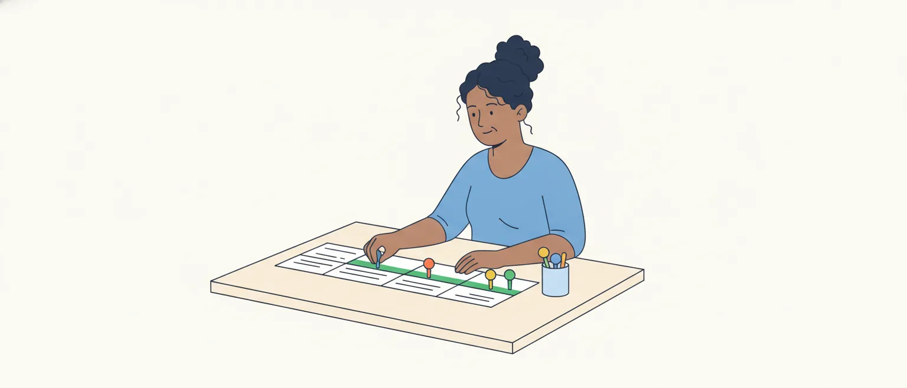

# Pontuação: o emprego dos sinais

O edital pede, em Língua Portuguesa (item 5.4 da P1): "Emprego dos sinais de pontuação". É uma linha só, mas cobre todos os sinais: vírgula, ponto e vírgula, dois-pontos, travessão, parênteses, aspas, ponto, ponto de interrogação, ponto de exclamação e reticências.

No Cebraspe, o item quase nunca pede a regra solta. Ele aponta um sinal do texto e afirma uma destas coisas: que o sinal é **obrigatório ou facultativo**, **por que** foi usado, o que acontece se for **retirado ou trocado**, ou que **efeito de sentido** produz.

A aula começa pela vírgula, com atenção à vírgula facultativa e à que muda o sentido, e depois trata dos outros sinais, um a um.

## Pontuação é sintaxe, não fôlego

O Manual de Redação da Presidência da República (seção 11.9) liga os sinais de pontuação à estrutura sintática e lhes dá três finalidades: marcar as pausas e a entoação da leitura, separar o que o autor quer destacar e esclarecer o sentido da frase, desfazendo ambiguidades.

A pausa existe, mas não é ela que decide onde vai a vírgula. Celso Luft, citado no artigo de Carneiro e Cavalcante, sustenta que, em português, a vírgula segue critérios sintáticos, e não a melodia da fala. Há pausa sem vírgula (depois de um sujeito longo) e vírgula quase sem pausa (*Sim, senhor*).

Por isso, a ideia escolar de que "vírgula é para respirar" atrapalha. Quem pontua pelo ouvido tropeça no sujeito longo e no termo deslocado.

> [!IMPORTANT]
> Antes de julgar qualquer vírgula, ache o **sujeito**, o **verbo** e os **complementos** da oração. A vírgula se explica pelo lugar que ocupa nessa estrutura.

## O que a vírgula não separa

Na **ordem direta**, a oração vem assim: sujeito, verbo, complementos e, no fim, as circunstâncias (tempo, lugar, modo). Se nada foi deslocado nem intercalado, não há vírgula.

O Manual da Presidência chama de erro a vírgula entre termos de ligação sintática estreita: entre o sujeito e o verbo, entre o verbo e seus complementos, entre o nome e seu complemento. Veja dois erros típicos:

- *O relator da proposta de emenda à Constituição, apresentou o parecer.* (separa o sujeito do verbo)
- *O presidente comunicou ao Plenário, que a sessão seria suspensa.* (separa o verbo do complemento)

O tamanho do sujeito não muda a regra. O manual do Senado diz que não se separa o sujeito do verbo "por mais longo que seja o sujeito", e isso vale também quando o sujeito é uma oração: *Quem quiser discutir a matéria deve inscrever-se na Mesa.*

Há uma voz diferente. Segundo Carneiro e Cavalcante, Bechara admite, como possível e não obrigatória, a vírgula depois de um sujeito ampliado por oração adjetiva; os autores concluem que não separar é a tendência, mas não um consenso. Os três manuais oficiais consultados (Presidência, Senado e STJ) não abrem essa exceção.

> [!WARNING]
> Sujeito longo pede fôlego, e a vírgula aparece por engano. Fôlego não é critério: veja o que há entre o fim do sujeito e o verbo. **Uma vírgula só**, para os manuais oficiais, é erro.

## Vírgulas que andam em par

Entre o sujeito e o verbo pode haver **duas** vírgulas: é quando algo foi encaixado no meio. O Manual da Presidência explica que as intercalações cortam o que está sintaticamente ligado e, por isso, ficam entre vírgulas. Os casos principais:

- **aposto explicativo**: *A relatora, deputada há três mandatos, pediu o adiamento da votação.*
- **vocativo**: *Agradeço, Senhor Presidente, a oportunidade.*
- **expressões que explicam ou corrigem** (*isto é*, *ou seja*, *ou melhor*, *por exemplo*): *A proposta foi prejudicada, ou seja, perdeu o objeto.*
- **conjunção fora do começo da oração** (*porém*, *contudo*, *portanto*, *pois*): *A oposição, contudo, manteve a obstrução.*
- **oração intercalada**: *O projeto, disse a relatora, volta à pauta amanhã.*

No começo ou no fim da frase, o termo fica com uma vírgula só, porque a outra ponta é o início da frase ou o ponto: *Senhor Presidente, peço a palavra.*

O aposto que apenas **especifica** o nome não leva vírgula: *o escritor Machado de Assis* (qual escritor?). O manual do STJ faz a mesma distinção entre aposto explicativo, com vírgulas, e especificativo, sem.

> [!CAUTION]
> A banca propõe tirar **uma** das vírgulas do par e pergunta se a correção se mantém. Para o adjunto adverbial intercalado, Luft (citado por Carneiro e Cavalcante) resume: duas vírgulas ou nenhuma, nunca uma só. Nos outros encaixes, os manuais pedem as duas.

## Séries e orações coordenadas

A vírgula separa termos de mesma função postos em série e orações coordenadas sem conjunção:

- *O projeto passou pela comissão, pelo Plenário e pela sanção.*
- *O presidente abriu a sessão, leu o expediente, anunciou a ordem do dia.*

Quando há conjunção, o manual do STJ manda separar por vírgula as orações coordenadas, **menos as iniciadas por *e* e *nem***. Assim, há vírgula antes de *mas*, *porém*, *portanto*, *pois*: *Houve acordo entre os líderes, mas a votação ficou para amanhã.* O manual do Senado pede essa vírgula antes das adversativas até em títulos.

As gramáticas não coincidem em tudo: Carneiro e Cavalcante mostram que algumas prescrevem a vírgula antes de adversativas, alternativas, conclusivas e explicativas, e que Cunha e Cintra só a prescrevem antes de adversativas e conclusivas. A classificação dessas orações é assunto da aula de coordenação e subordinação.

A conjunção também pode mudar de lugar. Se *porém*, *contudo*, *portanto* vêm no meio da oração, ficam entre vírgulas (parte anterior). Se abrem a oração depois de ponto ou de ponto e vírgula, o manual do STJ diz que **podem** ser seguidas de vírgula: *A sessão caiu por falta de quórum; portanto(,) a matéria volta à pauta amanhã.* A exceção é *mas*, que, por si só, não pede vírgula depois.

> [!TIP]
> *Pois* tem dois lugares. Antes da oração, explica (*Votem logo, pois o prazo termina hoje*). No meio dela, entre vírgulas, conclui (*O prazo terminou; a matéria está, pois, prejudicada*).

## A vírgula antes de "e"

O *e* já faz a ligação, e por isso, em regra, dispensa a vírgula: *O relator leu o parecer e pediu vista.* As duas orações têm o mesmo sujeito.

O manual do STJ lista quando a vírgula aparece antes de *e*:

1. **sujeitos diferentes**: *O relator leu o parecer, e o Plenário aprovou o requerimento.*
2. ***e* com valor de *mas***: *A matéria estava na pauta, e não foi votada.*
3. ***e* repetido para dar ênfase**: *O Plenário discutiu, e emendou, e votou.*
4. **vírgula que fecha uma intercalação**: *O parecer, lido ontem, e as emendas serão publicados.* Aqui a vírgula pertence ao termo intercalado, e não ao *e*.

No caso dos sujeitos diferentes, Carneiro e Cavalcante encontraram a mesma regra em quatro das gramáticas que compararam. Luft, segundo os mesmos autores, vai além e considera a vírgula facultativa antes de *e* quando o trecho anterior é muito longo, sem dizer quanto.

Uma prova do Cebraspe para a própria Câmara, aplicada em 8/3/2026, trouxe um item que dava certa vírgula como obrigatória e a justificava por separar duas orações de mesmo sujeito. O gabarito definitivo deu o item como errado. No texto da prova, a vírgula fechava uma oração adverbial posta antes da principal (leitura nossa), caso da parte sobre orações adverbiais, mais adiante.

> [!CAUTION]
> "Mesmo sujeito" não justifica vírgula: é o caso em que ela costuma faltar. O item junta uma classificação (obrigatória, facultativa) e uma justificativa; se uma das duas for falsa, o item é errado.

## Adjunto adverbial deslocado: curto ou longo

O adjunto adverbial (a circunstância de tempo, lugar, modo) tem lugar natural no fim da oração. Levado para o início ou para o meio, fica **deslocado**, e a vírgula marca o deslocamento:

- *O Plenário votou a medida provisória na sessão extraordinária de quinta-feira.* (ordem direta, sem vírgula)
- *Na sessão extraordinária de quinta-feira, o Plenário votou a medida provisória.*
- *O Plenário, na sessão extraordinária de quinta-feira, votou a medida provisória.*

O tamanho conta. O manual do STJ diz que, quando o adjunto é "de pequeno porte", a vírgula pode ser dispensada, e que ela volta quando se quer realçá-lo: *Hoje haverá sessão solene* ou *Hoje, haverá sessão solene*. O manual do Senado diz o mesmo com outras palavras: isolam-se os adjuntos deslocados "e, em geral, longos"; se o adjunto for curto, a vírgula é facultativa.

O problema é que **nenhuma fonte mede o "curto"**. Carneiro e Cavalcante mostram que as gramáticas dão como curto o adjunto formado por um advérbio ou por uma locução, mas trazem exemplos que se contradizem; para os dois autores, essa é uma das regras mais imprecisas.

Os professores de concurso costumam resolver a dúvida contando palavras, mas não chegam ao mesmo número: nos podcasts indicados nesta aula, um trata como longo o adjunto com mais de duas palavras, e outro dá a vírgula como facultativa até três. São convenções de quem ensina, não regras das gramáticas.

> [!NOTE]
> Leitura nossa: um advérbio sozinho (*hoje*, *ontem*, *aqui*, *depois*) é o caso seguro de vírgula facultativa; uma expressão de muitas palavras é o caso seguro de vírgula. Entre os dois (*ontem à tarde*, *na comissão*), as fontes não dão medida. Item que dependa só disso é arriscado.

## Orações adverbiais: antes, no meio ou depois

Quando a circunstância tem verbo, é uma **oração adverbial**, e a regra fica mais firme. O manual do STJ manda separar por vírgula a oração adverbial que vem **antes** da principal ou **no meio** dela:

- *Quando o presidente declarou aberta a sessão, havia quórum.*
- *A oposição, embora tivesse número, não pediu a verificação da votação.*

Vale também para a oração sem conjunção, com o verbo no infinitivo, no gerúndio ou no particípio, como nos exemplos do manual do Senado para termos e orações deslocados. Dois exemplos nossos: *Lido o parecer, abriu-se a discussão.* *Para evitar a obstrução, os líderes fecharam um acordo.*

Quando a oração adverbial vem **depois** da principal, o manual do STJ dá a vírgula como facultativa: *A sessão foi suspensa(,) porque faltou quórum.*

Aqui as gramáticas divergem. Segundo Carneiro e Cavalcante, Cipro Neto e Infante dão a vírgula como optativa com a oração posposta, enquanto Rocha Lima manda usá-la antes e depois da principal. E há um caso à parte: na oração que indica consequência (*falou tanto que perdeu a voz*), Rocha Lima manda usar a vírgula, e Cegalla manda não usar.

> [!IMPORTANT]
> Oração adverbial **antes** da principal ou **no meio** dela: vírgula. **Depois**: facultativa para a maior parte das fontes. E repare: um termo com verbo é oração, mesmo que seja curto (*Para ilustrar, cito um caso*). Não é "adjunto curto".

## A vírgula que muda o sentido

Na oração adjetiva, a vírgula não é questão de certo e errado: é questão de **o que a frase diz**. Compare:

- *Os deputados que assinaram o requerimento serão ouvidos.*
- *Os deputados, que assinaram o requerimento, serão ouvidos.*

Sem vírgulas, a oração é **restritiva**: só uma parte dos deputados assinou, e só essa parte será ouvida. Com vírgulas, é **explicativa**: todos os deputados de que se fala assinaram, e todos serão ouvidos. O Manual da Presidência manda separar por vírgula as adjetivas explicativas; o manual do STJ mostra, com pares como esse, que a leitura muda.

![Dois quadros lado a lado com a mesma frase. À esquerda, sem vírgulas, oração restritiva: Os deputados que assinaram o requerimento serão ouvidos; o desenho mostra um conjunto grande, os deputados, com uma parte destacada dentro dele, os que assinaram e serão ouvidos; só uma parte dos deputados assinou, e só essa parte será ouvida. À direita, com vírgulas, oração explicativa: Os deputados, que assinaram o requerimento, serão ouvidos; o desenho mostra o conjunto inteiro destacado; todos os deputados de que se fala assinaram, e todos serão ouvidos. No pé: tirar as duas vírgulas não cria erro de gramática, mas troca todos por só os que; a correção se mantém e o sentido muda.](imagens/restritiva-e-explicativa.svg "Restritiva e explicativa: o que as vírgulas fazem com o sentido")

O teste é perguntar: a oração **delimita** de quem se fala ou só **acrescenta** uma informação sobre todos? Uma pista (leitura nossa): quando o nome já aponta um ser único (*o Plenário*, *a Constituição*, *o autor deste projeto*), não há o que delimitar, e a oração é explicativa.

A banca cobra isso pela supressão. Na prova do concurso de 2025 do TCU, um item perguntava se retirar as vírgulas que isolavam uma oração adjetiva prejudicaria a coerência das ideias do texto. A classificação dessas orações é da aula de coordenação e subordinação; aqui interessa o efeito da vírgula.

> [!WARNING]
> "Manteria a correção gramatical" e "manteria o sentido" são afirmações diferentes. Tirar as vírgulas de uma explicativa pode manter a primeira e derrubar a segunda. Leia qual das duas o item afirma, ou se afirma as duas.

## Verbo omitido, datas e o mapa da vírgula

Três usos menores completam a lista.

**Verbo omitido.** O Manual da Presidência e o manual do Senado usam a vírgula para marcar o verbo que não se repetiu: *O Senado analisou a medida provisória; a Câmara, o projeto de lei.* (a vírgula está no lugar de *analisou*). Luft, citado por Carneiro e Cavalcante, chama essa regra de "artificial" e trata a vírgula como facultativa; acrescenta que, quando ela é usada, o sinal anterior deve ser mais forte: ponto e vírgula ou ponto.

**Datas.** A vírgula separa o nome do lugar: *Brasília, 21 de outubro de 2026.*

***Etc.*** O manual do Senado considera facultativa a vírgula antes de *etc.* e recomenda não usá-la.

![Quadro em três colunas sobre a vírgula. Primeira coluna, não se usa, entre termos ligados pela sintaxe: sujeito e verbo, mesmo com sujeito longo ou oracional; verbo e complemento; nome e complemento; antes de oração restritiva; antes de e com o mesmo sujeito, em regra; e uma vírgula só do par, porque na intercalação são duas ou nenhuma. Segunda coluna, usa-se: termos e orações em série; intercalação, em par, como aposto, vocativo, ou seja e porém; oração adjetiva explicativa; oração adverbial antes da principal ou no meio dela; adjunto adverbial longo deslocado; antes de mas, porém, portanto e pois; antes de e com sujeitos diferentes. Terceira coluna, facultativa: adjunto adverbial curto deslocado, como em Hoje haverá sessão, sem que nenhuma fonte meça o curto; oração adverbial depois da principal, como em A sessão foi suspensa porque faltou quórum, caso em que Rocha Lima manda usar a vírgula; depois de conjunção que vem após ponto e vírgula ou ponto, como portanto; e antes de etc., que o manual do Senado prefere sem vírgula. No pé, onde os autores divergem: a vírgula que marca o verbo omitido, que os manuais mandam usar e Luft trata como facultativa.](imagens/virgula-tres-situacoes.svg "O mapa da vírgula: onde não se usa, onde se usa e onde é facultativa")

> [!TIP]
> Diante de uma vírgula do texto, faça três perguntas, nesta ordem: ela separa sujeito e verbo ou verbo e complemento? Ela tem par? O que ela isola foi deslocado, intercalado ou está em série?

## Ponto e vírgula

O ponto e vírgula fica entre a vírgula e o ponto: separa mais que a vírgula, mas não encerra o período. O Manual da Presidência diz que, em princípio, ele separa estruturas coordenadas que **já têm vírgulas dentro**, e que também é usado no lugar da vírgula para dar ênfase. Os manuais do STJ e do Senado detalham três usos:

- **entre orações coordenadas**, sobretudo as longas (para orações curtas, o manual do STJ diz que basta a vírgula): *A Mesa propôs o adiamento; os líderes, porém, insistiram na votação.*
- **entre partes que já têm vírgulas**: *Falaram a presidente da comissão, autora do requerimento; o relator, que leu o parecer; e o líder da minoria.*
- **entre os itens de uma enumeração**, como os incisos de um artigo.

O exemplo a seguir é inventado, só para mostrar a pontuação dos incisos:

> Art. 2º Compete à comissão:
>
> I – discutir as proposições;
>
> II – realizar audiências públicas;
>
> III – emitir parecer.

Cada inciso termina em ponto e vírgula, e o último, em ponto.

> [!NOTE]
> Leitura nossa, para itens de troca de sinal: entre duas orações independentes, o ponto e vírgula costuma poder virar ponto (com maiúscula depois). Trocá-lo por vírgula já é outro caso: se as partes têm vírgulas internas, a troca embaralha a leitura.

## Dois-pontos

Os dois-pontos **anunciam** o que vem depois. Pelo Manual da Presidência (11.9.3), servem para introduzir citações, marcar falas em diálogo e indicar um esclarecimento, um resumo ou uma consequência do que se afirmou. Nos exemplos dos manuais, também abrem enumerações.

- **citação**: *A relatora foi direta: "O texto não será alterado."*
- **esclarecimento**: *O requerimento tinha um objetivo: adiar a votação.*
- **consequência ou resumo**: *Não havia quórum: a sessão foi encerrada.*
- **enumeração**: *Três matérias entraram na pauta: a medida provisória, o projeto de lei e o requerimento de urgência.*

Como os dois-pontos explicam, podem ser trocados por travessão: o Manual da Presidência diz que o travessão substitui os dois-pontos, e o manual do Senado dá esse uso para introduzir uma explicação. *O requerimento tinha um objetivo — adiar a votação.*

A banca cobra a **função** do trecho anunciado. Na prova do concurso de 2025 do TCU, um item afirmava que o trecho depois dos dois-pontos explicitava um termo que estava subentendido antes. Na do STM, também do concurso de 2025, os dois-pontos serviam só de endereço ("no trecho subsequente aos dois-pontos"), e o item tratava de verbo.

> [!TIP]
> Releia o que vem antes e pergunte: o que vem depois explica, enumera, cita ou conclui? Nomeie a relação antes de julgar o item.

## Travessão e parênteses

Travessões e parênteses fazem o mesmo trabalho das vírgulas em par: isolam um trecho encaixado. O Manual da Presidência diz que o travessão substitui parênteses, vírgulas e dois-pontos (10.5) e que os parênteses intercalam explicações, indicações, comentários e observações, como uma data, uma referência ou uma sigla (10.4).

O que muda é o peso. O manual do STJ indica o travessão duplo também para isolar palavras ou orações a que se quer dar **ênfase**; os parênteses guardam a explicação posta à parte.

![Quadro com a mesma frase isolada de três jeitos. Com vírgulas, a forma neutra: A relatora, deputada há três mandatos, pediu o adiamento da votação. Com travessões, que dão realce ao trecho: A relatora, travessão, deputada há três mandatos, travessão, pediu o adiamento da votação. Com parênteses, para a explicação à parte: A relatora, abre parêntese, deputada há três mandatos, fecha parêntese, pediu o adiamento da votação. Abaixo, três regras para quando os sinais se encontram. Um: se a frase já pedia vírgula naquele ponto, ela fica depois do segundo travessão ou do parêntese, como em Ouvida a relatora, travessão, deputada há três mandatos, travessão, vírgula, a comissão votou o parecer. Dois: no fim do período, basta um travessão, e o ponto fecha a frase, como em A comissão ouviu quem pediu o adiamento, travessão, a relatora. Três: tirar um só sinal do par deixa a frase errada; são dois ou nenhum.](imagens/tres-jeitos-de-isolar.svg "Vírgulas, travessões e parênteses isolando o mesmo trecho")

Três detalhes aparecem em prova:

1. **A vírgula depois do segundo travessão.** Se a frase já pedia vírgula naquele ponto, ela continua lá, depois do travessão (manuais do STJ e do Senado). O mesmo vale para o sinal que coincide com o fim do parêntese: fica depois dele.
2. **Travessão simples no fim.** Se o trecho isolado termina o período, usa-se um travessão só; não se fecha com outro antes do ponto.
3. **Travessão não é hífen.** O hífen liga partes de palavras; o travessão separa partes da frase. O Manual da Presidência proíbe o hífen no lugar do travessão.

O travessão também introduz a fala no diálogo: o manual do Senado registra esse uso, e o da Presidência o emprega em seus exemplos.

> [!NOTE]
> O desenho do travessão é convenção de cada casa: o Manual da Presidência usa um traço médio (–), e o manual do Senado, um traço longo (—), e pede que não se use o médio no lugar dele. Na prova, conta a função do sinal, não o comprimento do traço (leitura nossa).

## Aspas

O Manual da Presidência (10.1) dá às aspas dois empregos: marcar a **citação textual direta** de até três linhas e, quando necessário, **diferenciar** títulos, termos técnicos, expressões fixas e definições. Se o trecho citado já tem aspas, elas viram aspas simples.

O manual do Senado acrescenta as palavras usadas fora do sentido habitual, as expressões populares e as gírias, e faz um alerta: aspas em palavra isolada podem dar a ela **sentido irônico ou pejorativo** e levar o leitor a entendê-la ao contrário. Em *O líder elogiou a "agilidade" da comissão*, as aspas sugerem que a comissão foi lenta.

A posição do ponto segue uma lógica só, comum aos manuais da Presidência, do Senado e do STJ:

- a citação é uma frase inteira e encerra o período: o ponto fica **dentro** das aspas. *A relatora afirmou: "O texto não será alterado."*
- a citação é um pedaço da frase de quem escreve: o ponto fica **fora**. *A relatora afirmou que o texto "não será alterado".*
- a interrogação ou a exclamação que não pertence à citação vem depois das aspas: *Quem disse "a sessão está encerrada"?*

> [!WARNING]
> As aspas não têm um valor único. Num item sobre "o efeito das aspas", decida pelo contexto se elas citam a fala de alguém, destacam um termo ou marcam ironia. Um valor não vale pelo outro.

## Ponto, interrogação, exclamação e reticências

**Ponto.** Encerra a frase declarativa, afirmativa ou negativa. É o sinal mais forte: depois dele começa outro período.

**Ponto de interrogação.** Marca o fim da pergunta **direta**: *Quando a matéria será votada?* O Manual da Presidência avisa que ele não cabe na interrogativa **indireta**, aquela em que a pergunta vem embutida em outra frase: *O deputado perguntou quando a matéria seria votada.*

**Ponto de exclamação.** Indica surpresa, espanto, admiração, súplica. Segundo o Manual da Presidência, na redação oficial fica em geral restrito aos discursos e às peças de retórica.

**Reticências.** O manual do STJ registra dois usos: indicar interrupção, incompletude do pensamento ou hesitação (*Senhor Presidente, eu gostaria de... Retiro o que ia dizer.*) e, entre colchetes, marcar que se cortou um trecho de uma citação: *"Todo o poder emana do povo [...]"*. No fim do enunciado, as reticências dispensam o ponto.

Os **colchetes**, no mesmo manual, servem para pôr uma observação de quem cita dentro do texto citado ou para indicar o corte.

> [!TIP]
> Na interrogativa indireta, o verbo de perguntar (*perguntou*, *quis saber*, *indagou*) já faz o trabalho do sinal. Frase com esse verbo e ponto de interrogação no fim merece desconfiança, a menos que a frase inteira seja uma pergunta.

## Como o Cebraspe cobra

Nas provas consultadas (Câmara dos Deputados, TCU, Polícia Federal, Justiça Eleitoral, CNJ e STM, de 2012 a 2026), os itens de pontuação seguem poucos moldes:

1. **classificação com justificativa**: "a vírgula é obrigatória e se justifica por...". São duas afirmações; basta uma falsa;
2. **supressão das duas vírgulas** que isolam uma oração adjetiva, com pergunta sobre o sentido ou a coerência;
3. **supressão de uma vírgula só** do par que isola uma intercalação, com pergunta sobre a correção;
4. **"é facultativa e a supressão preservaria a correção"**, aplicada a um termo no começo do período. Veja se é advérbio curto ou oração;
5. **deslocamento**: mover uma expressão adverbial para o início do período, "desde que seguida de vírgula";
6. **efeito de sentido** das aspas, ou do trecho posto entre travessões;
7. **função do trecho** que vem depois dos dois-pontos;
8. **sinal como endereço**: a banca cita o sinal só para localizar o trecho, e o item trata de outro assunto.

A prova de Taquígrafo da Câmara de 2012, do cargo que antecedeu o de Registro e Redação, tem itens dos moldes 5 e 6.

> [!TIP]
> Como cada erro anula um acerto, marque quando conseguir apontar a estrutura (sujeito, intercalação, oração deslocada). Item que dependa só de um ponto em que os autores divergem, como o tamanho do adjunto "curto" ou a vírgula do verbo omitido, pode ficar em branco.

## Fontes

- Manual de Redação da Presidência da República, 3ª edição (2018), seções 10.1 (aspas), 10.4 (parênteses), 10.5 (travessão) e 11.9 (pontuação). Presidência da República, Casa Civil. Cópia hospedada pelo ICMBio: https://ava.icmbio.gov.br/pluginfile.php/4592/mod_data/content/16325/Manual-de-redacao%20oficial%20_3%C2%AA%20EDI%C3%87%C3%83O%202018.pdf
- Manual de Comunicação da Secom, verbetes "Vírgula", "Travessão", "Aspas" e "Ponto e vírgula". Senado Federal. https://www12.senado.leg.br/manualdecomunicacao/estilos/virgula
- Manual de Padronização de Textos do STJ, 2ª edição (2016), verbete "pontuação". Superior Tribunal de Justiça. https://scon.stj.jus.br/docs_intranet/comunicacao/interna/Manual_atualizado.pdf
- Tinha uma vírgula no meio da frase: considerações sobre as prescrições do emprego do sinal. Leandro Vidal Carneiro e Mônica Magalhães Cavalcante, *Domínios de Lingu@gem*, v. 9, n. 5, 2015. https://seer.ufu.br/index.php/dominiosdelinguagem/article/download/29237/17088
- Sinais de pontuação: quais são, funções. Guilherme Viana (Mundo Educação). https://mundoeducacao.uol.com.br/gramatica/pontuacao.htm
- Episódio 51 – Uso da vírgula no adjunto adverbial. Wanderson Melo (podcast Português Jurídico). https://podcasts.apple.com/br/podcast/epis%C3%B3dio-51-uso-da-v%C3%ADrgula-no-adjunto-adverbial/id1507504573?i=1000532280037
- Casos obrigatórios de vírgula. Letícia Góes (podcast Português com Letícia). https://podcasts.apple.com/br/podcast/casos-obrigat%C3%B3rios-de-v%C3%ADrgula-aprenda-de-verdade-e/id1534371896?i=1000680128203
- Cebraspe. Câmara dos Deputados 2025, nível superior, caderno de Conhecimentos Gerais, aplicado em 8/3/2026, e gabarito definitivo. https://cdn.cebraspe.org.br/concursos/CD_25_NS/arquivos/E61A04B682ABA7AF746F702D22B1516C4A4BC005855CE5CFFF5D2280F3E790CE.pdf
- Cebraspe. TCU 2025, Auditor Federal de Controle Externo, caderno de Conhecimentos Básicos. https://cdn.cebraspe.org.br/concursos/TCU_25_AUFC/arquivos/E853346980B6093207C3ECF8630F11E71C8F39D74F9D7881E2AB5DE760FB5366.pdf
- Cebraspe. Polícia Federal 2025, caderno de Conhecimentos Básicos. https://cdn.cebraspe.org.br/concursos/PF_25/arquivos/106_PF_CB1_01.pdf
- Cebraspe. Concurso Nacional Unificado da Justiça Eleitoral 2024, caderno de Conhecimentos Básicos. https://cdn.cebraspe.org.br/concursos/CPNUJE_24/arquivos/988_CPNUJE_CB3_01.PDF
- Cebraspe. CNJ 2024, caderno de Conhecimentos Básicos. https://cdn.cebraspe.org.br/concursos/CNJ_24/arquivos/979_CNJ_CB4_01.PDF
- Cebraspe. Superior Tribunal Militar 2025, caderno de Conhecimentos Gerais. https://cdn.cebraspe.org.br/concursos/STM_25/arquivos/072_STM_CG1_01.pdf
- Cespe/UnB. Câmara dos Deputados 2012, Analista Legislativo – Taquígrafo Legislativo, caderno de Conhecimentos Específicos. https://cdn.cebraspe.org.br/concursos/CD_12_AT/arquivos/CAMARA12_006_22.pdf
