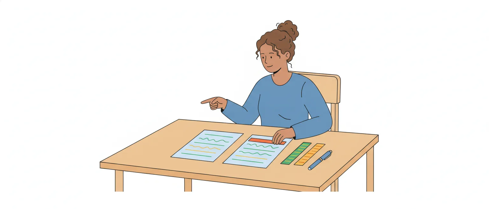

# Reescrita, significação das palavras e substituição de trechos

O edital pede, em Língua Portuguesa (item 6 da P1, p. 51): "Reescrita de frases e parágrafos do texto. 6.1 Significação das palavras. 6.2 Substituição de palavras ou de trechos de texto." Na prova, isso vira um tipo de item: a banca aponta um trecho do texto, propõe uma troca e afirma o que aconteceria com ele.

Reescrita não é uma matéria nova. É o lugar onde a banca junta o vocabulário com a gramática que você já estudou: concordância, regência, crase, pontuação, conectores, tempos verbais. Esta aula cuida do **sentido das palavras** e da **troca de palavras e de trechos**. Mudar a ordem das orações, passar da voz ativa para a passiva, juntar períodos e mudar o nível de formalidade (itens 6.3 e 6.4) ficam para a outra aula de reescrita.

## Um trecho, uma proposta, um comando

Todo item de reescrita tem três peças:

- o **trecho original**, que está no texto da prova (o item diz o parágrafo e o período);
- a **proposta**: uma palavra nova, um trecho novo ou a frase inteira reescrita;
- o **comando**: o que a banca afirma sobre a troca. É a parte que diz "manteria a correção gramatical", "sem prejuízo do sentido original", "sem comprometer a coerência do texto".

O candidato apressado lê a proposta, acha que "ficou bom" ou "ficou estranho" e marca. O erro está aí: o item não pergunta se a frase nova é boa. Ele **afirma** uma coisa precisa sobre ela, e é essa afirmação que você julga.

> [!IMPORTANT]
> Antes de olhar a proposta, sublinhe no item o que o comando afirma: **correção**, **sentido**, **coerência** ou uma combinação. A mesma troca pode dar *certo* com um comando e *errado* com outro.

## O comando decide o gabarito

Cada palavra do comando manda conferir uma coisa diferente. A divisão abaixo é a do professor Luiz Felipe Durval, num artigo sobre a reescritura no Cebraspe:

- **correção gramatical**: a frase nova respeita a norma-padrão? Confira concordância, regência, crase e pontuação;
- **sentido**: a frase nova diz a mesma coisa? Confira os sinônimos, a relação marcada por conjunções e preposições, o tempo e o modo dos verbos e a troca de oração adjetiva restritiva por explicativa (ou o contrário);
- **coerência**: as ideias continuam combinando entre si e com a realidade, sem contradição?

Veja como o comando muda o julgamento. No texto: *O relator apresentou um parecer sucinto sobre a medida provisória.* A proposta: trocar *sucinto* por *superficial*.

- "Manteria a **correção gramatical**": verdadeiro. *Superficial* é adjetivo e concorda com *parecer*.
- "Manteria a **coerência**": verdadeiro. A frase continua fazendo sentido.
- "Manteria o **sentido**": falso. *Sucinto* é o que diz muito em poucas palavras; *superficial* é o que não se aprofunda. A segunda palavra traz uma crítica que a primeira não tem.

![Quadro com três colunas, uma para cada palavra do comando. Correção gramatical: a pergunta é se a frase nova respeita a norma-padrão; confira concordância, regência, crase e pontuação. Sentido: a pergunta é se a frase nova diz a mesma coisa; confira sinônimos, conectores e tempo e modo do verbo. Coerência: a pergunta é se as ideias continuam combinando, sem contradição; confira a lógica do trecho com o resto do texto. Abaixo, o exemplo da aula: em O relator apresentou um parecer sucinto, a troca de sucinto por superficial mantém a correção, não mantém o sentido e mantém a coerência. No pé: quando o comando junta dois critérios com a conjunção e, basta um falhar para o item estar errado.](imagens/comando-do-item.svg "O que cada palavra do comando manda conferir")

Quando o comando junta dois critérios ("os sentidos **e** a correção gramatical"), os dois têm de se manter. Basta um falhar para o item estar errado.

## Sentido e coerência não são a mesma coisa

É o ponto que mais derruba candidatos. Durval é direto: mudar o sentido não torna o texto incoerente. O texto pode dizer **outra coisa** e continuar lógico.

A coerência só se quebra quando a troca cria uma contradição ou um absurdo. Em *A sessão foi encerrada porque faltou quórum*, trocar *faltou* por *sobrou* dá uma frase gramatical e sem lógica: ninguém encerra a sessão por excesso de presentes. Aí, sim, a coerência se perde.

Por isso, o comando "sem comprometer a coerência" é **mais fácil de satisfazer** do que "sem alterar o sentido". Uma palavra que não é sinônimo exato pode passar no primeiro e ser reprovada no segundo. A aula de coesão mostrou o mesmo com os conectores; aqui, vale para qualquer palavra.

> [!NOTE]
> Na prova da Câmara de 2025 (aplicada em março de 2026), o item 19 propunha trocar um adjetivo por outro que não é sinônimo exato dele e pedia só que não se comprometesse "a coerência das ideias do texto". O gabarito definitivo foi *certo*. A banca não publica o motivo: a explicação pelo comando é leitura nossa.

## Quando o item afirma que o sentido muda

Nem todo item diz que a troca "mantém" alguma coisa. Um molde frequente afirma o contrário: a troca **alteraria** o sentido, às vezes com a ressalva de que "manteria a correção gramatical". Se a troca de fato muda o sentido, e a gramática continua correta quando o item diz que continua, o item está **certo**.

O Cebraspe usou esse molde nas provas da Polícia Federal de 2025 (item 8), da Justiça Eleitoral de 2024 (item 16) e da Câmara de 2025 (item 4), e os três itens foram dados como certos. No da Câmara, a proposta invertia a ordem de um substantivo e de um adjetivo, e o item afirmava que isso "alteraria o sentido" e "poderia comprometer a coerência".

A posição do adjetivo muda mesmo o sentido de alguns pares:

- *um simples requerimento* (um mero requerimento) × *um requerimento simples* (sem complicação);
- *certa emenda* (uma emenda qualquer, não identificada) × *a emenda certa* (a correta).

> [!CAUTION]
> Ao ver "alteraria o sentido" ou "prejudicaria a correção", muita gente marca *errado* por reflexo, como se toda troca ruim fosse item errado. O item é uma afirmação: se ela descreve bem o que acontece, o gabarito é *certo*.

## O roteiro: gramática primeiro, sentido depois

Para não se perder, siga sempre a mesma ordem:

1. **Leia o comando** e marque o que ele afirma.
2. **Volte ao texto** e leia o período inteiro, não só a palavra apontada.
3. **Monte a frase nova** por completo, com a troca feita.
4. Se o comando fala em correção, **procure erro de gramática** na frase nova: concordância, regência, crase, pontuação, modo do verbo.
5. Se fala em sentido, **compare as duas frases**: dizem a mesma coisa, com a mesma força e a mesma certeza?
6. Se fala em coerência, veja se a frase nova **combina com o resto do texto**.

![Roteiro em seis passos, ligados por setas. Um: leia o comando e marque o que ele afirma, correção, sentido ou coerência. Dois: volte ao texto e leia o período inteiro. Três: monte a frase nova por completo. Quatro: se o comando fala em correção, procure erro de gramática, isto é, concordância, regência, crase, pontuação e modo do verbo. Cinco: se fala em sentido, compare as duas frases, vendo se dizem a mesma coisa, com a mesma força e a mesma certeza. Seis: se fala em coerência, veja se a frase nova combina com o resto do texto. No pé: o que o comando não pede não entra no julgamento; e, se você não consegue justificar a resposta, o item pode ficar em branco, porque cada erro anula um acerto.](imagens/roteiro-do-item.svg "Seis passos para julgar um item de reescrita")

A gramática vem primeiro porque é a parte mais objetiva: um erro de crase ou de concordância resolve o item sem discussão sobre nuances. Na prova da Câmara de 2025, dois dos itens de troca tinham comando só de correção: um mudava a flexão de um particípio (item 2), e outro propunha uma reescrita "correta" de um trecho (item 11).

> [!TIP]
> O que o comando não pede não entra no julgamento. Se ele fala só em correção, não importa que o sentido mude. E, se você não consegue justificar a resposta por um dos passos, o item pode ficar em branco: nesta prova, cada erro anula um acerto.

## Significação das palavras: vale o sentido do texto

O item 6.1 do edital não cobra lista de sinônimos decorada. Cobra o sentido que a palavra tem **naquele trecho**. O Manual de Redação da Presidência da República abre o capítulo de Semântica com essa orientação: para saber o significado de uma palavra, consideram-se a história dela, a sua estrutura (radical, prefixos, sufixos) e o contexto em que aparece. E manda verificar sempre esse contexto.

O dicionário dá os sentidos **possíveis**; o texto escolhe um. *Ordinário*, na conversa, pode ser "de má qualidade"; em *sessão ordinária* e *lei ordinária*, é "comum, regular". Quem troca *ordinária* por *ruim* num texto sobre o Plenário não entendeu o trecho.

Os moldes mais comuns do Cebraspe para este ponto, vistos em itens de 2023 reunidos no e-book de Décio Terror, são dois: "o vocábulo X **tem o mesmo sentido de** Y" e "X **é empregado com o sentido de** Y". Nos dois, a resposta está no período em que a palavra aparece.

> [!WARNING]
> Desconfie de qualquer método para resolver item de vocabulário "sem ler o texto". Duas palavras podem ser sinônimas no dicionário e não se trocarem naquela frase, ou o contrário.

## Uma palavra, vários sentidos

**Polissemia** é o nome do fenômeno: uma única palavra com dois ou mais sentidos (definição dos slides de Eduardo Amaral, da UFMG). O contexto separa os sentidos:

- *relevar*: perdoar, desculpar (*O presidente relevou o atraso do orador*) ou pôr em relevo, destacar (*O parecer releva a importância do tema*);
- *sanção*: a aprovação de um projeto pelo presidente da República ou a pena para quem descumpre a norma;
- *pauta*: a lista de matérias da sessão ou o assunto de que se trata (*o tema entrou em pauta*).

O item explora isso de dois jeitos. Ou propõe um sinônimo do sentido **errado** (*relevou o atraso* → *destacou o atraso*, que muda a ideia), ou afirma que a palavra tem, em dois pontos do texto, o mesmo sentido, quando não tem.

A fronteira entre polissemia e homonímia (palavras diferentes de forma igual) e os tipos de homônimos foram vistos na aula de Linguística sobre formação de palavras e relações de sentido. Aqui interessa só o efeito: achar o sentido que vale no trecho.

## Sentido literal e sentido figurado

A palavra pode estar no **sentido literal** (o próprio, o do dicionário), também chamado **denotativo**, ou no **sentido figurado**, o **conotativo**, que depende do contexto para ser entendido. O texto de Márcia Fernandes, no Toda Matéria, lembra que a linguagem denotativa é a de textos como a bula, o manual de instruções e o texto científico.

Já o discurso parlamentar e o noticiário político usam muito o sentido figurado:

- *O projeto foi **engavetado** na comissão* (ficou parado, sem andamento);
- *A proposta **naufragou** no Senado* (fracassou);
- *O líder **costurou** um acordo* (articulou, com paciência);
- *O plenário **ferveu** durante o debate* (agitou-se).

Trocar a palavra figurada por uma literal exige cuidado com o que se acrescenta. *Naufragou* → *fracassou* conserva a ideia. *Naufragou* → *foi rejeitada* diz mais do que o texto disse: a proposta pode ter fracassado sem ir a voto, por falta de acordo ou de prazo.

> [!NOTE]
> Leitura nossa: quando a troca apaga uma imagem (*engavetado* → *paralisado*), a informação se mantém e o efeito expressivo muda. Se o comando fala em "ideia central" ou em "coerência", a troca tende a passar; se fala em "sentidos" do texto, pese se a imagem dizia algo a mais, como ironia ou crítica.

## Sinônimos: parecidos, quase nunca iguais

A base teórica vem da aula de Semântica da UFS (curso de Letras a distância). Ela cita Oliveira: **sinônimos perfeitos não existem**; a sinonímia é semelhança de significados, não igualdade. E cita Dubois, para quem a sinonímia é questão de **grau**: pode ser completa ou não.

A mesma aula explica como os estudiosos testam dois sinônimos: pela **substituição** de um pelo outro em contextos diferentes. É o que o item da prova faz com você. E a conclusão é a mesma: a troca vale em alguns contextos e não em outros.

Em textos técnicos, a diferença cresce. Ilari e Geraldi, citados na aula da UFS, lembram que palavras intercambiáveis na conversa ganham sentidos específicos no uso técnico: *roubo* se aplica a crimes que o legislador considera mais graves que o *furto*, e *separação*, *desquite* e *divórcio* não são a mesma coisa no vocabulário jurídico.

O Manual de Redação da Presidência chega ao mesmo ponto por outro caminho: recomenda procurar sinônimos ou termos mais precisos para as palavras repetidas, mas manda deixar o texto como está se a substituição comprometer o sentido, tornando-o ambíguo ou menos claro.

## Quatro perguntas antes de aceitar a troca

Diante de "X poderia ser substituído por Y, sem alteração de sentido", faça quatro perguntas:

1. **A precisão é a mesma?** Termo técnico não se troca por palavra comum: *furto* × *roubo*; *sessão* (do Plenário) × *reunião* (de comissão).
2. **O alcance é o mesmo?** A palavra nova pode abranger mais ou menos gente e coisas. Num texto sobre uma sessão conjunta, com deputados e senadores, trocar *os deputados votaram primeiro* por *os parlamentares votaram primeiro* inclui os senadores.
3. **A intensidade é a mesma?** *Pedir* não é *exigir*; *criticar* não é *atacar*; *preocupante* não é *alarmante*.
4. **A avaliação é a mesma?** Há palavras neutras e palavras que julgam: *sucinto* × *superficial*; *afirmou* × *alegou* (apresentou como justificativa ou defesa) × *admitiu* (reconheceu algo contra si).

Um "não" basta para o sentido mudar. Para quem vai registrar debates, a quarta pergunta é trabalho diário: escrever que o deputado *admitiu* o que ele apenas *afirmou* muda o que ficou registrado.

> [!NOTE]
> As quatro perguntas são organização nossa, para a prova; as gramáticas e a banca não usam essa lista. Há ainda uma quinta diferença, a de **formalidade** (*falar* × *proferir*), que é assunto da outra aula de reescrita.

## A palavra nova arrasta a gramática

Uma troca perfeita no sentido pode quebrar a frase, porque a palavra nova tem as suas exigências:

- **gênero e número**: *O problema foi resolvido pela Mesa* → *A questão foi resolvida pela Mesa*. Se o item troca só o substantivo e deixa *foi resolvido*, a concordância se perde;
- **preposição**: *A comissão precisa de mais prazo* → *necessita de mais prazo* (mesma preposição), mas *requer mais prazo* (sem preposição);
- **crase**: *Os servidores assistiram à sessão solene* → *presenciaram a sessão solene*. *Presenciar* não pede preposição: mantido o *à*, a frase fica errada.

O Cebraspe já cobrou os dois lados: uma substituição que punha acento grave onde não há crase (Justiça Eleitoral 2024, item 6, que afirmava o prejuízo à correção e foi dado como certo) e uma troca de flexão que mantinha a correção (Câmara 2025, item 2).

As regras de concordância, de regência e de crase têm aulas próprias; aqui, o hábito a criar é **reler a frase inteira com a palavra nova**, e não só a palavra.

> [!WARNING]
> "Mantém o sentido **e** a correção" pede duas conferências. O sinônimo mais exato do mundo dá item errado se a preposição ou o acento grave que ficaram na frase não combinam com ele.

## Parônimos: a troca de uma letra

**Parônimos** são palavras parecidas na grafia ou na pronúncia, mas não idênticas, com sentidos diferentes (Manual de Redação da Presidência, item 12.1). Num item de substituição, o parônimo se disfarça de sinônimo. Estes pares são da lista do Manual, com os sentidos que ele dá:

| Par | Sentidos |
| --- | --- |
| ratificar / retificar | validar, confirmar / corrigir, emendar |
| deferir / diferir | atender, despachar favoravelmente / adiar; ser diferente |
| infligir / infringir | aplicar (pena, castigo) / transgredir, violar (lei, regulamento) |
| elidir / ilidir | suprimir, eliminar / contestar, refutar |
| prescrever / proscrever | determinar; ficar sem efeito / abolir, proibir |
| descriminar / discriminar | absolver de crime / diferençar, separar |

O Manual de Comunicação do Senado acrescenta que *descriminar* tem a variante *descriminalizar*, mais comum no meio jurídico, e que *discriminar* pode ter a conotação de preconceito.

Dois testes rápidos: *A Mesa ratificou a decisão* admite *confirmou*, e não *corrigiu*; *O requerimento foi deferido* admite *atendido*, e não *adiado*. Outros pares, e os homônimos *sessão*, *seção* e *cessão*, estão na aula de Linguística sobre formação de palavras e relações de sentido.

> [!CAUTION]
> A banca pode pôr o parônimo na **proposta** (*ratificou* → *retificou*) e afirmar que o sentido se mantém, ou usar no item o sentido de um para explicar o outro. Leia a palavra letra por letra.

## Expressões parecidas que não se equivalem

O item 12.2 do Manual de Redação da Presidência traz expressões que a banca pode propor como troca. Algumas não se equivalem:

- ***a princípio*** (no começo, inicialmente) × ***em princípio*** (em tese, de maneira geral): *A princípio, o líder apoiava o texto* (depois mudou) × *Em princípio, o líder apoia o texto* (em tese, salvo ressalvas);
- ***ao nível de*** (à mesma altura de: *ao nível do mar*) × ***em nível de*** (nessa instância: *em nível federal*). O Manual chama *a nível de* de modismo, que é melhor evitar;
- ***onde*** só vale por *em que* quando indica lugar: *a cidade onde nasceu*. Em *a lei onde é fixada a pena*, o Manual manda trocar por *em que* ou *na qual*;
- ***junto a*** indica proximidade física (*sentado junto à porta*); o Manual considera impróprio *declaramos junto à Receita* e prefere *declaramos à Receita*.

Outras se equivalem, e a troca mantém o sentido: ***a fim de*** vale por *para* ou *com o objetivo de* (Manual de Comunicação do Senado); o Manual da Presidência recomenda alternar *no sentido de* com *a fim de* e *com a finalidade de*, e *devido a* com *em virtude de* e *em razão de*. Já ***afim***, numa palavra só, é adjetivo: semelhante, que tem afinidade.

Os pares *à medida que* × *na medida em que* e *posto que* × *porque* estão na aula de coesão.

## Substituição de trechos: a mesma ideia com outra forma

O item 6.2 fala também em "trechos de texto". Aqui a troca é de um grupo de palavras por outro. Os casos mais comuns:

- **oração por nome**: *Os líderes reconhecem que há divergências no texto* → *reconhecem a existência de divergências no texto*. Na Câmara 2025 (item 21), a banca deu como certa uma troca desse tipo, com a correção e o paralelismo mantidos;
- **locução por adjetivo**: *a proposta do governo* → *a proposta governamental*;
- **palavra rara por expressão comum**: no STM 2025 (item 16), uma reescrita que trocava uma palavra pouco usada por uma expressão corrente foi dada como certa, com o comando "sem prejuízo da ideia central do texto";
- **nome ou trecho por pronome ou forma substituta** (*não forem nominais* → *não o forem*), visto na aula de coesão, junto com a condenação de *o mesmo* no lugar de um nome.

A aula da UFS chama de **paráfrase** essa sinonímia entre frases e avisa, com Cançado, que também entre frases não há sinonímia perfeita. Na prática, pergunte o que o trecho original carregava e veja se a forma nova carrega o mesmo:

- *o relatório do mês* (o deste mês) não é *o relatório mensal* (o que sai todo mês);
- *O deputado afirmou que o projeto será aprovado* não é *O deputado afirmou a aprovação do projeto*: o nome *aprovação* não tem tempo verbal, e o que era previsão passa a soar como fato.

> [!WARNING]
> A troca de locução por adjetivo não é automática. Na prova da Justiça Eleitoral de 2024 (item 12), a afirmação de que uma locução com *de* podia virar adjetivo "sem prejuízo da correção gramatical e do sentido original" foi dada como errada.

## As palavras pequenas que carregam o sentido

Na reescrita de um trecho, o erro costuma estar numa palavra curta que mudou ou sumiu:

- **quantidade**: *a maioria dos destaques foi rejeitada* → *os destaques foram rejeitados* (agora, todos);
- **certeza e obrigação**: *a Mesa pode adiar a votação* → *a Mesa deve adiar*; *talvez haja acordo* → *haverá acordo*;
- **restrição**: *só o relator se manifestou* → *o relator se manifestou* (sumiu a ideia de que ninguém mais falou);
- **negação**: *não é raro que falte quórum* → *é raro que falte quórum* (o contrário);
- **tempo e modo do verbo**: *a bancada tem votado com o governo* (fato que se repete até agora) → *a bancada votou com o governo* (fato único, encerrado), exemplo da aula de tempos e modos verbais.

O artigo de Durval inclui entre as trocas que alteram o sentido a da **oração adjetiva restritiva pela explicativa** (com vírgulas): *os deputados que faltaram terão desconto* (só os que faltaram) × *os deputados, que faltaram, terão desconto* (todos faltaram). A regra das vírgulas é da aula de pontuação.

> [!NOTE]
> A lista de "palavras pequenas" é organização nossa. Serve de conferência final no passo 5 do roteiro: quantidade, certeza, restrição, negação e tempo são os mesmos nas duas frases?

## No texto legal, sinônimo não é neutro

Para quem vai trabalhar com textos da Câmara, a troca de palavras tem regra em lei. A Lei Complementar nº 95, de 1998, que trata da redação das leis, manda, no art. 11:

- usar as palavras e as expressões "em seu sentido comum", salvo quando a norma tratar de assunto técnico, caso em que se usa a nomenclatura própria da área (inciso I, *a*);
- expressar a ideia, quando repetida no texto, "por meio das mesmas palavras, evitando o emprego de sinonímia com propósito meramente estilístico" (inciso II, *b*);
- evitar expressão ou palavra "que confira duplo sentido ao texto" (inciso II, *c*);
- escolher termos que tenham o mesmo sentido na maior parte do território nacional, evitando expressões locais ou regionais (inciso II, *d*).

Ou seja: na lei, se o art. 1º fala em *servidor*, o art. 5º não passa a falar em *funcionário* só para variar. O leitor da lei entende que palavra diferente quer dizer coisa diferente.

> [!NOTE]
> A LC nº 95 não está no item 6 do edital: entra aqui como apoio, para mostrar por que a banca trata a troca de palavras com tanto rigor em textos técnicos. A técnica legislativa é assunto dos conhecimentos específicos.

## Como o Cebraspe cobra

A prova de Conhecimentos Gerais da Câmara de 2025, aplicada em março de 2026 pela mesma banca, é o melhor retrato: dos 26 itens de Português, pelo menos sete propunham uma substituição ou uma reescrita. Os moldes, somados aos de outras provas recentes:

1. **só correção**: "seria mantida a correção gramatical caso X fosse substituído por Y" (Câmara 2025, item 2);
2. **reescrita "correta"**: "o trecho poderia ser corretamente reescrito como…" (Câmara 2025, item 11, dado como errado: na reescrita proposta, falta o acento grave em *aquele* depois de *superior*);
3. **sentidos e correção**: "estariam mantidos os sentidos e a correção gramatical caso…" (Câmara 2025, item 15);
4. **só coerência**: "poderia ser substituído, sem comprometimento da coerência das ideias" (Câmara 2025, item 19);
5. **a troca que altera**: "manteria a correção, mas implicaria prejuízo aos sentidos" (Polícia Federal 2025, item 8);
6. **equivalência**: "a estrutura X corresponde a Y" (TCU 2025, item 16) e "X tem o mesmo sentido de Y";
7. **ideia central**: "sem prejuízo da ideia central do texto, a oração poderia ser assim reescrita" (STM 2025, item 16).

A quantidade varia muito: na prova do TCU de 2025, só dois dos vinte itens de Português eram desse tipo.

> [!NOTE]
> No edital de 2026, cada erro anula um acerto. E os motivos dos gabaritos citados nesta aula são leitura nossa: a banca só publica justificativa de item anulado ou alterado.

## Pegadinhas no estilo da banca

- Julgar a **proposta** ("ficou boa", "ficou estranha") em vez da **afirmação** do comando.
- Marcar *errado* por reflexo quando o item diz que a troca "alteraria o sentido", e ela de fato altera.
- Tratar **sentido** e **coerência** como a mesma coisa: a troca que muda o sentido pode manter a coerência.
- Aceitar o sinônimo do dicionário sem voltar ao texto: a palavra tinha **outro sentido** naquele trecho.
- Trocar termo técnico por palavra comum (*sessão* por *reunião*) ou palavra neutra por palavra que julga (*afirmou* por *admitiu*).
- Não ver o **parônimo** na proposta: *ratificar* por *retificar*, *deferir* por *diferir*, *infligir* por *infringir*.
- Conferir o sentido e esquecer a **gramática** que a palavra nova arrasta: a preposição, a crase, o gênero.
- Aceitar a reescrita em que sumiu ou mudou uma palavra pequena: *só*, *não*, *pode*, *a maioria*, *talvez*.
- Ler *a princípio* como *em princípio*, ou *afim* como *a fim de*.
- Dar por certo que locução e adjetivo se equivalem sempre (*do mês* × *mensal*).

## Fontes

- Manual de Redação da Presidência da República, 3ª ed., 2018: itens 12 (Semântica), 12.1 (Homônimos e parônimos) e 12.2 (Expressões a evitar e expressões de uso recomendável). Presidência da República, Casa Civil; cópia hospedada pelo ICMBio. https://ava.icmbio.gov.br/pluginfile.php/4592/mod_data/content/16325/Manual-de-redacao%20oficial%20_3%C2%AA%20EDI%C3%87%C3%83O%202018.pdf
- Lei Complementar nº 95, de 26 de fevereiro de 1998, art. 11. Presidência da República. https://www.planalto.gov.br/ccivil_03/leis/lcp/lcp95.htm
- Reescritura de frases: desvendando questões CEBRASPE. Luiz Felipe Durval (Estratégia Concursos), 30/6/2021. https://concursos.estrategia.com/portal/reescritura-de-frases-desvendando-questoes-cebraspe/
- Semântica e Pragmática — Aula 5: As sutis (im)propriedades do "significar" com as palavras (seção sobre sinonímia e paráfrase, com citações de Oliveira, Dubois, Ilari e Geraldi e Cançado). CESAD/UFS. https://cesad.ufs.br/ORBI/public/uploadCatalago/18512216022012Semantica_e_Pragmatica_Aula_5.pdf
- Introdução aos Estudos Linguísticos II — aulas 35-36: semântica lexical (slides, a partir de Claudio Cezar Henriques). Eduardo Amaral, Faculdade de Letras da UFMG. https://grad.letras.ufmg.br/arquivos/monitoria/Apoio-%20Encontro3.pdf
- Denotação e Conotação. Márcia Fernandes (Toda Matéria). https://www.todamateria.com.br/conotacao-e-denotacao/
- Descriminar/discriminar e A fim de/afim — Manual de Comunicação da Secom. Senado Federal. https://www12.senado.leg.br/manualdecomunicacao/estilos/descriminar-discriminar e https://www12.senado.leg.br/manualdecomunicacao/estilos/a-fim-de-afim
- 100 Questões CEBRASPE — Questões Comentadas (e-book; consultado só para os moldes dos itens de significado das palavras). Décio Terror. https://www.professordecioterror.com.br/wp-content/uploads/2024/02/100-questoes-comentadas-CEBRASPE-todos-os-temas.pdf
- Cebraspe. Câmara dos Deputados, Edital nº 1/2025 (nível superior), prova objetiva de Conhecimentos Gerais, aplicada em 8/3/2026, e gabarito definitivo. https://cdn.cebraspe.org.br/concursos/CD_25_NS/arquivos/E61A04B682ABA7AF746F702D22B1516C4A4BC005855CE5CFFF5D2280F3E790CE.pdf
- Cebraspe, provas objetivas e gabaritos definitivos: Superior Tribunal Militar 2025 (https://cdn.cebraspe.org.br/concursos/STM_25/arquivos/072_STM_CG1_01.pdf); Concurso Público Nacional Unificado da Justiça Eleitoral 2024 (https://cdn.cebraspe.org.br/concursos/CPNUJE_24/arquivos/988_CPNUJE_CB3_01.PDF); Polícia Federal 2025 (https://cdn.cebraspe.org.br/concursos/PF_25/arquivos/106_PF_CB1_01.pdf); TCU 2025 (https://cdn.cebraspe.org.br/concursos/TCU_25_AUFC/arquivos/E853346980B6093207C3ECF8630F11E71C8F39D74F9D7881E2AB5DE760FB5366.pdf)
