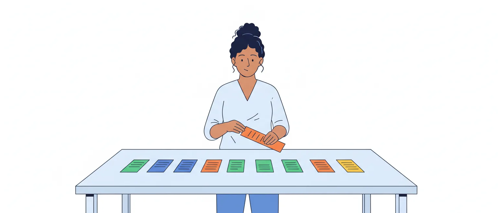

# Reescrita: reorganizar orações e períodos, mudar de gênero e de nível de formalidade

O edital pede, em Língua Portuguesa: "6.3 Reorganização da estrutura de orações e de períodos do texto. 6.4 Reescrita de textos de diferentes gêneros e níveis de formalidade" (p. 51). São duas habilidades: **mexer na arquitetura da frase** sem estragar a gramática nem o sentido, e **dizer a mesma coisa para outro leitor**, em outro gênero ou em outro grau de formalidade.

A troca de palavras e de trechos por equivalentes (itens 6 a 6.2) fica na aula de reescrita e significação, e a troca de conectores foi vista na aula de coesão. Aqui, as palavras quase não mudam: muda o lugar delas, a voz do verbo, o número de períodos e o tom do texto. É a rotina de quem registra e redige debates: ouvir uma fala e devolvê-la em outra forma, sem trair o que foi dito.

## Como o Cebraspe cobra

O item propõe uma mudança num trecho do texto e afirma que ela mantém alguma coisa. Nas provas da banca lidas para esta aula (Câmara 2025, aplicada em março de 2026; TCU 2025; STM 2025; CNJ 2024; Câmara 2012, cargo de Taquígrafo), a reorganização apareceu de cinco jeitos:

1. **deslocar um termo**: um advérbio que sai do começo do período e vai para depois do verbo, entre vírgulas; um adjunto adverbial levado ao início, "desde que seguido de vírgula";
2. **deslocar uma palavra pequena**, como um *não*, para outro ponto da frase;
3. **tirar ou pôr vírgulas** em volta de uma oração;
4. **fundir dois períodos** num só;
5. **reescrever o período inteiro**, com várias mudanças de uma vez (voz do verbo, tempo, ordem).

Nem toda reescrita proposta está errada. Na Câmara 2025, o deslocamento de um advérbio do começo do período para depois do verbo, entre vírgulas, foi dado como certo. No STM 2025, também foi certa a reescrita de uma oração em ordem inversa, posta em outra ordem e com uma palavra rara trocada por expressão equivalente.

Nenhuma dessas provas pediu a reescrita de um trecho em outro gênero ou em outro nível de formalidade. A formalidade apareceu de outro modo: itens que **caracterizam a linguagem do texto** (se é formal ou informal) ou que tratam do uso de uma variante em situação que pede a norma-padrão. Na Câmara 2025, o primeiro texto da prova era um trecho do *Manual de linguagem simples* da própria Casa.

> [!NOTE]
> A banca só publica o gabarito, sem o motivo. Quando esta aula explica por que uma reescrita falha, a explicação é leitura nossa, apoiada na gramática e nos manuais citados no fim.

## O comando decide o que conferir

O comando diz o que a reescrita tem de manter, e cada palavra dele é uma pergunta diferente:

- **correção gramatical**: a frase nova tem erro de concordância, regência, crase, pontuação ou colocação?
- **sentido** (ou "os sentidos", "o sentido original"): a frase nova informa o mesmo?
- **coerência**: as ideias continuam combinando entre si e com o resto do texto?

Como se viu na aula de coesão, sentido e coerência não são a mesma coisa: a reescrita pode dizer algo diferente e continuar coerente. Se o comando pede só "correção gramatical", uma reescrita correta que muda o sentido torna o item certo. Se pede "os sentidos e a correção", basta falhar numa das duas coisas.

Há também comandos mais soltos, como "sem prejuízo da ideia central" ou "mantidas as relações sintático-semânticas". Leia o comando antes da reescrita e sublinhe o que ele exige.

> [!IMPORTANT]
> Reescrita é pacote: confira **cada mudança** contra **cada exigência** do comando. Uma mudança errada basta para o item ser E.

## A ordem direta, ponto de partida

Para saber o que foi deslocado, é preciso ter em mente a ordem normal. O Manual de Redação da Presidência a resume assim, com os parênteses indicando o que pode faltar:

**(sujeito) – verbo – (complementos) – (adjunto adverbial)**

*A comissão aprovou o parecer na reunião de terça-feira.* Sujeito, verbo, objeto, adjunto adverbial: ordem direta. O mesmo vale para o período: na ordem direta, a oração principal vem primeiro, e a adverbial, depois: *A sessão foi suspensa porque faltou quórum.*

Os manuais oficiais (o da Presidência, o de redação da Câmara e o de linguagem simples) recomendam a ordem direta em nome da clareza: a inversa, diz o manual de linguagem simples, torna a leitura mais lenta. Mas a ordem inversa não é erro. O próprio Manual da Presidência diz que, em certas ocasiões, ela serve para evitar ambiguidade.

> [!TIP]
> Antes de julgar um deslocamento, reponha a frase na ordem direta. Fica fácil ver qual termo saiu do lugar e a que palavra ele estava ligado.

## Deslocar um termo dentro da oração

O adjunto adverbial é o termo que mais se move. Pode ir para o começo ou para o meio da oração, e aí a vírgula entra em cena:

- *A comissão aprovou o parecer na reunião de terça-feira.* (ordem direta)
- *Na reunião de terça-feira, a comissão aprovou o parecer.* (no começo, seguido de vírgula)
- *A comissão aprovou, na reunião de terça-feira, o parecer.* (no meio, entre vírgulas)

Já o **sujeito e o objeto**, mesmo deslocados, **não se separam do verbo por vírgula**: *Aprovou a comissão o parecer*, e não "Aprovou, a comissão, o parecer". E o verbo continua concordando com o sujeito que foi para depois dele: *Chegaram ao plenário os relatórios*, e não "chegou os relatórios".

![Esquema da ordem direta e dos deslocamentos. No alto, a ordem direta da oração em quatro blocos: sujeito, entre parênteses, A comissão; verbo, aprovou; complementos, entre parênteses, o parecer; adjunto adverbial, entre parênteses, na reunião de terça-feira. Abaixo, o adjunto adverbial muda de lugar: no começo da oração, seguido de vírgula, Na reunião de terça-feira, a comissão aprovou o parecer; no meio da oração, entre vírgulas, A comissão aprovou, na reunião de terça-feira, o parecer. Depois, no período, a oração adverbial também muda de lugar: na ordem direta, a oração principal vem antes, A sessão foi suspensa porque faltou quórum; na ordem inversa, a adverbial vem antes, seguida de vírgula, Porque faltou quórum, a sessão foi suspensa. No pé, o que não leva vírgula: sujeito e objeto, mesmo deslocados, não se separam do verbo por vírgula, como em Aprovou a comissão o parecer.](imagens/ordem-direta-e-deslocamentos.svg "A ordem direta e os deslocamentos que a banca propõe")

Quando o adjunto deslocado é curto, a vírgula pode faltar, e os guias não traçam a linha no mesmo ponto. O Manual de Comunicação do Senado a dá como opcional para o adjunto de **até três palavras** e a exige para o mais longo. A coluna de Dad Squarisi só a dispensa quando o adjunto tem **uma palavra** (*Ontem visitei o museu*). São critérios de casas de redação, não regra única: os casos de vírgula são assunto da aula de pontuação.

## O deslocamento que muda o sentido

Mudar um termo de lugar pode mudar **a palavra a que ele se liga**. Três situações merecem atenção.

**Palavras de alcance curto**, como *não*, *só*, *apenas*, *também* e *até*, agem sobre o que vem logo depois delas:

- *Só o relator leu o parecer ontem.* (ninguém mais leu)
- *O relator só leu o parecer ontem.* (não fez outra coisa com ele, ou leu só ontem)
- *O relator leu só o parecer ontem.* (não leu outros documentos)

**O *não*** segue a mesma lógica: *O mérito do projeto não está em criar cargos* (está em outra coisa) é diferente de *O mérito do projeto está em não criar cargos* (o mérito é justamente não criar). Na prova do TCU de 2025, um item que propunha levar um *não* para depois de uma preposição, dizendo que as relações de sentido se manteriam, foi dado como errado.

**O adjunto que pertence a uma oração subordinada** não pode ir para o começo do período sem mudar de dono:

- *O presidente informou que a sessão seria retomada às 14 horas.* (a retomada é às 14 horas)
- *Às 14 horas, o presidente informou que a sessão seria retomada.* (o aviso foi às 14 horas)

A segunda frase é perfeita na gramática e na vírgula. O que mudou foi o sentido.

> [!CAUTION]
> "Desde que seguido de vírgula" resolve a pontuação, não o sentido. Veja antes a que verbo o termo estava ligado e a que verbo ele passa a se ligar.

## Deslocar uma oração

A oração adverbial se move como o adjunto adverbial. Quando vem antes da principal ou no meio dela, é isolada por vírgula:

- *A sessão foi suspensa porque faltou quórum.*
- *Porque faltou quórum, a sessão foi suspensa.*
- *A sessão, porque faltou quórum, foi suspensa.*

Com a oração **adjetiva**, a que começa por *que*, *o qual*, *cujo*, o caso é outro: a vírgula não acompanha um deslocamento, ela **muda o sentido**. *Os deputados que assinaram o requerimento foram convocados* fala só dos que assinaram (restritiva). *Os deputados, que assinaram o requerimento, foram convocados* afirma que todos assinaram (explicativa).

Por isso, pôr ou tirar as vírgulas de uma adjetiva costuma manter a correção gramatical e alterar o sentido. Na prova do TCU de 2025, um item afirmava que suprimir as vírgulas de uma oração desse tipo prejudicaria a coerência do texto, e foi dado como certo. A classificação das orações é da aula de coordenação e subordinação.

> [!WARNING]
> Vírgula em volta de oração adverbial marca lugar. Vírgula em volta de oração adjetiva marca sentido. Não trate as duas do mesmo jeito.

## Da voz ativa para a passiva

A troca de voz reorganiza a oração inteira. Na **voz ativa**, o sujeito pratica a ação; na **passiva**, o sujeito a recebe. O passo a passo:

1. o **objeto direto** da ativa vira **sujeito** da passiva;
2. o verbo vira ***ser* + particípio**: o *ser* fica **no mesmo tempo e modo** do verbo da ativa, e o particípio concorda com o novo sujeito;
3. o **sujeito** da ativa vira **agente da passiva**, com *por* (*pelo*, *pela*).

*A comissão aprovou as emendas* → *As emendas foram aprovadas pela comissão.*

![Esquema da mesma frase em três vozes. Voz ativa: A comissão, sujeito, quem faz; aprovou, verbo no pretérito perfeito; as emendas, objeto direto. Duas setas cruzadas levam o objeto direto à posição de sujeito e o sujeito à posição de agente da passiva. Passiva analítica: As emendas, sujeito, que recebe a ação; foram aprovadas, o verbo ser no mesmo tempo mais o particípio, que concorda com o sujeito; pela comissão, agente da passiva. Passiva sintética: Aprovaram-se, verbo mais se, que concorda com o sujeito; as emendas, sujeito, que recebe a ação; sem agente, porque a comissão some da frase. Quadro: o tempo não muda na troca; aprovou vira foram aprovadas; aprovava vira eram aprovadas; aprovará vira serão aprovadas; tinha aprovado vira tinham sido aprovadas; vai aprovar vira vão ser aprovadas. No pé: em regra, sem objeto direto não há passiva; A comissão precisa de mais prazo não se transpõe; em Precisa-se de mais prazo, o sujeito é indeterminado, e o verbo fica no singular.](imagens/transposicao-de-voz.svg "A transposição de voz: quem vira o quê")

O ponto em que a reescrita mais falha é o **tempo do auxiliar**: *aprovava* → *eram aprovadas*; *aprovará* → *serão aprovadas*; *tinha aprovado* → *tinham sido aprovadas*; *vai aprovar* → *vão ser aprovadas*. Se a ativa diz *aprovou* e a passiva diz *eram aprovadas*, o tempo mudou, e o sentido também.

Em regra, **sem objeto direto não há passiva**: *A comissão precisa de mais prazo* não se transpõe. A página de vozes verbais do Toda Matéria diz que "somente os verbos transitivos" admitem a troca; a do Brasil Escola é mais precisa: a troca pede objeto direto.

> [!TIP]
> Na volta (da passiva para a ativa), faça o caminho contrário e pergunte: quem fez? Se a passiva não tem agente, a ativa terá de inventar um sujeito, e aí a reescrita acrescenta informação.

## A passiva com "se" e o agente que some

A **passiva sintética** usa o verbo com o pronome *se* e **não tem agente**: *Aprovaram-se as emendas*. O termo sem preposição (*as emendas*) é o sujeito, e o verbo concorda com ele: *aprovou-se o parecer*, *aprovaram-se as emendas*. Os valores do *se* foram vistos na aula de classes de palavras.

Duas falhas são típicas quando a reescrita adota essa forma:

- **a concordância**: "aprovou-se as emendas" está errado na norma-padrão. No CNJ 2024, um item reescrevia um período inteiro com verbos acompanhados de *se* e outro tempo verbal, e foi dado como errado;
- **o agente que some**: de *A comissão aprovou as emendas* para *Aprovaram-se as emendas*, o leitor deixa de saber quem aprovou.

O *Manual de linguagem simples* da Câmara lembra que a voz ativa mostra quem faz o quê e que a passiva é uma escolha para pôr o foco no que se faz, e não em quem faz. Lembra também que passar uma passiva sem agente para a ativa pode exigir apuração: é preciso descobrir quem fez.

> [!NOTE]
> Leitura nossa: se a passiva conserva o agente, o tempo e a concordância, ela informa o mesmo que a ativa e só muda o foco. Desconfie quando o agente some, quando aparece um agente que o texto não dava ou quando o tempo do auxiliar não é o do verbo original.

## Verbo que vira substantivo

Outra reorganização comum troca o verbo por um substantivo da mesma família (a **nominalização**) ou faz o caminho contrário:

- *A Mesa decidiu arquivar a proposta.* → *A decisão da Mesa foi pelo arquivamento da proposta.*
- *A análise das emendas será feita pelo relator.* → *O relator analisará as emendas.*

O manual de linguagem simples recomenda desfazer a nominalização, porque o verbo substantivado alonga a frase e esconde quem age. Para a prova, o que importa é conferir três coisas na reescrita:

1. **quem faz** continua dito? *O arquivamento da proposta foi decidido* já não diz quem decidiu;
2. **a regência** do substantivo está certa? O verbo *obedecer* e o nome *obediência* pedem *a* (*obediência ao regimento*), mas *analisar o texto* vira *análise **do** texto*;
3. **o tempo** se manteve? *Será feita* é futuro: *analisará*, não *analisa*.

## Juntar e dividir períodos

**Período** é a frase que tem verbo. Tem tantas orações quantos são os verbos, sem contar os auxiliares (*vai votar* é uma oração só). A reescrita pode fundir dois períodos ou partir um em dois.

Ao **juntar**, é preciso escolher um elo: um conector, um pronome relativo, um gerúndio. E todo elo afirma uma relação. Veja:

- *O projeto recebeu vinte emendas. O relator pediu mais prazo.* (dois fatos, lado a lado)
- *Como o projeto recebeu vinte emendas, o relator pediu mais prazo.* (agora há uma causa, que o original não afirmava)
- *Recebendo vinte emendas, o relator pediu mais prazo.* (pior: quem recebe as emendas passa a ser o relator)

Na Câmara 2025, um item propunha fundir dois períodos num só, com uma oração de gerúndio, "sem prejuízo da correção gramatical e da coerência", e foi dado como errado.

Ao **dividir**, os riscos são outros. O pedaço que sobra precisa ficar de pé sozinho: o Manual da Presidência chama de **frase fragmentada** a oração subordinada pontuada como se fosse frase completa (*O projeto foi aprovado. Depois de ser debatido por três sessões.*). E os pronomes do segundo período precisam continuar achando o referente no primeiro.

> [!CAUTION]
> Fundir períodos quase sempre acrescenta uma relação (causa, tempo, condição, oposição). Pergunte: o texto original afirmava essa relação? Se não, o sentido mudou.

## Oração reduzida e oração desenvolvida

A oração **desenvolvida** tem conector e verbo conjugado: *quando a discussão se encerrou*. A **reduzida** não tem conector, e o verbo vem no infinitivo, no gerúndio ou no particípio: *encerrada a discussão*. A reescrita troca uma pela outra:

- *Encerrada a discussão, o presidente abriu a votação.* → *Depois que a discussão foi encerrada, o presidente abriu a votação.*
- *É necessário aprovar o requerimento.* → *É necessário que se aprove o requerimento.*
- *Havendo acordo, a matéria será votada hoje.* → *Se houver acordo, a matéria será votada hoje.*

Na passagem para a desenvolvida, confira o **conector** (a relação é a mesma?) e o **tempo e o modo** do verbo que apareceu.

O gerúndio pede cuidado extra, porque não diz sozinho qual é a relação: *Não havendo quórum, o presidente encerrou a sessão* pode ser lido como causa (*como não havia*) ou como tempo (*quando não havia*). Desenvolver obriga a escolher. A aula de orações reduzidas da UFS avisa que o desdobramento é um recurso didático e que, em algumas reduzidas de gerúndio, ele soa forçado.

No infinitivo com sujeito próprio, o Manual da Presidência, seguindo a gramática normativa, não aceita a preposição contraída com o artigo do sujeito: *antes **de o** relator ler o parecer*, e não "antes do relator ler o parecer".

## O paralelismo que a reescrita não pode quebrar

Ideias de mesmo papel na frase pedem a **mesma forma gramatical**: é o paralelismo, que o Manual da Presidência trata no item sobre erros de construção. Toda reorganização que mexe em termos coordenados precisa conservá-lo.

- **Reduzida com desenvolvida**: *O presidente pediu aos líderes indicar os membros e que apresentassem as emendas.* Conserto: *que indicassem os membros e apresentassem as emendas* ou *indicar os membros e apresentar as emendas*.
- **Par correlato fora do lugar**: *O parecer não só analisa o mérito como também a constitucionalidade.* Depois de *não só* vem um verbo; depois de *como também*, um nome. Conserto: *O parecer analisa não só o mérito como também a constitucionalidade.*
- **Coisas de natureza diferente em fila**: *A comitiva visitou o Plenário, as comissões e o presidente da Casa.* Conserto, em dois períodos: *A comitiva visitou o Plenário e as comissões. Depois, foi recebida pelo presidente da Casa.*

O manual aponta ainda o *e que* sem um *que* anterior: *É jurista renomado, e que tem sólida formação*. Os tipos de paralelismo e as correlações voltam na aula de coordenação e subordinação.

> [!WARNING]
> Numa enumeração reescrita, leia só o começo de cada item: verbo, verbo, verbo; ou nome, nome, nome. Mistura é sinal de erro.

## Do discurso direto para o indireto

No **discurso direto**, a fala vem como foi dita, entre aspas ou depois de travessão. No **indireto**, quem escreve conta o que o outro disse, numa oração aberta por *que* ou *se* (conjunções integrantes). A passagem mexe em quatro coisas:

| No discurso direto | No discurso indireto |
| --- | --- |
| 1ª pessoa (*eu*, *meu*, *nós*) | 3ª pessoa (*ele*, *seu*, *eles*) |
| presente | pretérito imperfeito |
| pretérito perfeito | pretérito mais-que-perfeito |
| futuro do presente | futuro do pretérito |
| imperativo | subjuntivo |
| *isto*, *este* | *aquilo*, *aquele* |
| *aqui*, *agora*, *amanhã* | *lá*, *naquele momento*, *no dia seguinte* |

— *Apresentarei meu parecer amanhã, nesta comissão* — disse o relator. → *O relator disse que apresentaria seu parecer no dia seguinte, naquela comissão.*

— *Há acordo?* — perguntou o presidente. → *O presidente perguntou se havia acordo.*

O recuo dos tempos e os casos em que ele não é obrigatório estão na aula de tempos e modos verbais, na parte sobre a ata. O verbo que introduz a fala também pesa: o Manual de Comunicação do Senado manda preferir os neutros (*dizer*, *afirmar*, *declarar*) e evitar os que embutem opinião de quem relata, como *disparar* e *ironizar*.

> [!CAUTION]
> A reescrita em discurso indireto que mantém "eu", "aqui" ou "amanhã" da fala original muda quem fala, onde e quando. Confira pessoa, tempo, lugar e demonstrativo, um por um.

## Nível de formalidade: adequação, não acerto e erro

Todo falante muda o modo de dizer conforme a situação e o interlocutor: é o **nível de formalidade** (ou registro). Reescrever num outro nível é ajustar o texto a outro leitor. Quatro ideias evitam os erros mais comuns:

- **informal não é errado**. A linguagem informal é adequada entre colegas e inadequada num documento oficial. O defeito é de lugar, não de gramática;
- **formal não é rebuscado**. Para o Manual da Presidência, ser formal é obedecer a regras de forma e tratar o assunto com civilidade; o padrão culto, diz o manual, é contra a pobreza de expressão, e não contra a simplicidade;
- **simples não é coloquial**. O *Manual de linguagem simples* da Câmara afirma que a linguagem simples se liga à clareza e à objetividade, não ao coloquialismo, e que a norma culta continua preservada;
- **fala não é sinônimo de informal, nem escrita de formal**. Um discurso em plenário é fala formal; um recado no celular é escrita informal.

Nos documentos oficiais, a escolha está feita: o Manual da Presidência exige a norma-padrão e não aceita coloquialismos, e o manual de redação da Câmara pede a "língua culta formal".

> [!NOTE]
> Alguns materiais escolares usam "linguagem culta", "linguagem formal" e "norma-padrão" como se fossem a mesma coisa. Não são exatamente: formalidade é grau de cerimônia; norma-padrão é o conjunto de regras da gramática. A diferença fica para a aula de variação linguística, na P2.

## O mesmo recado em dois níveis

O edital fala em reescrita "de diferentes níveis de formalidade". Veja o mesmo aviso em duas versões. A primeira é a mensagem de um assessor no grupo dos colegas:

> Pessoal, a reunião de amanhã caiu. O relator não vai conseguir terminar o parecer a tempo. Fica pra quinta, 10h, no mesmo plenário. Se mudar de novo, eu aviso.

A segunda é o comunicado aos membros da comissão:

> Comunicamos que a reunião prevista para amanhã foi adiada para quinta-feira, às 10 horas, no mesmo plenário, porque o relator não concluirá o parecer a tempo. Qualquer nova alteração será informada.

![Quadro com o mesmo recado em dois níveis de formalidade. À esquerda, a versão informal, mensagem no grupo dos colegas de gabinete: Pessoal, a reunião de amanhã caiu. O relator não vai conseguir terminar o parecer a tempo. Fica pra quinta, 10h, no mesmo plenário. Se mudar de novo, eu aviso. À direita, a versão formal, comunicado aos membros da comissão: Comunicamos que a reunião prevista para amanhã foi adiada para quinta-feira, às 10 horas, no mesmo plenário, porque o relator não concluirá o parecer a tempo. Qualquer nova alteração será informada. Abaixo, o que mudou. Tratamento: Pessoal e eu aviso viram texto sem vocativo, com comunicamos e será informada. Palavras: caiu, pra, quinta e 10h viram foi adiada, para, quinta-feira e às 10 horas. Verbo: não vai conseguir terminar vira não concluirá. Períodos: frases curtas, sem conector, viram um período, com a causa em porque. O que não pode mudar: o fato, a reunião de amanhã foi adiada; o motivo, o parecer não fica pronto; o novo dia, a hora e o lugar, quinta-feira, 10 horas, mesmo plenário; e o aviso de que outra mudança será comunicada. No pé: informal não é errado; a mensagem informal está adequada ao grupo de colegas e ficaria inadequada num comunicado oficial; formal também não é rebuscado, pois o comunicado usa palavras comuns e frases completas.](imagens/mesmo-recado-dois-niveis.svg "Exemplo nosso: o que muda e o que não pode mudar")

Mudaram o tratamento, as palavras de conversa (*caiu*, *pra*), a forma do verbo e a amarração das frases. Não mudaram o fato, o motivo, o dia, a hora e o lugar. É esse o teste de qualquer reescrita entre níveis: **a forma se ajusta, a informação fica**.

Repare que a versão formal não usa "outrossim", "supracitado" nem frases enroladas. E que a informal não tem erro de concordância nem de ortografia: informalidade se faz com escolhas de palavra e de tratamento, não com erros.

## Da fala ao texto escrito, e de um gênero a outro

Passar uma fala para a escrita também é reescrever. Um trecho de fala, transcrito como foi dito:

> Olha, senhor presidente, eu... eu queria dizer o seguinte, né: a nossa bancada não teve tempo de ler o relatório, o relatório chegou ontem de noite, então a gente pede pra adiar a votação.

A mesma fala, posta em texto escrito, ainda em discurso direto:

> Senhor presidente, quero dizer o seguinte: a nossa bancada não teve tempo de ler o relatório, que chegou ontem à noite. Por isso, pedimos o adiamento da votação.

Saíram as hesitações (*eu... eu*), os marcadores de conversa (*olha*, *né*) e a repetição (*o relatório, o relatório*); entraram a pontuação, o pronome relativo e um conector. O conteúdo é o mesmo. Um artigo da revista Anagrama (USP) aplica esse roteiro, que é de Luiz Antônio Marcuschi, a uma aula gravada, e lembra que formal e informal são usos possíveis da fala e da escrita, não marcas de uma ou de outra.

Agora o mesmo conteúdo em outros dois **gêneros**:

- **ata** (resumo em terceira pessoa, discurso indireto, tempos recuados): *O deputado afirmou que sua bancada não tivera tempo de ler o relatório, recebido na noite anterior, e pediu o adiamento da votação.*
- **notícia** (o mais importante primeiro, verbo de dizer neutro): *A bancada pediu o adiamento da votação. Segundo o deputado, o relatório chegou na noite anterior e não houve tempo para a leitura.*

Cada gênero tem a sua finalidade e a sua forma, como se viu na aula de compreensão e gêneros. A teoria da passagem de um texto a outro (retextualização) e as diferenças entre fala e escrita são de duas aulas de Linguística da P2.

> [!NOTE]
> Os exemplos desta parte são nossos, para treinar a reescrita. Não descrevem as normas internas da Câmara para o registro dos debates. Como referência de casa legislativa, o Manual de Comunicação do Senado manda corrigir, nas falas reproduzidas em notícias, os erros grosseiros de sintaxe ou morfologia, sem alterar o sentido e o estilo de quem falou.

## Do técnico para o simples

O terceiro tipo de reescrita do item 6.4 troca o leitor: o texto escrito para especialistas passa a ser lido pelo cidadão. O *Manual de linguagem simples* da Câmara reúne as operações desta aula em diretrizes: escrever apenas o necessário, preferir a voz ativa e a ordem direta, evitar frases intercaladas, usar frases afirmativas, evitar verbos substantivados.

Um exemplo nosso, com todas elas:

> Fica vedada aos visitantes, quando não previamente autorizada pela administração, a realização de registros fotográficos nas dependências do Plenário.

> Os visitantes só podem fotografar o Plenário com autorização prévia da administração.

A ordem voltou a ser direta (o sujeito *os visitantes* na frente), a intercalada sumiu, a dupla negação (*vedada* e *não autorizada*) virou afirmação com *só*, e *realização de registros fotográficos* virou *fotografar*. A regra é a mesma: quem pode, o quê, com que condição.

O manual ensina a escrever melhor; a prova pergunta outra coisa. Em vários dos pares "antes e depois" do manual, a versão nova **corta informação de propósito**, porque o autor a julgou desnecessária para aquele leitor. É boa prática de redação, mas uma reescrita assim não "mantém os sentidos" do original.

> [!WARNING]
> Mais claro não quer dizer equivalente. Se o comando pede a manutenção do sentido, confira se nada foi cortado nem acrescentado, por melhor que a frase nova pareça.

## Pegadinhas do Cebraspe

Os moldes de reescrita errada que resultam desta aula (os quatro primeiros saem de itens de prova; os demais são leitura nossa das mesmas operações):

1. **a palavra pequena deslocada**: o *não* ou o *só* mudam de lugar e passam a agir sobre outro termo;
2. **a fusão que cria relação**: dois períodos viram um, com um gerúndio ou um conector que o texto não tinha;
3. **a passiva com *se* no singular** diante de sujeito plural, ou com o tempo do verbo trocado no meio do caminho;
4. **a vírgula da adjetiva**: pôr ou tirar muda o sentido, ainda que a frase continue correta;
5. **o adjunto que troca de oração**: vai para o começo do período, com vírgula, e passa a modificar o verbo errado;
6. **o agente que some ou aparece** na troca de voz;
7. **o paralelismo quebrado** na enumeração ou no par *não só... como também*;
8. **o discurso indireto pela metade**: muda o verbo e esquece o pronome ou o advérbio;
9. **a reescrita "mais formal" com erro**: palavras de cerimônia e, no meio, uma regência ou uma concordância errada;
10. **a caracterização trocada**: chamar de "informal" um texto apenas claro e direto, ou tratar marca de informalidade como erro gramatical.

> [!TIP]
> Um conselho de professor de cursinho que vale para esta banca: diante de uma reescrita, comece perguntando "o que há de errado aqui?". Se, depois de conferir tudo, você não achar nada, o item pode estar certo.

## Roteiro para julgar uma reescrita

1. **Leia o comando** e marque o que ele exige: correção, sentido, coerência.
2. **Ache o trecho** no texto e leia o período inteiro, não só o pedaço citado.
3. **Liste as mudanças**, uma por uma: o que saiu do lugar, que verbo mudou, que vírgula entrou.
4. **Confira a correção** de cada mudança: concordância (inclusive com sujeito depois do verbo), regência e crase, vírgulas, paralelismo.
5. **Confira o sentido**: quem faz, quando, com que alcance (*não*, *só*), que relação entre as orações.
6. **Decida ou deixe em branco**: como um erro anula um acerto, marque quando conseguir apontar a mudança que salva ou que derruba o item.

## Fontes

- Manual de linguagem simples: como planejar, desenvolver e testar textos que funcionam. Patrícia Roedel, Câmara dos Deputados, Edições Câmara, 2024 (tópico "Linguagem coloquial ou informal" e diretrizes "Prefira a voz ativa", "Prefira a ordem direta", "Evite frases intercaladas", "Use frases afirmativas" e "Evite substantivar verbos"). https://bd.camara.leg.br/bd/bitstreams/e0d3210c-4891-40cc-9e1f-84f4e941a7c7/download
- Manual de Redação da Presidência da República, 3ª ed., 2018: itens 3.1 (clareza e precisão), 3.6 (formalidade e padronização), 11.1 a 11.4 (construção de frases, sujeito preposicionado, frases fragmentadas, erros de paralelismo) e 11.9.1 (vírgula). Cópia hospedada pelo ICMBio. https://ava.icmbio.gov.br/pluginfile.php/4592/mod_data/content/16325/Manual-de-redacao%20oficial%20_3%C2%AA%20EDI%C3%87%C3%83O%202018.pdf
- Manual de redação: documentos administrativos, 2ª ed. Câmara dos Deputados, Edições Câmara, 2023 (itens 1.2 e 1.3). https://bd.camara.leg.br/bd/bitstreams/53dcada1-41d5-47f9-b404-8a616fe55284/download
- Manual de Comunicação da Secom, Senado Federal: verbetes "Adjunto adverbial deslocado", "Correção de declarações" e "Verbo declaratório". https://www12.senado.leg.br/manualdecomunicacao/estilos/adjunto-adverbial-deslocado
- Vírgula 6: termos deslocados, e Vírgula 7: orações deslocadas. Dad Squarisi, blog no Correio Braziliense, 2019. https://blogs.correiobraziliense.com.br/dad/virgula-6-termos-deslocados/ e https://blogs.correiobraziliense.com.br/dad/virgula-7-oracoes-deslocadas/
- Vozes verbais. Márcia Fernandes (Toda Matéria). https://www.todamateria.com.br/vozes-verbais/
- Vozes verbais. Flávia Neves (Norma Culta). https://www.normaculta.com.br/vozes-verbais/
- Voz ativa: o que é, exemplos, como identificar. Guilherme Viana (Brasil Escola). https://brasilescola.uol.com.br/gramatica/vozes-verbais.htm
- Tipos de discurso: direto, indireto e indireto livre. Daniela Diana (Toda Matéria). https://www.todamateria.com.br/discurso-direto-indireto-e-indireto-livre/
- Níveis de linguagem. Márcia Fernandes (Toda Matéria). https://www.todamateria.com.br/niveis-de-linguagem/
- Língua Portuguesa III — Aula 9: As orações reduzidas. José Araújo Filho, CESAD/UFS. https://cesad.ufs.br/ORBI/public/uploadCatalago/17263216022012Lingua_Portuguesa_III_Aula_9.pdf
- Retextualização de texto oral. Flávia Andréia dos Santos, Lúcia Gandarillas Cabrera e Vera Lúcia Góes, Revista Anagrama (USP), 2008. https://periodicos.usp.br/anagrama/article/download/35326/38046/41618
- Reescritura de frases: desvendando questões CEBRASPE. Luiz Felipe Durval (Estratégia Concursos), 2021. https://concursos.estrategia.com/portal/reescritura-de-frases-desvendando-questoes-cebraspe/
- STM, ABIN, STJ. O que fazer? Elias Santana (Gran Cursos Online), 2018. https://blog.grancursosonline.com.br/stm-abin-stj-o-que-fazer-por-elias-santana/
- Cebraspe. Câmara dos Deputados, edital de 2025, nível superior: prova objetiva de Conhecimentos Gerais, aplicada em 8/3/2026, e gabarito definitivo. https://cdn.cebraspe.org.br/concursos/CD_25_NS/arquivos/E61A04B682ABA7AF746F702D22B1516C4A4BC005855CE5CFFF5D2280F3E790CE.pdf
- Cebraspe. TCU, Auditor Federal de Controle Externo, edital de 2025: prova objetiva de Conhecimentos Básicos, aplicada em 22/2/2026, e gabarito definitivo. https://cdn.cebraspe.org.br/concursos/TCU_25_AUFC/arquivos/E853346980B6093207C3ECF8630F11E71C8F39D74F9D7881E2AB5DE760FB5366.pdf
- Cebraspe. Superior Tribunal Militar, edital de 2025: prova objetiva de Conhecimentos Gerais, aplicada em 1º/6/2025, e gabarito definitivo. https://cdn.cebraspe.org.br/concursos/STM_25/arquivos/072_STM_CG1_01.pdf
- Cebraspe. CNJ 2024: caderno de Conhecimentos Básicos, aplicado em 30/6/2024, e gabarito definitivo. https://cdn.cebraspe.org.br/concursos/CNJ_24/arquivos/979_CNJ_CB4_01.PDF
- Cespe/UnB. Câmara dos Deputados 2012, Analista Legislativo, Taquígrafo Legislativo: caderno de Conhecimentos Específicos e gabarito definitivo. https://cdn.cebraspe.org.br/concursos/CD_12_AT/arquivos/CAMARA12_006_22.pdf
