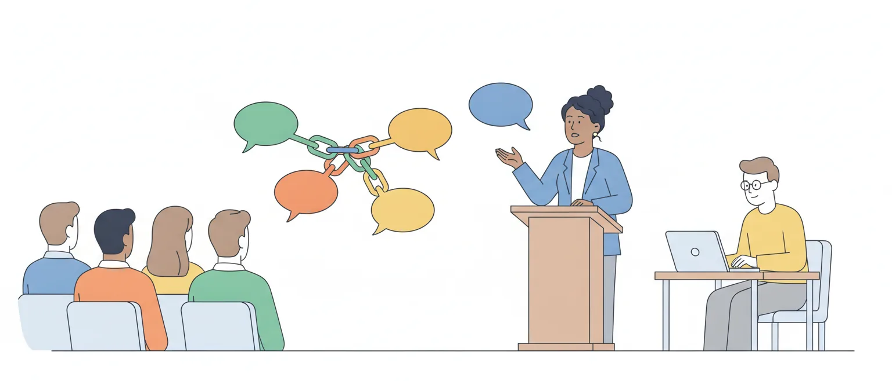

# Teoria da enunciação e análise do discurso: enunciado, texto, dialogismo e polifonia

O edital pede, em Linguística (item 5 da P2): "Teoria da Enunciação e Análise do Discurso. 5.1 Situação de comunicação; enunciação e enunciado; a teoria da enunciação na produção do texto escrito. 5.2 Conceitos de texto e discurso; dialogismo e polifonia; esferas sociais de comunicação". O item 5.3, retórica e oratória parlamentar, é assunto de outra aula.

São conceitos de teoria, mas servem ao trabalho do cargo: quem registra uma sessão transforma um **ato de fala** (alguém, num dia, num lugar, diante de alguém) num **texto que será lido depois**, por quem não estava lá. Esta aula explica o que se perde e o que precisa ser reconstruído nessa passagem.

O item 5 é novo: o programa do concurso de 2012 para Taquígrafo não o trazia, e não se achou item do Cebraspe que cobre diretamente estes conceitos. Por isso, a aula aposta em definições seguras, em quem disse o quê e nos pontos em que os autores divergem.

## Três linhas de pensamento num item só

O título do item junta nomes que não são da mesma teoria. Convém separá-los antes de começar:

- a **teoria da enunciação**, do linguista francês Émile Benveniste: estuda o ato de usar a língua e as marcas que esse ato deixa no que se diz (*eu*, *aqui*, *agora*);
- o **Círculo de Bakhtin** (Mikhail Bakhtin, Valentin Volóchinov e outros, na Rússia dos anos 1920 em diante): daí vêm enunciado concreto, **dialogismo**, **polifonia**, **esferas** e gêneros do discurso;
- a **Análise do Discurso** de linha francesa (Michel Pêcheux; no Brasil, Eni Orlandi): estuda o discurso em sua relação com a história e a ideologia. Os subitens do edital não pedem os conceitos próprios dela.

As linhas discordam entre si. Cabral (2012) mostra que a Análise do Discurso critica Benveniste por tratar a enunciação como ato de um indivíduo que escolhe: para ela, quem fala já fala de dentro de uma história e de um gênero. Guarde a consequência prática: **a mesma palavra muda de definição conforme o autor**.

> [!WARNING]
> Muitos resumos atribuem a Bakhtin o livro *Marxismo e filosofia da linguagem* (1929). A tradução brasileira antiga saiu com o nome dele; a edição atual (Editora 34, 2017) dá como autor **Valentin Volóchinov**, do Círculo de Bakhtin. De Bakhtin são *Problemas da poética de Dostoiévski* e o ensaio "Os gêneros do discurso".

## Situação de comunicação

Leia a frase: *Hoje não haverá votação aqui.* Que dia é "hoje"? Onde é "aqui"? Quem garante? A frase está completa como frase, mas só diz alguma coisa quando se sabe **quem fala, a quem, onde, quando e para quê**. Esse conjunto é a situação de comunicação.

A situação também muda o valor do que se diz. *Está encerrada a sessão*, dito pelo presidente, que dirige os trabalhos, encerra a sessão. Dito por um visitante na galeria, é só um comentário. As palavras são as mesmas.

Em Benveniste, segundo a leitura de Flores (2018), a situação é o conjunto das circunstâncias de **pessoa, tempo e espaço** em que o ato de enunciar acontece. Ela vira o centro de referência: é a partir de quem fala, de onde e de quando fala que se entende *eu*, *aqui* e *hoje*.

O *Manual de Redação da Presidência da República* chega à mesma ideia por outro caminho. Para haver comunicação, é preciso alguém que comunique, algo a comunicar e alguém que receba; e devem-se considerar a intenção de quem escreve e a finalidade do documento, "para que o texto esteja adequado à situação comunicativa".

> [!TIP]
> Diante de um texto de prova, faça as cinco perguntas antes de ler os itens: quem fala? A quem? Onde? Quando? Para quê? Item que fala em "adequação à situação comunicativa" se resolve com elas.

## Enunciação e enunciado: o ato e o produto

A distinção central do item 5.1 é esta:

- **enunciação** é o **ato** de dizer. Na definição de Benveniste, é "este colocar em funcionamento a língua por um ato individual de utilização";
- **enunciado** é o **produto** desse ato: aquilo que foi dito ou escrito e que fica.

A enunciação acontece uma vez e não se repete. Se o mesmo deputado disser a mesma frase na terça e na quinta, haverá a mesma frase e **duas enunciações**: mudaram o momento, os ouvintes, talvez o lugar. As notas taquigráficas guardam enunciados; o ato daquele dia não volta.

Antes da enunciação, diz Benveniste, a língua é só possibilidade. Ao falar, o locutor **se apropria** da língua e a converte em **discurso**. E o interesse dele está no ato: "é o ato mesmo de produzir um enunciado, e não o texto do enunciado, que é nosso objeto".

> [!CAUTION]
> A inversão é a pegadinha mais provável: dizer que a enunciação é o produto e o enunciado é o ato. Enunciação termina como *ação*: é o ato.

## O enunciado em Bakhtin

O Círculo de Bakhtin usa a mesma palavra com outro peso. Para Bakhtin, o **enunciado** é a **unidade real da comunicação**, o que alguém de fato diz a alguém numa situação. Ele o opõe à **oração**, que é unidade da língua, analisável fora de qualquer situação.

Três traços desse enunciado concreto, nas fontes desta aula:

- o sentido depende das **condições de produção**. No exemplo do Brasil Escola, *Adorei a manga* não diz se a manga é fruta ou parte da blusa; a situação é que decide;
- todo enunciado **responde** a enunciados anteriores e espera resposta: é um elo numa corrente (volta-se a isso em dialogismo);
- o falante leva em conta o **destinatário** (o que ele sabe, o que pensa), e isso pesa na escolha do gênero e do estilo.

Há, portanto, uma diferença de foco. Benveniste separa o ato do produto e estuda o ato. Bakhtin toma o enunciado já com a situação dentro dele. Uma terceira posição aparece em Cabral (2012): para Ducrot, a enunciação é simplesmente o **acontecimento** do aparecimento de um enunciado, sem que a teoria precise falar em ato de um sujeito.

> [!NOTE]
> Leitura nossa: se o item opõe enunciação a enunciado sem citar autor, use o par ato e produto, que é a oposição que as fontes desta aula apresentam. Se cita Bakhtin, lembre que "enunciado" ali é a unidade da comunicação, oposta à oração.

## Eu, tu, aqui, agora

Quem fala instala a si mesmo e ao outro no que diz. Benveniste chama de **locutor** quem enuncia e de **alocutário** aquele a quem a enunciação se dirige: "Toda enunciação é, explícita ou implicitamente, uma alocução, ela postula um alocutário". Mesmo o monólogo tem essa estrutura de diálogo.

Para marcar sua posição, o locutor usa, na síntese de Flores (2018):

- **índices específicos**, necessários a toda enunciação: os de **pessoa** (*eu* e *tu*), os de **espaço** (*este*, *aqui*) e as **formas temporais**, organizadas em torno do **presente**, que coincide com o momento da enunciação;
- **procedimentos acessórios**: a interrogação, a intimação (ordem, apelo), a asserção e as modalidades.

*Eu* e *tu* são as **pessoas** da enunciação. *Ele* é o que Benveniste chama de **não pessoa**: aquele ou aquilo de que se fala, ausente da troca. E os índices se renovam a cada enunciação: *eu* é quem está falando agora; quando o outro toma a palavra, *eu* passa a ser ele.

![Esquema da enunciação com uma frase de exemplo. No alto, a frase dita por uma relatora numa comissão: "Eu apresento hoje, nesta Casa, o parecer que Vossas Excelências me pediram". Abaixo, cinco caixas, cada uma com uma parte da frase: "Eu" é o locutor, quem enuncia; "Vossas Excelências" é o alocutário, a quem a enunciação se dirige; "hoje" e o presente "apresento" são o agora, o momento da enunciação; "nesta Casa" é o aqui, o lugar da enunciação; e, numa caixa tracejada, "o parecer" é a não pessoa, aquilo de que se fala. Depois, duas faixas: a enunciação é o ato de dizer a frase naquele dia, naquele lugar, para aquelas pessoas, e não se repete; o enunciado é o produto, o que foi dito e fica nas notas taquigráficas, e pode ser lido depois. No pé: índices específicos são pessoa, espaço e tempo; procedimentos acessórios são interrogação, intimação, asserção e modalidades; fora da situação, não se sabe quem é "eu", que dia é "hoje" nem onde é "nesta Casa".](imagens/quadro-da-enunciacao.svg "A enunciação e suas marcas numa frase")

O tempo como categoria que depende do momento da fala já apareceu na aula de categorias semânticas; aqui interessa o conjunto: pessoa, tempo e espaço se definem juntos, a partir de quem enuncia.

> [!IMPORTANT]
> *Eu*, *tu*, *aqui*, *agora*, *hoje* e *este* não têm referente fixo: só se preenchem na enunciação. Fora da situação, não se sabe quem é "eu" nem que dia é "hoje".

## Marcas que aparecem e marcas que somem

Compare dois modos de registrar o mesmo fato:

> Eu apresento hoje, nesta Casa, o parecer que Vossas Excelências me pediram.

> O parecer foi apresentado à comissão em 21 de outubro de 2026.

O primeiro enunciado exibe a enunciação: *eu*, *hoje*, *nesta Casa*, o presente. O segundo a apaga: terceira pessoa, voz passiva, data por extenso. O efeito é de **objetividade**, e é o que a redação oficial pede com a impessoalidade: o *Manual de Redação da Presidência* a explica, entre outras razões, pela "ausência de impressões individuais de quem comunica".

Apagar as marcas não elimina quem enuncia. Cabral (2012) resume a crítica de Brandão e de Fuchs: nas formas impessoais, o sujeito se **mascara**, mas não se apaga; sua posição fica marcada de outro lugar. Alguém escolheu o que registrar, em que ordem e com que palavras.

> [!CAUTION]
> "Por estar em terceira pessoa, o texto não tem enunciador" ou "é neutro": desconfie. A impessoalidade é um efeito construído por quem escreve. Nas fontes desta aula, não há enunciação sem locutor.

## A enunciação no texto escrito

No fim do artigo "O aparelho formal da enunciação" (1970), Benveniste diz que é preciso distinguir a enunciação falada da **enunciação escrita** e que esta se situa em **dois planos**: "o que escreve se enuncia ao escrever e, no interior de sua escrita, ele faz os indivíduos se enunciarem".

A ata de uma reunião mostra os dois planos. No primeiro, quem redige enuncia: organiza, resume, escolhe os verbos de dizer. No segundo, dentro do texto, os deputados falam: *o relator afirmou que…*, *a deputada respondeu que…*. Flores (2018) observa que pode haver mais de dois planos e que a ideia não vale só para a narrativa literária.

Do mesmo artigo de Flores saem dois pontos que interessam a quem escreve:

- **não há enunciação escrita sem locutor**, em qualquer dos planos;
- a **situação de produção** e a **situação de leitura** não coincidem: quem escreve e quem lê estão separados em tempo, espaço e pessoa.

Na fala, locutor e alocutário partilham o aqui e o agora. Na escrita, não. Daí a tarefa de quem produz o texto escrito: pôr no texto o que a situação dava de graça. *Ontem* vira data; *aqui*, o nome do lugar; *eu*, o nome ou o cargo de quem falou.

![Quadro em duas colunas que compara a fala de uma relatora na comissão com o registro na ata. À esquerda, a fala, em que locutor e ouvintes partilham o aqui e o agora: "Eu recebi ontem, aqui, o pedido de Vossas Excelências e apresento hoje o parecer". À direita, a ata, em que o leitor está em outro tempo e lugar: "A relatora declarou que recebera o pedido dos membros da comissão em 20 de outubro de 2026, na Câmara dos Deputados, e apresentou o parecer em 21 de outubro de 2026". Entre as colunas, cinco linhas de correspondência: "eu" passa a "a relatora"; "Vossas Excelências" passa a "os membros da comissão"; "ontem" passa a "20 de outubro de 2026"; "aqui" passa a "na Câmara dos Deputados"; "hoje" e o presente "apresento" passam a "21 de outubro de 2026" e ao passado "apresentou". Embaixo, os dois planos da enunciação escrita: plano 1, quem redige a ata enuncia ao escrever; plano 2, dentro do texto, a relatora é posta a falar.](imagens/da-tribuna-a-ata.svg "Da fala à ata: as marcas da situação viram informação no texto")

A troca dos tempos verbais nessa passagem foi vista na aula de tempos e modos; as operações de passar da fala para a escrita são da aula de intertextualidade e retextualização.

> [!NOTE]
> Benveniste só indicou a enunciação escrita, sem desenvolvê-la; Flores apresenta seus pontos como proposta de pesquisa. A aplicação à ata e a regra prática de trocar *ontem* e *aqui* por data e lugar são leitura nossa.

## Texto e discurso

O edital pede "conceitos", no plural, e com razão: não há uma definição única. Cada linha recorta os dois termos de um jeito.

**Texto.** Na Linguística Textual, vista na aula de leitura e coesão, o texto é estudado como um todo de sentido, e não como soma de frases; e a coerência depende também de quem o interpreta. Na linha de Bakhtin, conforme o Brasil Escola, o texto, verbal ou não, é um exemplo de enunciado concreto. Benveniste, como se viu, não toma o texto como objeto: interessa-lhe o ato.

**Discurso.** Para Benveniste, é a língua assumida por quem fala: a enunciação converte a língua em discurso. Para Bakhtin, citado por Marcuzzo (2008), é "a língua em sua integridade concreta e viva", e não a língua como sistema abstrato; por isso não é individual: constrói-se entre interlocutores e em relação com outros discursos. Na Análise do Discurso, é "efeito de sentido entre locutores" (Pêcheux, citado por Cabral) ou "palavra em movimento, prática de linguagem" (Orlandi, citada por Alós).

O que essas definições de discurso têm em comum é o que elas recusam: tratar a língua só como sistema, fora do uso. Orlandi, na resenha de Alós, liga o discurso às **condições de produção**: em sentido estrito, o contexto imediato da enunciação; em sentido amplo, o contexto sócio-histórico e ideológico.

> [!NOTE]
> Leitura nossa, para organizar o estudo: o **texto** é o que se pode apontar (a ata, o parecer, a fala transcrita); o **discurso** é esse texto visto com suas condições de produção (quem, a quem, onde, quando, para quê, a partir de que posição). Nenhuma fonte desta aula dá essa fórmula como definição: não a tome como "a do Cebraspe".

## Três sentidos de "discurso" que não se misturam

A palavra aparece no edital, na gramática e no dia a dia da Câmara com sentidos diferentes:

- na **teoria** (este item do edital): a língua em uso, ligada às condições de produção;
- na **gramática**: discurso direto, indireto e indireto livre, que são modos de **relatar a fala de alguém** dentro de um texto;
- no **Parlamento**: o discurso do deputado, isto é, o pronunciamento, que é um **gênero**.

Um pronunciamento é um texto (um enunciado, para Bakhtin), pertence a um gênero e pode ser estudado como discurso, no sentido teórico. E o discurso relatado é uma das formas de fazer outra pessoa falar dentro do texto, o segundo plano da enunciação escrita.

> [!WARNING]
> Item que define "discurso", no sentido da teoria, como "modo de reproduzir a fala de personagens" troca a teoria pela gramática.

## Dialogismo

Para Bakhtin, nenhum enunciado é o primeiro. Quem fala **responde** ao que já foi dito sobre o assunto e **antecipa** o que o outro pode responder. Essa relação constitutiva de todo enunciado com outros enunciados é o **dialogismo**. Barros, citada por Marcuzzo (2008), o define como o "princípio constitutivo da linguagem e de todo discurso".

Um parecer mostra isso bem. Ele responde ao projeto, às emendas, à nota técnica, aos discursos contrários; e já se defende das objeções que virão (*Não se diga que a medida aumenta despesa…*). Mesmo quando não cita ninguém, o texto foi escrito diante dessas outras vozes.

Três cuidados, tirados de Marcuzzo (2008) e de Maciel (2016):

- dialogismo **não é diálogo face a face**: a relação é entre discursos. Uma lei dialoga com as leis anteriores sem que ninguém converse;
- dialogismo **não é concordância**: as relações dialógicas incluem acordo e polêmica. Faraco, citado por Maciel, diz que elas "não apontam somente na direção das consonâncias, mas também das multissonâncias e das dissonâncias";
- dialogismo **não é só citação** de um texto por outro: a relação existe mesmo quando não aparece na superfície. A citação reconhecível é assunto da aula de intertextualidade.

Maciel lembra ainda que o termo mais frequente em Bakhtin é "relações dialógicas", e não "dialogismo". O contrário de dialógico, quando se fala de um tipo de discurso, é **monológico**: o que se apresenta como único e definitivo e não deixa ver os outros discursos que o atravessam.

> [!IMPORTANT]
> O dialogismo é propriedade de **todo** enunciado, e não uma qualidade de alguns textos. Um texto de uma voz só, autoritário, continua sendo resposta a outros dizeres.

## Polifonia: dois sentidos

Aqui as fontes se dividem, e a aula mostra os dois lados.

**Sentido estrito.** Bakhtin tomou a palavra da música para descrever uma inovação dos romances de Dostoiévski: as personagens têm vozes **plenas e independentes**, em pé de igualdade com a do autor, que não dá a última palavra; o diálogo fica **inconcluso**. Para Maciel (2016), é o conjunto dessas condições que faz a polifonia, ligada ao gênero romance. Não bastam "várias vozes", nem vozes em conflito, nem vozes citadas de modo explícito.

**Sentido largo.** Diana Barros, citada por Maciel e por Marcuzzo, usa o termo para caracterizar um tipo de texto: aquele em que as vozes **se mostram**, em oposição ao texto **monofônico**, em que elas se escondem sob a aparência de uma voz só. Nas palavras dela, "monofonia e polifonia são, portanto, efeitos de sentido", produzidos em discursos que são sempre dialógicos. A aula da UFS segue essa linha, e Marcuzzo conclui com ela: "todo texto é, por essência, dialógico, mas nem todo texto é polifônico".

Maciel discorda expressamente de Barros: para ele, a polifonia não é questão de as vozes serem explícitas nem de quantas são. Faraco, citado por Marcuzzo, chega a dizer que o conceito não recebeu acabamento. E Marcuzzo registra, com Barros, que foram os estudos de Oswald Ducrot que levaram essas ideias de Bakhtin à análise linguística; a teoria dele não é desenvolvida nesta aula.

![Quadro comparativo em três colunas. Primeira coluna, dialogismo: princípio constitutivo da linguagem; está em todo enunciado; inclui acordo e polêmica; não depende de citação visível. Segunda coluna, polifonia em sentido estrito, de Bakhtin sobre Dostoiévski, na leitura de Maciel: modo de compor o romance, com vozes plenas e independentes, em igualdade com a do autor; ninguém dá a última palavra, o diálogo fica inconcluso; ligada ao romance; não basta haver várias vozes. Terceira coluna, polifonia em sentido largo, de Barros, seguida pela aula da UFS: efeito de sentido de certos textos; as vozes se mostram; exemplo, as notas taquigráficas de um debate; o oposto é o texto monofônico, em que as vozes se escondem sob uma só, como na ementa de uma lei. No pé, o que os dois sentidos têm em comum: todo texto é dialógico, mas nem todo texto é polifônico; e um aviso: dialogismo e polifonia não são sinônimos.](imagens/dialogismo-e-polifonia.svg "Dialogismo e os dois sentidos de polifonia")

No sentido largo, a comparação é fácil de fazer. As notas taquigráficas de um debate deixam ver muitas vozes: oradores, apartes, a presidência. A ementa de uma lei fala com uma voz só, embora a lei tenha saído de uma longa disputa. As duas são dialógicas; só a primeira seria chamada de polifônica.

> [!CAUTION]
> Nos dois sentidos, **dialogismo e polifonia não são sinônimos**, e a polifonia é a noção mais restrita. Item que diga "todo texto é polifônico, pois todo texto é dialógico" confunde os dois. Se o acerto depender de qual sentido de polifonia vale e o item não citar autor, o risco é alto.

## Esferas sociais de comunicação

As pessoas não falam "em geral": falam como parlamentares, juízes, jornalistas, cientistas, vizinhos. Bakhtin chama de **esfera** ou **campo** cada um desses domínios da atividade humana em que a língua é usada. Grillo (2006) mostra que a noção atravessa a obra do Círculo com vários nomes: esfera ou campo da comunicação discursiva, da atividade humana, da criatividade ideológica.

O que a esfera faz, segundo as fontes:

- dá conta da **pluralidade**: literatura, ciência, religião, imprensa e família são exemplos que os slides de Grillo trazem do ensaio de Bakhtin;
- **condiciona os enunciados**: cada esfera tem finalidades e condições próprias, e cada uma "refrata a realidade à sua própria maneira" (*Marxismo e filosofia da linguagem*, citado por Grillo);
- **gera gêneros**: "cada campo de utilização da língua elabora seus tipos relativamente estáveis de enunciados", os gêneros do discurso (Bakhtin, citado por Farias e Oliveira);
- condiciona até o modo de **transmitir o discurso alheio**, isto é, como se cita.

Um mesmo fato muda ao passar de uma esfera a outra. A aprovação de um projeto é, na esfera parlamentar, ata, notas taquigráficas e redação final; na jornalística, notícia e editorial; na jurídica, talvez um acórdão anos depois; na do cotidiano, conversa de fila. Mudam a finalidade, o destinatário, o vocabulário e o jeito de citar o que os deputados disseram.

O Círculo distingue ainda a **ideologia do cotidiano**, a das conversas do dia a dia, das esferas constituídas, como a ciência, a religião e a literatura (Grillo, 2006). Os gêneros de cada esfera e seus três elementos (conteúdo temático, estilo e construção composicional) são da aula de gêneros e tipos textuais.

> [!WARNING]
> Esfera não é gênero nem lugar de publicação. A esfera parlamentar é o campo de atividade; o parecer e a ata são gêneros que ela produz; o *Diário da Câmara dos Deputados* e o portal são onde os textos circulam.

## Como o Cebraspe pode cobrar

Não foi encontrado item da banca sobre enunciação e enunciado, dialogismo e polifonia ou esferas. Nas provas de conhecimentos específicos consultadas (Câmara, 2012, Taquígrafo; SEDUC/AL, aplicada em 2018; Fundação Inoversa Sul, aplicada em 2025), o que aparece é vizinho do assunto:

1. **marca de quem enuncia e seu efeito**: o item aponta um recurso do texto (as aspas, por exemplo) e afirma o efeito que ele produz ou de quem é a opinião que ele marca;
2. **adequação à situação**: o item afirma que certa escolha de linguagem é adequada ou inadequada ao interlocutor e à situação comunicativa;
3. **vozes no texto**: um item de 2018 falou em "pluralidade de vozes" a propósito de um poema, sem usar o termo polifonia. É uma amostra só e não permite dizer qual sentido a banca adota;
4. **textos-base com o vocabulário do tópico**: um texto de prova de 2025 fala em enunciação e pede para não confundir língua com discurso, embora os itens sobre ele fossem de outros assuntos.

O item composto é comum na banca: identifica um mecanismo e tira dele uma consequência. Basta uma das partes estar errada.

Com base nesses moldes, as trocas que esta aula ensina a evitar (leitura nossa): enunciação dada como produto; texto impessoal dado como texto sem enunciador; dialogismo dado como conversa ou como concordância; polifonia dada como sinônimo de dialogismo; esfera dada como gênero; *Marxismo e filosofia da linguagem* como obra de Bakhtin; o discurso da teoria confundido com discurso direto e indireto.

> [!TIP]
> Cada erro anula um acerto. Marque quando o item se resolver por uma distinção firme (ato e produto; todo enunciado é dialógico; quem fala, a quem, onde e quando). Se depender de um conceito em que os autores divergem e o item não disser de quem é, deixar em branco é uma opção.

## Fontes

- Valdir do Nascimento Flores, "A enunciação escrita em Benveniste: notas para uma precisão conceitual", *D.E.L.T.A.*, v. 34, n. 1, 2018, p. 395-417 (as citações de Benveniste, *Problemas de linguística geral II*, e a enunciação escrita): https://www.scielo.br/j/delta/a/M7NWvrwmcmxh9GrTSsKYQhF/?lang=pt
- Luis Rodolfo Cabral, "Enunciação: entraves para os estudos discursivos", *Littera on line* (UFMA), n. 5, 2012 (Benveniste; a enunciação na Análise do Discurso; Ducrot, Brandão e Pêcheux): https://periodicoseletronicos.ufma.br/index.php/littera/article/view/1273
- Patrícia Marcuzzo, "Diálogo inconcluso: os conceitos de dialogismo e polifonia na obra de Mikhail Bakhtin", *Cadernos do IL* (UFRGS), n. 36, 2008 (discurso, dialogismo, monologismo e polifonia; Barros, Faraco, Fiorin): https://seer.ufrgs.br/cadernosdoil/article/view/18908
- Lucas Vinício de Carvalho Maciel, "Diferenças entre dialogismo e polifonia", *Revista de Estudos da Linguagem* (UFMG), v. 24, n. 2, 2016, p. 580-601 (o sentido estrito de polifonia e a crítica a Barros): https://periodicos.ufmg.br/index.php/relin/article/view/28368
- Universidade Federal de Sergipe (CESAD), *Produção e Recepção de Texto I*, aula 18 (dialogia e polifonia; textos polifônicos e monofônicos): https://cesad.ufs.br/ORBI/public/uploadCatalago/23114110052020Producao_e_Recepcao_de_Texto_I_Aula_18.pdf
- Sheila Vieira de Camargo Grillo, "Divulgação científica na esfera midiática", *Intercâmbio* (LAEL/PUC-SP), v. XV, 2006, seção 1 (esfera e campo no Círculo de Bakhtin): https://revistas.pucsp.br/index.php/intercambio/article/view/3691
- Sheila Vieira de Camargo Grillo, "Gêneros do discurso: contribuições do Círculo de Bakhtin", slides da disciplina Teorias do texto (FFLCH-USP) (enunciado e oração; esferas e gêneros; o destinatário): https://dialogo.fflch.usp.br/sites/dialogo.fflch.usp.br/files/upload/paginas/Ge%CC%82neros%20do%20discurso.pdf
- Sandra Aparecida Lima Silveira Farias e Luciano Amaral Oliveira, "Gêneros textuais e o livro didático: enfoque formal ou sociocultural?", *Eutomia* (UFPE), n. 12, v. 1, 2013 (a citação de Bakhtin sobre os campos e os gêneros do discurso): https://periodicos.ufpe.br/revistas/EUTOMIA/article/view/422
- Luciana Kuchenbecker Araújo (Brasil Escola), "O que é enunciado?" (o enunciado em Bakhtin e o exemplo da manga): https://brasilescola.uol.com.br/o-que-e/portugues/o-que-e-enunciado.htm
- Anselmo Peres Alós, resenha de Eni Orlandi, *Análise de Discurso: princípios & procedimentos*, *Signum: Estudos da Linguagem* (UEL), v. 15, n. 3, 2012, p. 389-394 (discurso e condições de produção em Orlandi): https://ojs.uel.br/revistas/uel/index.php/signum/article/view/13004
- Maria Helena Cruz Pistori, resenha de Valentin Volóchinov, *Marxismo e filosofia da linguagem* (Editora 34, 2017), *Bakhtiniana*, v. 13, n. 2, 2018 (a autoria na edição atual): https://revistas.pucsp.br/index.php/bakhtiniana/article/view/36646
- Presidência da República, *Manual de Redação da Presidência da República*, 3ª ed. (2018), Parte I, capítulo 1 e item 3.5 (cópia hospedada pelo ICMBio): https://ava.icmbio.gov.br/pluginfile.php/4592/mod_data/content/16325/Manual-de-redacao%20oficial%20_3%C2%AA%20EDI%C3%87%C3%83O%202018.pdf
- Cespe/UnB, Câmara dos Deputados 2012, Analista Legislativo – Taquígrafo Legislativo, caderno de conhecimentos específicos e gabarito definitivo (referência de estilo): https://cdn.cebraspe.org.br/concursos/CD_12_AT/arquivos/CAMARA12_006_22.pdf
- Cebraspe, SEDUC/AL 2017, cargo 11, prova objetiva de conhecimentos específicos (referência de estilo): https://cdn.cebraspe.org.br/concursos/SEDUC_AL_17/arquivos/MATRIZ_376_SEDUCAL011__PAG_6.PDF
- Cebraspe, Fundação Inoversa Sul 2024, cargo 19 (Professor de Língua Portuguesa), caderno de conhecimentos específicos, aplicado em 2025 (referência de estilo): https://cdn.cebraspe.org.br/concursos/INOVERSASUL_24/arquivos/033_INOVERSASUL_019_01.PDF
