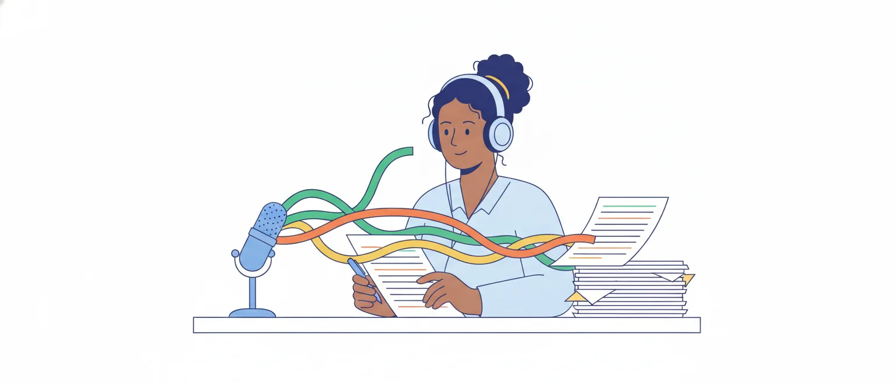

# Intertextualidade, retextualização, reescritura e paráfrase

O edital pede, em Linguística (item 6.2 da P2): "Intertextualidade; processos de retextualização; reescritura e paráfrase". São quatro palavras para um mesmo fato: **todo texto nasce de outros textos**. O que muda de uma para a outra é a relação entre o texto novo e o texto de onde ele veio.

Este é o assunto mais próximo do trabalho do cargo. O ato que organiza o Departamento de Registro Oficial e Redação Parlamentar da Câmara (Ato da Mesa nº 251, de 2026, art. 2º, na publicação original) lhe dá a tarefa de fazer o registro oficial e a redação final dos discursos e debates, e de publicar textos produzidos a partir do registro dos discursos e debates orais. Passar a fala para a escrita é retextualizar.

## Quatro palavras, quatro perguntas

Guarde uma pergunta para cada termo. Elas voltam no fim da aula, num quadro.

- **Intertextualidade**: este texto traz outro texto dentro dele?
- **Retextualização**: este texto foi produzido a partir de outro, em outra modalidade (fala ou escrita) ou em outro gênero?
- **Reescritura** (ou reescrita): esta é uma nova versão do mesmo texto?
- **Paráfrase**: isto diz o mesmo que aquilo, com outras palavras?

As quatro noções se cruzam, e os autores não traçam as fronteiras do mesmo jeito. A aula mostra onde eles concordam e onde divergem.

> [!TIP]
> Diante de um item, descubra primeiro de qual das quatro perguntas ele trata. Metade das trocas de nome se resolve aí.

## Intertextualidade: um texto dentro de outro

A ideia vem da teoria literária dos anos 1960: Julia Kristeva, a partir do dialogismo de Bakhtin, propôs que todo texto é um "mosaico de citações". Nenhum texto se entende sozinho; ele conversa com os que vieram antes.

Na Linguística Textual brasileira, a obra de referência é *Intertextualidade: diálogos possíveis*, de Koch, Bentes e Cavalcante. Pelas resenhas e artigos que a resumem, ela separa dois sentidos:

- **sentido estrito** (*stricto sensu*): num texto está inserido outro texto, o **intertexto**, que foi efetivamente produzido antes e faz parte da memória dos interlocutores. Um deputado que diz na tribuna "todo o poder emana do povo" traz para o discurso o parágrafo único do art. 1º da Constituição;
- **sentido amplo** (*lato sensu*): a intertextualidade é condição de qualquer texto, porque todo dizer remete a dizeres anteriores e a modelos de texto. É por ela que reconhecemos uma ata como ata: já lemos outras. As autoras falam aqui em intertextualidade **intergenérica** (o intercâmbio entre gêneros para produzir efeitos de sentido) e **tipológica** (as sequências que permitem reconhecer o tipo de texto).

A intertextualidade depende do leitor: quem não conhece o texto de origem não percebe a retomada e pode perder parte do sentido.

> [!IMPORTANT]
> No sentido estrito, só há intertextualidade se existe um **texto anterior efetivamente produzido** a que o novo remete. Parecer com "o jeito de falar dos políticos" não basta: é preciso apontar o texto retomado.

## Os quatro tipos de Koch, Bentes e Cavalcante

No sentido estrito, as autoras distinguem quatro tipos, que podem aparecer juntos no mesmo texto (definições conforme o artigo de Luana Ferraz, que aplica a obra):

- **temática**: textos diferentes compartilham os mesmos temas. Os pareceres de duas comissões sobre o mesmo projeto;
- **estilística**: o autor repete, imita ou parodia um estilo ou uma variedade da língua. Um cronista que escreve uma receita de bolo no estilo de uma lei, com artigos e parágrafos;
- **explícita**: o autor do texto novo **expõe a fonte** do intertexto. "Como disse Ulysses Guimarães ao promulgar a Constituição, em 1988...";
- **implícita**: o intertexto entra **sem citação expressa da fonte**. Cabe ao leitor ou ouvinte reconhecê-lo.

Na implícita, o autor pode seguir a direção do texto de origem (a **captação**) ou contrariá-lo, ironizá-lo, pô-lo em dúvida (a **subversão**). Affonso Romano de Sant'Anna chama esses dois movimentos de intertextualidade das semelhanças e das diferenças. É o par que a escola ensina como paráfrase e paródia.

Um exemplo de subversão: "Todo o poder emana do povo, e contra ele tem sido exercido", dito num discurso de oposição. A frase da Constituição está lá, sem a fonte e com o final trocado. Quando o texto de origem é alterado para produzir sentido novo, as autoras usam o termo francês *détournement*.

> [!WARNING]
> O critério de explícita e implícita, em Koch, é a **fonte**: mencionada ou não. Nem todos usam esse critério, como mostra a próxima parte.

## Outras classificações e uma divergência

Há outra arrumação, de base literária (Genette e Piègay-Gros), usada no artigo de Souza-Santos e Araújo. Ela separa duas relações:

- **copresença**: um pedaço de um texto está dentro de outro. De forma explícita, a **citação** (reprodução literal de um trecho, atribuída ao autor) e a **referência** (menção a título, personagem ou autor). De forma implícita, a **alusão** (remissão indireta, por pistas, sem marca) e o **plágio** (apropriação do texto alheio sem dar a fonte);
- **derivação**: um texto dá origem a outro. Por transformação, a **paródia**; por imitação de estilo, o **pastiche**.

Os materiais escolares trazem ainda uma lista corrida de "tipos": citação, epígrafe (o trecho alheio posto na abertura de um texto), alusão, paráfrase, paródia, pastiche, tradução. São nomes úteis, mas não formam um sistema: misturam os dois critérios acima.

A divergência que importa está na palavra **explícita**. Para Koch, é explícita a intertextualidade com a fonte mencionada. O Brasil Escola define a explícita como a que aparece "diretamente na superfície textual", com semelhança ou cópia de trechos do original: o critério ali é a semelhança visível, e não a menção da fonte.

> [!NOTE]
> Leitura nossa: numa prova de professor aplicada em 2018 (SEDUC-AL), o Cebraspe deu como certo um item que via "explícita intertextualidade" entre um poema modernista e uma obra romântica; o poema retoma um verso conhecido, alterado e sem citar o autor. A banca só justifica itens anulados, então o motivo não é público. O que se pode dizer é que, ali, "explícita" não dependeu da menção da fonte. Item que só se resolve pela etiqueta explícita ou implícita é arriscado.

## Paráfrase, paródia e citação

**Paráfrase** é a retomada de um texto que **mantém o sentido** e muda as palavras. **Paródia** é a retomada que mantém a forma reconhecível e **muda o sentido**, para criticar, ironizar ou fazer rir. As duas são intertextualidade; o que as separa é a direção: a paráfrase concorda com a origem, a paródia a subverte.

Compare, a partir do art. 5º da Constituição ("Todos são iguais perante a lei"):

- citação: *A Constituição diz que "todos são iguais perante a lei".*
- paráfrase: *Segundo a Constituição, a lei trata todas as pessoas da mesma maneira.*
- paródia: *Todos são iguais perante a lei; uns, mais iguais que os outros.*

Na **citação**, as palavras são as do original, entre aspas. Na paráfrase, segundo Souza-Santos e Araújo, somam-se reprodução e adaptação, **com a fonte indicada**. Retire a fonte de uma citação ou de uma paráfrase e apresente o conteúdo como seu: é **plágio**.

Para esses autores, a paráfrase pode ser copresença (um trecho parafraseado dentro de um artigo ou de uma reportagem) ou derivação (um texto inteiro feito de outro, como o **resumo**). Guarde o resumo: ele volta na retextualização.

Uma fronteira vizinha: a **polifonia** (as vozes dentro de um texto) é mais ampla que a intertextualidade, porque não exige um texto anterior efetivamente existente. O assunto é da aula de enunciação e discurso.

> [!CAUTION]
> "A paródia mantém o sentido do texto original, alterando-lhe apenas a forma": errado, é o contrário. Quem mantém o sentido é a paráfrase.

## Retextualização: produzir um texto a partir de outro

O nome que domina o assunto é o de Luiz Antônio Marcuschi, em *Da fala para a escrita: atividades de retextualização*. O livro não tem versão aberta; o que segue vem de artigos que o citam e resumem (lista no fim).

Para Marcuschi, na leitura de Dennys Dikson, retextualizar é passar um texto **de uma modalidade para outra** (da fala para a escrita, por exemplo) ou transformá-lo dentro da mesma modalidade, mantendo o gênero ou trocando-o. São quatro movimentos, que a aula da UFS ilustra com exemplos de Marcuschi:

| De | Para | Exemplo |
| --- | --- | --- |
| fala | escrita | entrevista oral → entrevista impressa; discurso → registro taquigráfico |
| fala | fala | conferência → tradução simultânea |
| escrita | fala | texto escrito → exposição oral |
| escrita | escrita | texto escrito → resumo escrito; notas → ata |

Os dois exemplos parlamentares da tabela (o registro e a ata) são nossos. O livro estuda só o primeiro movimento, da fala para a escrita, que é o do cargo.

Duas ideias de Marcuschi, citadas por Dikson, sustentam o resto da aula:

- a retextualização **não é mecânica**: envolve operações que "interferem tanto no código como no sentido";
- antes de transformar, é preciso **compreender**: toda retextualização implica uma interpretação prévia, e a compreensão malfeita é fonte de problemas de coerência no texto final.

E uma terceira, que derruba um preconceito: a passagem da fala para a escrita "não é a passagem do caos para a ordem, mas de uma ordem para outra". A fala não é uma escrita com defeito (o contínuo entre fala e escrita é assunto da aula de oralidade e escrita).

> [!WARNING]
> Retextualizar não é **transcrever**. A transcrição passa o som para o papel, com as hesitações e repetições; a retextualização parte dela (ou da escuta) e produz outro texto. A resenha do livro registra que Marcuschi separa retextualização de transcrição e de transcodificação.

## Da fala para a escrita: as nove operações

O modelo de Marcuschi para a passagem da fala à escrita tem **nove operações**, em **dois grupos**. A lista abaixo segue os resumos de Araujo e de Santos, Cabrera e Góes; a redação é nossa.

**Primeiro grupo: regularização e idealização** (estratégias de eliminação e de inserção)

1. eliminar marcas estritamente interacionais, hesitações e partes de palavras (*né*, *tá?*, *ahn*, *eu... eu*, palavra começada e abandonada);
2. introduzir a pontuação sugerida pela entoação da fala;
3. retirar repetições, reduplicações, redundâncias e paráfrases (o orador que diz a mesma coisa duas vezes);
4. introduzir parágrafos e pontuação detalhada, **sem mudar a ordem** dos assuntos.

**Segundo grupo: transformação** (substituição, seleção, acréscimo, reordenação e condensação)

5. explicitar o que a fala deixa por conta da situação: os dêiticos (*esse aqui*, *lá*, *aquele*) e as ações que acompanham a fala (o orador que aponta alguém ou mostra um documento);
6. reconstruir frases truncadas, concordâncias e a ordem sintática, conforme a norma escrita;
7. dar tratamento de estilo: novas estruturas e novo vocabulário, mais formais;
8. reordenar os assuntos e reorganizar a sequência dos argumentos;
9. agrupar argumentos e condensar ideias.

![Esquema das nove operações de retextualização da fala para a escrita, segundo Marcuschi, em dois grupos. Primeiro grupo, regularização e idealização, por eliminação e inserção: 1, eliminar marcas interacionais, hesitações e partes de palavras; 2, pontuar pela entoação; 3, retirar repetições, redundâncias e paráfrases; 4, introduzir parágrafos e pontuação detalhada, sem mudar a ordem dos assuntos. Segundo grupo, transformação: 5, explicitar dêiticos e ações; 6, reconstruir a sintaxe conforme a norma escrita; 7, dar tratamento de estilo, com estruturas e vocabulário mais formais; 8, reordenar os assuntos e os argumentos; 9, agrupar argumentos e condensar ideias. Uma seta ao lado indica que, do primeiro para o segundo grupo, cresce a intervenção no texto e o risco para o conteúdo. No pé: nem toda retextualização usa as nove operações.](imagens/nove-operacoes.svg "As nove operações do modelo de Marcuschi, em dois grupos")

Nem todo texto pede as nove: uma fala bem organizada pode ficar pronta depois das primeiras. E os resumos não coincidem em tudo: a aula da UFS apresenta "sete procedimentos" (eliminação, inserção, reformulação, reconstrução, substituição, estruturação argumentativa e condensação), que juntam operações da lista.

> [!IMPORTANT]
> Nove operações, dois grupos. O **primeiro** (1 a 4) elimina e insere: limpa e pontua. O **segundo** (5 a 9) transforma: explicita, reconstrói, troca, reordena e condensa.

## O que muda a forma e o que pode mudar o conteúdo

Esta é a distinção que mais interessa a quem vai registrar discursos.

**Mudam a forma, e o conteúdo fica.** As hesitações, os marcadores conversacionais (*né*, *tá*, *sabe?*, *assim*), os começos abandonados e as repetições são marcas do momento em que a fala foi produzida e da interação com quem ouve. Não informam nada sobre o assunto.

Suprimi-los é regularizar: o texto fica legível, e o que o orador disse continua igual. O mesmo vale para a pontuação e os parágrafos que apenas seguem a entoação e a ordem da fala.

**Podem mudar o conteúdo, e por isso exigem cuidado.** As operações do segundo grupo dependem de interpretação.

Quem explicita um dêitico decide a que ele se refere; quem reconstrói a frase decide o que o orador quis dizer; quem troca uma palavra por outra mais formal escolhe um sinônimo que pode não ser exato; quem reordena e condensa escolhe o que é principal. Segundo Santos, Cabrera e Góes, é esse grupo o responsável pelas mudanças mais acentuadas no texto.

Sobre a condensação, Araujo faz uma distinção útil: **condensar** é reduzir o volume de palavras mantendo as informações o mais perto possível do original; **resumir** é eliminar as informações secundárias. Quem condensa e joga fora uma ressalva do orador resumiu sem avisar.

> [!NOTE]
> A divisão entre "forma" e "conteúdo" é uma leitura didática nossa, apoiada nos dois grupos do modelo. Marcuschi afirma que as operações, no conjunto, interferem no código e no sentido, e Santos, Cabrera e Góes observam que até a pontuação pela entoação carrega interpretação. A regra prática: do grupo 1 para o grupo 2, o risco cresce.

## Um trecho de plenário, passo a passo

As **notas taquigráficas** são o registro escrito do que se fala nas sessões e reuniões: o Regimento Interno da Câmara fala no "apanhamento do discurso" pela taquigrafia (art. 73, VI) e em "notas taquigráficas" (art. 57, XVIII).

O exemplo a seguir foi criado para esta aula; não reproduz discurso real. Imagine a **transcrição** de um trecho, tal como foi falado:

> — Senhor Presidente, eu... eu queria, né, dizer que esse projeto aqui, ele... a gente já discutiu ele lá na comissão, tá? E lá, lá na comissão, o relator falou que ia, que ia tirar aquele artigo, aquele dos prazos, né? Só que não tirou. Então, assim, eu acho que não dá pra votar isso hoje, não.

**Passo 1, operações 1 a 4.** Saem as hesitações (*eu... eu*, *ele...*), os marcadores (*né*, *tá?*, *assim*), as repetições (*lá, lá na comissão*; *que ia, que ia*) e o *não* final, que só reforça a negação já feita. Entra a pontuação:

> Senhor Presidente, eu queria dizer que esse projeto aqui, a gente já discutiu ele lá na comissão. E lá o relator falou que ia tirar aquele artigo, aquele dos prazos. Só que não tirou. Então, eu acho que não dá pra votar isso hoje.

Nada do que o orador afirmou se perdeu. O texto ainda soa como fala.

**Passo 2, operações 5 a 7.** Os dêiticos são explicitados (*esse projeto aqui* vira *o projeto em pauta*; *isso* vira *a matéria*), a sintaxe é reconstruída (*esse projeto, a gente já discutiu ele* vira *já discutimos o projeto*) e o vocabulário sobe de registro (*falou que ia tirar* vira *afirmou que retiraria*; *só que* vira *mas*; *não dá pra* vira *não é possível*):

> Sr. Presidente, quero dizer que já discutimos na comissão o projeto em pauta. Lá, o Relator afirmou que retiraria o artigo que trata dos prazos, mas não o retirou. Por isso, acho que não é possível votar a matéria hoje.

![Quadro em três faixas com o mesmo trecho de discurso. Primeira faixa, a transcrição, com hesitações, marcadores e repetições riscados: eu..., né, ele..., tá?, lá, na comissão, que ia, né?, assim, e o não final. Segunda faixa, depois das operações 1 a 4: Senhor Presidente, eu queria dizer que esse projeto aqui, a gente já discutiu ele lá na comissão. E lá o relator falou que ia tirar aquele artigo, aquele dos prazos. Só que não tirou. Então, eu acho que não dá pra votar isso hoje. Terceira faixa, depois das operações 5 a 7: Sr. Presidente, quero dizer que já discutimos na comissão o projeto em pauta. Lá, o Relator afirmou que retiraria o artigo que trata dos prazos, mas não o retirou. Por isso, acho que não é possível votar a matéria hoje. Ao lado da terceira faixa, o que foi preservado: quem discutiu e onde, o que o relator disse e não fez, o acho que, a negação e o hoje.](imagens/fala-para-registro.svg "Da transcrição ao registro: exemplo criado para esta aula")

As operações 8 e 9 não foram necessárias: o trecho é curto e já vinha em ordem. Elas apareceriam se o mesmo trecho virasse uma linha de **ata**, que é outro gênero, em terceira pessoa: *O orador ponderou que o relator não retirara o artigo sobre os prazos, como havia anunciado na comissão, e opinou que a matéria não deveria ser votada naquele dia.*

> [!TIP]
> Depois de retextualizar, faça a conferência ao contrário: leia só a versão escrita e pergunte se o orador assinaria cada afirmação. O que ele não disse não pode estar lá.

## Onde o registro pode trair o orador

Três versões que parecem só "arrumar" o trecho e, na verdade, mudam o que foi dito:

1. *Não é possível votar a matéria hoje.* Sumiu o **acho que**. A opinião virou afirmação categórica.
2. *O Relator descumpriu o acordo de retirar o artigo dos prazos.* O orador não falou em **acordo** nem em **descumprir**: disse que o relator falou que tiraria e não tirou. O juízo foi acrescentado.
3. *O orador é contra o projeto.* Ele se opôs a **votar hoje**, não ao projeto. É uma inferência de quem registra.

Daí a lista do que **não é marcador** e não pode ser tratado como ruído da fala:

- a negação (*não*, *nem*, *nunca*), salvo a repetida, que só reforça;
- os modalizadores (*acho que*, *talvez*, *parece*, *certamente*, *com certeza*);
- as palavras que restringem (*só*, *apenas*, *pelo menos*, *quase*);
- os marcadores de tempo e lugar que informam (*hoje*, *ontem*, *nesta Casa*);
- os conectivos que carregam o raciocínio (*mas*, *porque*, *portanto*, *embora*).

*Né* e *tá?* pedem a atenção do ouvinte. *Acho que* e *só* dizem algo sobre o assunto.

Pela publicação original do Ato da Mesa nº 251, de 2026, cabe ao departamento garantir a precisão do texto do registro oficial e responder por sua veracidade, integridade e autenticidade (art. 2º, VI). O mesmo artigo prevê a supressão de expressões antirregimentais "por determinação da Mesa" (inciso IV): aí se retira conteúdo, mas por decisão da Mesa, e não por escolha de quem redige.

> [!CAUTION]
> "Na retextualização, pode-se suprimir qualquer palavra curta e repetida da fala sem prejuízo do conteúdo": errado. A supressão sem perda vale para hesitações, marcadores conversacionais e repetições; negação, modalizador e restrição são conteúdo.

## Reescritura: nova versão do mesmo texto

**Reescritura**, **reescrita** e **refacção** nomeiam o trabalho de voltar a um texto para melhorá-lo. O artigo de d'Andrea e Ribeiro reúne as definições:

- para Matencio, reescrever é produzir **uma nova versão do texto**, refinando o que a versão original já buscava; retextualizar é produzir **um novo texto**, o que implica mudança de propósito;
- as operações da reescrita são quatro, segundo autores que os dois citam: **adição**, **substituição**, **supressão** e **deslocamento**. Valem para uma vírgula, uma palavra ou um período inteiro.

O deputado que revisa o próprio discurso antes da publicação, o consultor que melhora a redação de uma minuta, o revisor que corrige uma ata: todos reescrevem. O texto continua sendo aquele discurso, aquela minuta, aquela ata.

É nesse sentido que as bancas usam a palavra. O item apresenta um trecho, propõe outra redação e pergunta se ela mantém a correção gramatical, o sentido ou a coerência. As técnicas (trocar conectivo, mudar a ordem, passar para a voz passiva) estão nas duas aulas de reescrita de Língua Portuguesa, da P1.

> [!IMPORTANT]
> Reescrever é mexer **no mesmo texto**, por adição, substituição, supressão ou deslocamento. Retextualizar é produzir **outro texto**, em outra modalidade, outro gênero ou com outro propósito.

## Paráfrase: três usos da mesma palavra

A palavra já apareceu três vezes nesta aula, e não com o mesmo alcance:

1. **como tipo de intertextualidade**: um texto retoma outro, de autor diferente, mantendo o sentido e indicando a fonte. *Segundo o relator, a proposta não aumenta despesas* parafraseia o parecer;
2. **como equivalência entre frases**: duas redações que dizem o mesmo. Santos, Cabrera e Góes falam em sinonímia no plano da sintaxe: dizer com outras palavras o que já foi dito. É o que um item de reescritura testa quando pergunta se o sentido foi mantido;
3. **como marca da fala**: o orador que se repete com outras palavras (*ou seja*, *quer dizer*, *em outras palavras*). Na operação 3 do modelo de Marcuschi, essas paráfrases são retiradas.

Em todos os usos, o teste é o mesmo: **o sentido se manteve?** Uma "paráfrase" que troca *e* por *mas*, o indicativo pelo subjuntivo ou uma oração restritiva por uma explicativa deixou de ser paráfrase.

> [!NOTE]
> Santos, Cabrera e Góes avisam que as teorias sobre paráfrase são amplas e divergentes. Os três usos acima são uma organização nossa do que as fontes trazem; não há uma lista oficial.

## As confusões típicas

**Retextualização × reescritura.** É a fronteira mais disputada, e as fontes divergem:

- d'Andrea e Ribeiro, lendo Marcuschi, propõem que "toda retextualização é reescrita, mas nem toda reescrita gera uma retextualização", e restringem a reescrita à passagem do escrito para o escrito;
- Matencio separa pelo propósito: novo texto de um lado, nova versão de outro;
- Dell'Isola define a retextualização como "refacção e reescrita de um texto para outro";
- para Marcuschi, a mudança de modalidade basta: a entrevista oral que vira entrevista impressa foi retextualizada, embora o gênero seja o mesmo. E há retextualização do escrito para o escrito (o resumo).

O critério mais seguro combina os dois: houve mudança de **modalidade**, de **gênero** ou de **propósito**? É retextualização. O texto continua o mesmo, melhorado? É reescritura.

**Retextualização × paráfrase.** A retextualização pretende conservar o conteúdo, como a paráfrase, mas o produto é um texto de outra modalidade ou de outro gênero, e as operações vão além de trocar palavras.

**Intertextualidade × retextualização.** Na intertextualidade, o texto de origem **aparece dentro** do novo e continua existindo ao lado dele. Na retextualização, o novo texto **ocupa o lugar** do texto-base para outro público ou outra situação. Matencio lembra que retextualizar envolve relações entre textos e gêneros, isto é, intertextualidade: as noções não se excluem.

**Paráfrase × citação × plágio.** Citação: as mesmas palavras, com aspas e fonte. Paráfrase: outras palavras, com fonte. Plágio: palavras ou ideias alheias, sem fonte.

**Transcrição × retextualização.** Transcrever não transforma; retextualizar transforma.

![Quadro comparativo de quatro noções. Intertextualidade: um texto traz outro dentro dele; pergunta: há um texto anterior retomado?; exemplo: o discurso que cita o artigo 1º da Constituição. Retextualização: um novo texto feito de outro, com mudança de modalidade, de gênero ou de propósito; pergunta: mudou de fala para escrita, de gênero ou de finalidade?; exemplo: o discurso falado que vira registro escrito, as notas que viram ata. Reescritura: nova versão do mesmo texto, por adição, substituição, supressão ou deslocamento; pergunta: o texto continua o mesmo, melhorado?; exemplo: o revisor que corrige a ata. Paráfrase: o mesmo sentido com outras palavras; pergunta: o sentido se manteve?; exemplo: segundo a Constituição, a lei trata todos da mesma maneira. No pé, três pares que não se confundem: paráfrase mantém o sentido e paródia o subverte; citação repete as palavras com a fonte e plágio esconde a fonte; transcrever não é retextualizar.](imagens/quatro-nocoes.svg "As quatro noções do edital, cada uma com a sua pergunta")

> [!WARNING]
> Há material de curso preparatório que trata os três termos do edital (retextualização, reescritura e paráfrase) como um só: a reescrita "cujo nome é retextualização" e que consiste em fazer uma paráfrase. A Linguística os distingue, e é a distinção que uma prova de Linguística tende a cobrar.

## Como o Cebraspe cobra

Nas provas consultadas, o recorte aparece de dois jeitos.

**Como reescritura**, que é o molde mais frequente. Na prova de conhecimentos gerais da Câmara aplicada em março de 2026, quatro itens de Português propunham reescritas, cada um com um comando: "poderia ser corretamente reescrito", "estariam mantidos os sentidos e a correção gramatical", manter "a correção gramatical" e "o paralelismo sintático", "sem prejuízo da correção gramatical e da coerência".

Na prova de Taquígrafo Legislativo de 2012, os dois itens de reescritura foram dados como errados. Pela nossa leitura, um mudava a relação lógica do trecho, e o outro juntava uma justificativa semântica duvidosa a uma regência que a norma condena (*preferir... do que*).

O comando decide o que conferir. O artigo de Luiz Felipe Durval (Estratégia) separa três pedidos:

- **correção gramatical**: concordância, regência, crase, pontuação;
- **sentido**: sinônimos, conectivos, tempo e modo verbais, oração restritiva ou explicativa;
- **coerência**: a lógica entre as ideias. Sentido e coerência não são a mesma coisa: trocar *e* por *mas* muda o sentido, e o texto continua coerente.

**Como intertextualidade, pelo nome**, em prova de professor (SEDUC-AL, aplicada em 2018), em dois moldes: o item afirma que um texto estabelece intertextualidade com determinada obra; ou aponta a intertextualidade como fator de coerência de um parágrafo que cita versos alheios.

Não foi encontrado item da banca que use "retextualização" ou "paráfrase" como conceito. Para esses dois pontos, não há molde: o treino desta aula é construído a partir da teoria.

> [!CAUTION]
> Item composto: "a supressão de X é operação de retextualização, o que mantém o sentido original". Julgue as duas partes. Basta uma errada (o nome da operação ou a consequência) para o item ser errado, e cada erro anula um acerto.

## Fontes

- A retextualização escrita-escrita. Dennys Dikson, *Revista Brasileira de Linguística Aplicada*, v. 18, n. 3, 2018 (CC BY 4.0). https://www.redalyc.org/journal/3398/339858317003/339858317003.pdf
- Retextualizar e reescrever, editar e revisar: reflexões sobre a produção de textos e as redes de produção editorial. Carlos F. B. d'Andrea e Ana Elisa Ribeiro, *Veredas On Line*, 1/2010 (UFJF). https://periodicos.ufjf.br/index.php/veredas/article/download/25140/14171
- Retextualização de texto oral. Flávia Andréia dos Santos, Lúcia Gandarillas Cabrera e Vera Lúcia Góes, *Revista Anagrama* (USP), ano 1, ed. 4, 2008. https://periodicos.usp.br/anagrama/article/download/35326/38046/41618
- Retextualização, estratégias de condensação e estruturação argumentativa em textos do ensino médio. Márcia Souza Maia e Araujo, anais do CONEL (UFES). https://periodicos.ufes.br/conel/article/view/1998/1510
- Produção e Recepção de Texto I — Aula 10: Conversação e interação face a face. CESAD/UFS. https://cesad.ufs.br/ORBI/public/uploadCatalago/08343214112014Producao_e_Recepcao_de_Texto_I_Aula_10.pdf
- Oralidade e letramento (resenha de *Da fala para a escrita: atividades de retextualização*, de Luiz Antônio Marcuschi). Maria de Fátima Berenice da Cruz, *Pontos de Interrogação* (UNEB), v. 9, n. 1, 2019. https://revistas.uneb.br/index.php/pontosdeint/article/download/7020/4630/18076
- Intertextualidade: diálogos possíveis (resenha do livro de Koch, Bentes e Cavalcante). Caroline Cassiana Silva dos Santos, *Nuances* (FCT/UNESP). https://revista.fct.unesp.br/index.php/Nuances/article/download/380/415/1180
- Conto popular, estória oral e conto literário: uma análise intertextual. Luana Ferraz, *Estudos Linguísticos* (GEL), 43 (3), 2014. https://revistadogel.emnuvens.com.br/estudos-linguisticos/article/download/529/404/1342
- O ensino de intertextualidade nos anos finais do ensino fundamental. José Elderson de Souza-Santos e Helena de Lima Marinho Rodrigues Araújo, *Educação em Revista* (UFMG), v. 38, 2022 (CC BY 4.0). https://www.redalyc.org/journal/3993/399371145001/399371145001.pdf
- Intertextualidade: o que é, tipos, exemplos. Talliandre Matos (Brasil Escola). https://brasilescola.uol.com.br/redacao/intertextualidade-.htm
- Reescritura de frases: desvendando questões Cebraspe. Luiz Felipe Durval (Estratégia Concursos), 2021. https://www.estrategiaconcursos.com.br/blog/reescritura-de-frases-desvendando-questoes-cebraspe/
- Ato da Mesa nº 251, de 16/3/2026 (publicação original), art. 2º. Câmara dos Deputados. https://www2.camara.leg.br/legin/int/atomes/2026/atodamesa-251-16-marco-2026-798819-publicacaooriginal-178493-cd-mesa.html
- Regimento Interno da Câmara dos Deputados (Resolução nº 17, de 1989), texto atualizado: arts. 57, XVIII, e 73, VI. Câmara dos Deputados. https://www2.camara.leg.br/legin/fed/rescad/1989/resolucaodacamaradosdeputados-17-21-setembro-1989-320110-normaatualizada-pl.html
- Constituição da República Federativa do Brasil de 1988, art. 1º, parágrafo único, e art. 5º, *caput*. https://www.planalto.gov.br/ccivil_03/constituicao/constituicao.htm
- Concurso Senado: o mais cobrado em português pelo Cebraspe. Vitor Macau (Direção Concursos), 2022. Citado só como exemplo da confusão entre os termos; não é leitura recomendada. https://www.direcaoconcursos.com.br/artigos/concurso-senado-portugues-cebraspe
- Cebraspe. Câmara dos Deputados, Edital nº 1/2025 (nível superior), caderno de conhecimentos gerais, aplicado em 8/3/2026, e gabarito definitivo. https://cdn.cebraspe.org.br/concursos/CD_25_NS/arquivos/E61A04B682ABA7AF746F702D22B1516C4A4BC005855CE5CFFF5D2280F3E790CE.pdf
- CESPE/UnB. Câmara dos Deputados 2012, Analista Legislativo — Taquígrafo Legislativo, caderno de conhecimentos específicos e gabarito definitivo. https://cdn.cebraspe.org.br/concursos/CD_12_AT/arquivos/CAMARA12_006_22.pdf
- Cebraspe. SEDUC-AL, Professor de Português, caderno de conhecimentos específicos, aplicado em 1º/4/2018, e gabarito definitivo. https://cdn.cebraspe.org.br/concursos/SEDUC_AL_17/arquivos/MATRIZ_376_SEDUCAL011__PAG_6.PDF
