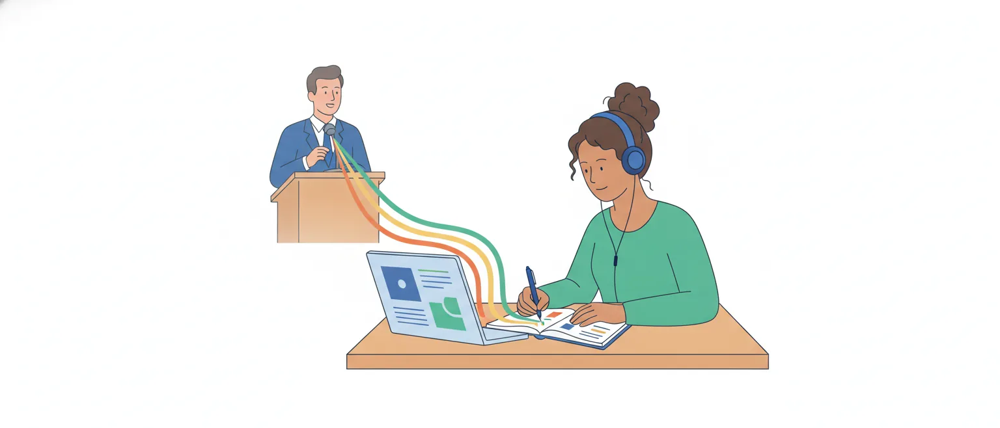

# Oralidade e escrita, normas linguísticas e a variação no português do Brasil

O edital pede, em Linguística (itens 7.2 e 7.3 da P2): "Oralidade e escrita. Formalidade e informalidade. Normas linguísticas. A variação linguística no português do Brasil. A variação linguística e a construção do texto escrito". São cinco assuntos numa linha só de raciocínio: como a **fala** e a **escrita** se relacionam, o que é **formal**, o que é **norma**, como o português varia no Brasil e o que dessa variação entra no texto escrito.

É o assunto do próprio cargo: quem trabalha no registro dos debates ouve uma fala e entrega um texto escrito oficial. No Cebraspe, ele não vem como pergunta de definição: a banca traz o texto de um linguista e cobra o que o autor sustenta. Por isso, mais do que decorar nomes, é preciso entender as posições.

## Um sistema, dois modos de usar

A base desta aula é o livro *Fala e escrita*, organizado por Luiz Antônio Marcuschi e Angela Paiva Dionisio. A ideia que o atravessa: fala e escrita são realizações de **um mesmo sistema linguístico**. Não há uma gramática para falar e outra para escrever; há dois modos de produzir textos com a mesma língua.

Os autores separam dois pares de termos:

- **oralidade** e **letramento** são **práticas sociais**: os usos que uma sociedade faz da língua falada e da língua escrita;
- **fala** e **escrita** são as **modalidades**: os dois modos de produzir o texto, um pelo som, outro pela grafia.

O **meio** é, para eles, a única distinção que divide em dois: o som passa, a grafia fica. Mas essa diferença não chega à sintaxe, à fonologia nem à organização do texto. Nenhuma preposição, nenhum pronome, nenhuma forma verbal é exclusiva da fala ou da escrita.

> [!IMPORTANT]
> Fala e escrita não são dois sistemas nem duas gramáticas: são dois modos de uso do mesmo sistema. Dicotômico, só o meio (som ou grafia).

## O contínuo fala–escrita

Se não são dois blocos opostos, como se relacionam? Para Marcuschi e Dionisio, as relações entre oralidade e escrita se dão num **contínuo**, uma gradação que passa pelos **gêneros textuais**, e não numa lista de características polares.

Numa ponta fica o gênero mais típico da fala, a conversa espontânea; na outra, o mais típico da escrita, como o artigo científico. Entre as duas, os gêneros se espalham:

- uma **carta pessoal** descontraída tem menos diferenças em relação a uma narrativa oral do que em relação a um texto acadêmico;
- uma **conferência** preparada com cuidado se parece mais com textos escritos do que com uma conversa.

A consequência prática: compara-se a linguagem de gêneros parecidos, e não "a fala" com "a escrita" em bloco. No quadro, os exemplos em negrito são do livro; os da Câmara, em itálico, são nossos.

![Quadro do contínuo fala–escrita, com um eixo que vai de mais perto da conversa espontânea a mais perto do artigo científico e duas faixas. Na faixa do meio sonoro, que chega pelo som, da esquerda para a direita: conversa espontânea e conversa no corredor; aparte em plenário e discurso de improviso; conferência preparada e discurso com roteiro; notícia de telejornal e discurso lido na tribuna, marcados como escrita oralizada. Na faixa do meio gráfico, que chega pela grafia: carta pessoal, bilhete e mensagem a um colega; entrevista impressa e notas taquigráficas, marcadas como fala editada; ata da sessão e parecer; artigo científico e texto de lei. No pé: compare gêneros vizinhos, e não a fala com a escrita em bloco; uma carta pessoal se parece mais com uma narrativa oral do que com um artigo científico.](imagens/continuo-fala-escrita.svg "O contínuo fala–escrita: os exemplos da Câmara são leitura nossa")

> [!NOTE]
> A posição dos gêneros da Câmara no quadro é leitura nossa, feita com os critérios do livro. Um discurso pode estar em mais de um ponto: improvisado, com roteiro ou lido.

## Escrita oralizada e fala editada

O contínuo tem casos em que o meio engana. O livro dá dois:

- a **notícia de telejornal** chega pelo som, mas é a leitura de um texto escrito. É uma **oralização da escrita**, e não língua falada;
- a **entrevista publicada** em jornal ou revista nasceu oral, mas só chega ao leitor por escrito. É uma **editoração da fala**.

Daí a frase do livro: não se pode confundir **oralização** com **oralidade**. Ler em voz alta não transforma um texto escrito em texto falado.

Para dar conta desses casos, Marcuschi separa, em outro livro (*Da fala para a escrita*, de 2001), o **meio** (sonoro ou gráfico) da **concepção** (oral ou escrita). A conferência acadêmica tem meio sonoro e concepção escrita; a carta pessoal, meio gráfico e concepção oral. Conhecemos essa parte pela exposição de Gilson Freire.

No trabalho do cargo, os dois casos aparecem todo dia: o discurso lido na tribuna é escrita oralizada; a nota taquigráfica publicada é fala editada. A passagem de um texto falado para um escrito, com suas operações, é assunto da aula de retextualização.

> [!TIP]
> Diante de um texto, faça duas perguntas separadas: por que meio ele chega (som ou grafia)? E como foi concebido (no improviso da conversa ou com planejamento e revisão)?

## As marcas do texto falado

A diferença que mais pesa não é de gramática: é de **formulação**. Na fala, produzir e ouvir acontecem ao mesmo tempo; na escrita, há um intervalo entre escrever e ler. Quem escreve revê, troca, corta, e o leitor só recebe a versão final. Quem fala corrige diante do ouvinte, e a correção fica no texto.

Veja um trecho inventado de discurso, transcrito como foi dito:

> Senhor Presidente, eu... eu queria dizer o seguinte, né... esse projeto, ele chegou aqui na Casa faz o quê? faz uns dois anos... dois anos e pouco... e a gente até hoje não votou. Então, assim... é preciso... nós precisamos votar isso aí.

Estão aí as marcas que o livro aponta numa aula gravada pelo Projeto NURC: **marcadores** (*né*, *então, assim*), **repetições** (*eu... eu*; *dois anos... dois anos e pouco*), **enunciados começados e abandonados** (*é preciso... nós precisamos*) e **pausas**. Aparece também o apoio na situação (*aqui na Casa*, *isso aí*), mais forte quando os interlocutores dividem o mesmo espaço.

Essas marcas **não são erros**. Marcuschi e Dionisio dizem que a hesitação, a correção e os marcadores são fenômenos sistemáticos da fala, que pedem categorias próprias de análise. O engano antigo era examinar a fala "pela lente da escrita".

> [!WARNING]
> Marca de fala não é marca de informalidade nem de erro. O trecho acima foi dito numa situação formal, por alguém que domina a norma culta, e tem todas as marcas.

## Dicotomias perigosas

O livro traz um quadro com o título "Dicotomias perigosas": pares que costumam ser atribuídos, um à fala, outro à escrita.

| Costuma-se dizer da fala | Costuma-se dizer da escrita |
| --- | --- |
| contextualizada | descontextualizada |
| implícita | explícita |
| concreta | abstrata |
| redundante | condensada |
| não planejada | planejada |
| imprecisa | precisa |
| fragmentária | integrada |

Para os autores, esses pares não se sustentam: toda língua se dá em contexto; os textos falados e os escritos são ambos planejados, de maneiras diferentes; há implícito e abstração nas duas modalidades. Outro engano é dizer que a fala é diálogo e a escrita, monólogo: o sermão e a conferência são orais e monologados, e há textos escritos em forma de diálogo.

As fontes não dizem tudo do mesmo jeito. O livro de Sociolinguística da UFSC descreve a fala como atividade "espontânea, improvisada" e a escrita como "ensaiada", com tempo para planejar e rever. Mas avisa, na mesma seção, que está pensando na conversa natural, que é preciso relativizar e que não há fronteira rígida entre as modalidades. É uma descrição dos casos típicos, e não a volta da dicotomia.

> [!CAUTION]
> Item que cola uma característica a toda a fala ou a toda a escrita ("a fala é sempre...", "a escrita nunca...") contraria os autores de referência. As diferenças valem para os gêneros típicos de cada ponta.

## Formalidade e informalidade

**Formalidade** é questão de **grau**, e não de dois compartimentos. O livro da UFSC a explica pela **monitoração**: em situações mais formais, prestamos mais atenção ao modo de falar; nas menos formais, menos. Entre o registro formal e o informal há um contínuo de graus.

O que faz monitorar mais ou menos? Para Stella Maris Bortoni-Ricardo, citada por Roberta Conceição, são o **ambiente**, o **interlocutor** e o **assunto**. Um texto de Mattoso Câmara Jr., usado pelo Cebraspe na prova de Taquígrafo da Câmara aplicada em 2012, dá um exemplo que serve à nossa aula: o deputado não fala na rua, com um amigo, como falaria numa sessão.

O ponto central é que a formalidade **cruza** as duas modalidades:

- fala formal: o discurso em sessão solene, a sustentação oral, a conferência;
- fala informal: a conversa no corredor;
- escrita formal: o parecer, a ata, o texto de lei;
- escrita informal: o bilhete, a mensagem a um colega.

Marcuschi e Dionisio são diretos: "Não é certo, portanto, afirmar que a fala é informal e a escrita é formal". Marcuschi acrescenta que, no dia a dia, a escrita informal (bilhetes, listas, recados) é muito frequente; ela só dura pouco. O que se guarda é a escrita formal, e isso cria a impressão de que toda escrita é formal.

> [!CAUTION]
> "A fala é informal; a escrita, formal" é a dicotomia que os autores de referência rejeitam. Formal e informal são graus, presentes nas duas modalidades.

## Norma: o que é normal e o que é normativo

A palavra **norma** tem dois sentidos na Linguística, e a prova pode jogar com eles. Conceição parte dos dois adjetivos que saem do substantivo:

- **normal**: norma é o conjunto dos usos habituais, correntes, de uma comunidade. É a norma **objetiva**, a que se observa. Nesse sentido, toda comunidade tem a sua, e norma equivale a variedade;
- **normativo**: norma é o modelo que se recomenda ou se impõe como correto. É a norma **prescritiva**.

O primeiro sentido ganhou forma com Eugenio Coseriu, que pôs a norma entre o sistema e a fala: o **sistema** reúne o que a língua permite; a **norma**, o que de fato se costuma fazer em cada comunidade. A oposição entre língua e fala, de Saussure, está na aula de signo linguístico.

No plural do edital, "normas linguísticas", cabem os dois sentidos: as várias normas que se usam e as que se prescrevem.

> [!TIP]
> Num item, veja primeiro em que sentido a palavra aparece: norma como hábito de um grupo (descrição) ou norma como regra a seguir (prescrição).

## Norma-padrão, norma gramatical e norma culta

Carlos Alberto Faraco separa três coisas que o uso comum mistura. Seguimos aqui a exposição de Freire:

- **norma-padrão**: uma codificação relativamente abstrata, separada do uso real, que serve de referência para uniformizar a língua. No Brasil, foi fixada no fim do século XIX, com base em usos de escritores portugueses do Romantismo;
- **norma gramatical**: o conjunto das prescrições dos gramáticos da segunda metade do século XX em diante, que flexibilizaram alguns pontos daquela norma-padrão;
- **norma culta**: os usos **reais** e habituais dos falantes letrados em situações mais monitoradas de fala e de escrita. Não é uniforme: a norma culta falada não é igual à escrita.

Faraco fala ainda em **"norma curta"**: regras estreitas de certo e errado, repetidas em colunas e páginas de consultoria gramatical, que condenam usos que nem as gramáticas de referência condenam.

![Quadro das normas linguísticas em duas colunas, segundo a divisão de Faraco exposta por Freire. À esquerda, o normativo, o que se prescreve: norma-padrão, codificação abstrata tirada de usos do passado para servir de referência, fixada no Brasil no fim do século XIX, um modelo e não a fala de alguém; norma gramatical, as prescrições das gramáticas da segunda metade do século XX em diante, que flexibilizaram alguns pontos da norma-padrão; e, em quadro tracejado, norma curta, regras estreitas de certo e errado que nem as gramáticas de referência abonam, crítica de Faraco e não uma norma a seguir. À direita, o normal, o que se usa de fato: norma culta, os usos habituais dos falantes letrados em situações mais monitoradas de fala e de escrita, que varia, fica perto da norma-padrão sem coincidir com ela e por isso recebe também o plural normas cultas; e normas populares, os usos habituais dos grupos menos escolarizados, com regras próprias e tão estruturadas quanto as cultas, que diferem pelo prestígio, valor social e não qualidade da língua, sem fronteira rígida com as cultas. No pé: nem todos os autores fazem essa divisão; o Manual de Redação da Presidência usa padrão culto, língua culta e norma padrão como equivalentes.](imagens/normas-linguisticas.svg "As normas: o que se prescreve e o que se usa")

> [!IMPORTANT]
> Norma-padrão é modelo prescrito; norma culta é uso real de falantes letrados. Uma fica do lado do normativo; a outra, do lado do normal.

## Onde os autores não coincidem

A divisão em três não é consenso, e os nomes mudam de fonte para fonte:

- **Freire** testou a divisão de Faraco em quatro pontos de gramática e concluiu que as gramáticas atuais pouco se afastam da norma-padrão: reconhecem usos brasileiros em notas à parte, sem lhes dar o mesmo valor. Para o ensino, ele acha pouco produtivo separar norma-padrão de norma gramatical;
- **Dante Lucchesi**, citado por Conceição, define a norma-padrão como as formas contidas e prescritas pelas gramáticas normativas, sem falar em norma gramatical;
- o **livro da UFSC** trata a norma padrão como o "ideal de língua prescrito nas gramáticas" e fala em "norma culta ou de prestígio";
- **Marcuschi**, no *Fala e escrita*, apoia-se numa definição de "língua padrão" como as formas usadas na fala e na escrita pelos falantes escolarizados. Pela divisão de Faraco, isso ficaria mais perto da norma culta (a aproximação é nossa);
- o **Manual de Redação da Presidência da República** usa "padrão culto", "língua culta" e "norma padrão" como equivalentes.

Há também divergência sobre quem é o falante "culto": para o Projeto NURC, quem tem curso superior completo; para Faraco, segundo Freire, basta o ensino médio concluído.

> [!NOTE]
> Leitura nossa: não há base para dizer qual nomenclatura o Cebraspe adota. Num item de 2012, dado como certo, a "modalidade prestigiada" aparece como a "que atende à norma padrão". Julgue o item pelo texto que o acompanha e desconfie do que depender só do rótulo.

## Norma culta, normas populares e prestígio

A definição operacional de **norma culta** mais usada no Brasil é a do Projeto NURC (Norma Urbana Culta), que gravou falantes de formação superior em cinco capitais: Recife, Salvador, Rio de Janeiro, São Paulo e Porto Alegre. Ao lado dela, os linguistas falam em **norma popular**, a dos grupos menos escolarizados.

Três pontos que rendem item:

1. **O prestígio não é da língua.** Uma variedade ganha prestígio quando seus falantes têm prestígio. No livro da UFSC, todas as variedades são igualmente bem estruturadas, e as avaliações de "prestígio" e "estigma" são de natureza social.
2. **Não há norma pura.** Segundo Faraco, citado por Conceição, as normas absorvem características umas das outras. Ataliba de Castilho, citado por Freire, conclui que não há oposição categórica entre fala popular e fala culta.
3. **O plural é mais exato.** Um falante culto do Recife não fala como um de Porto Alegre (o exemplo é de Marcos Bagno): daí o plural que Conceição adota, "normas cultas" e "normas populares".

Lucchesi descreve a realidade brasileira como polarizada entre a norma culta e a popular, por razões históricas e sociais. Os tipos de variação e o preconceito linguístico são da aula de variação linguística.

> [!WARNING]
> "Culta" não quer dizer melhor, nem "popular" quer dizer errada. Os dois termos descrevem quem usa a variedade e o valor social que ela recebe.

## A variação no português do Brasil

O edital pede a variação "no português do Brasil". O livro da UFSC reúne os fenômenos mais estudados, em que a forma corrente no país se afasta da que a tradição gramatical privilegia. Os exemplos do quadro são nossos, montados sobre os do livro e os do artigo de Freire.

| Fenômeno | Forma que a tradição privilegia | Forma corrente no Brasil |
| --- | --- | --- |
| Pronomes pessoais | *tu*, *nós*, *vós* | *você*, *a gente*, *vocês* |
| Sujeito | oculto: *Votamos ontem* | expresso: *Nós votamos ontem*; *A gente votou ontem* |
| Colocação do pronome | ênclise: *O relator apresentou-o* | próclise: *O relator o apresentou* |
| Oração relativa | com preposição: *o projeto a que me referi* | **cortadora**: *o projeto que me referi*; com **pronome lembrete**: *o projeto que me referi a ele* |
| Verbo com *se* | no plural: *Votam-se os destaques* | no singular: *Vota-se os destaques* |
| Objeto direto retomado | pronome átono: *O relator o leu* | *O relator leu ele*; *O relator leu o parecer*; ou nada: *O relator leu* |
| Concordância | todas as marcas de plural | marcas variáveis, menos frequentes nas situações informais |

Alguns resultados que o livro registra:

- com *você* e *a gente*, que pedem verbo na terceira pessoa, o paradigma verbal em uso passou de seis formas para três ou quatro (*eu ando*; *você, ele, a gente anda*; *nós andamos*; *vocês, eles andam*);
- a relativa padrão parece estar saindo da fala espontânea, substituída pela cortadora; a relativa com pronome lembrete é usada sobretudo por falantes menos escolarizados e sofre estigma;
- a próclise é o padrão brasileiro, embora a ênclise seja mais bem vista do ponto de vista normativo;
- com o *se*, o verbo no singular é o uso mais frequente mesmo em situações formais;
- nos estudos de Naro e Lemle e de Scherre, a marca de plural na concordância aparece mais nas situações formais do que nas informais.

> [!IMPORTANT]
> Esses fenômenos não separam "quem sabe" de "quem não sabe" português. Vários deles (*a gente*, a próclise, a relativa cortadora) estão na fala dos brasileiros escolarizados.

## Três contínuos para o português do Brasil

Para descrever essa variação sem cortar o país em dois, Bortoni-Ricardo propõe três linhas, expostas por Conceição e por Freire:

- **urbanização**: dos falares rurais mais isolados aos falares urbanos, mais expostos à escola, à imprensa e às gramáticas. No meio, a zona **rurbana** (migrantes de origem rural, comunidades do interior sob influência urbana);
- **oralidade–letramento**: dos eventos mediados pela fala aos mediados pela escrita, sem fronteira nítida. Uma aula é evento de letramento cheio de momentos de oralidade;
- **monitoração estilística**: dos estilos espontâneos aos planejados, com mais atenção à forma.

Dois termos da autora ajudam a ler o quadro da parte anterior. **Traço descontínuo** é o que desaparece nas áreas urbanas, como *inté* (por *até*). **Traço gradual** é o que aparece ao longo de todo o contínuo, como *ocê* e *cê*, usados também por falantes urbanos em estilo não monitorado.

Faraco, segundo Freire, situa as variedades cultas no cruzamento do polo urbano com o polo do letramento. E lembra que todas as variedades, cultas ou populares, têm estilos mais e menos monitorados.

> [!TIP]
> Os três contínuos respondem a três perguntas: de onde vem o falante (urbanização), o evento se apoia na fala ou na escrita (oralidade–letramento) e quanta atenção a situação pede (monitoração).

## A variação entra no texto escrito

A última parte do edital é "a variação linguística e a construção do texto escrito". O ponto de partida está no *Fala e escrita*: **a escrita também varia**. Fora a ortografia, que é oficial, não há grande homogeneidade nos modos de escrever. A norma pesa mais na escrita, mas não é obedecida sem exceção, e a fala "impõe" tendências à escrita, como certas mudanças de regência.

Freire reuniu pesquisas que medem isso em textos de jornal e da universidade. O gráfico mostra dois fenômenos do quadro anterior: a forma prescrita é mais frequente nos gêneros mais próximos do polo da escrita, mas só chega a 100% num dos gêneros do gráfico.

![Gráfico de barras em dois painéis sobre a presença da forma prescrita pela norma-padrão na escrita culta. Painel 1, verbo no plural em frases como quando se acionam as usinas, em jornais cearenses, pesquisa de Magalhães, 2018: notícia, 43 por cento, 15 de 35; artigo de opinião, 63 por cento, 30 de 48; editorial, 71 por cento, 27 de 38. Painel 2, relativa com a preposição, como em uma opinião de que discordo, em jornais cariocas e textos acadêmicos, pesquisa de Mallmann, Garcia e Escobar, 2019: crônica, 37 por cento, 6 de 16; entrevista, 59 por cento, 29 de 49; artigo científico, 64 por cento, 98 de 154; tese ou dissertação, 78 por cento, 18 de 23; editorial, 100 por cento, 21 de 21. No pé: quanto mais o gênero se aproxima do polo da escrita, mais perto da norma-padrão; dados reunidos por Freire, 2020.](imagens/escrita-por-genero.svg "A forma prescrita na escrita culta, por gênero (dados reunidos por Freire, 2020)")

No painel 2, as quatro relativas achadas em notícias também eram da forma padrão; as autoras supõem a ação de revisores. A relativa com pronome lembrete não apareceu em nenhum gênero, o que confirma o estigma. E a retomada do objeto pelo pronome átono (*as pesquisas o louvavam*), quase ausente da fala, foi de 44% nas crônicas e entrevistas e de 73% nos editoriais, artigos de opinião e reportagens.

A conclusão de Freire: a escrita do brasileiro letrado mistura estruturas **conservadoras** e **inovadoras**, com mais das primeiras nos gêneros do polo da escrita. Ela não coincide com a norma-padrão, mas é fortemente influenciada por ela.

> [!IMPORTANT]
> Escrever não é sair da variação. O texto escrito culto varia conforme o gênero, e formas correntes na fala entram nele em graus diferentes.

## O texto oficial e a norma

No texto oficial, a escolha já está feita. O Manual de Redação da Presidência da República (item 3.6, "Formalidade e padronização") diz que os atos normativos e os expedientes oficiais "requerem o uso do padrão culto do idioma", que fica acima das diferenças regionais e dos modismos. E acrescenta duas ressalvas úteis para a prova:

- "a língua culta é contra a pobreza de expressão e não contra a sua simplicidade": padrão culto não é linguagem rebuscada;
- "não existe propriamente um padrão oficial de linguagem": o que há é o uso da norma padrão nos atos oficiais. O jargão burocrático deve ser evitado.

O Manual reconhece a variação ao descrevê-la. Na parte de regência, manda escrever *os recursos de que o Estado dispõe* e chama a forma sem a preposição (a relativa cortadora desta aula) de própria "da linguagem oral ou escrita informal". É o mesmo fenômeno, visto por quem prescreve.

No registro dos debates, a Câmara informa que divulga os discursos de Plenário em até 30 minutos e, depois, a íntegra das sessões na "redação final, com revisão". Na prova prática de Taquígrafo de 2012, o Cebraspe pediu a correção de um discurso "com base na norma padrão da língua portuguesa escrita e considerando as peculiaridades de um discurso parlamentar".

> [!NOTE]
> Leitura nossa: a página da Câmara não diz o que a revisão muda na fala do orador, e não achamos em fonte pública o manual interno da taquigrafia. Um artigo de Maria Rodrigues de Oliveira cita dele a orientação de não registrar gaguejos; não vimos o original.

## Adequação no lugar de certo e errado

O fio que une a aula é a troca de uma pergunta por outra. A tradição pergunta se a forma é **certa ou errada**. A Sociolinguística, no quadro do livro da UFSC, rejeita esses juízos e pergunta se a forma é **adequada à situação**: todas as variedades são estruturadas, e cada uma serve mais ou menos a cada situação comunicativa.

Isso não é vale-tudo. Marcuschi e Dionisio avisam que a variação tem limite e que há regras a seguir na fala e na escrita. E o texto de Mattoso Câmara usado na prova de 2012 admite que se corrija um uso por três motivos: ele marca desfavoravelmente a pessoa, prejudica a clareza ou rompe com o uso geral.

Há ainda o erro de quem tenta acertar. Na **hipercorreção**, o falante inseguro, querendo imitar a forma de prestígio, produz uma forma que não é do uso corrente nem do padrão das gramáticas (a definição é do *Dicionário crítico de sociolinguística*, de Marcos Bagno, lida no podcast indicado nesta aula). É a variação agindo sobre quem escreve.

Para o cargo, a consequência é direta: reconhecer que *a gente votou* é português legítimo não impede de saber que um parecer pede *votamos* ou *votou-se*. Conhecer a variação e dominar a norma-padrão andam juntos.

> [!CAUTION]
> Dizer que a Linguística "aceita tudo" ou que "não existe erro em situação nenhuma" é exagero que a banca explora. A posição dos autores é a da adequação: há usos inadequados para certas situações.

## Como o Cebraspe cobra

Nas provas lidas (Taquígrafo da Câmara, aplicada em 2012, e professor de Língua Portuguesa da Fundação Inoversa Sul, aplicada em 2025), o assunto vem quase sempre preso a um texto de linguista ou de gramático. Os moldes:

1. **o que o autor sustenta**: o item resume uma posição do texto. O erro mais comum é **trocar descrição por defesa**: o autor descreve que a sociedade valoriza a linguagem de prestígio, e o item diz que ele a defende;
2. **generalização**: o item estende a posição do autor com "todas", "sempre", "em vez de". Em 2012, foi dado como errado um item que fazia o linguista mandar os gramáticos abandonar as regras;
3. **adequação**: itens que ligam a análise ou a correção de uma forma à situação de uso foram dados como certos;
4. **o registro do próprio texto**: em 2025, um item afirmava que um texto de dois linguistas sobre o ensino da variação adota o nível formal e a norma padrão, e foi dado como certo;
5. **variação contra norma**: em 2025, foi dado como errado um item segundo o qual, na Base Nacional Comum Curricular, o estudo da variação ficaria desligado do aprendizado da norma-padrão.

O motivo de cada gabarito é leitura nossa: a banca só justifica item anulado.

> [!TIP]
> Antes de marcar, pergunte: o texto **diz** isso ou só **descreve** que outros pensam assim? Como cada erro anula um acerto, item que depende de um rótulo em que os autores divergem pode ficar em branco.

## Fontes

- Fala e escrita (1ª ed., 1ª reimpressão, 2007): apresentação e capítulos 1 a 3. Luiz Antônio Marcuschi e Angela Paiva Dionisio (orgs.), CEEL/UFPE e MEC, Autêntica. https://www.serdigital.com.br/gerenciador/clientes/ceel/arquivos/29.pdf
- Sociolinguística (Licenciatura em Letras-Português a distância): capítulo 3, seções 4.2.3 e 4.2.4 e Unidade E. Izete Lehmkuhl Coelho, Edair Maria Görski, Guilherme Henrique May e Christiane Maria Nunes de Souza, UFSC. https://ppglin.posgrad.ufsc.br/files/2013/04/Sociolingu%C3%ADstica_UFSC.pdf
- Norma-padrão, norma gramatical e norma culta no Brasil: convergências, divergências e implicações para o ensino da escrita. Gilson Costa Freire, Revista (Con)Textos Linguísticos, v. 14, n. 29, 2020. https://periodicos.ufes.br/contextoslinguisticos/article/view/32219
- Normas linguísticas do português do Brasil. Roberta Bohrer da Conceição, Web-Revista Sociodialeto, v. 7, n. 20, 2017. https://periodicosonline.uems.br/sociodialeto/article/view/7800
- A eliminação no discurso parlamentar: uma estratégia de retextualização. Maria Rodrigues de Oliveira, Domínios de Lingu@gem, v. 7, n. 2, 2013. https://seer.ufu.br/index.php/dominiosdelinguagem/article/view/23488
- Você sabe o que é HIPERCORREÇÃO? Português em Meia Hora (Thiago Godoy), episódio de 22/8/2023, ouvido por transcrição automática até o minuto 22. https://podcasts.apple.com/br/podcast/voc%C3%AA-sabe-o-que-%C3%A9-hipercorre%C3%A7%C3%A3o/id1700332316?i=1000625236153
- Manual de Redação da Presidência da República, 3ª ed., 2018: item 3.6 e a parte de regência verbal (cópia hospedada pelo ICMBio). https://ava.icmbio.gov.br/pluginfile.php/4592/mod_data/content/16325/Manual-de-redacao%20oficial%20_3%C2%AA%20EDI%C3%87%C3%83O%202018.pdf
- Entenda como é feito o registro do discurso parlamentar. Câmara dos Deputados. https://www2.camara.leg.br/atividade-legislativa/plenario/discursos/o-registro-dos-discursos
- CESPE/UnB (atual Cebraspe). Câmara dos Deputados 2012, Analista Legislativo, atribuição Taquígrafo Legislativo: caderno de conhecimentos específicos e prova prática, aplicados em 13 e 14/10/2012, e gabarito definitivo. https://cdn.cebraspe.org.br/concursos/CD_12_AT/arquivos/CAMARA12_006_22.pdf
- Cebraspe. Fundação Inoversa Sul 2024, cargo 19 (Professor de Língua Portuguesa – Anos Finais), caderno de conhecimentos específicos, aplicado em 5/1/2025, e gabarito definitivo. https://cdn.cebraspe.org.br/concursos/INOVERSASUL_24/arquivos/033_INOVERSASUL_019_01.PDF
