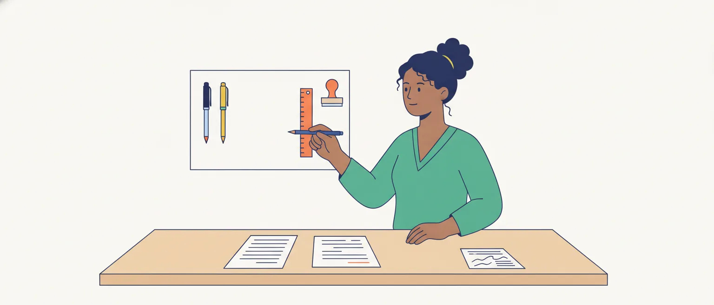

# Recursos de produção de textos e adequação ao gênero

O edital pede, em Linguística (item 4 da P2): "Reconhecimento dos recursos de produção de textos. Recursos estilísticos e estruturais na elaboração de tipos e gêneros textuais variados. Adequação da linguagem ao gênero e às convenções da escrita". A palavra que manda é **reconhecimento**: a prova não pede que você escreva bonito, e sim que veja, num texto dado, **o que o autor fez e para quê**.

Esse item repete, quase palavra por palavra, o programa do concurso de Taquígrafo Legislativo de 2012, também do Cebraspe (na época, Cespe). Aquela prova usou a expressão do edital num item, e é por ela que esta aula se guia.

## Recurso é escolha com efeito

Quem escreve escolhe o tempo todo: esta palavra e não aquela, esta ordem, este tempo verbal, com ou sem aspas, um parágrafo ou três. **Recurso de produção** é cada uma dessas escolhas quando ela produz um **efeito** no leitor: convencer, atenuar, destacar, criticar, fazer rir, dar aparência de neutralidade.

Compare duas manchetes sobre o mesmo fato: "Câmara aprova **reforma** da previdência" e "Câmara aprova **desmonte** da previdência". O fato é um só; a palavra escolhida já diz de que lado o autor está.

A Matriz de Referência do Saeb, do Inep, chama essa parte da leitura de "relações entre recursos expressivos e efeitos de sentido" e a divide em quatro habilidades: perceber ironia ou humor; o efeito da pontuação e de outras notações; o efeito da escolha de uma palavra ou expressão; e o efeito de recursos ortográficos e morfossintáticos. É um bom mapa do que procurar.

> [!TIP]
> Diante de qualquer item deste assunto, faça três perguntas, nesta ordem: **o recurso está mesmo no texto?** Que **efeito** ele produz ali? Esse efeito serve à **finalidade** daquele gênero? O item pode errar em qualquer uma das três.

## Estilístico ou estrutural?

O edital fala em recursos **estilísticos** e **estruturais**, mas não os define. Esta aula os separa assim:

- **estilísticos**: as escolhas de **linguagem**. A palavra, a figura, o grau de certeza, o tempo verbal, a pontuação expressiva, o registro mais ou menos formal;
- **estruturais**: as escolhas de **organização**. As partes que o gênero exige, a ordem das informações, a divisão em parágrafos, o tipo de sequência (narrar, descrever, expor, argumentar, instruir).

Alguns recursos ficam nos dois lados. A repetição e o paralelismo, por exemplo, são um modo de construir a frase (estrutura) e também um modo de dar ênfase (estilo).

![Mapa em duas colunas. À esquerda, recursos estilísticos, escolhas de linguagem: escolha da palavra, como reforma ou desmonte, que revela a posição do autor; figuras, como metáfora, metonímia e ironia, que aproximam, resumem ou criticam; modalização, como certamente, talvez, seria, que reforça ou atenua o compromisso com o que se diz; pontuação e destaques, como aspas, travessão e negrito, que marcam distância, comentário ou realce. À direita, recursos estruturais, escolhas de organização: partes do gênero, como o lide da notícia e o preâmbulo da ata; ordem da informação, o mais importante primeiro ou a ordem do tempo; parágrafo, com tópico frasal e desenvolvimento; sequências, narrar, descrever, expor, argumentar e instruir. No meio, valem para os dois lados: repetição e paralelismo. No pé, o roteiro: recurso, efeito, finalidade do gênero.](imagens/mapa-dos-recursos.svg "Recursos estilísticos e estruturais: o que procurar no texto")

> [!NOTE]
> A divisão acima é uma organização desta aula, feita a partir das fontes do fim. Nas provas lidas, a banca não pede que o candidato diga se um recurso é "estilístico" ou "estrutural": pede o recurso e o efeito.

## A escolha da palavra

A palavra carrega avaliação. Num relatório, "o governo **ajustou** as despesas" e "o governo **cortou** as despesas" descrevem o mesmo ato com pesos diferentes. O mesmo vale para "ocupação" e "invasão", "manifestantes" e "baderneiros", "flexibilizar" e "afrouxar".

Palavras pequenas também avaliam. No texto de Machado de Assis usado na prova de 2012, o autor admite que "**certos** modos de dizer" entram na língua pela força do uso, mas recusa "tudo o que o **abuso**, o capricho e a moda inventam". O indefinido restringe a concessão; o substantivo *abuso* já condena o que nomeia. Um item tratou essas escolhas como indícios da posição do autor e foi dado como certo.

Na prova de Conhecimentos Gerais do concurso da Câmara de 2025 (aplicada em março de 2026), a banca considerou certo que trocar "presidente" por "presidenta" manteria a correção e evidenciaria uma opção política. Ou seja: duas formas corretas, e a escolha entre elas produz sentido.

> [!IMPORTANT]
> Quando o item diz que uma palavra "revela", "evidencia" ou "indica" a posição do autor, volte ao texto e troque a palavra por uma neutra. Se o tom mudar, a escolha era um recurso.

## Figuras: o efeito vale mais que o nome

Figuras de linguagem são usos que se afastam do sentido ou da construção comuns para ganhar expressividade. Os manuais as dividem em figuras de palavras, de pensamento, de sintaxe e de som. Para esta prova, interessa o que cada uma **faz** no texto:

| Figura | Exemplo | Efeito |
| --- | --- | --- |
| **Metáfora** (comparação sem o "como") | "Este projeto é um cheque em branco." | resume uma crítica numa imagem |
| **Comparação** (com "como", "tal qual") | "Votar sem ler o parecer é como assinar sem ler o contrato." | explica o novo pelo conhecido |
| **Metonímia** (um termo por outro vizinho) | "Esta **Casa** decidiu." "O **Planalto** vetou." | o lugar pela instituição: encurta e dá peso |
| **Hipérbole** (exagero) | "Já disse mil vezes desta tribuna." | ênfase |
| **Eufemismo** (suavização) | "O ministro faltou com a verdade." | critica sem ofender |
| **Ironia** (dizer o contrário) | "Belo exemplo de transparência: o relatório chegou cinco minutos antes da votação." | critica pelo avesso |
| **Antítese** (ideias opostas) | "Prometeram muito, entregaram pouco." | contraste que fixa a ideia |

Nas duas provas da Câmara lidas para esta aula (2012 e 2025), nenhum item pede o nome de uma figura. O que aparece é o recurso descrito e o efeito afirmado.

A comparação tem uma armadilha própria. Num texto da prova de 2012, um linguista dizia que condenar uma construção que as pessoas usam é como decretar que é "errado" haver terremotos. O ponto comum é um só: são fatos, e ao cientista cabe reconhecê-los. Um item que estendia a comparação a outra característica dos terremotos, o poder de destruição, foi dado como errado (a banca não publica o motivo; a explicação é leitura nossa).

> [!CAUTION]
> Numa comparação ou analogia, vale apenas o ponto comum que o **autor** explorou. Item que acrescenta outra semelhança, por mais razoável que pareça, extrapola o texto.

## Aspas e ironia

As aspas são um recurso de notação que a banca já cobrou com as palavras do edital. O Manual de Redação da Câmara (item 2.2.1) lista seus empregos: citação direta curta; termo ainda não incorporado à língua; **sentido irônico, figurado ou impróprio** de uma palavra; títulos de matérias e artigos; definições e exemplos.

No texto argumentativo, o caso que importa é o terceiro. Quando alguém escreve que certos gramáticos viam os falares populares como "corrompidos", as aspas avisam: **essa palavra não é minha**, é de quem pensava assim. Elas marcam distância, não adesão.

Na prova de 2012, o item que começava por "Entre os recursos de produção de texto utilizados pela autora" tinha duas metades. A segunda afirmava que as aspas ressaltavam os vocábulos que melhor exprimiam a opinião da autora sobre as variedades não padronizadas da língua. Gabarito do item: errado.

> [!NOTE]
> A banca só publica justificativa de item anulado ou alterado: não se sabe qual metade ela considerou errada. Leitura nossa: as duas. As palavras entre aspas eram o juízo de outros, que a autora discutia, e não o dela; e o futuro do pretérito, da primeira metade (parte seguinte), afasta a autora do que relata, em vez de dar assertividade.

## Modalização: quanto o autor se compromete

Modalizar é marcar a **atitude** de quem escreve diante do que diz. A aula de categorias semânticas mostrou os dois eixos que a prova cobra (o do conhecimento e o da conduta). Aqui interessa o efeito no texto:

- **reforçar**: *certamente*, *sem dúvida*, *é evidente que*, *de fato*. O autor assume o que afirma;
- **atenuar**: *talvez*, *parece que*, *é possível que*, *provavelmente*. O autor se protege;
- **avaliar**: *infelizmente*, *felizmente*, *lamentavelmente*, *é louvável que*. O autor julga o fato;
- **obrigar ou permitir**: *é preciso*, *deve*, *cabe a*, *pode*. O autor dita conduta.

Os tempos verbais também modalizam. O **futuro do pretérito** é o caso clássico: em "segundo a liderança, o acordo **estaria** fechado" ou "para esses autores, a norma **seria** superior", o autor relata sem assumir (a aula de tempos e modos verbais listou os quatro valores desse tempo).

A primeira metade do item de 2012 dizia que formas no futuro do pretérito ("seria", "deveria") **imprimiam assertividade** ao discurso. Com a metade das aspas, o item foi dado como errado. Como dito na observação da parte anterior, entendemos que o efeito é o oposto: esse tempo afasta o autor do que é dito.

> [!CAUTION]
> Desconfie do efeito invertido: futuro do pretérito que "dá certeza", *talvez* que "reforça", aspas que "confirmam a opinião do autor". O recurso está no texto, mas o efeito afirmado é o contrário do real.

## Repetição, paralelismo e pergunta retórica

Três recursos de construção aparecem muito em discursos:

- **anáfora**: repetir a mesma palavra no começo de frases seguidas. "Esta Casa **escolheu** a criança sem café da manhã. **Escolheu** a merendeira. **Escolheu** o agricultor familiar";
- **paralelismo**: dar a mesma forma a ideias de mesmo nível. "O relator pediu **que se ouvissem** os prefeitos e **que se adiasse** a votação": duas orações de mesma estrutura. Na Câmara 2025, um item de reescrita cuja troca mantinha "o paralelismo sintático" foi dado como certo;
- **pergunta retórica**: perguntar sem esperar resposta. "Quem pode ser contra um prato de comida?" equivale a afirmar que ninguém pode.

A escola ensina a fugir da repetição, mas ela nem sempre é defeito. A videoaula da Univesp indicada nesta aula mostra um articulista que repete "pela primeira vez" de propósito, para frisar a mudança de que fala.

Na lei, a repetição é **regra**: a Lei Complementar nº 95/1998 manda exprimir a ideia repetida "por meio das mesmas palavras", evitando a sinonímia "com propósito meramente estilístico" (art. 11, II, *b*). Os recursos do orador (ordem do discurso, apelos, gestos) ficam para a aula de retórica e oratória parlamentar.

> [!WARNING]
> "A repetição de X torna o texto redundante" pode estar errado. Veja antes se a repetição dá ênfase, garante a precisão (na lei) ou mantém o paralelismo.

## Pontuação e destaques

A pontuação tem um lado de regra, que é assunto da aula de pontuação, e um lado de **efeito**, que é o desta:

- o **travessão** e os **parênteses** isolam um comentário do autor, uma explicação ou uma ressalva;
- as **reticências** suspendem a frase e deixam algo no ar; a **exclamação** marca emoção ou ênfase; a **interrogação** pode ser pergunta de verdade ou pergunta retórica;
- os **dois-pontos** anunciam explicação, exemplo ou citação.

Os destaques gráficos (negrito, itálico, sublinha, maiúsculas) funcionam pela raridade. O Manual da Câmara (item 2.2) manda usá-los "com parcimônia", e a LC 95/1998 pede pontuação "de forma judiciosa", sem "abusos de caráter estilístico" (art. 11, I, *e*).

## Recursos estruturais: o plano do texto

Cada gênero tem um **plano** que o leitor já espera. Reconhecer o plano é reconhecer o gênero e saber onde está cada informação. Cinco gêneros próximos do cargo:

- **notícia**: abre pelo **lide**, que o Manual de Comunicação do Senado define como o primeiro parágrafo, com a informação principal. Na tradição do jornalismo, o resto vem em ordem decrescente de importância;
- **artigo de opinião**: texto interpretativo e opinativo, em geral assinado (mesmo manual). Organiza-se em torno de uma **tese** e dos **argumentos** que a sustentam;
- **ata**: registro dos fatos e deliberações de uma reunião ou sessão. Pelo Manual da Câmara (item 3.4.2), tem título, **texto num único parágrafo** (preâmbulo com lugar, data e participantes; registro dos assuntos e decisões; fecho), local e data e assinatura;
- **lei**: três partes fixas (LC 95/1998, art. 3º): **preliminar** (epígrafe, ementa, preâmbulo, objeto e âmbito de aplicação), **normativa** e **final** (medidas de implementação, disposições transitórias, vigência e revogação);
- **discurso em plenário**: o Regimento Interno manda o deputado dirigir a palavra "ao Presidente, ou aos Deputados de modo geral" (art. 73, X): daí o vocativo de abertura ("Senhor Presidente").

![Cinco cartões com o plano de cinco gêneros. Notícia: lide, o primeiro parágrafo com a informação principal, e depois o resto em ordem decrescente de importância (Manual de Comunicação do Senado e Manual de linguagem simples da Câmara). Artigo de opinião: tese, argumentos e fecho, texto opinativo e em geral assinado. Ata: título, texto num único parágrafo com preâmbulo, registro dos assuntos e decisões e fecho, local e data, assinatura (Manual de Redação da Câmara, 3.4.2). Lei: parte preliminar, com epígrafe, ementa, preâmbulo, objeto e âmbito de aplicação; parte normativa; parte final, com implementação, disposições transitórias, vigência e revogação (LC 95/1998, art. 3º). Discurso em plenário: palavra dirigida ao Presidente ou aos Deputados de modo geral, colega tratado por Senhor ou Deputado e, quando o orador se dirige a ele, por Excelência (RICD, art. 73, X e XI). Um sexto cartão ensina a usar o quadro: ache a parte, veja o que ela faz, confira se o item descreve a parte certa.](imagens/plano-dos-generos.svg "O plano de cinco gêneros próximos do cargo")

> [!NOTE]
> O plano do artigo de opinião (tese, argumentos, fecho) é síntese nossa, apoiada na definição do manual do Senado e na sequência argumentativa descrita adiante. A teoria dos gêneros (construção composicional, conteúdo temático e estilo) é da aula de gêneros e tipos textuais.

## A ordem da informação

A ordem também é recurso. O Manual de linguagem simples da Câmara recomenda que o primeiro parágrafo traga o que é mais importante para o leitor e que o resto venha em **ordem decrescente de importância**. O mesmo manual dá nome ao defeito contrário, tirado do jornalismo: o **nariz de cera**, a introdução que retarda a entrada no assunto.

Nem todo gênero funciona assim. Instruções e processos, diz o manual, vão em **ordem cronológica**. A ata segue a ordem dos trabalhos da sessão. O artigo de opinião pode guardar a tese para o fim, depois de preparar o leitor.

Por isso, a ordem diz algo sobre a intenção: o que vem primeiro é o que o autor quer que você leia, mesmo que pare ali.

> [!NOTE]
> Do manual vêm a ordem decrescente de importância e a ordem cronológica das instruções. O que se diz da ata e do artigo de opinião é observação nossa.

## O parágrafo e as sequências

Dentro do texto, a unidade de organização é o **parágrafo**. No modelo de Othon Garcia, exposto numa aula da UFS, o parágrafo-padrão tem **tópico frasal** (um ou dois períodos curtos com a ideia central), **desenvolvimento** e uma **conclusão** facultativa. O tópico frasal costuma ser uma generalização; o desenvolvimento a fundamenta, por enumeração, definição ou comparação, entre outros modos.

Um exemplo: "As comissões são o filtro do processo legislativo. [tópico frasal] Nelas, os projetos são examinados por especialistas, recebem emendas e, muitas vezes, são arquivados antes de chegar ao Plenário. [desenvolvimento]"

O segundo recurso é a **sequência** (ou tipo textual). Cada uma deixa marcas, resumidas pelo fascículo da UFMT a partir de Koch e Elias:

| Sequência | O que faz | Marcas |
| --- | --- | --- |
| Narrativa | conta fatos em sucessão | verbos de ação, tempos da narração (em geral, os pretéritos), marcadores de tempo |
| Descritiva | apresenta características | verbos de estado, presente ou pretérito imperfeito, marcadores de lugar |
| Expositiva | explica conceitos em ordem lógica | tempos do comentário (em geral, o presente), conectores lógicos |
| Injuntiva | prescreve ações | imperativo, infinitivo ou futuro do presente |
| Argumentativa | defende uma posição | modalizadores, verbos de opinião, operadores argumentativos |

Um gênero costuma misturar sequências, e o que se classifica é a **predominante** (assunto da aula de compreensão e gêneros, na P1). Exemplificação, definição e generalização como modos de organizar o texto são da aula de compreensão interpretativa e crítica.

> [!TIP]
> As marcas ligam o estrutural ao estilístico: se o parágrafo está cheio de modalizadores e de *mas*, *portanto*, *aliás*, a sequência é argumentativa, ainda que o gênero seja uma notícia.

## Adequação: quem decide é o gênero

**Adequar** a linguagem é ajustá-la à situação: quem escreve, para quem, com que finalidade e onde o texto vai circular. O fascículo da UFMT resume: o que determina o estilo de um texto é, sobretudo, o suporte em que ele circula, a quem se dirige e qual é o seu objetivo.

Veja o mesmo fato, fictício, em três gêneros:

> **Ata.** Passou-se à Ordem do Dia. Foi aprovado, por 312 votos favoráveis e 121 contrários, o Projeto de Lei nº 1.234, de 2026, que amplia o programa de alimentação escolar.
>
> **Notícia.** A Câmara aprovou nesta terça-feira (20), por 312 votos a 121, o projeto que amplia a merenda escolar para alunos de tempo integral. O texto segue para o Senado.
>
> **Discurso.** Senhor Presidente, hoje esta Casa escolheu. Escolheu a criança que chega à escola sem café da manhã. Escolheu a merendeira. Quem pode ser contra um prato de comida?

A ata usa voz passiva, nome técnico e nenhuma avaliação. A notícia põe o essencial no lide e troca o termo técnico por um corrente ("merenda"). O discurso tem vocativo, metonímia ("esta Casa"), anáfora e pergunta retórica. Nenhum dos três está "mais certo": cada um faz o que seu gênero pede.

> [!IMPORTANT]
> **Adequado não é sinônimo de correto.** Um texto pode seguir toda a gramática e ser inadequado (um discurso lido como ata), e uma fala informal pode ser perfeitamente adequada à situação.

## O que serve num gênero atrapalha no outro

A consequência prática da adequação: o mesmo recurso muda de valor conforme o gênero.

![Quadro com três recursos nas linhas e três gêneros nas colunas: discurso em plenário, ata e expediente administrativo, e lei. Ironia e figuras: no discurso, recurso de persuasão; no expediente, jamais usar linguagem irônica, pomposa ou rebuscada (Manual da Câmara, 1.1); a lei manda usar as palavras em seu sentido comum (LC 95, art. 11, I, a). Adjetivos e avaliação: no discurso, marcam a posição do orador; no expediente, evitar o emprego abusivo de adjetivos (Manual, 1.4); na lei, evitar adjetivações dispensáveis (LC 95, art. 11, I, c). Repetição da mesma palavra: no discurso, ênfase, como na anáfora; no expediente, evitar repetir palavras no início de períodos e parágrafos seguidos (Manual, 1.4); na lei, repetir é a regra: a mesma ideia, as mesmas palavras, sem sinonímia de estilo (LC 95, art. 11, II, b). No pé: a coluna do discurso é leitura desta aula; mesmo ali há limite, porque o Regimento proíbe a referência descortês ou injuriosa (art. 73, XII).](imagens/mesmo-recurso-tres-generos.svg "O mesmo recurso em três gêneros")

O Manual de Redação da Câmara é direto: no expediente, "jamais usar linguagem irônica, pomposa ou rebuscada", evitar a primeira pessoa (com exceção de certos ofícios de caráter pessoal, assinados por deputados) e o emprego abusivo de adjetivos. O que no discurso é recurso, ali é excesso.

Mesmo o discurso tem limite de registro. O Regimento Interno exige que o deputado trate o colega por "Senhor" ou "Deputado" e, ao dirigir-se a ele, por "Excelência" (art. 73, XI), e proíbe a referência "descortês ou injuriosa" a membros do Legislativo e a autoridades (art. 73, XII).

> [!WARNING]
> Item que elogia, num texto oficial, a "expressividade" de uma figura ou de um adjetivo, ou que critica um discurso por "não ser impessoal", aplica a um gênero a régua do outro.

## Formal não é rebuscado; simples não é informal

Dois enganos comuns, desfeitos pelos próprios manuais oficiais:

1. **Formal não é rebuscado.** O Manual de Redação da Presidência (item 3.6) afirma que usar o padrão culto "não significa empregar a língua de modo rebuscado ou utilizar figuras de linguagem próprias do estilo literário" e que a língua culta é contra a pobreza de expressão, não contra a simplicidade. O da Câmara manda trocar *hodierno* por *atual* e *encômio* por *elogio*.
2. **Simples não é informal.** O Manual de linguagem simples da Câmara diz que a linguagem simples se liga "à clareza e à objetividade, não ao coloquialismo", e que a norma culta continua preservada.

O Manual da Presidência acrescenta: não existe "um padrão oficial de linguagem"; existe o uso da norma-padrão nos atos oficiais. O jargão burocrático, como todo jargão, deve ser evitado. O estudo da redação oficial em si é de outra aula.

> [!WARNING]
> "O texto é formal porque usa vocabulário raro e frases longas" confunde formalidade com rebuscamento. "O texto é claro, logo é coloquial" confunde clareza com informalidade.

## Registro: a situação pede um grau de formalidade

**Registro** é o grau de formalidade com que alguém fala ou escreve numa situação. A mesma pessoa muda de registro várias vezes por dia. Um texto de Mattoso Câmara Jr., usado na prova de 2012, resume a ideia com um exemplo do cargo: "O deputado não fala na rua, ao se encontrar com um amigo, como falaria em uma sessão da Câmara".

O registro informal **não é erro**: é o adequado à conversa, à mensagem a um colega, à crônica. O problema é o descompasso: gíria num parecer, ou linguagem de parecer numa campanha para o público jovem. Na prova de 2012, dois itens sobre a adequação da construção à situação e sobre o uso de uma variante onde se esperava a modalidade de prestígio foram dados como certos.

Os tipos de variação (regional, social, de situação) e a diferença entre dialeto e registro são da aula de variação linguística; norma-padrão e norma culta, da aula de oralidade e escrita.

## Convenções da escrita

A escrita tem regras que são **acordos**: não nascem da fala, foram combinadas para que todos leiam do mesmo jeito. São as **convenções da escrita**: ortografia, acentuação, pontuação, maiúsculas, divisão em parágrafos, modo de citar, de destacar, de grafar números, siglas e abreviaturas.

Há convenções gerais, que valem para qualquer texto escrito, e convenções **do gênero ou da instituição**. O Manual de Redação da Câmara chama as suas de "padronização". Alguns exemplos dele:

- número que se escreve com uma só palavra vai **por extenso** ("quinze proposições");
- **sigla** de até três letras, em maiúsculas (*ONU*); de quatro ou mais, lida como palavra, só com a inicial maiúscula (*Unesco*, *Petrobras*); lida letra por letra, toda em maiúsculas (*FGTS*, *INSS*);
- **itálico** em títulos de publicações e em palavras estrangeiras não incorporadas à língua;
- **aspas** em citação direta de menos de quatro linhas; a mais longa vai em parágrafo recuado, sem aspas. O manual avisa que os discursos parlamentares seguem disposição própria.

A convenção também varia com o suporte. As abreviações das mensagens de internet (*vc*, *tb*) são convenção daquele ambiente e inadequadas numa ata; passar a fala do Plenário para a escrita exige decidir o que as convenções pedem, assunto das aulas de oralidade e escrita e de retextualização.

> [!NOTE]
> O edital não define "convenções da escrita", e as provas lidas não têm item sobre elas isoladamente. A leitura acima (regras combinadas da modalidade escrita, gerais e de cada gênero) é nossa, apoiada nos manuais da Câmara.

## Como o Cebraspe cobra

Nas provas lidas (Taquígrafo de 2012 e Conhecimentos Gerais da Câmara 2025, aplicada em março de 2026), os itens seguem poucos moldes:

1. **recurso e efeito no mesmo item**: o item nomeia um recurso que está no texto e afirma o que ele produz. É item composto: se uma parte falha, o item inteiro é errado;
2. **efeito invertido**: o recurso existe, e o efeito afirmado é o contrário (o futuro do pretérito "assertivo");
3. **função errada**: as aspas que "expressam a opinião do autor", quando marcam a palavra de outros;
4. **recurso de argumentação bem descrito**: o exemplo que sustenta a tese, a analogia entre duas áreas. Em 2012, os dois itens desse tipo eram certos;
5. **comparação esticada**: o item acrescenta uma semelhança que o autor não explorou;
6. **escolha lexical e posição**: uma palavra como indício do ponto de vista, ou uma troca que "evidenciaria" uma opção;
7. **adequação à situação**: a construção vale ou não conforme o contexto em que foi usada;
8. **extrapolação sobre o gênero**: na Câmara 2025, um item atribuía ao texto uma gradação do cuidado com o vocabulário conforme o gênero e o público, de importante a irrelevante. Foi dado como errado.

Nenhum item lido pergunta se o texto "é formal ou informal" nem pede nome de figura.

> [!TIP]
> Com +1 para o acerto e −1 para o erro, marque só quando localizar o recurso no texto e conseguir dizer o efeito com suas palavras. Se o item depende de uma classificação que a aula marcou como leitura nossa, o branco é uma boa resposta.

## Fontes

- Manual de redação: documentos administrativos, 2ª ed. Câmara dos Deputados, Edições Câmara, 2023 (capítulo 1; itens 2.1, 2.2, 2.3 e 3.4.2). https://bd.camara.leg.br/bd/bitstreams/53dcada1-41d5-47f9-b404-8a616fe55284/download
- Manual de linguagem simples: como planejar, desenvolver e testar textos que funcionam. Patrícia Roedel, Câmara dos Deputados, Edições Câmara, 2024 ("O que não é?" e "Escreva o mais importante primeiro"). https://bd.camara.leg.br/bd/bitstreams/e0d3210c-4891-40cc-9e1f-84f4e941a7c7/download
- Manual de Redação da Presidência da República, 3ª ed., 2018 (capítulo I, item 3.6), cópia hospedada pelo ICMBio; original em www.planalto.gov.br/legislacao. https://ava.icmbio.gov.br/pluginfile.php/4592/mod_data/content/16325/Manual-de-redacao%20oficial%20_3%C2%AA%20EDI%C3%87%C3%83O%202018.pdf
- Lei Complementar nº 95, de 26 de fevereiro de 1998 (arts. 3º e 11). https://www.planalto.gov.br/ccivil_03/leis/lcp/lcp95.htm
- Regimento Interno da Câmara dos Deputados (Resolução nº 17, de 1989), texto atualizado: art. 73, X, XI e XII. https://www2.camara.leg.br/legin/fed/rescad/1989/resolucaodacamaradosdeputados-17-21-setembro-1989-320110-normaatualizada-pl.html
- Manual de Comunicação da Secom, glossário: verbetes "Lide" e "Artigo". Senado Federal. https://www12.senado.leg.br/manualdecomunicacao/glossario/lide
- Leitura e Produção de Texto (fascículo da Licenciatura em Tecnologias Digitais, UFMT/UAB), unidade 1. Mariângela Sólla López, 2018, licença Creative Commons Atribuição-CompartilhaIgual. https://educapes.capes.gov.br/handle/capes/430003
- Produção e Recepção de Texto I, aula 20: estrutura do parágrafo-padrão. CESAD/UFS. https://cesad.ufs.br/ORBI/public/uploadCatalago/17043224022014Producao_e_Recepcao_de_Texto_I_Aula_20.pdf
- Matriz de Referência de Língua Portuguesa do Saeb (tópico "Relações entre recursos expressivos e efeitos de sentido"). Inep. https://download.inep.gov.br/educacao_basica/prova_brasil_saeb/menu_do_professor/o_que_cai_nas_provas/Matriz_de_Referencia_de_Lingua_Portuguesa.pdf
- Figuras de linguagem. Márcia Fernandes (Toda Matéria). https://www.todamateria.com.br/figuras-de-linguagem/
- Leitura e Produção de Textos: Os efeitos de sentido (videoaula). Vanessa Martins do Monte, Univesp. https://www.youtube.com/watch?v=Hk-Z466EYzE
- Cespe/UnB. Câmara dos Deputados 2012, Analista Legislativo, atribuição Taquígrafo Legislativo: caderno de conhecimentos específicos (itens 71 a 100), gabarito definitivo e edital de abertura. https://cdn.cebraspe.org.br/concursos/CD_12_AT/arquivos/CAMARA12_006_22.pdf
- Cebraspe. Câmara dos Deputados, Edital nº 1/2025 (nível superior): caderno de Conhecimentos Gerais, aplicado em 8/3/2026, e gabarito definitivo. https://cdn.cebraspe.org.br/concursos/cd_25_ns/arquivos/E61A04B682ABA7AF746F702D22B1516C4A4BC005855CE5CFFF5D2280F3E790CE.pdf
