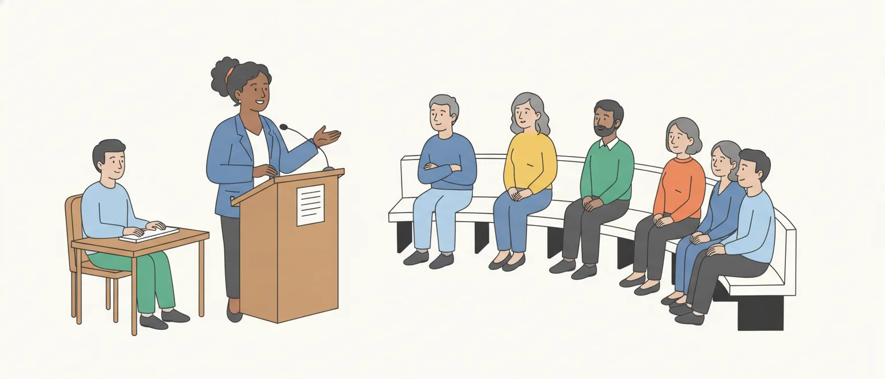

# Retórica e oratória parlamentar

O edital pede, em Linguística (item 5.3 da P2): "Retórica e oratória parlamentar". São duas metades: a **retórica**, que é a teoria de como um discurso persuade, e a **oratória parlamentar**, que é a fala do deputado na tribuna, o material de trabalho de quem registra e revisa discursos na Câmara.

O Cebraspe ainda não cobrou esse item com esse nome nas provas abertas que servem de modelo (Taquígrafo de 2012 e Câmara de 2025). O que há são itens que pedem o recurso de argumentação usado num trecho. Por isso, esta aula dá os conceitos e, em seguida, treina a aplicação deles a um discurso.

## Retórica e oratória: o que cada palavra nomeia

**Retórica** é a arte de **persuadir pelo discurso**. A definição que ficou é a de Aristóteles, citada por Mateus e por Fiorin: a capacidade de descobrir, em cada caso, o que serve para persuadir. O centro é a persuasão, e o instrumento é o argumento.

**Oratória** é a prática de falar em público, a eloquência. O verbete da Toda Matéria resume a separação que se fez com o tempo: a oratória ficou ligada ao falar bem, à exposição eloquente; a retórica, ao convencimento e à persuasão pela argumentação. Mateus diz algo parecido: a argumentação é o traço fundamental da retórica; a eloquência é um traço frequente, que nem sempre aparece.

A ligação com a política é de origem. O mesmo verbete lembra que, na democracia grega, o direito à voz (a *isegoria*) fazia da palavra o caminho para decidir. **Oratória parlamentar**, nesta aula, é a fala dos parlamentares no Plenário e nas comissões, dentro das regras do Regimento.

> [!WARNING]
> Retórica não é enfeite. Fiorin, a partir de Genette, mostra que ela foi sendo reduzida, ao longo da história, a uma lista de figuras (a "retórica restrita"). Na origem, ela trata da argumentação inteira: o que dizer, em que ordem e de que modo.

## Um discurso para acompanhar a aula

O trecho abaixo é inventado para esta aula. Uma deputada fala na discussão de um projeto que manda instalar água potável nas escolas rurais. Leia uma vez; as partes seguintes voltam a ele.

> Senhor Presidente, Senhoras e Senhores Deputados, fui professora de escola rural por vinte anos antes de chegar a esta Casa. Falo, portanto, do que vi.
>
> No ano passado, visitei uma escola em que as crianças levavam de casa a própria água, em garrafas usadas. Quando a água acabava, a aula acabava.
>
> A Constituição diz que a educação é direito de todos. Ora, não há direito à educação onde não há água para beber. Dir-se-á que o custo é alto; mais alto é o custo de cada dia de aula perdido.
>
> Por isso, peço a cada colega: aprovemos este projeto. Nenhuma criança deve escolher entre a sede e a escola.

Quatro parágrafos, quatro funções diferentes. A aula vai dar nome a cada uma.

## Orador, auditório e acordo

O manual de redação do Senado organiza o pronunciamento com três noções da retórica, na linha de Perelman:

- **orador**: quem fala. Não é só o nome e o cargo: é a região de onde vem, os valores que defende, a trajetória. Tudo isso entra no discurso;
- **auditório**: aqueles que o orador quer influenciar. Mateus lembra que nem sempre é quem está na frente dele: o ministro responde ao jornalista, mas fala para os cidadãos;
- **acordo**: as premissas que o auditório já aceita antes de o discurso começar. O manual dá a Constituição de 1988 como exemplo. É do acordo que o orador parte para chegar à tese.

No discurso da aula, a deputada parte de um acordo ("a educação é direito de todos") e dele tira o que quer aprovar.

Há uma diferença de uso em **auditório universal**. Para o manual do Senado, é virtualmente todo o Brasil, que acompanha a sessão pelo rádio e pela TV; o **auditório particular** é o recorte para quem o orador fala de fato (os professores, os militares, um ministro). Em Mateus, que segue Perelman, o auditório universal não é uma multidão real: é um **ideal**, o conjunto de todas as pessoas razoáveis, capazes de seguir uma argumentação rigorosa.

> [!NOTE]
> Leitura nossa: as duas acepções circulam. Se um item falar em "auditório universal", veja no próprio item se ele trata do público mais amplo possível (uso do manual) ou do auditório ideal de Perelman (uso de Mateus).

## As três provas: ethos, pathos e logos

Aristóteles separa as provas em dois grupos. As que **já existem** antes do discurso (leis, contratos, testemunhos, confissões) são as **extra-artísticas**: o orador não as cria, só as usa. As que ele **constrói ao falar** são as artísticas, e são três:

- **ethos**: a prova que vem do **caráter do orador**. É a imagem de pessoa confiável, competente e honesta que ele constrói no discurso. "Fui professora de escola rural por vinte anos": a deputada mostra por que merece ser ouvida;
- **pathos**: a prova que vem das **emoções do auditório**. O orador desperta piedade, indignação, vergonha, orgulho. "Nenhuma criança deve escolher entre a sede e a escola";
- **logos**: a prova que vem do **próprio discurso**, do raciocínio. Suas duas formas são o **exemplo** (indução: de casos para a regra) e o **entimema** (dedução: na definição de Mateus, um silogismo com uma das premissas omitida). Um entimema nosso: "este prédio é público; logo, precisa de rampa de acesso". Falta a premissa que o ouvinte completa sozinho: todo prédio público precisa de rampa.

![Quadro em três colunas. Ethos apoia-se no orador: é a imagem de pessoa confiável que o orador constrói ao falar, com caráter, experiência e autoridade; a pergunta do ouvinte é: posso confiar em quem fala?; no discurso da aula, fui professora de escola rural por vinte anos, falo, portanto, do que vi. Pathos apoia-se no auditório: são as emoções que o discurso desperta em quem ouve, como piedade, indignação, vergonha e orgulho; a pergunta do ouvinte é: o que isto me faz sentir?; no discurso da aula, nenhuma criança deve escolher entre a sede e a escola. Logos apoia-se no próprio discurso: é o raciocínio, com o exemplo, que é indução, e o entimema, que é dedução, isto é, o que o orador conclui dos fatos; a pergunta do ouvinte é: isto faz sentido?; no discurso da aula, não há direito à educação onde não há água para beber. Embaixo, fora do trio: as provas que já existem antes do discurso, como leis, contratos, testemunhos e confissões, e também o laudo ou outro documento que o orador só apresenta; o orador não as cria, só as usa; são as provas extra-artísticas, e ethos, pathos e logos são as artísticas.](imagens/provas-retoricas.svg "Ethos, pathos e logos, com exemplos do discurso da aula")

No discurso da aula, o raciocínio também é dedutivo: parte de um princípio aceito (a educação é direito de todos) e acrescenta que "não há direito à educação onde não há água para beber". Aqui as duas premissas estão ditas; o que fica para o ouvinte é a conclusão (leitura nossa).

As três se combinam, e a fronteira nem sempre é nítida: a mesma frase pode dar credibilidade e comover. Fiorin grafa *éthos*, *páthos* e *lógos*; é a mesma coisa.

E o dado, o número, o documento? Depende do que o orador faz com ele. A lei, o testemunho, o laudo e a tabela oficial que ele apenas apresenta já existiam antes do discurso: são provas **extra-artísticas** (o laudo e a tabela são exemplos nossos; a lista de Aristóteles traz testemunhas e contratos escritos, entre outros). **Logos** é o que o orador constrói a partir deles: a comparação, a conclusão que tira. Citar um dado não faz dele, sozinho, uma prova construída pelo orador.

> [!CAUTION]
> Ethos não é a ética do orador na vida real, nem um "princípio ético". É a **imagem** que o discurso constrói: Mateus fala no caráter que o orador "aparenta, pelo menos, possuir". Outra troca: tomar por prova construída pelo orador o documento que ele só apresenta.

## Convencer e persuadir

O manual do Senado separa as duas palavras: **convencer** se faz com razões (fatos, leis, dados); **persuadir**, com a mobilização dos afetos. Um bom pronunciamento, diz o manual, equilibra as duas estratégias: só números cansam; só emoção parece falta de objetividade.

Nem todas as fontes usam as palavras assim:

- para **Fiorin**, persuadir é o termo geral: persuade-se **convencendo** (pela razão) ou **comovendo** (pela emoção), e os dois meios são igualmente válidos;
- **Mateus** avisa que não adota uma distinção entre as duas palavras (a que ele cita, de Reboul, opõe "levar a crer" a "fazer compreender") e usa uma e outra para a adesão do auditório;
- para **Perelman e Olbrechts-Tyteca**, o critério é outro, o **auditório**: é *persuasiva* a argumentação que pretende valer só para um auditório particular, e *convincente* a que deveria obter a adesão de todo ser racional (o auditório universal). Lemos a passagem do *Tratado da argumentação* na citação de Danblon.

O manual do Senado e Fiorin têm um ponto comum: há um caminho pela razão e outro pela emoção, e o bom discurso usa os dois; muda o nome dado a cada um. Em Perelman, a pergunta deixa de ser "razão ou emoção?" e passa a ser "para quem vale o argumento?".

> [!WARNING]
> Um item que diga "persuadir é sempre apelar à emoção, e convencer, à razão" repete o manual do Senado, mas não vale para todos os autores: em Perelman, a diferença está no auditório. Veja se o item cita uma fonte ou um texto e responda por ele.

## Os três gêneros da retórica clássica

Aristóteles classificou os discursos em três gêneros. Mateus os resume num quadro, pelos critérios de tempo, ato e valores:

| Gênero | Tempo | O orador | Valores |
| --- | --- | --- | --- |
| **deliberativo** | futuro | aconselha ou desaconselha | o benéfico e o nocivo |
| **judiciário** (ou forense) | passado | acusa ou defende | o justo e o injusto |
| **epidítico** (ou demonstrativo) | presente | louva ou censura | o digno e o indigno |

O **deliberativo** é o gênero da assembleia: discute o que fazer e pesa os prós e os contras de uma decisão. O discurso da aula é deliberativo: pede a aprovação de um projeto e olha para o futuro. O **judiciário** reconstrói o que aconteceu e discute culpa. O **epidítico** é o da cerimônia: o elogio fúnebre, a homenagem, e também a censura pública.

O lugar não decide o gênero. Mateus insiste nisso: o que vale é o tempo, a finalidade e os valores. Um deputado que, numa entrevista, culpa o governo anterior faz retórica judiciária fora do tribunal. Na Câmara, portanto, cabem os três (exemplos nossos): a discussão de um projeto, a acusação e a defesa num processo disciplinar, a homenagem numa sessão solene.

![Tabela dos três gêneros retóricos da classificação clássica. Deliberativo: tempo futuro; o orador aconselha ou desaconselha; valores, o benéfico e o nocivo; lugar típico, assembleias políticas; argumento típico, o exemplo, que é indução. Judiciário, ou forense, judicial: tempo passado; o orador acusa ou defende; valores, o justo e o injusto; lugar típico, tribunais; argumento típico, o entimema, que é dedução. Epidítico, ou demonstrativo: tempo presente; o orador louva ou censura; valores, o digno e o indigno; lugar típico, cerimônias e espaço público; argumento típico, a amplificação. Embaixo, à esquerda, exemplos nossos na Câmara: deliberativo, o deputado pede a aprovação de um projeto em discussão; judiciário, a acusação e a defesa de um deputado num processo disciplinar; epidítico, a homenagem numa sessão solene. À direita, a variante do manual do Senado, de 2006: três tipos de pronunciamento, deliberativo, de propaganda e epidítico; o judiciário não aparece, e no lugar dele entra o discurso de propaganda, o elogio de uma política pública em andamento; não é a classificação de Aristóteles.](imagens/generos-retoricos.svg "Os gêneros clássicos e a variante do manual do Senado")

> [!CAUTION]
> As trocas mais fáceis de montar: dar ao deliberativo o tempo passado, ou ao judiciário o futuro; dizer que o epidítico só elogia (ele também censura); deixar o lugar decidir o gênero, como se um discurso fosse deliberativo só por ser feito no Parlamento.

## A tríade do manual do Senado

O manual do Senado também fala em três tipos de pronunciamento, mas a lista é outra: **deliberativo**, **de propaganda** e **epidítico**.

- o **deliberativo** expõe uma situação e pede uma providência: a apresentação de um projeto, a denúncia de uma falha que exige atitude;
- o **de propaganda** fala bem de uma política pública, de uma instituição ou de um programa em andamento, para manter a adesão de quem já os apoia;
- o **epidítico** ("de falar bem") faz uma homenagem: a uma data, a uma pessoa, a uma cidade.

O gênero **judiciário** não está nessa lista, e o "de propaganda" não está na de Aristóteles. O manual parte dos tipos mais comuns de fala dos parlamentares e diz tomar por base "os ensinamentos da Retórica", mas a lista dele não coincide com a clássica.

O manual acrescenta que, em graus diversos, todos os discursos têm natureza deliberativa: até a homenagem pode terminar recomendando uma atitude ao ouvinte. A frase fala de um traço presente em qualquer pronunciamento; não desfaz a classificação clássica, em que a homenagem continua epidítica e, na Câmara, cabem os três gêneros.

> [!IMPORTANT]
> Guarde as duas listas com a origem de cada uma. **Clássica (Aristóteles)**: deliberativo, judiciário, epidítico. **Manual do Senado (2006)**: deliberativo, de propaganda, epidítico. Num item, o que decide é a fonte a que ele se refere.

## As cinco operações da retórica

A tradição divide o trabalho do orador em cinco operações (os cânones), que Mateus atribui à sistematização de Cícero:

1. **invenção** (*inventio*): achar o que dizer, isto é, os argumentos e as provas;
2. **disposição** (*dispositio*): pôr os argumentos em ordem;
3. **elocução** (*elocutio*): dar forma ao texto, com a escolha das palavras, do estilo e das figuras;
4. **memória** (*memoria*): dominar o discurso para proferi-lo sem depender do papel;
5. **ação** (*actio* ou *pronuntiatio*): proferir o discurso, com a voz, o ritmo, as pausas, os gestos e a postura.

A ordem das duas últimas varia: Fiorin, a partir de Barthes, lista a ação antes da memória. E registra que só as três primeiras foram objeto de estudo mais detido.

Sobre a elocução, Fiorin lembra as quatro qualidades que Cícero pedia: **correção**, **clareza**, **ornamentação** e **adequação** do discurso às circunstâncias. As figuras, que pertencem a essa operação, são assunto de outro tópico do edital (o item 10, funções e figuras de linguagem).

> [!WARNING]
> **Invenção** não é inventar fatos. Fiorin, com Barthes, explica que é o ato de **encontrar** argumentos. E **ação** não é o conteúdo do discurso: é o desempenho de quem o profere.

## As partes do discurso

O esquema mais difundido da disposição tem **quatro partes**. É o que Mateus descreve:

1. **exórdio**: a abertura. Prepara o auditório, pede atenção e boa vontade, e o orador mostra quem é;
2. **narração**: a exposição dos fatos, clara e ordenada, só com o que interessa à causa;
3. **confirmação** (*argumentatio*): a parte mais longa, que argumenta sobre os fatos narrados. Divide-se em **prova** (os argumentos a favor) e **refutação** (a resposta aos contrários);
4. **peroração**: o fecho. Resume e comove, em três movimentos: amplificação, paixão e recapitulação.

O número **não é fixo**: muda de autor para autor.

- **Aristóteles** diz que só duas partes são necessárias, a exposição do assunto e a prova, e que o discurso tem no máximo quatro: introdução, exposição, prova e epílogo. Para ele, a refutação faz parte da prova;
- a ***Retórica a Herênio***, pelo sumário que consultamos, lista seis: introdução, narração, divisão, prova, refutação e conclusão;
- **Quintiliano** registra que a maioria dos autores divide o discurso forense em cinco: exórdio, narração, prova, refutação e peroração.

A diferença está em contar a refutação e a divisão como partes ou como pedaços de outra parte.

No discurso da aula, cada parágrafo é uma parte. O primeiro é o exórdio (vocativo e apresentação); o segundo, a narração (a visita à escola); o terceiro, a confirmação, com prova ("não há direito à educação...") e refutação ("dir-se-á que o custo é alto..."); o quarto, a peroração.

![Quadro das partes do discurso no esquema mais difundido, o de quatro partes, na ordem, com o discurso da aula como exemplo. Primeira, exórdio, que abre: prepara o auditório, pede atenção e boa vontade, e o orador mostra quem é e ganha confiança, o ethos; exemplo: fui professora de escola rural por vinte anos, falo, portanto, do que vi. Segunda, narração, que expõe os fatos: conta o caso de modo claro e ordenado, muitas vezes em ordem cronológica, só com o que interessa à tese; exemplo: no ano passado, visitei uma escola em que as crianças levavam de casa a própria água. Terceira, confirmação, que argumenta, em latim argumentatio: a parte mais longa, com a prova, os argumentos a favor, e a refutação, a resposta aos argumentos contrários; exemplo: não há direito à educação onde não há água para beber; dir-se-á que o custo é alto; mais alto é o custo. Quarta, peroração, que fecha, em três movimentos: amplificação, paixão e recapitulação; exemplo: aprovemos este projeto; nenhuma criança deve escolher entre a sede e a escola. Uma faixa mostra a correspondência com as três partes dos manuais de redação de hoje, que condensam as quatro do esquema: introdução para o exórdio, desenvolvimento para a narração e a confirmação, conclusão para a peroração. No pé, onde as fontes divergem: o manual do Senado, de 2006, lista exórdio, narração, provas e peroração, e diz que a narração é também conhecida como argumentação; no livro de Mateus, de 2018, argumentatio é o nome latino da confirmação; a narração só expõe os fatos, e quem argumenta é a parte seguinte. E a contagem varia por autor: Aristóteles, duas partes necessárias e quatro no máximo; Retórica a Herênio, seis; Quintiliano, cinco no discurso forense.](imagens/partes-do-discurso.svg "O esquema de quatro partes e as divergências entre as fontes")

Os manuais de redação de hoje condensam as quatro em três: introdução, desenvolvimento e conclusão. O manual do Senado cita Othon Garcia para dizer que a introdução deve trazer uma proposição (um princípio aceito, posto como problema), e o desenvolvimento, a argumentação, com fatos, exemplos, dados e testemunhos autorizados.

> [!CAUTION]
> O manual do Senado lista exórdio, narração, provas e peroração, e diz que a narração é "também conhecida como argumentação". Em Mateus, é o contrário: *argumentatio* é o nome da **confirmação**, e a narração apenas expõe. Diante de um item, confira de que fonte ele parte.

## A ordem das partes não é camisa de força

Mateus registra que, segundo Aristóteles, o discurso deliberativo quase dispensa o exórdio, porque o assunto já é conhecido, e que Quintiliano via no excesso de planejamento mais estorvo que ajuda.

O fecho também muda com o gênero. O manual do Senado pede, no deliberativo, uma conclamação: alguém com poder **deve** fazer algo em favor de alguém. Na homenagem, basta recapitular.

Os retores latinos, diz Mateus, ligavam a cada momento um estilo: o **simples**, para explicar; o **médio**, para agradar; o **elevado**, para comover, próprio da peroração.

O manual do Senado menciona ainda quatro "fases" do discurso na retórica tradicional: predispor o ouvinte a favor do orador, ampliar ou atenuar o que foi dito, excitar as paixões e recapitular.

> [!NOTE]
> Essas quatro fases coincidem, uma a uma, com as quatro partes que Aristóteles dá ao **epílogo**, isto é, ao fecho (*Retórica*, III.19): dispor o ouvinte a favor do orador, amplificar ou atenuar, excitar as emoções e recapitular. Leitura nossa: trate-as como movimentos da peroração, e não como as partes do discurso inteiro (exórdio, narração, confirmação e peroração).

## Escrito para ser ouvido

O pronunciamento costuma nascer escrito, mas é feito para o ouvido. O manual do Senado chama isso de **oralidade** da minuta e tira dela regras práticas:

- **frases no ritmo da respiração**, em ordem direta, sem os períodos longos da escrita;
- **repetição** de palavras e expressões. O leitor pode voltar ao parágrafo anterior; o ouvinte só tem a última frase. O que seria deselegante no texto para ler ajuda a fixar a ideia no texto para ouvir;
- **poucos números**. Cifras em excesso confundem; comparações, imagens e analogias fazem o ouvinte dimensionar a grandeza;
- **leitura em voz alta** depois de escrever, para testar ritmo, entonação e facilidade de pronúncia.

No discurso da aula, "quando a água acabava, a aula acabava" repete o verbo de propósito, e não há nenhuma cifra.

As diferenças entre fala e escrita e a passagem do discurso falado ao texto das notas taquigráficas são assunto das aulas de oralidade e escrita e de retextualização.

> [!TIP]
> Para o cargo, a consequência é direta: repetição e frase curta num discurso podem ser **recurso**, e não defeito. Quem revisa o registro de uma fala precisa distinguir uma coisa da outra.

## Lugares: de onde saem os argumentos

Os **lugares** (*topoi*) são esquemas de preferência que o auditório aceita sem discussão; servem de ponto de partida para os argumentos. O manual do Senado, com base em Antônio Suárez Abreu, lista seis:

- **quantidade**: vale mais o que serve a mais gente ou dura mais. É o princípio da regra da maioria;
- **qualidade**: vale mais o que é único ou raro: a obra de arte, a espécie ameaçada. Contesta o lugar da quantidade;
- **ordem**: o anterior vale mais que o posterior; a causa, mais que o efeito;
- **essência**: vale mais o que melhor representa um ideal (de justiça, de coragem);
- **pessoa**: primeiro as pessoas, depois as coisas;
- **existente**: vale mais o que já existe do que o que pode vir. "Mais vale um pássaro na mão que dois voando."

No discurso da aula, o fecho ("nenhuma criança deve escolher entre a sede e a escola") põe a criança antes de qualquer outra conta: é o lugar da **pessoa**. Já a resposta ao custo ("mais alto é o custo de cada dia de aula perdido") compara duas grandezas, o que a aproxima do lugar da **quantidade** (leitura nossa; o manual não dá exemplo parecido).

## O que quase todo discurso parlamentar traz

O manual do Senado aponta cinco elementos que costumam aparecer no pronunciamento, em qualquer posição:

1. **cortesias**, agradecimentos e elogios: o orador mostra com quem se identifica. Vão além dos vocativos e pronomes de tratamento;
2. **problemas, perigos e advertências**: a análise da situação que as propostas querem resolver;
3. **crenças e valores**: princípios afirmados com ênfase, que trabalham o acordo com o auditório;
4. **identidade do orador**: de onde vem, que experiência tem. Dá credibilidade ao conjunto (é o ethos);
5. **proposições e conclamações**: o que o orador propõe e a quem pede que aja.

O mesmo manual busca no Sermão da Sexagésima, do Padre Antônio Vieira (1655), as cinco qualidades do orador: a **pessoa** (quem é), a **ciência** (o que sabe), a **matéria** (o assunto, que deve ser um só), o **estilo** (próprio de cada um) e a **voz** (o tom com que fala).

> [!TIP]
> Teste no discurso da aula: a identidade está em "fui professora"; o problema, na escola sem água; o valor, no direito à educação; a conclamação, em "aprovemos este projeto".

## A moldura do Regimento

A oratória parlamentar tem regras de cena. O Regimento Interno da Câmara fixa algumas, que ajudam a ler um discurso (o detalhe fica para a aula das sessões):

- ninguém fala sem pedir a palavra e sem que o presidente a conceda; só depois disso a **taquigrafia** começa a registrar o discurso (art. 73, VI);
- o orador fala de pé e se dirige **ao presidente ou aos deputados em geral** (art. 73, III e X). Daí o vocativo "Senhor Presidente, Senhoras e Senhores Deputados";
- ao citar um colega, usa "Senhor" ou "Deputado" antes do nome; ao se dirigir a ele, "Excelência" (art. 73, XI). Não pode ser descortês ou injurioso com membros do Legislativo e autoridades (art. 73, XII);
- o **aparte** é a interrupção breve e oportuna do orador, para indagação ou esclarecimento, e depende da permissão dele (art. 176);
- o tempo molda o texto: **cinco minutos**, sem apartes, no Pequeno Expediente (art. 81); **vinte e cinco minutos**, incluídos os apartes, no Grande Expediente (art. 87);
- a **sessão solene** serve a comemorações especiais ou à recepção de altas personalidades, e nela só falam os oradores previamente designados pelo presidente (art. 68).

> [!NOTE]
> Leitura nossa: as cortesias e as formas de tratamento não são só enfeite retórico; em parte, são exigência do Regimento. Ao analisar um discurso, separe o que é escolha do orador do que é regra da Casa.

## Como analisar um trecho de discurso

Diante de um trecho, faça seis perguntas, nesta ordem:

1. **Quem fala e para quem?** O orador, o auditório (o do Plenário e o de fora) e o acordo de que ele parte.
2. **Qual é o gênero?** Olhe o tempo e o ato: propõe para o futuro, julga o passado, louva ou censura no presente?
3. **Em que parte do discurso está o trecho?** Abre, narra, argumenta ou fecha?
4. **Que prova predomina?** A imagem do orador, a emoção do auditório ou o raciocínio?
5. **De que lugar sai o argumento?** Quantidade, qualidade, ordem, essência, pessoa ou existente?
6. **Que marcas de oralidade há?** Repetição, frase curta, pergunta ao auditório.

Aplicado ao discurso da aula: uma deputada fala aos colegas, que vão votar, a partir do direito à educação; gênero deliberativo; as quatro partes do esquema mais difundido, na ordem; ethos no começo, logos no meio, pathos no fim; lugar da pessoa no fecho; repetição e frases curtas.

## Como o Cebraspe pode cobrar

Não há item anterior da banca com o nome deste tópico. O que a prova de Taquígrafo de 2012 mostra é o **formato provável**. Na objetiva, havia itens sobre o recurso que o autor de um texto usou para sustentar a argumentação (a exemplificação, por exemplo). Na prova prática, a banca deu um trecho de discurso de um deputado do século XIX, com erros gramaticais inseridos, e mandou corrigi-los "considerando as peculiaridades de um discurso parlamentar".

O item tende a ser **composto**: identifica um recurso no trecho e tira dele um efeito ("ao mencionar a própria trajetória, o orador busca comover o auditório"). Basta uma metade errada para o item ser errado: nesse exemplo, a trajetória constrói o ethos (credibilidade), e não o pathos.

As trocas que este conteúdo permite (leitura nossa, não lista da banca):

- gênero com o tempo ou o valor de outro;
- ethos, pathos e logos entre si;
- narração por confirmação, exórdio por peroração;
- a lista do manual do Senado apresentada como a de Aristóteles, ou o contrário;
- retórica reduzida a figuras ou a "falar bonito";
- invenção como "inventar", ação como "conteúdo".

> [!TIP]
> Cada erro anula um acerto. Marque quando conseguir apontar no trecho a palavra ou a frase que prova a classificação. Se o item depender de um ponto em que as fontes divergem e não disser de que fonte parte, o branco é uma opção.

## Fontes

- Manual de Redação Parlamentar e Legislativa. Consultoria Legislativa do Senado Federal, 2006: seção "Pronunciamentos", p. 31 a 44. https://www12.senado.leg.br/institucional/estrutura/SF/OAS/CONLEG/arquivos/manuais/manual-de-redacao-parlamentar-e-legislativa
- Introdução à Retórica no Séc. XXI. Samuel Mateus, LabCom.IFP, Universidade da Beira Interior, 2018: introdução e capítulos 3 e 4. https://www.labcom.ubi.pt/ficheiros/201804271553-201807_introretorica_smateus.pdf
- Argumentação e discurso. José Luiz Fiorin, *Bakhtiniana*, v. 9, n. 1, 2014, p. 53-70. https://revistas.pucsp.br/index.php/bakhtiniana/article/view/17352
- Retórica. Aristóteles, tradução inglesa de W. Rhys Roberts, edição em hipertexto de Lee Honeycutt: livro I, cap. 2 (provas), e livro III, cap. 13 (partes do discurso) e 19 (epílogo). https://kairos.technorhetoric.net/stasis/2017/honeycutt/aristotle/index.html
- Rhetorica ad Herennium: sumário da obra, com as partes do discurso em I.4 (em inglês). Brigham Young University. https://rhetoric.byu.edu/Primary%20Texts/Ad%20Herennium.htm
- Institutio Oratoria. Quintiliano, tradução inglesa de H. E. Butler, livro III, cap. 9 (as cinco partes do discurso forense). https://penelope.uchicago.edu/Thayer/E/Roman/Texts/Quintilian/Institutio_Oratoria/3C%2A.html
- A adesão em Perelman: reflexões sobre o pensamento retórico. Emmanuelle Danblon, *EID&A*, n. 5, 2013, p. 235-247 (cita a distinção entre persuadir e convencer do *Tratado da argumentação*). https://periodicos.uesc.br/index.php/eidea/article/view/447
- Retórica: significado, origem e relação com a política. Pedro Menezes (Toda Matéria). https://www.todamateria.com.br/retorica/
- Regimento Interno da Câmara dos Deputados (Resolução nº 17, de 1989), texto atualizado: arts. 68, 73, 81, 87 e 176. Câmara dos Deputados. https://www2.camara.leg.br/legin/fed/rescad/1989/resolucaodacamaradosdeputados-17-21-setembro-1989-320110-normaatualizada-pl.html
- CESPE/UnB (atual Cebraspe). Câmara dos Deputados 2012, Analista Legislativo — Taquígrafo Legislativo, caderno de conhecimentos específicos, com a prova prática de análise textual (referência de estilo). https://cdn.cebraspe.org.br/concursos/CD_12_AT/arquivos/CAMARA12_006_22.pdf
