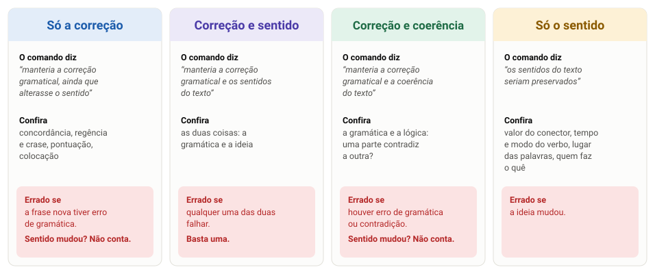

# Reescrita de frases e textos e adequação da linguagem

O edital pede "Reescrita e Produção Textual: 6.1 Reescrita de frases e textos. 6.2 Adequação da linguagem a diferentes contextos" (p. 28). Na prova, o item quase sempre tem esta cara:

> A substituição de "X" (linha 4) por "Y" manteria a correção gramatical e os sentidos do texto.

Reescrita não é um assunto novo: é o lugar onde a banca junta conectores, concordância, regência, crase e pontuação. Por isso esta aula é curta. Ela ensina **o método de julgar o item** e manda você às outras aulas para as regras.

> [!NOTE]
> No caderno de Assistente Administrativo do CAU/TO 2023, a Quadrix não fez item de reescrita (fez no de nível superior). Nas provas de nível médio da banca de 2020 a 2025, o molde acima aparece bastante. Vale saber o método; não vale decorar listas.

## O que é reescrever

Reescrever é dizer **a mesma coisa de outro jeito**: trocar uma palavra, mudar a ordem, passar da voz ativa para a passiva, juntar duas frases em uma. A pergunta da prova é sempre a mesma: depois da mudança, **a frase continua certa? Continua dizendo o mesmo?**

Veja uma frase e três reescritas:

> A comissão aprovou o relatório na sexta-feira.

1. *Na sexta-feira, a comissão aprovou o relatório.* Mudou a ordem; a gramática e o sentido continuam.
2. *O relatório foi aprovado pela comissão na sexta-feira.* Mudou a voz; a gramática e o sentido continuam.
3. *A comissão aprovaria o relatório na sexta-feira.* A gramática está certa, mas o sentido mudou: o que era fato virou hipótese.

## As três perguntas do comando

A banca não pergunta sempre a mesma coisa. Leia o comando com atenção, porque ele tem **três variantes**:

- **Só a correção.** O comando avisa que o sentido pode mudar ("ainda que haja alteração de sentido"). Aqui, a frase nova só precisa estar **gramaticalmente certa**. Se ficou com outro sentido, tudo bem.
- **Correção e sentido.** A frase nova precisa estar certa **e** dizer o mesmo. Basta uma das duas falhar para o item estar errado.
- **Só o sentido** (ou "a coerência"). A pergunta é se a **ideia** continua a mesma: a mesma relação entre as partes, o mesmo tempo, o mesmo responsável pela ação.

> [!IMPORTANT]
> Com "ainda que altere o sentido", uma reescrita que muda tudo pode estar **certa**. Com "e os sentidos", uma reescrita impecável na gramática pode estar **errada**.

"Sentido" e "coerência" estão perto, mas não são a mesma palavra: a coerência é o sentido do texto inteiro, sem contradição. Na prática, as duas pedem a mesma conferência: a ideia mudou ou não?

## Passo a passo para julgar o item

A turma deixa muitos itens em branco. Este roteiro serve para tirar a dúvida em menos de um minuto.

1. **Leia o comando primeiro.** Marque qual das três variantes ele usa.
2. **Monte a frase nova inteira.** Volte à linha, troque o trecho e leia o período completo com a mudança, em voz baixa. Não julgue só a palavra trocada.
3. **Teste a correção.** O verbo ainda concorda com o sujeito? A preposição que o verbo pede continua lá? A crase ainda cabe? A vírgula ficou no lugar? (As regras estão nas aulas de concordância, de regência e crase e de pontuação.)
4. **Teste o sentido.** A relação entre as ideias é a mesma (causa, oposição, condição)? O tempo do verbo mudou? Uma palavra como *só*, *já* ou *até* trocou de lugar? Quem faz a ação continua o mesmo?
5. **Decida pelo comando.** Só correção: vale o passo 3. Correção e sentido: os passos 3 e 4. Só sentido: o passo 4.

> [!TIP]
> Escreva a reescrita em cima do original, no rascunho. Ver as duas frases uma sobre a outra mostra na hora o que mudou.

## As trocas que a banca mais faz

Nos itens de nível médio da Quadrix, a reescrita repete os mesmos movimentos. Para cada um, o que conferir.

### Troca de conector

É uma das mais frequentes. *Porque* por *visto que*, *mas* por *contudo*, *embora* por *ainda que*. Dê nome à ideia de cada conector e compare. O valor de cada um está na aula de coesão, coerência e conectores; não repetimos a tabela aqui.

### Troca por sinônimo

A palavra nova precisa ter o mesmo sentido **naquele contexto**, não no dicionário em geral. Em *A reunião foi longa*, trocar *longa* por *extensa* mantém o sentido. Em *O candidato tem a ficha limpa*, trocar *limpa* por *higienizada* muda tudo: uma é ficha sem registros; a outra, papel lavado.

Cuidado também com o verbo que muda a regência: a palavra nova pode ter o mesmo sentido e pedir outra preposição. Aí a correção cai (veja a aula de regência e crase).

### Deslocamento de uma palavra

Mudar uma palavra de lugar pode mudar o sentido inteiro. Veja o *só*:

- ***Só** o fiscal assinou o termo.* Ninguém mais assinou.
- *O fiscal **só** assinou o termo.* Ele assinou e não fez mais nada (não leu, não conferiu).
- *O fiscal assinou **só** o termo.* Não assinou nenhum outro documento.

Já o adjunto adverbial (de tempo, de lugar, de modo) costuma poder ir para o começo da frase sem mudar o sentido, como em *Na sexta-feira, a comissão aprovou o relatório*. A vírgula que acompanha o deslocamento é assunto da aula de pontuação.

### Voz ativa e voz passiva

Na passagem da ativa para a passiva analítica:

- o **objeto direto** vira **sujeito**;
- o sujeito vira **agente da passiva** (com *por*, *pelo*, *pela*);
- entra o verbo **ser**, no **mesmo tempo e modo** do verbo original, mais o particípio.

*O setor **enviou** os boletos* → *Os boletos **foram enviados** pelo setor.* Os dois verbos estão no pretérito perfeito. Se a reescrita trouxer *eram enviados*, o tempo mudou (o fato concluído virou hábito), e o sentido também.

Só vai para a passiva o verbo que tem **objeto direto**. *Os profissionais gostaram do portal* não tem passiva ("O portal foi gostado" não existe), porque *gostar* pede a preposição *de*.

### Nominalização: verbo que vira substantivo

*Depois que a ata foi aprovada* pode virar *Depois da aprovação da ata*. O sentido se mantém, e a frase fica mais curta. O preço: às vezes some **quem** fez a ação.

Por isso o Manual de linguagem simples da Câmara recomenda, a quem escreve, o verbo no lugar do substantivo, a voz ativa e a ordem direta. Para a prova, basta saber que as duas formas podem dizer o mesmo.

### Paralelismo

Ideias do mesmo tipo, numa enumeração, pedem a **mesma forma**. Compare:

- *O setor pediu a revisão dos prazos e que o horário fosse ampliado.* Um substantivo e uma oração lado a lado: falta paralelismo.
- *O setor pediu a revisão dos prazos e a ampliação do horário.* Dois substantivos.
- *O setor pediu que os prazos fossem revistos e que o horário fosse ampliado.* Duas orações.

### Oração reduzida e oração desenvolvida

O gerúndio e o particípio escondem a relação entre as ideias, e a reescrita a deixa explícita. Confira se a relação escolhida é a do original:

- *O sistema saiu do ar, **atrasando** os boletos* → *…, **o que atrasou** os boletos*. Mantém: a queda causou o atraso.
- *O sistema saiu do ar, **atrasando** os boletos* → *…, **porque atrasou** os boletos*. Inverte: o atraso viraria a causa da queda.
- ***Terminada** a reunião, a ata foi lida* → ***Quando terminou** a reunião, …*. Mantém a ideia de tempo.

### Sujeito de verbo no infinitivo

Quando o infinitivo tem sujeito próprio, a norma-padrão não junta a preposição com o artigo desse sujeito: *antes **de o** prazo acabar*, e não "antes do prazo acabar" (Manual da Presidência, item 11.2). A Quadrix já usou essa troca.

### Vírgula que entra ou sai

Pôr ou tirar uma vírgula também é reescrita, e às vezes muda quem está incluído:

- *Os servidores que trabalham à tarde receberão o aviso.* Só os da tarde.
- *Os servidores, que trabalham à tarde, receberão o aviso.* Todos, e todos trabalham à tarde. As regras ficam na aula de pontuação.

## Reescrever para ficar claro

O 6.1 fala também em reescrever **textos**, não só frases. O Manual de Redação da Presidência dá o rumo: palavras simples, frases curtas, ordem direta, o mesmo tempo verbal do começo ao fim (item 3.1) e nenhuma palavra inútil (item 3.3, concisão). Exemplo nosso:

> Venho, por meio desta, informar a Vossa Senhoria que, conforme já informado anteriormente, o prazo final para a entrega dos documentos se encerra no dia 30.

> Informo que o prazo para a entrega dos documentos termina no dia 30.

A segunda versão diz o mesmo com metade das palavras: *já* e *anteriormente* repetiam a mesma ideia, e *prazo final* que *se encerra* também.

A outra meta é tirar a **ambiguidade** (item 11.6 do Manual), que costuma vir de um pronome com dois candidatos:

- *A diretora conversou com a assessora sobre o seu relatório.* De quem é o relatório?
- *A diretora conversou com a assessora sobre o relatório da assessora.* Resolvido.

Com o *que*, a saída é trocar por *o qual* ou *a qual*, que mostram gênero: em *Chegou a cópia do contrato que o setor pediu*, o setor pediu a cópia ou o contrato? *A cópia do contrato, a qual o setor pediu* responde.

> [!WARNING]
> Clareza não é o mesmo que formalidade. Uma frase pode ser formal e confusa, ou simples e perfeita para um documento oficial.

## Adequação: registro não é certo ou errado

O 6.2 trata de outra coisa: **escolher a linguagem conforme a situação**. Ninguém fala com a família como fala numa audiência, e as duas falas podem estar ótimas.

O caderno de variação linguística do Ceale e do MEC (seção 3.2) descreve o **registro** como uma escala com dois polos, o **formal** e o **informal**. O que puxa para um lado ou para o outro é a situação: a distância entre as pessoas, a "cerimônia" do momento e até o assunto. Colegas falam de um jeito na reunião sobre o trabalho e de outro quando o assunto vira futebol.

Dois pontos que a banca explora:

- **Registro não depende de ser fala ou escrita.** Um bilhete escrito pode ser bem informal; uma palestra falada pode ser bem formal. O Ceale diz isso com todas as letras.
- **Informal não é sinônimo de errado.** O registro informal é o adequado às situações sem cerimônia. O problema está em usá-lo onde a situação pede o formal, e vice-versa. Pedir "Vossa Senhoria me faria a gentileza de passar o arroz?" no almoço de domingo também é inadequado.

A BNCC vai na mesma linha: a escola deve ensinar a reconhecer as variedades da língua, combater o preconceito linguístico e usar a norma-padrão "em situações de fala e escrita nas quais ela deve ser usada" (habilidade EF69LP56).

## Adequação no trabalho

No serviço público, o contexto mais comum é a comunicação oficial. O Manual da Presidência pede o padrão culto nos expedientes (item 3.6), mas avisa que isso **não significa escrever de modo rebuscado** e que o jargão burocrático deve ser evitado. Coloquialismos também não cabem no texto oficial (item 12.2).

Para o **e-mail** profissional, o item 6.4.5 do Manual recomenda: nada de emoticons, nada de abreviações de conversa na internet ("vc", "pq"), nada de caixa alta para destacar.

Agora o mesmo aviso em três contextos (exemplos nossos):

- **No grupo de mensagens da equipe:** *Gente, amanhã de manhã o sistema sai do ar. Deixem os boletos pra tarde, tá?*
- **No e-mail a um profissional registrado:** *Prezado profissional, informamos que o sistema ficará indisponível amanhã, das 8h às 12h. Os boletos poderão ser emitidos a partir das 12h.*
- **No post do Conselho na rede social:** *Atenção! Amanhã de manhã o portal vai estar em manutenção. Deixe para emitir seu boleto à tarde.*

Os três estão adequados ao seu lugar. O primeiro no e-mail seria um problema; o segundo no grupo da equipe soaria frio, mas não errado. O Manual de Comunicação do Senado admite estilo informal na peça publicitária: o mesmo órgão usa registros diferentes conforme o gênero e o público.

> [!NOTE]
> Adequar também é pensar no leitor. O mesmo Manual do Senado troca o jargão técnico por palavras comuns quando o público é leigo. Termo técnico não é erro; só não serve para quem não o conhece.

## Como a banca cobra adequação

A Quadrix já juntou o 6.2 ao molde da reescrita: troca uma expressão típica da fala por uma equivalente formal e pergunta se a troca dá "mais formalidade" ao trecho. Exemplo nosso: *não deu pra concluir o relatório* → *não foi possível concluir o relatório*. Mesmo sentido, registro mais formal. Em outras provas, pediu para julgar se um trecho está adequado à correspondência oficial.

> [!CAUTION]
> Pela nossa leitura desses itens (sem os gabaritos), o erro costuma estar na **justificativa**, não na classificação. Desconfie de afirmações como "é formal porque é escrito", "segue a redação oficial porque foi escrito pela chefia" ou "a forma informal está incorreta".

## Pegadinhas no estilo da banca

- Comando com "ainda que altere o sentido" e item que acusa mudança de sentido como se fosse erro.
- Reescrita com o mesmo sentido e um erro escondido de concordância, regência ou crase, longe da palavra trocada.
- Passagem para a passiva com o verbo *ser* em outro tempo.
- *Só*, *já*, *até*, *apenas*, *ainda* mudados de lugar.
- Gerúndio reescrito com a relação errada (causa no lugar de consequência).
- Sinônimo de dicionário que não serve no contexto.
- Vírgula inserida que transforma uma restrição em explicação.
- Tratar o informal como "erro" ou o escrito como "formal" por natureza.

## Fontes

- Presidência da República, *Manual de Redação da Presidência da República*, 3ª ed. (2018): itens 3.1, clareza e precisão (p. 17-18); 3.3, concisão (p. 18-19); 3.6, formalidade e padronização (p. 20-21); 6.4.5, recomendações para o e-mail (p. 48); 11.1, ordem dos termos (p. 60-61); 11.2, sujeito preposicionado (p. 61-62); 11.4, paralelismo (p. 62-65); 11.6, ambiguidade (p. 65-66); 12.2, coloquialismos no texto oficial (p. 95). Cópia hospedada pela UFGD: https://files.ufgd.edu.br/arquivos/arquivos/78/PROTOCOLO/Normas%20Internas/Manual%20de%20Reda%C3%A7%C3%A3o%20da%20Presid%C3%AAncia%20da%20Rep%C3%BAblica%20-%203%C2%AA%20edi%C3%A7%C3%A3o,%20revista,%20atualizada%20e%20ampliada.pdf
- Câmara dos Deputados, *Manual de linguagem simples* (Edições Câmara, 2024), parte "Desenvolver": "Prefira a voz ativa", "Prefira a ordem direta" e "Evite substantivar verbos" (p. 56, 57 e 60 do PDF): https://bd.camara.leg.br/bd/bitstreams/e0d3210c-4891-40cc-9e1f-84f4e941a7c7/download
- Maria Geralda Teixeira Bevilaqua (NEAD/STJ), "EaDicas de Português, Dica 12 — Paralelismo sintático e semântico I" (2014): https://ead.stj.jus.br/pluginfile.php/105436/mod_resource/content/11/assets/files/2dica-12.pdf
- Luiz Felipe Durval (Estratégia Concursos), "Reescritura de frases: desvendando questões CEBRASPE" (2021), sobre os critérios de correção, sentido e coerência: https://concursos.estrategia.com/portal/reescritura-de-frases-desvendando-questoes-cebraspe/
- Décio Terror Filho (Estratégia Concursos), "Um assunto certo de cair na prova do STJ: Reescrita de texto" (2015), sobre a transposição para a passiva: https://www.estrategiaconcursos.com.br/blog/um-assunto-certo-de-vai-cair-na-prova-do-stj-reescrita-de-texto/
- Ceale/FaE-UFMG e Ministério da Educação, *Variação lingüística e ensino: caderno do professor* (2006), seção 3.2, "A variação de registro" (p. 38-39): https://cake.ceale.fae.ufmg.br/files/uploads/Col.%20Alfabetiza%C3%A7%C3%A3o%20e%20Letramento/Col%20Alf.Let.%2015%20Variacao_Linguistica.pdf
- Ministério da Educação, *Base Nacional Comum Curricular*, habilidades EF69LP55 e EF69LP56 (p. 163 do PDF) e EM13LP10 (p. 510 do PDF): https://basenacionalcomum.mec.gov.br/images/BNCC_EI_EF_110518_versaofinal_site.pdf
- Senado Federal, Manual de Comunicação da Secom, verbetes "Jargão legislativo" e "Linguagem publicitária": https://www12.senado.leg.br/manualdecomunicacao/estilos/jargao-legislativo e https://www12.senado.leg.br/manualdecomunicacao/estilos/linguagem-publicitaria
- Márcia Fernandes (Toda Matéria), "Vozes verbais": https://www.todamateria.com.br/vozes-verbais/ (a condição para a passiva é ter objeto direto, e não só ser transitivo).
- Modelo dos itens: questões do Instituto Quadrix de 2020 a 2025 no assunto "Redação - Reescritura de texto" do Estude Grátis, usadas só como referência de estilo: https://www.estudegratis.com.br/questoes-de-concurso/materia/portugues/assunto/redacao-reescritura-de-texto
