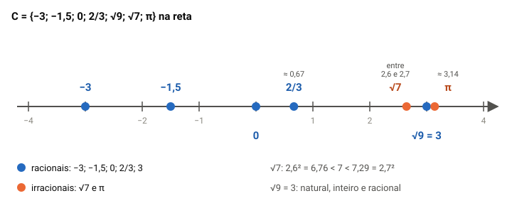

# Operações com conjuntos numéricos

> Edital (Conhecimentos Básicos, Matemática, item 1.1, p. 28): "1 Matemática Básica: 1.1 Operações com conjuntos numéricos."

## Por que este tópico importa

O item 1.1 é a base de toda a matemática da prova: saber **de que tipo é cada número** (natural, inteiro, racional, irracional, real) e **fazer contas com eles sem calculadora**, que o edital proíbe.

Na Quadrix, o molde mais comum é este: o comando dá um conjunto pequeno, com cinco a sete números de tipos misturados, e os itens perguntam o que sobra quando ele é cruzado com N, Z ou Q. Também caem itens soltos sobre propriedades ("a soma de dois irracionais é irracional?"), dízimas, ordem das operações e MMC e MDC.

A boa notícia: são itens de resposta exata. Com uma tabela na cabeça e um método para cada conta, dá para marcar com segurança. Esta aula vai do conjunto menor ao maior e, no fim, mostra como julgar o item.

## Naturais e inteiros

Os **números naturais** são os de contar: **N = {0, 1, 2, 3, ...}**. Sem o zero, escreve-se **N\* = {1, 2, 3, ...}**: o asterisco sempre quer dizer "tirando o zero".

> [!NOTE]
> Pôr o 0 nos naturais é uma **convenção**, e não uma verdade da matemática. Alguns livros, inclusive o material da OBMEP do 9º ano, começam N pelo 1. Nesta aula, seguimos a convenção que a Quadrix usa nos itens: o 0 é natural, e N\* é o conjunto sem ele.

Os **números inteiros** juntam os naturais e os negativos: **Z = {..., −3, −2, −1, 0, 1, 2, 3, ...}**. Os símbolos que aparecem nos itens:

- **Z\*** = inteiros sem o zero;
- **Z+** = inteiros não negativos = {0, 1, 2, ...}, o mesmo que N;
- **Z−** = inteiros não positivos = {..., −2, −1, 0}. O zero está em Z+ e em Z−.

**Comparar negativos.** Na reta, quem está mais à direita é maior. Por isso **−4 é maior que −7**, embora 7 seja maior que 4. Pense em dívida: dever 4 é melhor que dever 7.

## Por que precisamos de conjuntos maiores

Uma operação é **fechada** num conjunto quando, operando dois elementos dele, o resultado ainda está nele. Somar dois naturais dá um natural: a adição é fechada em N. Já 3 − 5 = −2 não é natural: **a subtração não é fechada em N**.

Para a subtração sempre dar certo, ampliamos N até Z. Em Z, somar, subtrair e multiplicar sempre dá inteiro. Mas 7 ÷ 2 = 3,5 não é inteiro: **a divisão não é fechada em Z**. Para ela, precisamos dos racionais.

A ideia que fica: cada conjunto novo **contém o anterior** e resolve uma conta que o anterior não resolvia.

## Racionais: as frações

Um número é **racional** quando pode ser escrito como uma fração de inteiros, com denominador diferente de zero: **Q = {*a*/*b* : *a* e *b* inteiros, *b* ≠ 0}**.

São racionais:

- **todo inteiro**, porque −5 = −5/1 e 0 = 0/1;
- **todo decimal finito**: 0,75 = 75/100 = 3/4; −1,2 = −12/10 = −6/5;
- **toda dízima periódica**: 0,333... = 1/3.

O que define o racional é **poder ser escrito** como fração de inteiros, e não a aparência. O número 6/3 está em forma de fração, mas é o inteiro 2; e 0,333... tem infinitas casas, mas é 1/3.

Em Q, as quatro operações são fechadas (a divisão, com divisor diferente de zero). Duas regras de frações que caem:

- **somar** pede denominador comum: 1/2 + 1/3 = 3/6 + 2/6 = **5/6**, e não 2/5;
- **dividir** é multiplicar pelo inverso: (3/4) ÷ (1/2) = (3/4) × 2 = **3/2**.

> [!WARNING]
> Somar numerador com numerador e denominador com denominador é o erro que a banca espera: *a*/*b* + *c*/*d* não é (*a* + *c*)/(*b* + *d*).

## Dízimas e fração geratriz

Ao dividir um inteiro por outro, ou a conta acaba (7/8 = 0,875), ou os algarismos passam a se repetir para sempre (1/3 = 0,333...). Esse bloco que se repete é o **período**. Por isso **toda dízima periódica é racional**, e a fração que a gera é a **fração geratriz**.

**Dízima simples** (o período começa logo depois da vírgula). Seja *x* = 0,454545... Multiplique por 100, porque o período tem dois algarismos:

- 100*x* = 45,4545...
- 100*x* − *x* = 45, então 99*x* = 45 e *x* = 45/99 = **5/11**.

**Dízima composta** (há algarismos antes do período). Seja *x* = 0,2777... Leve a vírgula para antes do período e depois para o fim do primeiro período:

- 10*x* = 2,777... e 100*x* = 27,777...
- 100*x* − 10*x* = 25, então 90*x* = 25 e *x* = 25/90 = **5/18**.

A **regra prática** resume as contas: no numerador, o número até o fim do primeiro período menos a parte que não se repete; no denominador, **um 9 para cada algarismo do período e um 0 para cada algarismo que não se repete** depois da vírgula. Em 0,2777...: (27 − 2)/90 = 25/90.

> [!TIP]
> Confira a geratriz dividindo de volta: 5 ÷ 18 = 0,2777... Sem calculadora, a conta armada leva um minuto e evita marcar errado um denominador.

Uma curiosidade que já virou item: **0,999... = 1**. Pela mesma conta, 10*x* − *x* = 9,999... − 0,999... = 9, e *x* = 1. Não é "quase 1": é 1.

## Irracionais e reais

Há números que **não podem** ser escritos como fração de inteiros: são os **irracionais** (I). A expansão decimal deles é **infinita e não periódica**. Exemplos:

- **√2, √3, √7, √10**: a raiz quadrada de um natural que **não é quadrado perfeito** é irracional. Já √9 = 3 e √0,49 = 0,7 são racionais;
- **π** = 3,14159..., que não se repete. **3,14 e 22/7 são aproximações de π**, e não o próprio π.

Os **reais** (R) são todos os números da reta: os racionais e os irracionais juntos. A figura mostra como os conjuntos se encaixam.

Três fatos saem da figura:

- **N ⊂ Z ⊂ Q ⊂ R**: todo natural é inteiro, todo inteiro é racional, todo racional é real;
- **Q ∩ I = ∅**: nenhum número é racional e irracional ao mesmo tempo;
- **Q ∪ I = R**: todo real é racional ou irracional. Por isso **I = R − Q**.

> [!IMPORTANT]
> I **não** está dentro de Q, nem Q dentro de I: são as duas metades separadas de R. O que está dentro de Q é Z, e dentro de Z, N.

## Estimar raízes sem calculadora

O item pode dizer "√20 é maior que 4,5". Para julgar, **compare quadrados**:

1. ache os quadrados perfeitos vizinhos: 4² = 16 < 20 < 25 = 5². Então √20 fica entre 4 e 5;
2. refine com uma casa: 4,4² = 19,36 e 4,5² = 20,25. Como 19,36 < 20 < 20,25, **√20 fica entre 4,4 e 4,5**.

O item está errado: √20 é menor que 4,5.

Duas regras de radicais que derrubam muita gente:

- **√36 = 6**, e não ±6. A raiz quadrada de um número positivo é positiva. Já a equação *x*² = 36 tem duas soluções, 6 e −6;
- **a raiz não se distribui na soma**: √(9 + 16) = √25 = 5, e não √9 + √16 = 7. No produto, pode: √(4 × 9) = √4 × √9 = 6.

## Operações com irracionais: a pegadinha

Em Q, as quatro operações são fechadas. **Em I, nenhuma é.** Somar ou multiplicar dois irracionais pode dar um racional:

- √2 + (−√2) = 0, racional;
- √2 × √2 = 2, racional;
- √2 × √8 = √16 = 4, racional;
- √2 ÷ √2 = 1, racional.

Por outro lado, há duas regras que **valem sempre**:

- **racional + irracional = irracional**: 3 + √2 é irracional;
- **racional diferente de zero × irracional = irracional**: 5√2 é irracional. Com o zero, não: 0 × √2 = 0.

| Operação | N | Z | Q | R | I |
|---|---|---|---|---|---|
| Adição | fechada | fechada | fechada | fechada | não |
| Subtração | não | fechada | fechada | fechada | não |
| Multiplicação | fechada | fechada | fechada | fechada | não |
| Divisão (divisor ≠ 0) | não | não | fechada | fechada | não |

> [!CAUTION]
> "A soma de dois números irracionais é sempre irracional" está **errado**: basta um contraexemplo, como √2 + (−√2) = 0. Em item com "sempre", "nunca" ou "todo", procure o contraexemplo.

## Pertinência e inclusão

Antes das operações, os dois símbolos que a banca troca:

- **∈ (pertence)** liga um **elemento** a um conjunto: 3 ∈ N; −2 ∉ N; √2 ∈ I;
- **⊂ (está contido)** liga um **conjunto** a outro: N ⊂ Z; {3} ⊂ N; Q ⊄ I.

"N ∈ Z" está errado (N não é um elemento de Z; é uma parte dele), e "3 ⊂ N" também (3 é elemento, não conjunto). O certo é **N ⊂ Z** e **3 ∈ N**.

## Operações entre os conjuntos numéricos

As quatro operações entre conjuntos são:

- **união** (A ∪ B): o que está em A **ou** em B;
- **interseção** (A ∩ B): o que está em A **e** em B;
- **diferença** (A − B): o que está em A **e não** está em B;
- **complementar de B em relação a A**: A − B, quando B está dentro de A.

Com os conjuntos encaixados, a regra é simples. Se um conjunto está dentro do outro, a **união é o maior**, e a **interseção é o menor**:

| Operação | Resultado | Por quê |
|---|---|---|
| N ∪ Z | Z | N está dentro de Z |
| N ∩ Z | N | idem |
| Z ∩ Q | Z | todo inteiro é racional; **não é vazio** |
| Z − N | {..., −3, −2, −1} | os inteiros negativos (o 0 é natural) |
| Q − Z | racionais não inteiros | 1/2, −0,75, 0,333... |
| R − Q | I | o complementar de Q em R |
| Q ∩ I | ∅ | não há número nas duas |
| N\* ∪ {0} | N | devolve o zero |

A diferença **depende da convenção de N**. Com o 0 em N, Z − N só tem negativos; se o 0 ficasse fora de N, ele estaria em Z − N. Por isso a aula fixa uma convenção: a da banca.

> [!WARNING]
> A interseção de dois conjuntos encaixados **nunca é vazia**: é o menor deles. "Z ∩ Q = ∅" está errado; vazia é Q ∩ I, porque Q e I não se tocam.

## O molde da banca: um conjunto dado

O comando costuma dar um conjunto finito e pedir operações com N, Z e Q. Veja um exemplo nosso (os elementos vão separados por **ponto e vírgula**, porque a vírgula já é a dos decimais):

**C = {−3; −1,5; 0; 2/3; √9; √7; π}**

**Primeiro passo: classifique cada elemento**, e simplifique o que puder. √9 = 3 é natural; √7 é irracional (7 não é quadrado perfeito); π é irracional.

| Elemento | N | Z | Q | I |
|---|---|---|---|---|
| −3 | | ✓ | ✓ | |
| −1,5 | | | ✓ | |
| 0 | ✓ | ✓ | ✓ | |
| 2/3 | | | ✓ | |
| √9 = 3 | ✓ | ✓ | ✓ | |
| √7 | | | | ✓ |
| π | | | | ✓ |

**Segundo passo: leia as operações na tabela.**

- C ∩ N = {0; 3}, com **2 elementos** (quem esquece o 0 ou não simplifica √9 erra);
- C ∩ Z = {−3; 0; 3};
- C ∩ Q = {−3; −1,5; 0; 2/3; 3}, com 5 elementos;
- C − Q = C ∩ I = {√7; π};
- (C ∩ Z) − N = {−3}, um conjunto **unitário**.

## Ordem das operações e contas à mão

Nas expressões, a ordem é:

1. **parênteses**, depois **colchetes**, depois **chaves**, de dentro para fora;
2. **potências e raízes**;
3. **multiplicações e divisões, da esquerda para a direita**, na ordem em que aparecem;
4. **adições e subtrações**, também da esquerda para a direita.

**Exemplo.** 20 − 4 × 3 + 6 ÷ 2 = 20 − 12 + 3 = **11**. E 8 ÷ 2 × 4 = 4 × 4 = **16**, e não 8 ÷ 8 = 1: a divisão veio primeiro, então é feita primeiro.

Três cuidados com sinais e potências:

- **−2² = −4**, porque a potência vale só para o 2; **(−2)² = 4**;
- **2³ × 2⁴ = 2⁷**: na multiplicação de mesma base, somam-se os expoentes; e **qualquer número diferente de zero elevado a 0 dá 1**;
- **decimais**: 0,2 × 0,3 = 0,06 (duas casas no total); 1,5 ÷ 0,03 = 150 ÷ 3 = 50 (multiplique os dois por 100 para tirar a vírgula do divisor).

## MMC e MDC: qual usar

O **MDC** (máximo divisor comum) é o **maior** número que divide os dois. O **MMC** (mínimo múltiplo comum) é o **menor** número, diferente de zero, que é múltiplo dos dois. Os dois saem da fatoração em primos:

- 18 = 2 × 3² e 24 = 2³ × 3;
- **MDC**: os primos comuns, com o **menor** expoente: 2 × 3 = **6**;
- **MMC**: todos os primos, com o **maior** expoente: 2³ × 3² = **72**.

Para conferir: com dois números, MDC × MMC = produto deles (6 × 72 = 432 = 18 × 24).

**Qual usar no problema:**

- **dividir em grupos iguais, do maior tamanho possível, sem sobrar** → **MDC**. Com 18 pastas azuis e 24 verdes, em grupos iguais e sem misturar cores, o maior grupo tem 6 pastas: são 3 grupos azuis e 4 verdes, 7 ao todo;
- **coisas que se repetem e voltam a coincidir** → **MMC**. Um relatório sai a cada 6 dias e outro a cada 8; se saíram juntos hoje, voltam a sair juntos em MMC(6, 8) = **24 dias**.

> [!TIP]
> Pergunta de controle: a resposta tem de ser **menor** que os números dados (o tamanho de um pedaço)? MDC. Tem de ser **maior** (um momento em que tudo coincide)? MMC.

## Como julgar o item, passo a passo

1. **Fixe a convenção**: N tem o 0; o asterisco tira o 0.
2. **Simplifique cada número** antes de classificar: √9, 6/3, √0,49, 0,999...
3. **Classifique** cada elemento numa tabela: N, Z, Q ou I.
4. **Leia a operação** com cuidado: "e" é interseção; "ou" é união; "menos" e "complementar" são diferença.
5. **Conte e confira** os elementos, um por um, e compare com o número do item.
6. Em afirmações gerais ("sempre", "todo", "nunca"), **procure um contraexemplo**. Se achar um, o item está errado.
7. **Marque**: C se tudo bate; E se qualquer parte não bate.

> [!IMPORTANT]
> Em branco vale zero, e o erro tira um ponto. Item de classificação bem feito, com a tabela, é ponto seguro: vale a pena fazê-lo com calma.

## Pegadinhas da Quadrix

- **Esquecer o 0** em N, em Z ou na contagem de elementos.
- **Não simplificar a raiz**: √9, √16, √0,49 são racionais.
- **Chamar a dízima periódica de irracional**: 0,333... e 0,2777... são racionais.
- **Tomar 3,14 ou 22/7 por π**: são aproximações racionais.
- **"Z ∩ Q é vazio"**: é Z. Vazia é Q ∩ I.
- **"A soma (ou o produto) de dois irracionais é irracional"**: nem sempre.
- **Trocar ∈ por ⊂**: elemento pertence; conjunto está contido.
- **Distribuir a raiz na soma**: √(9 + 16) é 5, e não 7.
- **Fazer a multiplicação antes da divisão** que vem antes dela: 8 ÷ 2 × 4 é 16.
- **Trocar MMC por MDC** no problema de grupos ou de coincidência.

## Fontes

- Francisco Bruno Holanda e Antônio Caminha Muniz Neto. *Conjuntos Numéricos, Parte 01* (Material Teórico, Módulo de Conjuntos, 9º ano). Portal da Matemática OBMEP/IMPA, 14/12/2019. https://cdnportaldaobmep.impa.br/portaldaobmep/uploads/material_teorico/cbgmun536g5k.pdf
- Francisco Bruno Holanda e Antônio Caminha Muniz Neto. *Conjuntos Numéricos, Parte 02* (Material Teórico, Módulo de Conjuntos, 9º ano). Portal da Matemática OBMEP/IMPA, 12/01/2020. https://cdnportaldaobmep.impa.br/portaldaobmep/uploads/material_teorico/h2930ro8968s0.pdf
- Francisco Bruno Holanda e Antônio Caminha Muniz Neto. *Conjuntos Numéricos, Parte 03* (Material Teórico, Módulo de Conjuntos, 9º ano). Portal da Matemática OBMEP/IMPA, 15/02/2020. https://cdnportaldaobmep.impa.br/portaldaobmep/uploads/material_teorico/1soit63r3q6g.pdf
- Angelo Papa Neto e Antonio Caminha M. Neto. *Números Irracionais e Reais* (Material Teórico, Módulo de Potenciação e Dízimas Periódicas, 8º ano). Portal da Matemática OBMEP/IMPA. https://cdnportaldaobmep.impa.br/portaldaobmep/uploads/material_teorico/66fugp2pn6o0o.pdf
- Angelo Papa Neto e Antonio Caminha M. Neto. *Números Inteiros e Operações* (Material Teórico, Números Inteiros e Números Racionais, 7º ano). Portal da Matemática OBMEP/IMPA. https://cdnportaldaobmep.impa.br/portaldaobmep/uploads/material_teorico/dhbnix4htds0s.pdf
- Angelo Papa Neto e Antonio Caminha M. Neto. *MDC e MMC*, Partes 1 e 2 (Material Teórico, Módulo de Divisibilidade, 6º ano). Portal da Matemática OBMEP/IMPA. https://cdnportaldaobmep.impa.br/portaldaobmep/uploads/material_teorico/8ex39lt2qn8kw.pdf e https://cdnportaldaobmep.impa.br/portaldaobmep/uploads/material_teorico/543nomntcq4o0.pdf
- Ulisses Lima Parente e Antonio Caminha M. Neto. *Potências com Expoente Inteiro, Parte 1* (Material Teórico, Módulo de Potenciação, 8º ano). Portal da Matemática OBMEP/IMPA, versão de 04/09/2026. https://cdnportaldaobmep.impa.br/portaldaobmep/uploads/material_teorico/44xcin5v2pyco.pdf
- REAMAT/UFRGS. *Pré-cálculo — Um Livro Colaborativo*, 2.3 Conjunto dos Números Racionais (CC BY-SA 3.0), com as seções 2.1 e 2.2. https://www.ufrgs.br/reamat/PreCalculo/livro/cn-conjunto_dos_nx00fameros_racionais.html

Vêm do material da OBMEP: a operação fechada e a passagem de N para Z pela subtração (*Parte 01*, p. 1 e 2); a definição de Q, a soma de frações e o alerta de que *a*/*b* + *c*/*d* não é (*a* + *c*)/(*b* + *d*), o fechamento de Q e a fração geratriz pela subtração de múltiplos de *x* (*Parte 02*, p. 1 a 4); I = R − Q, o diagrama dos conjuntos encaixados, Z+ = R+ ∩ Z e as operações de união, interseção e diferença aplicadas a subconjuntos de R (*Parte 03*, p. 1 a 3); a raiz de um número que não é potência perfeita como irracional e a estimativa de raízes pela comparação de quadrados (*Números Irracionais e Reais*); a reta e a comparação de inteiros (*Números Inteiros e Operações*); o MMC e o MDC pela fatoração (*MDC e MMC*); e as propriedades das potências (*Potências com Expoente Inteiro*). O material da OBMEP do 9º ano usa N sem o zero; a convenção com o zero, e N\* sem ele, está no REAMAT (2.1), que confirma também a definição de Q (2.3).

São nossos, conferidos à mão: todos os exemplos numéricos, o conjunto C e a sua tabela, a tabela das operações entre N, Z, Q, I e R (nenhuma fonte aberta encontrada trata dessas operações entre os conjuntos numéricos, que a banca cobra), a tabela de fechamento, as regras sobre soma e produto de irracionais (as fontes lidas não as discutem), o quadro de quando usar MMC ou MDC, o passo a passo e a lista de pegadinhas, tirada do molde dos itens da Quadrix em provas de outros conselhos (um conjunto finito dado, cruzado com N, Z e Q). A prova de 2023 do cargo no CAU/TO não teve itens deste tópico.
