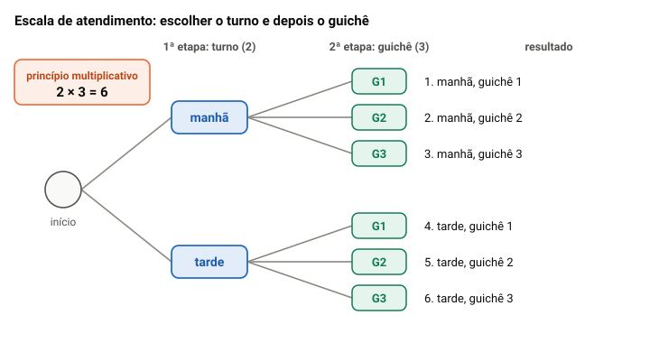

# Contagem e probabilidade

> Edital (Conhecimentos Básicos, Matemática, item 2, p. 28): "Análise Combinatória e Probabilidade: 2.1 Princípios de contagem (arranjos, combinações, permutações). 2.2 Noções de probabilidade."

## Por que este tópico importa

Contar é responder **"de quantas maneiras isso pode acontecer?"** sem escrever todas as maneiras. Probabilidade usa essa contagem para dizer **qual a chance** de um resultado.

Na Quadrix, o tema vem como nas outras partes de matemática: uma **situação hipotética curta** (servidores, comissões, senhas, letras de uma palavra) e três itens de certo ou errado. Na prova de 2023 do cargo no CAU/TO, foram três itens de combinatória.

O erro mais comum de quem começa é usar a conta de **arranjo** quando o problema é de **combinação**, e o contrário. Esta aula dá peso a essa diferença, com um teste simples. A prova não permite calculadora: todas as contas daqui se fazem à mão, simplificando antes de multiplicar.

## Princípio multiplicativo: etapas em sequência

Quando uma escolha é feita em **etapas** e cada etapa tem sempre o mesmo número de opções, o total é o **produto** das opções de cada etapa.

**Exemplo.** Um servidor vai ser escalado para o atendimento: primeiro escolhe-se o turno (manhã ou tarde) e depois o guichê (1, 2 ou 3). São 2 × 3 = **6** escalas possíveis.

A árvore mostra por que se multiplica: cada um dos 2 turnos abre 3 galhos. Com 4 etapas, a árvore fica grande demais para desenhar, mas a conta continua a mesma.

> [!TIP]
> Comece pela etapa que tem **restrição**. Para formar números de 3 algarismos que terminem em 5, com os algarismos 1 a 5 sem repetir, escolha primeiro o último (1 opção), depois o primeiro (4) e o do meio (3): 1 × 4 × 3 = 12.

## Princípio aditivo: casos que não acontecem juntos

Quando o problema se divide em **casos separados**, que não podem acontecer ao mesmo tempo, conta-se cada caso e **somam-se** os resultados.

**Exemplo.** Um servidor vai a Araguaína a serviço. Pode ir de ônibus, em um de 3 horários, ou de carro oficial, escolhendo um de 2 veículos e um de 2 motoristas. De ônibus, são 3 opções; de carro, 2 × 2 = 4. No total, 3 + 4 = **7** maneiras de ir.

A regra prática:

- **"e depois"** (uma etapa e a outra, em sequência) → **multiplica**;
- **"ou"** entre casos que se excluem (ônibus ou carro, nunca os dois) → **soma**.

Não se multiplica 3 × 4: ninguém vai de ônibus *e* de carro na mesma viagem.

## Fatorial: a conta que se simplifica

O **fatorial** de um número *n*, escrito *n*!, é o produto de *n* por todos os inteiros positivos menores que ele:

- 3! = 3 × 2 × 1 = 6;
- 4! = 4 × 3 × 2 × 1 = 24;
- 5! = 120 e 6! = 720;
- por convenção, 0! = 1.

O fatorial cresce rápido, mas **quase sempre se cancela**. Como 9! = 9 × 8 × 7!, a divisão 9!/7! vira só 9 × 8 = **72**. E 9!/(7! × 2!) = (9 × 8)/2 = **36**.

> [!TIP]
> Sem calculadora, nunca calcule o fatorial inteiro. Escreva o maior como produto até chegar ao menor, corte o que se repete e só então multiplique.

## Permutação: todos em fila

**Permutar** é pôr em ordem **todos** os elementos de um grupo. Com *n* elementos diferentes, há *n*! ordens possíveis.

**Exemplo.** Cinco processos serão analisados um depois do outro. Para o primeiro lugar da fila, há 5 opções; para o segundo, sobram 4; depois 3, 2 e 1. São 5! = **120** ordens de análise.

Com uma restrição, fixe primeiro o que está preso. Se um dos processos, urgente, tem de ser o primeiro, sobram 4 para ordenar: 4! = **24** ordens.

## Permutação com repetição: anagramas

Um **anagrama** é qualquer ordem das letras de uma palavra, com sentido ou não. Se todas as letras forem diferentes, é uma permutação simples; se alguma se repete, a conta muda. Veja os dois casos:

- **CASTRO** (6 letras diferentes): 6! = 720 anagramas;
- **PALMAS** (6 letras, com o A duas vezes): 6!/2! = 720/2 = **360** anagramas.

Por que dividir por 2!? Se os dois A fossem diferentes (A₁ e A₂), haveria 720 ordens. Mas trocar A₁ com A₂ não muda a palavra: cada anagrama foi contado 2 vezes.

A regra: divida *n*! pelo fatorial de **cada** letra repetida. Em ARARA (5 letras: três A e dois R), são 5!/(3! × 2!) = 120/12 = **10** anagramas.

> [!WARNING]
> O erro esperado é esquecer a divisão. A banca põe no item o número sem divisão (720 para PALMAS) ou divide uma vez só quando há duas letras repetidas.

## Arranjo: escolher e dar função

Agora nem todos são usados: escolhem-se **alguns** de um grupo. A pergunta que decide tudo é se **a ordem da escolha importa**.

No **arranjo**, ela importa: cada escolhido recebe um **lugar ou uma função diferente**.

**Exemplo.** Entre 6 servidores, serão escolhidos um presidente e um secretário para uma comissão. Para presidente, há 6 opções; escolhido o presidente, sobram 5 para secretário. São 6 × 5 = **30** maneiras.

"Ana presidente e Bruno secretário" é diferente de "Bruno presidente e Ana secretária". As duas ordens contam.

A conta do arranjo de *n* elementos tomados *r* a *r* é o produto de *r* números, começando em *n* e descendo de um em um. Com 6 servidores e 3 cargos (presidente, vice e secretário): 6 × 5 × 4 = **120**. Em fórmula: A(*n*, *r*) = *n*!/(*n* − *r*)!.

## Combinação: escolher sem função

Na **combinação**, a ordem **não** importa: só interessa **quem** foi escolhido. É o caso de comissão sem cargos, grupo, equipe, dupla.

**Exemplo.** Entre os mesmos 6 servidores, serão escolhidos 2 para uma comissão, sem cargos. O arranjo dá 6 × 5 = 30, mas aqui "Ana e Bruno" e "Bruno e Ana" são **a mesma comissão**: cada dupla foi contada 2 vezes. São 30/2 = **15** comissões.

Com 3 membros, cada comissão aparece em 3! = 6 ordens diferentes dentro do arranjo. Então, de 6 servidores, saem 120/6 = **20** comissões de 3.

A regra geral: **combinação = arranjo ÷ *r*!**, em que *r* é o número de escolhidos. Em fórmula: C(*n*, *r*) = A(*n*, *r*)/*r*! = *n*!/(*r*! × (*n* − *r*)!).

> [!IMPORTANT]
> Arranjo: a ordem importa (cargos, posições, senha). Combinação: a ordem não importa (comissão, grupo). A combinação é o arranjo **dividido por *r*!**, o número de ordens de cada grupo.

## O teste: trocar a ordem muda o resultado?

Palavras como "escolher", "formar" ou "selecionar" aparecem nos dois casos. Não decida pela palavra: **faça o teste**.

1. Monte um resultado concreto, com nomes: Ana, Bruno e Carla.
2. Troque a ordem: Bruno, Ana e Carla.
3. Pergunte: **virou outro resultado?** Se sim, é arranjo. Se continua o mesmo, é combinação.

![Quadro com dois painéis, 8 servidores e 3 escolhidos. À esquerda, com cargos de presidente, vice e secretário: Ana, Bruno, Carla é diferente de Bruno, Ana, Carla; cada ordem é outra diretoria; arranjo, 8 vezes 7 vezes 6 igual a 336. À direita, comissão de 3 membros sem cargos: as 6 ordens de Ana, Bruno e Carla são a mesma comissão; combinação, 336 dividido por 6 igual a 56; divide-se por 3 fatorial, que é 6, e não por 3. Embaixo, o teste: monte um resultado, troque a ordem e veja se virou outro. Virou outro, como em cargos, senha, fila, primeiro e segundo lugar: arranjo. Continua o mesmo, como em comissão, grupo, equipe, dupla: combinação.](imagens/a-ordem-importa.svg "O mesmo grupo de 3 aparece 6 vezes no arranjo")

**Exemplo em que o arranjo parece certo.** De 8 servidores, quer-se formar uma comissão de 3. A conta que vem à cabeça é 8 × 7 × 6 = 336. Parece certa, mas não é: ela conta {Ana, Bruno, Carla} seis vezes, uma para cada ordem. O resultado certo é 336/6 = **56**.

Outros pares para treinar o teste:

- **Senha × grupo de algarismos.** Senha de 3 algarismos diferentes, escolhidos de 1 a 6: 123 e 321 abrem cofres diferentes, então é arranjo, 6 × 5 × 4 = **120**. Já escolher 3 desses algarismos para um sorteio é combinação: 120/6 = **20**.
- **Partidas entre setores.** Sete setores vão jogar um torneio em que cada setor enfrenta cada outro uma vez. "Setor A contra B" é a mesma partida que "B contra A": 7 × 6/2 = **21** partidas, e não 42.
- **Cargo para alguns, os outros sem função.** De 8 servidores, uma comissão de 4 com 1 coordenador e 3 membros comuns. Escolha o coordenador (8 opções) e depois o grupo de 3 entre os 7 restantes: C(7, 3) = 210/6 = 35. Total: 8 × 35 = **280**.

> [!CAUTION]
> A palavra "ordem" no enunciado não obriga a usar arranjo. Se os 3 escolhidos "serão listados na portaria em ordem alfabética", a ordem já vem decidida pelos nomes, e quem decide é só o grupo: combinação.

## Combinações sem calculadora

Três atalhos para fazer a conta à mão:

1. **Corte antes de multiplicar.** C(9, 3) = (9 × 8 × 7)/(3 × 2 × 1). O 6 de baixo divide o 9 × 8 = 72, que vira 12; 12 × 7 = **84**.
2. **Escolher quem entra é o mesmo que escolher quem fica de fora.** C(10, 8) = C(10, 2), porque cada grupo de 8 deixa 2 de fora: (10 × 9)/2 = **45**. Use sempre o menor dos dois números.
3. **Confira a ordem de grandeza.** A combinação é sempre menor que o arranjo de mesmo *n* e *r* (quando *r* é 2 ou mais). Se a sua combinação deu maior, algo foi multiplicado em vez de dividido.

Depois da conta, leia o número do item **algarismo por algarismo**. C(12, 4) = (12 × 11 × 10 × 9)/24 = **495**. A banca gosta de escrever 459 ou 549 no item: o candidato que faz a conta certa e lê o item depressa marca errado.

## Restrições: "exatamente", "pelo menos" e "ou"

Um setor tem 9 servidores: 5 arquitetos e 4 administradores. Será formada uma comissão de 3, sem cargos. O total é C(9, 3) = **84**.

- **Exatamente 1 arquiteto:** escolha o arquiteto (5) e os outros 2 entre os administradores, C(4, 2) = 6. São 5 × 6 = **30**.
- **Nenhum arquiteto:** os 3 entre os 4 administradores, C(4, 3) = **4**.
- **Pelo menos 1 arquiteto:** é mais fácil tirar do total o que não serve: 84 − 4 = **80**.

O erro clássico em "pelo menos 1" é escolher "um arquiteto garantido" (5) e completar com 2 quaisquer dos 8 restantes, C(8, 2) = 28: 5 × 28 = 140. O resultado passa do total de 84, o que já denuncia o erro. A comissão {Ana, Bia, Caio}, com três arquitetos, foi contada três vezes, uma para cada "arquiteto garantido".

O **"ou"** da matemática é inclusivo: "Ana ou Bruno na comissão" inclui o caso dos dois juntos. Entre os mesmos 9, as comissões com:

- os dois: Ana e Bruno mais 1 dos outros 7 = **7**;
- exatamente um deles: 2 × C(7, 2) = 2 × 21 = **42**;
- Ana ou Bruno (pelo menos um): 42 + 7 = **49**, ou pelo complementar, 84 − C(7, 3) = 84 − 35 = 49.

> [!WARNING]
> Itens da Quadrix já puseram, ao lado de "com A ou B", o número de "exatamente um dos dois". Leia "ou" como "pelo menos um", a não ser que o item diga "apenas um" ou "exatamente um".

## Probabilidade: favoráveis sobre possíveis

Num experimento em que todos os resultados têm a **mesma chance** (dado honesto, sorteio entre nomes, escolha ao acaso), a probabilidade de um evento é:

**P = casos favoráveis ÷ casos possíveis**

**Exemplo.** Um setor tem 12 servidores, 5 deles do protocolo. Sorteando um nome ao acaso, a probabilidade de sair alguém do protocolo é **5/12**.

A probabilidade fica sempre entre 0 (impossível) e 1 (certo). Os itens da banca costumam trazê-la em porcentagem, com limites como "superior a 40%". Tenha à mão as frações mais comuns:

| Fração | Porcentagem |
|---|---|
| 1/2 | 50% |
| 1/3 | cerca de 33,3% |
| 2/5 | 40% |
| 3/7 | cerca de 42,9% |
| 1/4 | 25% |
| 1/5 | 20% |
| 1/6 | cerca de 16,7% |
| 1/8 | 12,5% |

Para comparar uma fração com um limite sem dividir, multiplique cruzado: 3/7 é maior que 40%? Compare 3/7 com 2/5: 3 × 5 = 15 e 2 × 7 = 14. Como 15 > 14, **3/7 > 2/5**.

## Probabilidade sobre uma contagem

Na banca, os casos favoráveis e possíveis quase sempre saem de uma contagem: de comissões, de anagramas, de senhas.

**Comissão sorteada.** Voltando aos 9 servidores (5 arquitetos e 4 administradores), a comissão de 3 é sorteada. A probabilidade de ela ter só administradores é 4/84 = **1/21**. A de ter exatamente 1 arquiteto é 30/84 = **5/14**.

**Uma pessoa específica.** A chance de Ana estar na comissão é o número de comissões com Ana, C(8, 2) = 28, sobre 84: 28/84 = **1/3**. Há um atalho: são 3 vagas para 9 pessoas, e cada pessoa tem a mesma chance, 3/9 = 1/3.

**Anagrama sorteado.** Dos 360 anagramas de PALMAS, os que começam com P são os anagramas de ALMAS, com a letra P fixa no início: 5!/2! = 60. A probabilidade é 60/360 = **1/6**. Atalho: a primeira letra é uma das 6 letras, igualmente provável; só uma é P.

> [!TIP]
> Antes de contar casos grandes, procure o atalho da "posição": a chance de a primeira letra ser vogal é a fração de vogais da palavra; a chance de uma pessoa estar entre os sorteados é vagas ÷ pessoas.

## Complementar e "pelo menos um"

O **evento complementar** de A é "A não acontece". As duas probabilidades somam 1:

**P(A não acontecer) = 1 − P(A)**

Isso resolve quase todo "pelo menos um": em vez de somar os casos de 1, de 2, de 3…, calcule a chance de **nenhum** e tire de 1.

**Exemplo.** Um dado é lançado duas vezes. Qual a chance de sair pelo menos um 6? Os resultados possíveis são 6 × 6 = 36. Sem nenhum 6, são 5 × 5 = 25. Então P(pelo menos um 6) = 1 − 25/36 = **11/36**.

")

Somar 1/6 + 1/6 = 12/36 é o erro: o resultado (6, 6) foi contado duas vezes. Só se somam probabilidades de eventos que **não podem acontecer juntos**.

**Na comissão:** a chance de haver pelo menos 1 arquiteto é 1 − P(nenhum arquiteto) = 1 − 1/21 = **20/21**.

## Sorteio com e sem reposição

Sortear 2 nomes de uma vez é o mesmo que sortear um e, **sem devolvê-lo**, sortear outro. A segunda chance muda, porque a urna mudou.

**Exemplo.** Em 10 fichas, 4 são de processos urgentes. Sorteiam-se 2, sem reposição. A chance de as duas serem urgentes:

- pela contagem: C(4, 2)/C(10, 2) = 6/45 = **2/15**;
- em etapas: 4/10 na primeira e 3/9 na segunda, 4/10 × 3/9 = 12/90 = **2/15**.

Os dois caminhos dão o mesmo resultado. O erro é usar 4/10 × 4/10 = 16/100, como se a primeira ficha tivesse voltado para a urna. Só use a mesma fração duas vezes quando o enunciado disser que há **reposição** (ou num dado, que não "gasta" as faces).

## Como julgar o item, passo a passo

1. **Anote os dados**: quantos elementos, quantos serão escolhidos, se há letras ou pessoas repetidas, se há restrição.
2. **Diga o tipo**: etapas em sequência (multiplica), casos separados (soma), todos em fila (permutação), alguns escolhidos com ordem (arranjo) ou sem ordem (combinação).
3. **Faça o teste da ordem** com nomes concretos: trocar a ordem muda o resultado?
4. **Procure as palavras de restrição**: "exatamente", "pelo menos", "no máximo", "ou". Para "pelo menos um", use o complementar.
5. **Faça a conta cortando antes de multiplicar** e confira a ordem de grandeza (a combinação é menor que o arranjo; a parte é menor que o total).
6. **Para probabilidade**, divida favoráveis por possíveis, contados do mesmo jeito (os dois com ordem ou os dois sem ordem).
7. **Compare com o item algarismo por algarismo** e com o limite ("superior a", "inferior a"). Um detalhe errado faz o item errado.

> [!IMPORTANT]
> Contagem tem resposta exata. Com o teste da ordem e a conta conferida, o item vale um ponto; em branco, vale zero.

## Pegadinhas da Quadrix

- **Arranjo no lugar de combinação**: comissão sem cargos contada como se tivesse ordem (336 em vez de 56).
- **Dividir por *r* em vez de *r*!**: com 3 escolhidos, divide-se por 6, e não por 3.
- **Anagrama sem a divisão** pelas letras repetidas.
- **Algarismos trocados** no resultado: 495 escrito como 459.
- **"Ou" lido como "exatamente um"**: o caso dos dois juntos fica de fora.
- **"Pelo menos um" com "um garantido"**, que conta o mesmo grupo várias vezes.
- **Somar probabilidades de eventos que acontecem juntos** (1/6 + 1/6 para "pelo menos um 6").
- **Sorteio sem reposição tratado como com reposição** (4/10 × 4/10).
- **Limites percentuais**: o resultado é 1/3 e o item diz "superior a 35%"; 3/7 e o item diz "inferior a 40%".

## Fontes

- Fabrício Siqueira Benevides e Antonio Caminha M. Neto. *Princípio Fundamental da Contagem* (Material Teórico, Módulo Princípios Básicos de Contagem, 2º ano do EM). Portal da Matemática OBMEP/IMPA, versão de 04/09/2016. https://cdnportaldaobmep.impa.br/portaldaobmep/uploads/material_teorico/7sv28v642xc8k.pdf
- Fabrício Siqueira Benevides e Antonio Caminha M. Neto. *O fatorial de um número e as permutações simples* (Material Teórico, Módulo Princípios Básicos de Contagem, 2º ano do EM). Portal da Matemática OBMEP/IMPA. https://cdnportaldaobmep.impa.br/portaldaobmep/uploads/material_teorico/opxoni3ht1woc.pdf
- Fabrício Siqueira Benevides e Antonio Caminha M. Neto. *Permutações com elementos repetidos* (Material Teórico, Módulo Princípios Básicos de Contagem, 2º ano do EM). Portal da Matemática OBMEP/IMPA. https://cdnportaldaobmep.impa.br/portaldaobmep/uploads/material_teorico/9kfgsvbenaos0.pdf
- Fabrício Siqueira Benevides e Antonio Caminha M. Neto. *Arranjos e Combinações Simples* (Material Teórico, Módulo Princípios Básicos de Contagem, 2º ano do EM). Portal da Matemática OBMEP/IMPA, versão de 04/12/2016. https://cdnportaldaobmep.impa.br/portaldaobmep/uploads/material_teorico/dds0ww9e3tsgo.pdf
- Fabrício Siqueira Benevides e Antonio Caminha M. Neto. *Ferramentas básicas* (Material Teórico, Módulo Introdução à Probabilidade, 2º ano do EM). Portal da Matemática OBMEP/IMPA. https://cdnportaldaobmep.impa.br/portaldaobmep/uploads/material_teorico/7t27369hjy80k.pdf
- Francisco Bruno Holanda e Ulisses Lima Parente. *Frações como Probabilidade, Parte 1* (Material Teórico, Módulo Frações como Porcentagem e Probabilidade, 6º ano). Portal da Matemática OBMEP/IMPA. https://cdnportaldaobmep.impa.br/portaldaobmep/uploads/material_teorico/64p44aa3jr0go.pdf
- Paulo Cezar Pinto Carvalho. *Métodos de Contagem e Probabilidade* (apostila 2 do PIC da OBMEP), 2012. https://www.obmep.org.br/docs/apostila2.pdf

Vêm do material da OBMEP: o princípio multiplicativo com a árvore de decisão, a dica de começar pela etapa com restrição e a divisão em casos que se somam (*Princípio Fundamental da Contagem*, p. 1 a 5); o fatorial e a simplificação de frações com fatoriais (*O fatorial de um número*); a divisão pelas letras repetidas nos anagramas (*Permutações com elementos repetidos*, p. 1 e 2); a definição de arranjo como lista ordenada e de combinação como escolha em que só o conjunto importa, a passagem do arranjo à combinação dividindo por *r*!, o campeonato em que "invertendo a ordem, temos a mesma partida" e o aviso de que "ordenado" no enunciado não obriga a usar arranjo (*Arranjos e Combinações Simples*, p. 1 a 7); probabilidade como favoráveis sobre possíveis e o "pelo menos uma cara" por exclusão (*Frações como Probabilidade, Parte 1*); o complementar, P(Aᶜ) = 1 − P(A), e o "pelo menos um" por ele (*Ferramentas básicas*, p. 2 a 5). Da apostila do PIC vêm a ideia de mostrar a conta de arranjo que "parece certa" numa escolha sem ordem e o erro de contar comissões com "pelo menos" fixando um elemento (Cap. 1, Exemplo 8, p. 10 e 11; Cap. 4, Exemplo 2, p. 31 e 32).

São nossos, com dados fictícios, todos os exemplos numéricos, refeitos com outros números e conferidos à mão e por contagem completa. São leitura nossa: o nome "teste da ordem", a tabela de frações e porcentagens, o atalho da "posição", a parte de sorteio com e sem reposição, o passo a passo para julgar o item e a lista de pegadinhas, tirada do molde dos itens da Quadrix em outros conselhos (situação hipotética com três itens; números com algarismos trocados; "ou" e limites percentuais).
