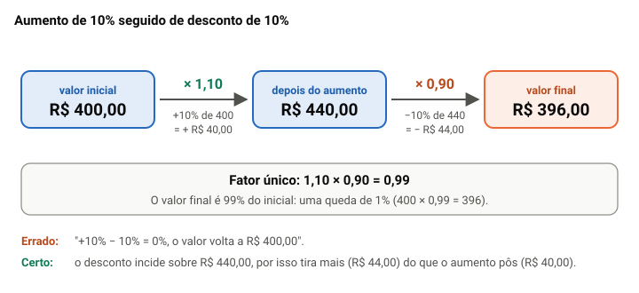

# Razão, proporção, porcentagem e regra de três

> Edital (Conhecimentos Básicos, Matemática, item 1.2, p. 28): "Razão, proporção, porcentagem e regra de três (simples e composta)."

## Por que este tópico importa

Estes quatro assuntos são, no fundo, um só: **comparar quantidades por divisão e por multiplicação**. Razão compara, proporção iguala duas razões, porcentagem é uma razão com denominador 100 e regra de três usa proporções para achar o número que falta.

Na Quadrix, a matemática vem em **situações hipotéticas curtas**, com três ou quatro números, seguidas de itens de certo ou errado. O item costuma errar por um **número trocado**, por uma palavra como **"exatamente"** ou **"mais de"**, ou por uma **troca de unidade** (horas e minutos, metros e centímetros).

A boa notícia: item de conta tem resposta exata. Com um método, dá para fechar a conta e marcar com segurança, em vez de deixar em branco. Esta aula dá o método de cada assunto e, no fim, um passo a passo para julgar o item.

## Razão: comparar por divisão

A **razão** entre dois números *a* e *b* (com *b* diferente de zero) é o quociente *a* ÷ *b*, que se escreve *a*/*b* ou *a* : *b* e se lê "*a* está para *b*".

**Exemplo.** Um setor tem 12 servidores e 20 estagiários. A razão entre servidores e estagiários é 12/20, que simplificada dá **3/5**: para cada 3 servidores, há 5 estagiários.

Três cuidados:

- **a ordem importa.** A razão entre estagiários e servidores é 20/12 = 5/3, outra coisa;
- **a razão é uma medida relativa**, e não absoluta. A razão 3/5 não diz que há 3 servidores, mas que eles estão nessa relação com os estagiários;
- **na mesma espécie de grandeza, as duas medidas precisam estar na mesma unidade.** A razão entre 30 minutos e 2 horas é 30/120 = 1/4, e não 30/2.

Também há razão entre grandezas de espécies diferentes, e aí a unidade faz parte da resposta: protocolos por servidor, processos por dia, quilômetros por hora.

> [!CAUTION]
> A banca troca a ordem da razão. "A razão entre estagiários e servidores é de 3 para 5" está errado no exemplo acima: o primeiro citado vai no numerador.

## Escala: uma razão do desenho

A **escala** de uma planta ou de um mapa é a razão entre a medida no desenho e a medida real, **na mesma unidade**. Escala 1:50 quer dizer que 1 cm no desenho vale 50 cm na realidade.

**Exemplo.** Na planta de uma sala, desenhada na escala 1:50, uma parede mede 6 cm. Na realidade, ela mede 6 × 50 = 300 cm, isto é, **3 m**.

O erro mais comum é parar no "300" e esquecer a unidade: o resultado sai em centímetros, porque a medida do desenho estava em centímetros. Para passar para metros, divida por 100.

## Proporção e a propriedade fundamental

Uma **proporção** é a igualdade de duas razões: *a*/*b* = *c*/*d*. Os termos *a* e *d* são os extremos; *b* e *c*, os meios.

A **propriedade fundamental** diz que, numa proporção, o produto dos meios é igual ao produto dos extremos: *a* × *d* = *b* × *c*. É a conhecida "multiplicação cruzada", que serve para duas coisas:

- **conferir** se duas razões formam proporção: 3/5 e 12/20 formam, porque 3 × 20 = 5 × 12 = 60;
- **achar o termo que falta**: em 3/5 = *x*/40, vem 5 × *x* = 3 × 40, e *x* = 24.

**Exemplo.** Quarenta processos serão divididos entre duas equipes na razão de 3 para 5. As partes somam 3 + 5 = 8; cada "parte" vale 40 ÷ 8 = 5 processos. A primeira equipe recebe 3 × 5 = **15**, e a segunda, 5 × 5 = **25**. Confira: 15/25 = 3/5 e 15 + 25 = 40.

## Grandezas direta e inversamente proporcionais

Duas grandezas são **diretamente proporcionais** quando a razão entre elas é constante: se uma dobra, a outra dobra; se uma cai à metade, a outra também. Mais páginas impressas, mais folhas gastas, na mesma proporção.

Duas grandezas são **inversamente proporcionais** quando o produto delas é constante: se uma dobra, a outra cai à metade. Mais servidores no mesmo serviço, menos dias para terminá-lo.

O teste rápido é **dobrar uma e ver o que acontece com a outra**, mantendo todo o resto fixo:

- dobrou → **diretamente** proporcionais;
- caiu à metade → **inversamente** proporcionais;
- mudou, mas não nessa medida → **não são proporcionais**.

> [!WARNING]
> "Quando uma aumenta, a outra também aumenta" não basta para haver proporcionalidade direta. O lado de um quadrado e a sua área crescem juntos, mas, quando o lado dobra, a área fica quatro vezes maior. A proporção exige a mesma medida.

## Divisão proporcional

Dividir um valor em partes **diretamente proporcionais** a alguns números é dar a cada um a mesma quantia por unidade. Some os números, divida o total pela soma e multiplique.

**Exemplo.** Uma verba de R$ 18.000,00 será dividida entre três setores, proporcionalmente ao número de servidores de cada um: 2, 3 e 4. A soma é 9; cada servidor "vale" 18.000 ÷ 9 = R$ 2.000,00. Os setores recebem **R$ 4.000,00**, **R$ 6.000,00** e **R$ 8.000,00**.

Na divisão **inversamente proporcional**, quem tem o número maior recebe menos. O jeito prático é trocar cada número pelo seu inverso e transformar os inversos em números inteiros.

**Exemplo.** Dividir 1.800 em partes inversamente proporcionais a 2, 3 e 6:

1. inversos: 1/2, 1/3 e 1/6;
2. multiplique todos por 6 (o mínimo múltiplo comum): 3, 2 e 1;
3. divida 1.800 em partes diretamente proporcionais a 3, 2 e 1: a soma é 6, e cada parte vale 300;
4. resultado: **900**, **600** e **300**.

Confira pelo produto, que tem de ser constante: 900 × 2 = 600 × 3 = 300 × 6 = 1.800.

> [!TIP]
> Antes de fechar a conta, faça a pergunta de bom senso: na divisão inversa, quem tem o número maior ficou com a menor parte? Se não, os números foram usados como diretos.

## Porcentagem e a conta de cabeça

**Porcentagem** é uma razão com denominador 100: 15% = 15/100 = 0,15. Calcular 15% de um valor é multiplicar o valor por 0,15.

Na prova, sem calculadora, ajuda partir de porcentagens fáceis e ir somando. Com o valor 480:

| Porcentagem | Como pensar | Resultado |
|---|---|---|
| 10% | divida por 10 | 48 |
| 5% | metade de 10% | 24 |
| 1% | divida por 100 | 4,8 |
| 15% | 10% + 5% | 72 |
| 25% | um quarto | 120 |
| 50% | metade | 240 |

**Porcentagem de porcentagem** multiplica. Dos 800 protocolos de um mês, 30% foram pedidos de registro; desses, 50% chegaram pelo site. Os pedidos de registro feitos pelo site são 50% de 30% = 0,50 × 0,30 = 0,15, isto é, **15% do total**, ou 120 protocolos. Somar (30% + 50%) ou subtrair não faz sentido aqui.

## O fator multiplicativo

Aumentar um valor em 12% é ficar com o valor inteiro (100%) mais 12%: 112% do valor. Em vez de calcular o aumento e somar, **multiplique pelo fator**:

- **aumento de *i*%** → multiplique por **1 + *i*/100**. Aumento de 12% → × 1,12; de 5% → × 1,05;
- **desconto de *i*%** → multiplique por **1 − *i*/100**. Desconto de 15% → × 0,85; de 30% → × 0,70.

**Exemplo.** Uma taxa de R$ 250,00 com desconto de 20% passa a 250 × 0,80 = **R$ 200,00**. A mesma taxa com aumento de 20% passa a 250 × 1,20 = **R$ 300,00**.

O fator também funciona ao contrário. Se o valor já reajustado é conhecido, **divida pelo fator** para voltar ao original. Uma anuidade que, depois de um reajuste de 8%, ficou em R$ 540,00 valia 540 ÷ 1,08 = **R$ 500,00** antes. Tirar 8% de 540 daria R$ 496,80, que está errado: os 8% foram calculados sobre 500, e não sobre 540.

## Aumentos e descontos sucessivos

Quando um percentual vem depois do outro, o segundo **incide sobre o valor já alterado**, e não sobre o inicial. Por isso as porcentagens sucessivas **não se somam: os fatores se multiplicam**.

O caso que mais cai: aumento de 10% seguido de desconto de 10%.

O valor final não volta ao inicial: **1,10 × 0,90 = 0,99**. Sobra 99% do valor, uma **queda de 1%**, qualquer que seja o valor de partida. A ordem não muda nada: desconto de 10% seguido de aumento de 10% dá 0,90 × 1,10 = 0,99 também.

Outros exemplos, todos pelo produto dos fatores:

- **dois aumentos**, de 10% e de 5%: 1,10 × 1,05 = 1,155, um aumento acumulado de **15,5%**, e não de 15%;
- **dois descontos**, de 20% e de 10%: 0,80 × 0,90 = 0,72, um desconto acumulado de **28%**, e não de 30%.

> [!IMPORTANT]
> Percentuais sucessivos: **multiplique os fatores**. O fator final menos 1 dá a variação acumulada. Somar os percentuais é o erro que a banca espera.

## Variação percentual: de onde se parte

A **variação percentual** é a variação dividida pelo **valor de partida**:

**variação percentual = (valor final − valor inicial) ÷ valor inicial**

**Exemplo.** Os atendimentos de um setor passaram de 400 para 500 por mês. A variação é de 100 sobre 400, um **aumento de 25%**. Se voltarem de 500 para 400, a variação será de 100 sobre 500, uma **queda de 20%**.

A mesma diferença de 100 dá percentuais diferentes, porque a base mudou. Por isso, para desfazer um aumento de 25%, não basta um desconto de 25%: 1,25 × 0,75 = 0,9375, e o valor fica abaixo do inicial. O desconto certo é de 20%, porque 1,25 × 0,80 = 1.

Também não confunda **variação absoluta** e **variação percentual**. Um setor que passa de 200 para 230 protocolos cresceu 30 unidades (15%); outro, que passa de 1.000 para 1.040, cresceu mais em unidades (40), mas só 4%.

## Regra de três simples

A **regra de três** acha um valor desconhecido quando duas grandezas são proporcionais: dos quatro números da proporção, três são dados. Usamos aqui o método das setas do material da OBMEP.

1. **Monte a tabela**: uma coluna por grandeza, uma linha por situação, cada número na sua coluna.
2. **Ponha uma seta para cima (↑) na coluna da incógnita** (o *x*).
3. **Compare a outra grandeza com a da incógnita.** Se for diretamente proporcional, seta para cima (↑); se for inversamente, seta para baixo (↓).
4. **Escreva a proporção**: a fração da coluna do *x* igual à fração da outra coluna, **invertida se a seta for para baixo**.

**Direta.** Quatro servidores digitalizam 600 processos por semana. Mantido o ritmo, seis servidores digitalizam 600 × 6 ÷ 4 = **900**. Mais servidores, mais processos, na mesma medida.

**Inversa.** Seis servidores concluem um recadastramento em 10 dias. Com quatro servidores, no mesmo ritmo, o prazo passa a 10 × 6 ÷ 4 = **15 dias**. Menos servidores, mais dias.

> [!NOTE]
> Outros livros usam setas com outro sentido: nelas, a seta mostra se a grandeza aumenta ou diminui de uma linha para a outra. Os dois métodos funcionam, mas misturados dão errado. Escolha um e use sempre o mesmo; nesta aula, a seta para cima marca a incógnita e as grandezas diretas, e a seta para baixo, as inversas.

## Regra de três composta

Na **regra de três composta**, há três grandezas ou mais. O método é o mesmo, com um cuidado: **compare cada grandeza com a da incógnita, uma de cada vez, mantendo as outras fixas**.

**Exemplo.** Quatro servidores, trabalhando 6 horas por dia, analisam 240 processos em 5 dias. Em quantos dias 6 servidores, trabalhando 5 horas por dia, analisam 720 processos?

A incógnita são os dias. Compare cada grandeza com eles:

- **servidores**: com mais servidores, mantidos as horas e os processos, são precisos **menos** dias. Inversa (↓);
- **horas por dia**: com mais horas por dia, **menos** dias. Inversa (↓);
- **processos**: com mais processos, **mais** dias. Direta (↑).

A fração da coluna do *x* é igual ao **produto** das outras frações, invertendo as de seta para baixo:

5/*x* = (6/4) × (5/6) × (240/720) = 5/12, e então ***x* = 12 dias**.

> [!TIP]
> Confira pela "unidade de trabalho". Na primeira situação, foram 4 × 6 × 5 = 120 horas de servidor para 240 processos: 2 processos por hora de servidor. Para 720 processos, são precisas 360 horas de servidor; com 6 servidores a 5 horas por dia (30 por dia), 360 ÷ 30 = 12 dias. A conta fecha.

## Unidades e palavras que decidem o item

Boa parte dos itens errados da banca não erra a conta: erra a **unidade** ou a **palavra** em volta do número. Antes de marcar, confira:

- **horas e minutos.** 2 horas e 30 minutos são 150 minutos, e não 230; e 1,5 hora são 90 minutos, e não 1 hora e 50;
- **dias e semanas, metros e centímetros.** Converta tudo para a mesma unidade antes de montar a tabela;
- **"exatamente", "mais de", "menos de", "no máximo".** Se a conta dá 9, "mais de 9" está errado e "exatamente 9" está certo;
- **a base da porcentagem.** "Um aumento de 25% em relação ao ano anterior" toma como base o ano anterior; "25% do total" toma o total;
- **o que o item pergunta.** O valor do desconto (R$ 50,00) não é o valor com desconto (R$ 200,00).

## Como julgar o item, passo a passo

1. **Anote os dados** da situação, cada número com a sua unidade.
2. **Diga o tipo**: razão, divisão proporcional, porcentagem (fator), percentuais sucessivos (produto dos fatores), regra de três simples ou composta (tabela com setas).
3. **Estime com números redondos.** Antes da conta exata, veja a ordem de grandeza: o resultado deve ser maior ou menor que o dado? Por volta de quanto?
4. **Faça a conta exata** com o método do tipo e **confira** por outro caminho (a multiplicação cruzada, o produto constante, a unidade de trabalho).
5. **Compare com o item palavra por palavra**: o número, a unidade, "exatamente" ou "mais de", a base da porcentagem e a ordem da razão.
6. **Marque** C se tudo bate; E se qualquer parte não bate. Basta um detalhe errado para o item estar errado.

> [!IMPORTANT]
> Item de conta não é questão de opinião: se o método foi seguido e a conferência fechou, a resposta é segura. Em branco vale zero; um item de conta bem resolvido vale um ponto.

## Pegadinhas da Quadrix

- **Somar percentuais sucessivos**: "aumento de 10% e depois desconto de 10% deixam o valor igual". Ficam 99%.
- **Desfazer um aumento com o mesmo percentual**: depois de +25%, é preciso −20% para voltar.
- **Inverter a razão**: trocar "estagiários para servidores" por "servidores para estagiários".
- **Tratar grandeza inversa como direta** na regra de três, sobretudo na composta (mais servidores, menos dias).
- **Divisão inversa feita como direta**: quem tem o número maior acaba recebendo mais.
- **Trocar a unidade**: minutos lidos como horas, centímetros da escala lidos como metros.
- **"Exatamente", "mais de", "menos de"** cercando o número certo.
- **Confundir variação absoluta com percentual**: crescer mais unidades não é crescer mais em porcentagem.

## Fontes

- Francisco Bruno Holanda e Antonio Caminha Muniz Neto. *Regra de Três Simples e Composta* (Material Teórico, Módulo Razões e Proporções, 7º ano). Portal da Matemática OBMEP/IMPA, versão de 25/02/2025. https://cdnportaldaobmep.impa.br/portaldaobmep/uploads/material_teorico/d9k71v53ba8k0.pdf
- Francisco Bruno Holanda e Antonio Caminha Muniz Neto. *Números Diretamente e Inversamente Proporcionais* (Material Teórico, Módulo Razões e Proporções, 7º ano). Portal da Matemática OBMEP/IMPA. https://cdnportaldaobmep.impa.br/portaldaobmep/uploads/material_teorico/c89zmw0n6cgks.pdf
- Francisco Bruno Holanda e Antonio Caminha Muniz Neto. *A Noção de Razão e Exercícios* (Material Teórico, Módulo Razões e Proporções, 7º ano). Portal da Matemática OBMEP/IMPA. https://cdnportaldaobmep.impa.br/portaldaobmep/uploads/material_teorico/a2lelc7rz94w0.pdf
- Ulisses Lima Parente e Antonio Caminha M. Neto. *Porcentagem* (Material Teórico, Módulo Porcentagem, Parte 1, 8º ano). Portal da Matemática OBMEP/IMPA. https://cdnportaldaobmep.impa.br/portaldaobmep/uploads/material_teorico/cfea7ykbmvscc.pdf
- Francisco Bruno Holanda e Antonio Caminha M. Neto. *Introdução à Porcentagem* (Material Teórico, Módulo Porcentagem e Juros, 7º ano). Portal da Matemática OBMEP/IMPA. https://cdnportaldaobmep.impa.br/portaldaobmep/uploads/material_teorico/ddyecs8bh1s8w.pdf
- Portal da Matemática OBMEP/IMPA. *Caderno de exercícios — Introdução à Porcentagem* (Módulo de Juros e Porcentagem, 7º ano). https://cdnportaldaobmep.impa.br/portaldaobmep/uploads/material/8jvrrnb6tgw8s.pdf
- REAMAT/UFRGS. *Pré-cálculo — Um Livro Colaborativo*, D.2 Proporção, E.1 Regra de 3 simples e E.2 Regra de 3 composta (CC BY-SA 3.0). https://www.ufrgs.br/reamat/PreCalculo/livro/rdt-regra_de_3_simples.html

Vêm do material da OBMEP: o método das setas na regra de três simples e na composta (seta para cima na incógnita e nas diretas, para baixo nas inversas, com a fração invertida; *Regra de Três*, p. 1 a 7); as definições de grandezas direta e inversamente proporcionais, a divisão proporcional pela constante e o alerta de que "crescer junto" não basta, com o exemplo do quadrado (*Números Diretamente e Inversamente Proporcionais*, p. 1 e 2); a razão como medida relativa (*A Noção de Razão*, p. 1); porcentagem como fração centesimal, porcentagem de porcentagem e o quadro de que porcentagens sucessivas não se somam (*Porcentagem, Parte 1*, p. 1 a 3); e a explicação de que cada percentual sucessivo incide sobre um valor diferente (*Introdução à Porcentagem*, p. 4). A propriedade fundamental e o cuidado de pôr as razões na mesma unidade estão também no REAMAT (D.2), cuja página de regra de três usa a outra convenção de setas, citada na parte da regra de três simples.

São nossos, com dados fictícios, todos os exemplos numéricos, conferidos à mão. São leitura nossa: o nome "fator multiplicativo" para 1 + *i* (o caderno de exercícios de porcentagem da OBMEP fala em fator de variação), a tabela da conta de cabeça, a conferência pela "unidade de trabalho", o passo a passo para julgar o item e a lista de pegadinhas, tirada do molde dos itens da Quadrix de outros conselhos (situação hipotética com três itens). A prova de 2023 do cargo no CAU/TO não teve itens deste tópico.
