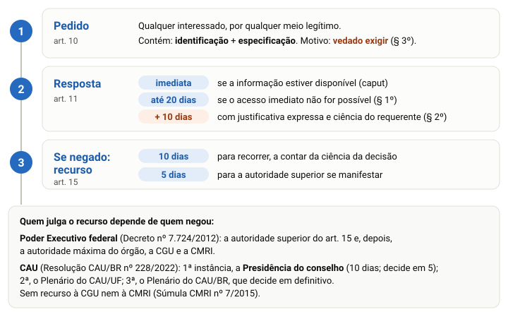

# Transparência e acesso à informação (Lei nº 12.527/2011)

> Edital (Conhecimentos Complementares, item 4): "Transparência e Acesso à Informação: 4.1 Noções da Lei nº 12.527/2011 e seus decretos."

## Por que este tópico importa

A **Lei nº 12.527/2011**, a Lei de Acesso à Informação (LAI), diz como qualquer pessoa obtém informações dos órgãos e das entidades públicas. Ela regula o direito previsto no **art. 5º, XXXIII**, da Constituição.

Na prova de 2023 do mesmo cargo, a Quadrix fez um bloco de **5 itens** só sobre esta lei, cada um com uma frase, na letra da lei. Cinco itens valem até 5 pontos, e errar tira ponto: vale a pena estudar com calma.

> [!TIP]
> Ordem de estudo: (1) o pedido e os prazos; (2) a gratuidade; (3) transparência ativa × passiva; (4) graus de sigilo e informação pessoal. No fim, há um passo a passo para julgar itens de lei.

## Quem a lei alcança

A lei vale para a União, os Estados, o Distrito Federal e os Municípios (art. 1º). Ficam sujeitos a ela (art. 1º, parágrafo único):

- os órgãos da administração direta dos **três Poderes**, incluídas as **Cortes de Contas**, e do **Ministério Público** (I);
- as **autarquias**, as fundações públicas, as empresas públicas, as sociedades de economia mista e as demais entidades controladas pelo poder público (II).

As **entidades privadas sem fins lucrativos** que recebem recursos públicos também se sujeitam, no que couber, mas só quanto à **parcela dos recursos públicos** e à sua destinação (art. 2º).

> [!NOTE]
> O CAU/BR e os CAU dos Estados são **autarquias** (Lei nº 12.378/2010, art. 24). Por isso a LAI vale para o CAU/TO, pelo art. 1º, parágrafo único, II.

## A regra é a publicidade

Das diretrizes do art. 3º, a primeira resume todas: **publicidade como preceito geral e sigilo como exceção**. As outras falam em divulgar **independentemente de solicitações**, usar a tecnologia da informação, criar uma **cultura de transparência** e desenvolver o **controle social**.

É **dever do Estado** garantir o acesso, por procedimentos objetivos e ágeis, de forma transparente, clara e em **linguagem de fácil compreensão** (art. 5º).

O art. 4º define os termos. Os que mais caem:

| Termo | O que é (art. 4º) |
|---|---|
| **Informação** | dados, processados **ou não**, contidos em qualquer meio, suporte ou formato |
| **Documento** | unidade de registro de informações, qualquer que seja o suporte |
| **Informação sigilosa** | a submetida **temporariamente** à restrição de acesso, por ser imprescindível à segurança da sociedade e do Estado |
| **Informação pessoal** | a relacionada à pessoa natural identificada ou identificável |
| **Integridade** | informação **não modificada**, inclusive quanto à origem, trânsito e destino |
| **Primariedade** | informação coletada **na fonte**, com o máximo de detalhamento, sem modificações |

> [!WARNING]
> Cuidado com as definições vizinhas: "não modificada" é **integridade**; "coletada na fonte" é **primariedade**. E a informação sigilosa é restrita **temporariamente**: a classificação sempre tem prazo máximo.

## Transparência ativa e transparência passiva

A lei não usa esses dois nomes, mas eles organizam bem o assunto (e o Decreto nº 7.724/2012 os usa como títulos de capítulos).

- **Transparência ativa:** o órgão divulga **por iniciativa própria**, sem que ninguém peça (art. 8º).
- **Transparência passiva:** o órgão responde a um **pedido** de alguém (arts. 10 a 14).

Um exemplo nosso. A lista de contratos de um conselho publicada no portal da transparência é transparência **ativa**. Uma arquiteta que pede ao conselho a ata de uma reunião que não está no portal usa a transparência **passiva**.

## O que deve estar no site, sem ninguém pedir

É dever dos órgãos e entidades divulgar, **independentemente de requerimentos**, informações de interesse coletivo ou geral, em local de fácil acesso (art. 8º). O § 1º lista o **mínimo**:

1. competências, estrutura organizacional, endereços, telefones e horários de atendimento;
2. registros de **repasses ou transferências** de recursos financeiros;
3. registros das **despesas**;
4. informações sobre **licitações**, com editais e resultados, e todos os **contratos** celebrados;
5. dados gerais para acompanhar programas, ações, projetos e obras;
6. **respostas a perguntas mais frequentes** da sociedade.

A divulgação em **sítios oficiais na internet** é obrigatória (§ 2º), em sites com ferramenta de pesquisa, informações atualizadas e acessibilidade para pessoas com deficiência, entre outros requisitos (§ 3º).

Uma exceção: os **Municípios de até 10.000 habitantes** estão dispensados da divulgação obrigatória na internet, mas continuam obrigados a divulgar em tempo real a execução orçamentária e financeira (§ 4º).

> [!CAUTION]
> "No mínimo" quer dizer que a lista **não é fechada**. E as perguntas frequentes entram na transparência **ativa**: não dependem de pedido.

## Conselhos profissionais: o art. 8º-B

A **Lei nº 15.141/2025** acrescentou dois artigos à LAI. O **art. 8º-A** trata dos serviços sociais autônomos que recebem recursos federais por contrato de gestão. O **art. 8º-B** fala diretamente dos conselhos, como o CAU:

> Art. 8º-B. Os conselhos de fiscalização profissional devem divulgar, de forma nominal e individualizada, lista das parcelas remuneratórias e indenizatórias, ainda que eventuais, incluídos os auxílios, as ajudas de custo, as gratificações, os jetons e quaisquer outras vantagens pecuniárias, que os empregados possam receber em virtude de condições específicas.

Os pontos que podem virar item: **"devem"** (é dever), **"nominal e individualizada"**, **"ainda que eventuais"** e a lista de exemplos (auxílios, ajudas de custo, gratificações, jetons).

> [!NOTE]
> Leitura nossa: material anterior a junho de 2025 não traz este artigo. Fique com as palavras da lei; não troque "lista das parcelas que os empregados possam receber" por "a remuneração de cada empregado".

## O pedido de acesso

O acesso pedido passa pelo **serviço de informações ao cidadão (SIC)**, que cada órgão ou entidade deve criar para atender e orientar o público, informar a tramitação de documentos e protocolar pedidos (art. 9º, I).

O art. 10 é o mais cobrado. Leia devagar:

- **quem pede:** **qualquer interessado** (caput);
- **como:** por **qualquer meio legítimo** (caput); e o órgão **deve** oferecer a opção de pedir pelo seu **site** (§ 2º);
- **o que o pedido contém:** só duas coisas, a **identificação do requerente** e a **especificação da informação** requerida (caput);
- **limite à identificação:** não pode ter exigências que **inviabilizem** a solicitação (§ 1º);
- **motivo:** são **vedadas quaisquer exigências** relativas aos motivos da solicitação de informações de interesse público (§ 3º).

> [!IMPORTANT]
> O pedido precisa **identificar quem pede** e **especificar o que pede**. **Não precisa dizer por quê**: a lei proíbe exigir o motivo (art. 10, § 3º). Um item que diga que o pedido "deve indicar os motivos", ou que o órgão "pode exigir a justificativa", está **errado**.

Exemplo nosso: um estudante pede ao CAU/TO o número de empresas de arquitetura registradas em Palmas. Ele se identifica e diz exatamente o que quer. Ninguém pode perguntar se é para um trabalho da faculdade ou para abrir um escritório.

## Os prazos de resposta

Se a informação está disponível, o acesso é **imediato** (art. 11, caput). Se não for possível, o órgão tem **até 20 dias** para (§ 1º):

1. comunicar a data, o local e o modo de fazer a consulta, a reprodução ou obter a certidão;
2. indicar as razões de fato ou de direito da **recusa**, total ou parcial; ou
3. comunicar que **não possui** a informação e indicar, se souber, quem a tem, ou remeter o pedido a esse órgão, avisando o interessado.

O prazo de 20 dias **poderá ser prorrogado por mais 10**, **mediante justificativa expressa**, da qual o requerente **será cientificado** (§ 2º).

Se a informação já estiver publicada (impressa, na internet ou em outro meio de acesso universal), o órgão informa, **por escrito**, onde e como consultá-la, e fica desobrigado de fornecê-la diretamente, **salvo** se o requerente declarar que não tem meios de fazer isso sozinho (§ 6º).

> [!CAUTION]
> Cuidado com números trocados: **20** (não 30) e **mais 10** (não 20). A prorrogação **não é automática**: exige justificativa expressa e aviso ao requerente.

## Gratuidade: o que pode ser cobrado

A **Lei nº 14.129/2021** deu nova redação ao art. 12, que passou a ter caput e dois parágrafos:

- o serviço de **busca e de fornecimento** da informação é **gratuito** (caput);
- quando o atendimento exigir **reprodução de documentos**, o órgão **poderá** cobrar **exclusivamente** o valor necessário ao ressarcimento dos **custos dos serviços e dos materiais utilizados** (§ 1º);
- fica **isento** desse ressarcimento quem não puder pagá-lo sem prejuízo do sustento próprio ou da família, declarando essa situação nos termos da Lei nº 7.115/1983 (§ 2º).

Exemplo nosso: pesquisar e enviar por e-mail a ata digital não custa nada. Se a pessoa pede cópias em papel de 200 páginas, o órgão pode cobrar o custo das cópias, e só ele, e quem declara não poder pagar não paga.

E o requerente tem direito ao **inteiro teor da decisão de negativa**, por certidão ou cópia (art. 14).

> [!WARNING]
> Dois erros comuns: "o acesso é **totalmente** gratuito, em qualquer caso" (errado: a reprodução pode ser cobrada) e "o órgão pode cobrar pela **busca**" (errado: a busca é gratuita).

## Negado o acesso: o recurso

Contra o indeferimento do acesso, ou contra a falta das razões da negativa, o interessado **poderá** recorrer em **10 dias** a contar da sua **ciência** (art. 15). O recurso vai à **autoridade hierarquicamente superior** à que decidiu, que **deverá se manifestar em 5 dias** (art. 15, parágrafo único).

Na negativa por sigilo, o requerente deve ser informado da possibilidade de recurso, dos prazos e de quem vai apreciá-lo (art. 11, § 4º). E a negativa **não fundamentada** sujeita o responsável a medidas disciplinares (art. 7º, § 4º).

O **art. 16** prevê recurso à **Controladoria-Geral da União (CGU)** e, depois, à **Comissão Mista de Reavaliação de Informações (CMRI)**, mas só contra negativas de órgãos e entidades do **Poder Executivo federal**. A Lei nº 9.784/1999 se aplica subsidiariamente a todo o procedimento de pedido e recurso (art. 20).

> [!NOTE]
> Pela Súmula CMRI nº 7/2015, os conselhos profissionais **não integram o Poder Executivo federal**, e por isso não cabe o recurso do art. 16 contra decisão de um conselho. Veja a parte "E no CAU?".

## O que não pode ser negado e o acesso parcial

- **Não pode ser negado** acesso à informação necessária à tutela judicial ou administrativa de **direitos fundamentais** (art. 21).
- Informações sobre **violação de direitos humanos** por agentes públicos **não podem** ter acesso restrito (art. 21, parágrafo único).
- Se a informação é **parcialmente sigilosa**, o acesso à **parte não sigilosa** é assegurado por **certidão, extrato ou cópia com ocultação** da parte sob sigilo (art. 7º, § 2º).
- O acesso inclui a informação de pessoa física ou entidade privada com vínculo com o órgão, **mesmo que o vínculo já tenha cessado** (art. 7º, III).
- A LAI **não exclui** as outras hipóteses legais de sigilo, como o segredo de justiça (art. 22).

## Os graus de sigilo

Pode ser **classificada** a informação cuja divulgação ponha em risco a segurança da sociedade ou do Estado, como a defesa nacional ou a saúde da população (art. 23).

São **três graus**, com prazos **máximos** contados **da data de produção** da informação (art. 24, § 1º):

Regras que acompanham os graus:

- em vez do prazo, pode-se fixar um **evento** como termo final, desde que ocorra antes do prazo máximo (§ 3º);
- passado o prazo ou ocorrido o evento, a informação torna-se **automaticamente** de acesso público (§ 4º);
- usa-se o **critério menos restritivo possível**, olhando a gravidade do risco e o prazo (§ 5º);
- quem tem acesso a informação sigilosa fica **obrigado a resguardar o sigilo** (art. 25, § 2º).

> [!CAUTION]
> Para guardar: **U-S-R = 25-15-5**, do mais grave ao menos grave. Não existe grau "confidencial" nem "restrito" na LAI.

## Informação pessoal: 100 anos, mas não é grau de sigilo

As informações pessoais ligadas à **intimidade, vida privada, honra e imagem** têm acesso restrito **independentemente de classificação de sigilo**, pelo prazo **máximo de 100 anos** a contar da produção (art. 31, § 1º, I). Têm acesso a elas os agentes públicos legalmente autorizados e a **própria pessoa**.

Terceiros só têm acesso com **previsão legal** ou **consentimento expresso** da pessoa (§ 1º, II). Há casos em que o consentimento é dispensado, como o cumprimento de **ordem judicial** (§ 3º).

E a restrição **não pode ser usada para atrapalhar** a apuração de irregularidades em que o titular esteja envolvido (§ 4º).

> [!WARNING]
> "Sigilo de 100 anos" é expressão de jornal. Na lei, os 100 anos são o **prazo máximo da restrição da informação pessoal**, que **não é classificada** em grau nenhum. Item que diga "a informação pessoal é classificada como ultrassecreta" está errado.

## Responsabilidades

São condutas ilícitas do agente público, entre outras (art. 32): **recusar** a informação, **retardar deliberadamente** o fornecimento ou fornecê-la de forma incorreta ou incompleta, e **impor sigilo** para proveito pessoal ou para esconder ato ilegal.

Para o servidor regido pela Lei nº 8.112/1990, essas condutas são infrações apenadas, **no mínimo, com suspensão** (art. 32, § 1º, II), e podem configurar também **improbidade administrativa** (§ 2º).

O órgão **responde diretamente** pelos danos da divulgação indevida de informação sigilosa ou pessoal, com direito de regresso contra o culpado (art. 34).

## "E seus decretos": o Decreto nº 7.724/2012

O Decreto nº 7.724/2012 regulamenta a LAI **no Poder Executivo federal** (art. 1º). A Quadrix já citou o decreto no comando de itens. O que ele acrescenta à lei:

- **pedido:** qualquer pessoa, **natural ou jurídica** (art. 11), com nome, documento de identificação, especificação clara e precisa da informação e endereço para resposta (art. 12); é **vedado** exigir os motivos (art. 14);
- **pedidos que não serão atendidos:** **genéricos**; **desproporcionais ou desarrazoados**; ou que exijam **trabalhos adicionais** de análise, interpretação ou consolidação de dados (art. 13);
- **prazos:** os mesmos 20 dias, e a prorrogação de 10 deve ser justificada **antes do fim** dos 20 (arts. 15 e 16);
- **recursos:** em 10 dias à autoridade superior (5 dias para decidir), depois à **autoridade máxima** do órgão, depois à **CGU** e, por fim, à **CMRI** (arts. 21 a 24); se não houver resposta, cabe **reclamação** à autoridade de monitoramento (art. 22).

O **Decreto nº 11.527/2023** revisou o 7.724. Duas mudanças fáceis de cobrar: os pedidos passam por um **sistema eletrônico mantido pela CGU**, de uso obrigatório no Executivo federal (art. 11-A), e o requerente identificado nesse sistema **pode pedir a preservação da sua identidade** perante o órgão (art. 12, parágrafo único).

O outro decreto da LAI, o **nº 7.845/2012**, trata do credenciamento de segurança no Executivo federal.

## E no CAU?

Aqui convém separar o que está na norma do que é leitura nossa.

**O que dizem as normas:**

- a **LAI vale** para o CAU, que é autarquia (art. 1º, parágrafo único, II);
- a **Súmula CMRI nº 7/2015** diz que os conselhos profissionais **não integram o Poder Executivo federal** e **não se sujeitam ao Decreto nº 7.724/2012**, e que não cabe contra eles o recurso do art. 16 da LAI;
- a **Resolução CAU/BR nº 228/2022** é a norma própria do CAU/BR e dos CAU dos Estados:
  - um **SIC** em cada conselho (art. 3º) e motivação proibida "em nenhuma hipótese" (art. 7º);
  - resposta em **20 dias corridos**, prorrogáveis por **até 10** (art. 9º);
  - **três instâncias** de recurso, de 10 dias cada: Presidência do conselho (decide em 5 dias), Plenário do CAU/UF e Plenário do CAU/BR, que decide em definitivo (arts. 11 a 13);
  - **só dois graus** de sigilo, **reservado (5 anos)** e **secreto (15 anos)**, improrrogáveis (arts. 14 e 15).

**Leitura nossa:** responda pela norma citada no comando (a LAI ou o Decreto nº 7.724/2012). A resolução mostra a lei no seu futuro local de trabalho; não troque as regras da lei pelas dela.

## Como julgar um item de lei, passo a passo

Muita gente deixa item de lei em branco por insegurança. Em branco vale zero; com método, dá para decidir com segurança. Para cada item:

1. **Ache a norma do comando.** "Segundo a Lei nº 12.527/2011" pede a lei; "conforme o Decreto nº 7.724/2012", o decreto.
2. **Ache o assunto do item:** pedido, prazo, custo, recurso, sigilo, informação pessoal, responsabilidade.
3. **Confira números e prazos.** 20 + 10; recurso em 10, decisão em 5; 25-15-5; 100 anos. Um número trocado é um desvio comum.
4. **Marque as palavras absolutas:** "sempre", "nunca", "apenas", "somente", "totalmente", "em qualquer caso". Pergunte: a lei tem exceção aqui? Se tem, o item costuma estar errado.
5. **Compare o verbo:** "pode" × "deve". O órgão **deve** dar acesso imediato ao que está disponível; o prazo **pode** ser prorrogado; a reprodução **pode** ser cobrada; a autoridade do recurso **deve** decidir em 5 dias.
6. **Procure palavra acrescentada:** "identificação, especificação **e motivo**"; "**apenas** pessoas físicas"; "**por escrito ou verbal**". Uma palavra a mais muda o item.
7. **Decida.** Se o item bate com a regra que você conhece, marque C; se encontrou um desvio claro, marque E. Só deixe em branco se não reconheceu o assunto.

## Pegadinhas da Quadrix

Para treinar, decida antes de ler a resposta.

| Afirmação | Certo ou errado? | Por quê |
|---|---|---|
| O pedido de acesso deve conter a identificação do requerente, a especificação da informação e os motivos da solicitação. | Errado | É **vedado** exigir motivos (art. 10, § 3º). |
| O acesso à informação é totalmente gratuito, mesmo quando exige reprodução de documentos. | Errado | A reprodução pode ser cobrada (art. 12, § 1º). |
| As respostas às perguntas frequentes da sociedade só são fornecidas mediante pedido. | Errado | Estão no mínimo da divulgação **independentemente de requerimento** (art. 8º, § 1º, VI). |
| A informação pessoal é classificada no grau ultrassecreto e fica restrita por 100 anos. | Errado | É restrita **independentemente de classificação** (art. 31, § 1º, I). |

## Fontes

- Lei nº 12.527/2011, texto compilado (arts. 1º a 34; art. 12 com a redação da Lei nº 14.129/2021; arts. 8º-A e 8º-B incluídos pela Lei nº 15.141/2025). Presidência da República (Planalto), consultado em 17/10/2026. https://www.planalto.gov.br/ccivil_03/_ato2011-2014/2011/lei/l12527.htm
- Lei nº 15.141/2025 (art. 216: inclui os arts. 8º-A e 8º-B na LAI). Planalto. https://www.planalto.gov.br/ccivil_03/_ato2023-2026/2025/lei/L15141.htm
- Decreto nº 7.724/2012, texto compilado (arts. 1º, 11 a 24; arts. 11, § 1º, 11-A e 12, parágrafo único, com a redação ou inclusão do Decreto nº 11.527/2023). Planalto, consultado em 17/10/2026. https://www.planalto.gov.br/ccivil_03/_ato2011-2014/2012/decreto/d7724.htm
- Decreto nº 7.845/2012. Planalto. https://www.planalto.gov.br/ccivil_03/_ato2011-2014/2012/decreto/d7845.htm
- Lei nº 12.378/2010, art. 24 (CAU/BR e CAU dos Estados como autarquias). Planalto. https://www.planalto.gov.br/ccivil_03/_ato2007-2010/2010/lei/l12378.htm
- Resolução CAU/BR nº 228/2022 (arts. 3º, 7º, 9º e 11 a 15). CAU/BR, Portal da Transparência. https://transparencia.caubr.gov.br/resolucao228/
- Súmula CMRI nº 7/2015 (conselhos profissionais), DOU de 8/6/2015. Casa Civil da Presidência da República. https://www.gov.br/casacivil/pt-br/assuntos/colegiados/comissao-mista-de-reavaliacao-de-informacoes-cmri/normativos-vigentes-1/sumula-cmri-no-7-de-2015.pdf
- Controladoria-Geral da União. *Aplicação da Lei de Acesso à Informação na Administração Pública Federal*, 4ª ed., 2019 (consulta de conceitos; anterior às mudanças de 2021, 2023 e 2025). https://basedeconhecimento.cgu.gov.br/handle/1/7615
