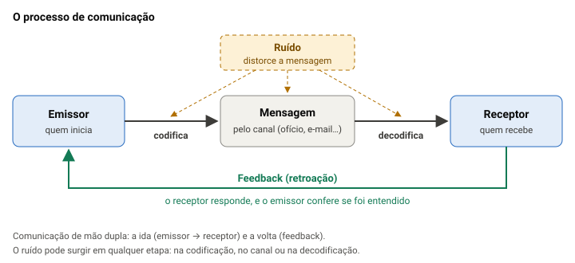

# Comunicação organizacional, redação oficial e tipos de documentos

> Edital (Conhecimentos Específicos, item 3): "3 Comunicação Organizacional: 3.1 Comunicação interna e externa. 3.2 Redação oficial de documentos. 3.3 Tipos de documentos administrativos."

## Por que este tópico importa

Num conselho profissional, quase tudo vira documento: o pedido do arquiteto, a ata da reunião, o ofício para outro órgão. Muitas vezes, quem os redige é o assistente administrativo.

Na prova de 2023 deste mesmo cargo, a Quadrix pôs 10 itens de comunicação nos conhecimentos específicos, todos de uma frase. O estilo da banca é trocar um conceito pelo vizinho: a definição de objetividade com o nome de concisão, o fecho de um caso no outro.

A aula segue a ordem do edital: comunicação, redação oficial e tipos de documentos.

## O processo de comunicação

Comunicar é fazer a mensagem chegar a outra pessoa **com o mesmo sentido**: importa o que foi entendido, não só o que foi dito. Os elementos cobrados:

- **emissor** (ou fonte): quem inicia a comunicação;
- **codificação**: transformar a ideia em mensagem (palavras, gráfico, gesto);
- **mensagem**: o que de fato se comunica;
- **canal** (ou meio): por onde a mensagem passa (ofício, e-mail, telefone, reunião);
- **receptor**: quem recebe e **decodifica**, isto é, traduz a mensagem para si;
- **ruído**: qualquer interferência que distorce a mensagem;
- **feedback** (ou retroação): o retorno do receptor ao emissor.

**Exemplo.** A chefe pede por e-mail "a planilha de ontem". O assistente envia a de compras, mas ela queria a de diárias. Houve ruído (a mensagem era vaga), e só o feedback ("não é essa") mostrou o problema.

> [!CAUTION]
> Item que diz que o feedback "não faz parte" do processo, ou que a comunicação eficaz é de mão única, está errado. É o feedback que confirma se a mensagem chegou como se pretendia.

## Interna × externa, formal × informal

São dois pares diferentes, e a banca gosta de misturá-los.

- **Interna × externa** diz **com quem** a organização fala. A interna é com o público de dentro (empregados, conselheiros, setores). A externa é com quem está fora (profissionais registrados, sociedade, imprensa, outros órgãos).
- **Formal × informal** diz **por qual caminho**. A formal usa os canais oficiais e segue os trâmites; é mais lenta. A informal é espontânea, corre por fora dos canais oficiais (a conversa no café, o "boato") e é mais rápida.

O aviso no mural sobre o novo horário do protocolo é **interna e formal**; a conversa de corredor sobre ele, **interna e informal**; o ofício a uma prefeitura, **externa e formal**.

A comunicação formal também pode ser oral, como numa reunião convocada pela chefia. Desconfie de item que diga que ela ocorre "rigorosamente" por escrito.

> [!NOTE]
> Margarida Kunsch, autora muito citada na área, chama de **comunicação organizacional integrada** a soma de quatro modalidades que devem funcionar juntas: institucional, mercadológica, interna e administrativa. A comunicação externa com a sociedade e a imagem da instituição são aprofundadas na aula de relações humanas e relações públicas.

## Fluxos e barreiras

Dentro da organização, a comunicação corre em quatro sentidos:

| Fluxo | Sentido | Exemplo |
|---|---|---|
| Descendente | Da chefia para os subordinados | A gerência envia a nova rotina de arquivamento |
| Ascendente | Dos subordinados para a chefia | O assistente informa que o estoque de papel está acabando |
| Horizontal (lateral) | Entre pessoas ou setores do mesmo nível | O setor de compras combina prazos com o almoxarifado |
| Diagonal | Entre níveis diferentes de setores diferentes | A gerente financeira pede um dado ao assistente do jurídico |

**Barreiras** são o que impede a mensagem de chegar como saiu. Costumam ser agrupadas em físicas (barulho, distância, falha do sistema), semânticas (palavra técnica ou ambígua, sentidos diferentes para o mesmo termo) e psicológicas ou pessoais (pressa, preconceito, emoção). Três nomes caem bastante:

- **filtragem**: o emissor "maquia" a informação para agradar a quem recebe;
- **percepção seletiva**: o receptor ouve só o que combina com o que ele já pensa;
- **sobrecarga de informação**: mensagens demais, e as importantes se perdem.

O atendimento ao público, com suas próprias barreiras e posturas, tem aula própria.

## Os atributos da redação oficial

Pelo Manual de Redação da Presidência da República, redação oficial é **a maneira pela qual o Poder Público redige comunicações oficiais e atos normativos**. Quem comunica é sempre o serviço público, sobre assunto das atribuições do órgão. O Manual liga suas regras ao art. 37 da Constituição: o texto que ninguém entende não cumpre a publicidade, mesmo publicado.

> [!NOTE]
> O Manual foi feito para a administração federal e é a referência que as bancas cobram. O edital não cita manual nenhum: tomá-lo como modelo para o CAU/TO é leitura nossa.

A 3ª edição (2018) lista os atributos: **clareza e precisão; objetividade; concisão; coesão e coerência; impessoalidade; formalidade e padronização; e uso da norma padrão.**

| Atributo | O que é, pelo Manual | Pergunta para testar |
|---|---|---|
| Clareza | O texto permite **compreensão imediata** pelo leitor | Quem lê entende de primeira? |
| Precisão | Complementa a clareza: palavra certa, **sem duplo sentido**, mantendo os mesmos termos em vez de sinônimos só por estilo | Alguma palavra pode ter dois sentidos? |
| Objetividade | **Ir diretamente ao assunto, sem voltas e sem redundâncias**, separando a ideia principal das secundárias | O texto começa pelo que interessa? |
| Concisão | Transmitir o **máximo de informações com o mínimo de palavras** | Há palavras que podem sair sem perda? |
| Coesão e coerência | Palavras, frases e parágrafos ligados, dando continuidade uns aos outros | As partes se encaixam? |
| Impessoalidade | O texto fala em nome do serviço público, sem impressões pessoais | Há opinião ou tom pessoal? |
| Formalidade e padronização | Regras de forma, civilidade no trato e o mesmo padrão em toda a administração | Segue o modelo? |
| Norma padrão | Língua culta, sem jargão nem rebuscamento | Há gíria, regionalismo ou "burocratês"? |

Dois detalhes do Manual que viram item:

- a concisão **não é economia de pensamento**: não se cortam passagens importantes só para encurtar; cortam-se palavras inúteis e redundâncias;
- a objetividade **não torna o texto rude**: ir direto ao assunto não exclui a delicadeza.

## Objetividade, concisão e clareza: como a banca troca

Compare duas versões do mesmo pedido (exemplo nosso):

> Primeira versão: "Venho, por meio deste, com o devido respeito e consideração, após longa reflexão acerca das dificuldades que o nosso setor vem enfrentando há algum tempo com os equipamentos, solicitar, se possível, a eventual substituição das impressoras antigas e ultrapassadas."
>
> Segunda versão: "Solicito a substituição das duas impressoras da Seção de Protocolo, que deixaram de funcionar em setembro."

A segunda é **objetiva** (começa pelo pedido, sem voltas), **concisa** (menos palavras, nenhuma informação a menos) e **mais clara e precisa** (diz quais impressoras e por quê). Repare que ela até acrescentou dados: concisão não é só encurtar.

> [!CAUTION]
> A Quadrix já deu a definição de objetividade ("ir diretamente ao assunto, sem voltas e sem redundâncias") com outros atributos ao lado, entre eles a concisão. Guarde a palavra-chave de cada um: **objetividade = direto ao assunto; concisão = mínimo de palavras; clareza = compreensão imediata; precisão = sem duplo sentido.**

## Pronomes de tratamento: o que mudou em 2019

Aqui há três camadas, e a ordem importa.

1. **Manual de 2002 (2ª edição)**: tabela longa, com formas como Vossa Magnificência (reitores) e Vossa Eminência (cardeais). Itens antigos de banca ainda usam essa tabela: não estude por ela.
2. **Manual de 2018 (3ª edição)**: quadro curto, com **Vossa Excelência** para altas autoridades e **Vossa Senhoria** em outros casos; **Digníssimo** e **Ilustríssimo** estão abolidos (item 4.4). As outras formas da tabela antiga só não constam do quadro, que o próprio Manual chama de "meramente exemplificativo": ele não as eliminou.
3. **Decreto nº 9.758/2019**, em vigor desde 1º de maio de 2019: na comunicação, oral ou escrita, com agentes públicos da **administração pública federal direta e indireta**, o **único pronome é "senhor"** (e "senhora", "senhores"), qualquer que seja o cargo, até o Presidente da República (arts. 1º e 2º).

O decreto **proíbe** expressamente, mesmo abreviadas: Vossa Excelência ou Excelentíssimo, Vossa Senhoria, Vossa Magnificência, doutor, ilustre ou ilustríssimo, digno ou digníssimo e respeitável (art. 3º). E ainda:

- o **endereçamento** não leva pronome nem o nome do agente, só o cargo e o setor; o nome entra se o cargo não bastar para identificar o destinatário ou se a correspondência for pessoal (art. 4º);
- errar o tratamento não justifica negar o ato pedido (art. 3º, § 2º);
- o decreto **não se aplica** à comunicação com autoridades estrangeiras e organismos internacionais, nem com Judiciário, Legislativo, tribunais de contas, Defensoria, Ministério Público ou outros entes federativos **quando a outra parte exigir** tratamento especial com base em norma própria (art. 1º, § 3º).

> [!IMPORTANT]
> O decreto não vale só para a comunicação interna de um órgão: vale para a comunicação, oral ou escrita, **com** qualquer agente público federal. Ele não mexe nos fechos nem no padrão ofício, que continuam os do Manual.

Do Manual, continua valendo a gramática dos pronomes (item 4.1.1): eles levam o verbo e o possessivo para a **3ª pessoa** ("Vossa Senhoria designará **seu** substituto"), e o adjetivo concorda com o sexo da pessoa ("Vossa Excelência está atarefada", se for mulher). **Vossa** é para falar **com** a autoridade; **Sua**, para falar **dela**.

## O vocativo

O vocativo é a invocação ao destinatário, no início do texto, sempre seguido de vírgula. Pelo Manual (item 4.4):

- **Excelentíssimo Senhor** (ou Excelentíssima Senhora) + cargo: só para os **chefes de Poder** (Presidente da República, do Congresso Nacional e do Supremo Tribunal Federal);
- **Senhor** ou **Senhora** + cargo: para as **demais autoridades**, mesmo as tratadas por Vossa Excelência ("Senhora Ministra,");
- **particular**: Senhor ou Senhora + o nome ou a forma com que a instituição o trata ("Senhor Contribuinte,"), ou ainda **Prezado Senhor** ou Prezada Senhora.

**Exemplo** (nosso, fictício). Ofício ao secretário estadual de Administração: "Senhor Secretário,". Resposta a uma arquiteta que pediu uma certidão: "Prezada Senhora,". "Excelentíssimo Senhor Ministro," está errado mesmo para o Manual: ministro não é chefe de Poder. E, com agente público federal, o decreto veda "Excelentíssimo" (art. 3º).

## O decreto vale para o CAU/TO?

> [!NOTE]
> Não há resposta em fonte aberta, e o que segue é leitura nossa. O CAU/TO é uma autarquia, o que, numa leitura, o poria na "administração federal indireta" do decreto. Mas a Súmula nº 7/2015 da Comissão Mista de Reavaliação de Informações diz que os conselhos profissionais não integram o Poder Executivo federal, o que pesa contra. Não afirme na prova que o decreto obriga o CAU.

Na prova, siga o **comando**. "Segundo o Manual": julgue pelo quadro do Manual (Vossa Excelência, Vossa Senhoria). "De acordo com o Decreto nº 9.758/2019" ou "com agentes públicos federais": só "senhor" vale. E o decreto não "manteve Vossa Excelência para ministros": isso está errado em qualquer comando.

## O padrão ofício

Até a 2ª edição, havia três expedientes: **aviso** (entre ministros), **ofício** (demais autoridades) e **memorando** (entre unidades do mesmo órgão). A 3ª edição **aboliu a distinção**: os três passaram a se chamar **ofício**, com a mesma forma, o **padrão ofício** (Manual, item 5).

Logo, a comunicação interna, entre setores do mesmo órgão, também é feita por ofício. O mesmo ofício para vários destinatários é **ofício circular**; assinado por vários órgãos, **ofício conjunto** (item 6.1).

![Esqueleto de um ofício no padrão ofício, com dados fictícios. De cima para baixo: cabeçalho centralizado com o brasão e o nome do órgão; identificação à esquerda, OFÍCIO Nº 37/2026/GAD/CEX; local e data à direita, Palmas, 3 de novembro de 2026; endereçamento à esquerda, com o tratamento, o nome, o cargo e o endereço; assunto em negrito, sem verbo, com ponto-final; vocativo seguido de vírgula; texto com parágrafos numerados; fecho, Atenciosamente; e a identificação do signatário, centralizada, com o nome em maiúsculas e o cargo](imagens/padrao-oficio.svg "As partes do padrão ofício, na ordem em que aparecem. Órgão e dados fictícios")

As regras do Manual (itens 5.1.1 a 5.1.8) que mais caem:

- **cabeçalho**: só na primeira página, com o Brasão de Armas da República e o nome do órgão;
- **identificação**: tipo do documento em maiúsculas, "Nº", número, ano com quatro dígitos e siglas do setor, da menor para a maior unidade;
- **local e data**: sem a sigla do estado depois da cidade, mês com minúscula, "1º" no primeiro dia do mês, ponto-final no fim;
- **assunto**: frase curta, **sem verbo**, em negrito, com ponto-final ("Assunto: Substituição de impressoras.");
- **texto**: introdução, desenvolvimento e conclusão; parágrafos numerados **só a partir de três**, sem numerar o vocativo e o fecho; na introdução, ir direto ("Solicito", "Informo"), sem "Tenho a honra de";
- **signatário**: nome em maiúsculas, sem negrito e sem linha acima, e cargo, centralizados.

> [!WARNING]
> O nome "memorando" ainda aparece em manuais antigos, em glossários e até numa passagem do próprio Manual de 2018 (no item do e-mail). Mas, como **tipo de expediente**, ele foi absorvido pelo ofício. Item que diz que a 3ª edição manteve o memorando para a comunicação interna está errado.

## Os dois fechos

O Manual trocou as quinze fórmulas antigas por **dois fechos** (item 5.1.7):

| Fecho | Para quem |
|---|---|
| **Respeitosamente,** | Autoridade de **hierarquia superior** à do remetente, inclusive o Presidente da República |
| **Atenciosamente,** | Autoridade de **mesma hierarquia** ou **inferior**, e **demais casos** (como o cidadão) |

A exceção são as comunicações a **autoridades estrangeiras**, que seguem rito próprio.

**Exemplo.** Ofício do presidente de um conselho ao presidente de outro: mesma hierarquia, **Atenciosamente**. Do gerente ao presidente do próprio conselho: **Respeitosamente**. Resposta a um arquiteto: **Atenciosamente**.

## O e-mail oficial

Pelo Manual (item 6.4), o e-mail pode ser **documento oficial** e exige linguagem formal. As regras:

- **assunto** claro e específico ("Agenda da reunião de compras de novembro", e não só "Reunião");
- **sem local e data** no corpo, porque o sistema já os registra;
- vocativo como nos demais documentos ("Senhor Coordenador,");
- fecho padrão **Atenciosamente**; "Att.", "Abraços" e "Saudações" não são fechos oficiais. O Manual admite que, em algumas situações, a saudação e o fecho sejam menos formais, mas o texto continua formal;
- para ter **valor documental**, isto é, valer como original, o e-mail precisa de certificação digital da ICP-Brasil.

## Os tipos de documentos administrativos

O Manual federal não trata de ata, atestado, certidão nem requerimento. As definições seguem, com palavras nossas, o Manual da UFV (2022) e o glossário da UFABC.

| Documento | Para que serve | Marca |
|---|---|---|
| **Ofício** | Comunicação oficial com outro órgão, com um particular ou entre setores | Padrão ofício |
| **Ata** | Registro **fiel** do que aconteceu e do que se decidiu numa reunião, sessão ou assembleia | Texto corrido, sem parágrafos, verbos no pretérito perfeito |
| **Relatório** | Exposição detalhada de **fatos ou atividades** realizados, para prestar contas ou informar a autoridade | Pode terminar com "É o relatório." |
| **Parecer** | **Opinião técnica ou jurídica** fundamentada, que serve de base para a decisão de outra autoridade | Relatório, análise e conclusão |
| **Despacho** | **Decisão** da autoridade, ou manifestação dela, num processo submetido à sua apreciação | Registrado no próprio processo |
| **Requerimento** | **Pedido** de pessoa física ou jurídica de algo a que tem, ou supõe ter, direito | Quem pede é o interessado |
| **Atestado** | Afirma um **fato ou situação de que o emissor tem conhecimento**, em favor de alguém | "Atesto que..." |
| **Declaração** | Afirma um fato, conceito ou compromisso em relação a alguém | "Declaro que..." |
| **Certidão** | Comprova a existência ou a inexistência de fato **registrado em livros, papéis ou sistemas** da administração | Reproduz o que consta dos registros |
| **Portaria** | Ato da autoridade que determina providências administrativas, impõe normas e define situações funcionais | Assinada pela autoridade competente |

O caminho dos documentos depois de escritos (receber, registrar, distribuir, expedir) é assunto da aula de protocolo e expedição.

## Atestado, declaração e certidão

Os três "afirmam" algo, por isso a banca troca um pelo outro. A diferença está **na base** do que se afirma:

- **certidão**: o que **está registrado** nos livros e sistemas do órgão. Se o registro diz que o profissional não tem débitos, a certidão reproduz isso;
- **atestado**: um fato que o emissor **conhece ou constatou**, em favor de alguém, em geral a pedido (o atestado de frequência de um estagiário, por exemplo);
- **declaração**: a manifestação de um fato ou compromisso por quem assina, começando por "Declaro".

O glossário da UFABC resume: o atestado é uma declaração; a certidão é uma transcrição legitimada do que consta dos registros.

> [!CAUTION]
> Item que diz que a certidão "dispensa registros" ou que se baseia "apenas no testemunho de quem assina" está errado: isso descreve o atestado. E "requerimento" é o pedido do interessado, e não a resposta do órgão.

## Passo a passo para julgar o item

> [!TIP]
> 1. **Leia o comando.** "Segundo o Manual" e "segundo o Decreto nº 9.758/2019" levam a respostas diferentes em pronomes.
> 2. **Ache a palavra-chave da definição** e veja se o nome bate com ela: "direto ao assunto" é objetividade; "mínimo de palavras", concisão; "registrado nos livros", certidão; "decisões da reunião", ata.
> 3. **Confira o par**: superior → Respeitosamente; mesmo nível, inferior ou cidadão → Atenciosamente. Interna/externa é com quem; formal/informal é por onde.
> 4. **Desconfie dos absolutos** ("sempre", "somente", "rigorosamente") e das regras antigas (memorando como tipo próprio). E não foi o Manual que eliminou Vossa Magnificência: quem a veda, com agentes federais, é o decreto (art. 3º).
> 5. **Confira cada pedaço da frase**: um detalhe trocado basta para o item estar errado. Se tudo bate com a regra, marque C: não deixe em branco o que você sabe resolver.

## Fontes

- Presidência da República. *Manual de Redação da Presidência da República*, 3ª ed., revista, atualizada e ampliada (2018). Cópia hospedada pelo ICMBio: https://ava.icmbio.gov.br/pluginfile.php/4592/mod_data/content/16325/Manual-de-redacao%20oficial%20_3%C2%AA%20EDI%C3%87%C3%83O%202018.pdf — itens 1 e 2 (p. 16), atributos (item 3, p. 16-21), pronomes de tratamento e concordância (4.1 e 4.1.1, p. 23-25), vocativo (4.4, p. 26-27), padrão ofício e suas partes (5 e 5.1, p. 27-32), fechos (5.1.7, p. 31), variações do ofício (6.1, p. 37) e e-mail (6.4, p. 46-47).
- *Decreto nº 9.758, de 11 de abril de 2019*. Planalto: https://www.planalto.gov.br/ccivil_03/_ato2019-2022/2019/decreto/d9758.htm — arts. 1º a 5º, lidos em 17/10/2026, sem nota de alteração ou revogação.
- Universidade Federal de Santa Catarina. *Guia prático de elaboração de documentos oficiais e atos normativos na UFSC* (2020), p. 3: o memorando extinto e o ofício como única correspondência, e o decreto no endereçamento. https://redacaooficial.paginas.ufsc.br/files/2020/02/GUIA-PR%C3%81TICO-DE-ELABORA%C3%87%C3%83O-DE-DOCUMENTOS-OFICIAIS-E-ATOS-NORMATIVOS-NA-UFSC.pdf
- Gran Cursos Online (blog). *Novidade na Redação Oficial: as formas de tratamento segundo o Decreto n. 9.758* (2019): as mudanças da 2ª para a 3ª edição do Manual. https://blog.grancursosonline.com.br/novidade-na-redacao-oficial-decreto-9758/
- Universidade Federal de Viçosa. *Manual de Redação Oficial da UFV*, versão 2022: ata (4.1, p. 17), atestado (4.2, p. 19), certificado (4.3, p. 21), declaração (4.6, p. 25), parecer (4.12, p. 39) e relatório (4.14, p. 44). https://www.ufv.br/wp-content/uploads/2023/03/Manual-de-Redacao-Oficial-da-UFV-versao-2022.pdf
- Universidade Federal do ABC. *Glossário de espécies documentais* (2015): ata, atestado, certidão, despacho, parecer, portaria, relatório e requerimento. https://proad.ufabc.edu.br/images/Arquivo_e_Protocolo/Orientacoes_Tecnicas/glossario_de_especies_documentais.pdf
- Paulo Alvarenga. *Comunicação organizacional para concursos – Guia Definitivo* (Estratégia Concursos, 2021): elementos do processo, formal × informal, interna × externa, fluxos e barreiras. https://www.estrategiaconcursos.com.br/blog/comunicacao-organizacional/
- Margarida M. K. Kunsch. Verbete "Comunicação integrada", em *Dicionário de Comunicação Organizacional* (UFSM). https://www.eca.usp.br/acervo/producao-academica/002918773.pdf
- Silva, Araújo e Souza Júnior. *Sistemas de Comunicação e Participação nas Organizações* (SEGeT, 2007), seções 2.2 a 3.4: barreiras (filtragem, percepção seletiva, sobrecarga). https://www.aedb.br/seget/arquivos/artigos07/429_Seget%202007%20[2].pdf
- Instituto Quadrix. *Prova objetiva do CRESS-MG 2024, Assistente Administrativo*, questão 56: a definição de objetividade com a concisão entre as alternativas (consultada só como referência de estilo). https://arquivos.qconcursos.com/prova/arquivo_prova/105503/quadrix-2024-cress-mg-assistente-administrativo-prova.pdf
- Comissão Mista de Reavaliação de Informações. *Súmula CMRI nº 7/2015* (conselhos profissionais). https://www.gov.br/casacivil/pt-br/assuntos/colegiados/comissao-mista-de-reavaliacao-de-informacoes-cmri/normativos-vigentes-1/sumula-cmri-no-7-de-2015.pdf

Vêm do Manual e do decreto, conferidos no texto: a definição de redação oficial, os atributos e suas definições, a gramática dos pronomes, o padrão ofício, os fechos, as variações do ofício, as regras do e-mail e todas as regras do Decreto nº 9.758/2019. A tabela de atributos, com as "perguntas para testar", é arranjo nosso; as definições nela são do Manual. Os tipos de documentos seguem a UFV e a UFABC, reescritos; "Atesto que..." é marca nossa, por analogia com o "Declaro" da UFV. A comunicação organizacional segue o guia do Estratégia e o verbete de Kunsch; os exemplos de fluxos, o e-mail da planilha, as duas versões do pedido de impressoras e o ofício do esqueleto são nossos, com dados fictícios. Que o decreto alcance ou não o CAU/TO é questão sem fonte aberta: o texto diz que é leitura nossa. A incidência na prova de 2023 vem do caderno do cargo, contado à mão (sem o gabarito). O destaque sobre a troca de objetividade por concisão vem da questão 56 do CRESS-MG 2024.
