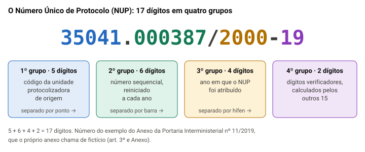

# Protocolo e expedição de correspondência

> Edital (Conhecimentos Específicos, p. 28): "3.4 Protocolo: recepção, classificação, registro e distribuição de documentos. 3.5 Expedição de correspondência: registro e encaminhamento."

## Por que este tópico importa

Todo dia chegam ao conselho requerimentos de arquitetos, ofícios de prefeituras, intimações, notificações dos Correios. Todo dia saem respostas, convocações e certidões. Quem cuida dessa entrada e dessa saída é o **protocolo**, um dos setores em que o assistente administrativo pode trabalhar.

A prova de 2023 deste cargo não teve item de protocolo, porque o edital era outro. Mas a Quadrix cobra o assunto em concursos de outros conselhos profissionais de nível médio, sempre em itens curtos: uma definição com uma palavra trocada, um serviço dos Correios confundido com outro, a correspondência particular tratada como oficial.

A aula segue o caminho do documento: primeiro o que chega (recepção, classificação, registro e distribuição), depois o que sai (expedição).

## O que é o protocolo

**Protocolo** é a unidade que controla a entrada, a circulação e a saída dos documentos de um órgão. A norma federal de referência é a **Portaria Interministerial nº 1.677/2015**, cujo anexo define os procedimentos de protocolo na Administração Pública Federal.

Pelo item 2 do anexo, são atividades de protocolo: **o recebimento, a classificação, o registro, a distribuição, o controle da tramitação, a expedição e a autuação** de documentos avulsos para formar processos.

Dois termos da norma que caem em prova:

- **documento avulso**: o documento solto, que não está reunido em processo (um ofício, um requerimento);
- **processo**: o conjunto de documentos avulsos reunidos e ordenados oficialmente no curso de uma ação administrativa.

E uma regra que derruba muito candidato: **o protocolo não arquiva**. O arquivamento, o desarquivamento e o empréstimo de documentos são da área de arquivo, e não da unidade de protocolo (item 3.4 do anexo). O protocolo controla o documento **enquanto ele circula**.

> [!NOTE]
> A Portaria nº 1.677/2015 foi feita para os órgãos e entidades da Administração Pública Federal. O CAU/TO é uma autarquia, mas conselho profissional tem regime próprio, e nenhuma fonte aberta diz se a portaria o obriga. Usá-la como modelo para o conselho é leitura nossa. Ela é, de todo modo, a referência que as bancas cobram, e o Manual de Gestão Documental do CAU/SP descreve as mesmas rotinas.

## O caminho do documento

O edital lista as etapas na mesma ordem da portaria. No documento que **chega**, o caminho é este:

1. **recebimento** (ou recepção): conferir e separar o que chegou;
2. **classificação**: dar ao documento o código do assunto;
3. **registro**: cadastrar os dados do documento;
4. **distribuição**: entregar ao setor que vai cuidar dele;
5. **controle da tramitação**: acompanhar por onde ele passa.

No documento que **sai**, o caminho é a **expedição**.

> [!WARNING]
> O Dicionário Brasileiro de Terminologia Arquivística, do Arquivo Nacional, lista o registro **antes** da classificação. A portaria e o edital põem a classificação antes. Estude pela ordem da norma e do edital, e não se prenda à posição dessas duas etapas: as fontes divergem. Já o registro **antes da distribuição** é ponto pacífico, como você vai ver adiante.

## Recebimento: o que conferir na chegada

Receber não é só pegar o envelope. Para o documento em papel, o anexo da portaria (item 2.1.1) manda conferir, entre outras coisas:

- **se o documento se destina ao órgão**, mesmo que o destinatário indicado não ocupe mais o cargo. O que não for do órgão é devolvido. Se houver comprovante de recebimento, ele é datado, assinado e devolvido;
- **se o invólucro está íntegro**. Envelope danificado: o fato é registrado no ato do recebimento e comunicado de imediato à autoridade competente;
- **se o documento é oficial ou particular**, e se o oficial é **ostensivo ou sigiloso** (veja a próxima parte);
- **se está marcado como "Urgente"**: ele passa na frente na classificação, no registro e na distribuição;
- **se os anexos e volumes indicados vieram**. Faltou algum, o protocolo avisa o remetente.

**Exemplo** (fictício). Chega ao conselho um ofício de uma prefeitura endereçado ao "Senhor Fulano, Gerente Administrativo", que saiu do cargo há dois meses. O ofício trata de um assunto do conselho: ele é recebido normalmente, porque se destina ao órgão, e não à pessoa.

No dia a dia de um conselho, o Manual de Gestão Documental do CAU/SP mostra a rotina: carimbar cada correspondência recebida com **nome legível, assinatura, data e hora**; se ela foi recebida por engano, anular o registro com o carimbo "sem efeito" e devolvê-la aos Correios.

## Oficial ou particular, ostensivo ou sigiloso

Na triagem, o protocolo faz duas separações.

**Oficial × particular.** Oficial é o documento que trata de assunto do órgão. Particular é o de interesse pessoal, como a carta de um parente endereçada a um empregado no endereço do conselho. O particular segue as regras que o próprio órgão definir (item 2.1.1, c), não entra na rotina dos documentos oficiais e **não é expedido pelo órgão** (observação do item 2.4).

**Ostensivo × sigiloso.** Ostensivo é o documento **sem restrição de acesso**; sigiloso é o que, pelo conteúdo, tem acesso restrito, nos termos da lei (glossário do anexo). A portaria não detalha o tratamento do sigiloso: remete à legislação própria.

> [!CAUTION]
> Desconfie do item que manda o protocolo abrir e analisar o envelope sigiloso. O manual do CAU/SP é expresso: não se abrem envelopes com grau de sigilo ou com segredo de justiça, salvo a pedido do setor de destino. O protocolo registra e encaminha; quem lê é o destinatário autorizado.

## Classificação: o código do assunto

**Classificar** é atribuir ao documento um código e um descritor, conforme a atividade de que ele resulta. Pelo glossário do anexo, isso serve para **agilizar a recuperação** do documento e preparar as etapas seguintes da gestão (avaliação, eliminação, recolhimento).

Pela portaria, os documentos das **atividades-meio** (pessoal, compras, patrimônio) seguem as classes aprovadas pelo **Conselho Nacional de Arquivos (Conarq)**; os das **atividades-fim** seguem as classes elaboradas por cada órgão e aprovadas pelo **Arquivo Nacional** (item 2.1.1, h).

**Exemplo.** Um pedido de compra de cadeiras é atividade-meio: qualquer órgão compra cadeiras. Um pedido de registro profissional de arquiteto é atividade-fim do conselho.

> [!TIP]
> "Classificação" tem mais de um sentido. O Dicionário Brasileiro de Terminologia Arquivística chama de classificação também a atribuição de **grau de sigilo** a um documento. A etapa de classificação do protocolo é a outra: o **código do assunto**. Leia o item inteiro para saber de qual se trata.

## Registro: a ficha do documento

**Registrar** é cadastrar as informações do documento **com o objetivo de controlar a sua tramitação**: essa é a definição do glossário do anexo. O registro é feito em sistema informatizado ou, excepcionalmente, em formulário (item 2.1.1, i).

Os dados que a portaria manda registrar:

- a espécie ou tipo do documento (ofício, requerimento...);
- o número e a data de produção;
- **a data de recebimento**;
- se é documento avulso ou processo;
- o **Número Único de Protocolo (NUP)**;
- o número de anexos e de volumes;
- o código de classificação e o descritor, ou o assunto;
- o remetente ou interessado;
- o destinatário.

Repare: a ficha guarda **quando** o documento entrou, **de quem** veio, **o que** é e **para quem** vai. É ela que permite responder, semanas depois, à pergunta "onde está o meu requerimento?".

## Por que registrar antes de distribuir

Esta é a parte que mais importa da aula. **O registro vem antes da distribuição**, e não depois. O motivo está na própria função do registro: ele existe para **controlar a tramitação**. Se o documento sai do protocolo sem registro, a primeira movimentação dele já acontece sem controle.

A portaria fecha a questão no item 2.3: **"É vedada a tramitação de documento, avulso ou processo, sem o respectivo registro"**. E a distribuição é justamente a **primeira tramitação** do documento dentro do órgão (glossário). Logo, não há distribuição sem registro prévio.

Há mais dois sinais na norma:

- a distribuição **também é registrada** (item 2.2), e esse registro identifica o documento **pelo NUP**, que só existe porque o documento já foi registrado;
- o documento "Urgente" é **priorizado** na classificação, no registro e na distribuição (item 2.1.1, e): a urgência acelera as etapas, mas não pula nenhuma.

**Exemplo** (fictício). Um arquiteto entrega na recepção um pedido de certidão. Se o servidor leva o papel direto ao setor técnico "para ganhar tempo", e o papel some numa mesa, ninguém consegue provar que ele chegou, em que data nem com quem está. Com o registro feito antes, o protocolo informa: "recebido em 3/11, NUP tal, distribuído ao setor técnico em 3/11, recebido por tal empregado".

> [!IMPORTANT]
> Ordem segura: **recebe → classifica → registra → distribui**. O registro é o que dá controle à tramitação; por isso ele precisa existir antes do primeiro movimento do documento (item 2.3).

## O Número Único de Protocolo (NUP)

O **NUP** é o número atribuído ao documento, avulso ou processo, **na unidade protocolizadora de origem**, para controlar os documentos. Quem o regula hoje é a **Portaria Interministerial nº 11/2019**, que vale para a Administração federal direta, autárquica e fundacional.

Pelo art. 3º, o NUP tem **17 dígitos em quatro grupos** (00000.000000/0000-00):

- **5 dígitos**: o código da unidade protocolizadora de origem;
- **6 dígitos**, depois de um ponto: o número sequencial, **reiniciado a cada ano**;
- **4 dígitos**, depois de uma barra: o ano;
- **2 dígitos**, depois de um hífen: os dígitos verificadores.

Regras do art. 4º que podem virar item:

- o processo que vai a **outro órgão federal mantém o NUP original**; é proibido dar um novo;
- o documento avulso produzido no órgão **para integrar um processo não recebe NUP**: a juntada ao processo já permite controlá-lo;
- o documento recebido de quem **não é da Administração federal** recebe NUP no órgão que o recebe, e a identificação de origem fica como referência.

> [!NOTE]
> O manual do CAU/SP usa o NUP. Se a Portaria nº 11/2019 obriga os conselhos profissionais é questão sem resposta em fonte aberta: é leitura nossa que o modelo vale para o CAU/TO.

## Distribuição e controle da tramitação

**Distribuição** é a **primeira tramitação** do documento para o destinatário, **dentro do órgão** (glossário do anexo). **Tramitação**, também chamada **movimentação**, é o curso do documento desde que foi produzido ou recebido até cumprir sua função administrativa.

Tanto a distribuição quanto cada tramitação seguinte são registradas (itens 2.2 e 2.3), com: o NUP, o remetente, o destinatário, os dados do documento, a **data do encaminhamento e quem encaminhou**, a **data do recebimento e quem recebeu**, e as providências, quando houver.

É esse histórico que permite ao protocolo dizer onde o documento está. Num sistema eletrônico como o SEI, que o CAU/SP usa, o registro de cada movimentação é automático, mas a lógica é a mesma.

**Autuação**, a última atividade da lista, é reunir e ordenar documentos avulsos para **formar um processo**. É obrigatória quando o assunto exige análise, parecer ou decisão. No processo em papel, só a **unidade protocolizadora** autua (item 2.6). Por isso a norma distingue a **unidade de protocolo** (recebe, classifica, registra, distribui, controla e expede) da **unidade protocolizadora**, que faz tudo isso e ainda autua processos e atribui o NUP.

## Expedição: o documento que sai

**Expedir** é enviar o documento para **fora** do órgão. Pelo item 2.4.1 do anexo, para o documento em papel:

1. o setor que produziu o documento o **classifica** e o **registra**;
2. encaminha ao protocolo, que **confere** se ele foi registrado, se está classificado e se os anexos e volumes estão lá. **Se houver falha, o protocolo devolve o documento ao setor** para corrigir;
3. o protocolo **registra a expedição**;
4. o documento sai **em invólucro próprio, com etiqueta** de dados do destinatário e do remetente, com medidas de segurança contra perda ou extravio.

O edital resume a expedição em **"registro e encaminhamento"**: de novo, nada sai sem registro.

> [!CAUTION]
> **Distribuição ≠ expedição.** Distribuir é entregar dentro do órgão (do protocolo ao setor técnico); expedir é mandar para fora (do conselho a uma prefeitura, a um profissional). A banca troca uma pela outra.

No CAU/SP, a rotina é concreta: o setor pede o envio pelo SEI, com nome, endereço completo e CEP do destinatário; o setor responsável posta e devolve ao remetente o **código de rastreamento** e a data da postagem; no início de cada mês, o que foi postado é conferido com a fatura dos Correios. Correspondência devolvida e AR que retorna são comunicados ao setor interessado.

## Os serviços dos Correios

Na expedição em papel, o conselho usa o serviço postal. Os termos que caem:

| Termo | O que é | Fonte |
|---|---|---|
| **Carta** | Comunicação escrita, de interesse específico do destinatário | Lei nº 6.538/1978, art. 47 |
| **Registro** | Postagem **qualificada**: o objeto é entregue aos Correios **contra a emissão de um certificado**, com número para rastrear | Lei nº 6.538/1978, art. 47; Correios |
| **Aviso de Recebimento (AR)** | Comprova a **entrega**, com os dados de quem recebeu | Correios |
| **Mão Própria** | Entrega **só às pessoas indicadas pelo remetente**; vale apenas para objeto registrado | Correios |
| **Valor Declarado** | Indenização no valor declarado, em caso de avaria ou extravio | Correios |

O **registro** comprova a **postagem**: o remetente sai da agência com o comprovante e o código de rastreamento. O destinatário recebe em casa, como qualquer carta. Quem comprova a **entrega**, com o nome de quem recebeu, é o **AR**.

O AR tem três modalidades, pela página dos Correios:

- **convencional**: o formulário volta ao remetente com os dados do recebedor;
- **eletrônico**: os dados do recebedor ficam registrados eletronicamente; serve para quem paga à vista e para quem tem contrato;
- **digital**: a imagem digitalizada vai ao sistema do cliente, **só para quem tem contrato**.

A portaria usa o AR num caso típico: quando o processo cai em **exigência** e o interessado é pessoa de fora da Administração, ele é convocado por **correspondência registrada com AR** (ou meio eletrônico que garanta o recebimento), e o comprovante é juntado ao processo (item 2.5).

> [!NOTE]
> **Malote** é o envio agrupado de correspondência, em bolsa fechada, entre unidades, como a sede e um escritório regional. A lei não usa a palavra; fala em "correspondência agrupada" (art. 47). Para a prova, guarde a ideia de transporte em lote, de rotina, entre unidades.

## Passo a passo para julgar o item

> [!TIP]
> 1. **Leia o comando.** "Segundo a Portaria nº 1.677/2015" pede a letra da norma; sem comando, vale a mesma regra, que é a que as bancas cobram.
> 2. **Pergunte: dentro ou fora?** Dentro do órgão é distribuição e tramitação; para fora, expedição.
> 3. **Procure o registro.** Qualquer etapa que faça o documento circular sem registro está errada: registra-se antes de distribuir e antes de expedir.
> 4. **Separe os Correios:** registro = postagem com comprovante; AR = prova da entrega; Mão Própria = só a pessoa indicada.
> 5. **Desconfie de absolutos** ("todo", "somente", "sempre") e de tarefas que não são do protocolo (arquivar, abrir sigiloso, expedir o particular). Se tudo bate com a regra, marque C.

## Fontes

- Ministério da Justiça e Ministério do Planejamento. *Anexo da Portaria Interministerial MJ/MP nº 1.677, de 7 de outubro de 2015* — procedimentos gerais de protocolo na Administração Pública Federal. Portal de Compras (gov.br): https://www.gov.br/compras/pt-br/acesso-a-informacao/legislacao/portarias/anexoportariaprocedimentosdeprotocolo.pdf — itens 2 (atividades e NUP, p. 1), 2.1.1 (recebimento, classificação e registro, p. 1-2), 2.2 (distribuição, p. 6), 2.3 (controle da tramitação, p. 7), 2.4 (expedição, p. 7-8), 2.5 (exigência, p. 8-9), 2.6 (autuação, p. 9), 3.4 (arquivamento fora do protocolo, p. 36) e glossário (p. 37-41). Lido em 30/10/2026.
- Ministério da Justiça e Segurança Pública e Ministério da Economia. *Portaria Interministerial nº 11, de 25 de novembro de 2019* (NUP). Diário Oficial da União: https://www.in.gov.br/web/dou/-/portaria-interministerial-n-11-de-25-de-novembro-de-2019-229645093 — arts. 1º a 4º e Anexo (exemplo de dígitos verificadores). Lida na cópia do DOU guardada pela CGU, em 30/10/2026.
- *Lei nº 6.538, de 22 de junho de 1978* (serviços postais), art. 47. Planalto: https://www.planalto.gov.br/ccivil_03/leis/l6538.htm
- Empresa Brasileira de Correios e Telégrafos. *Serviços adicionais* (AR, Mão Própria, Valor Declarado, Registro). https://www.correios.com.br/enviar/servicos-adicionais — lida em 30/10/2026.
- Conselho de Arquitetura e Urbanismo de São Paulo. *Manual de Gestão Documental* (2024), seção 3 (p. 8) e capítulo 8, Protocolo e correspondência (p. 27-29). https://transparencia.causp.gov.br/wp-content/uploads/2024/02/Manual-de-Gestao-Documental.pdf
- Arquivo Nacional. *Dicionário Brasileiro de Terminologia Arquivística* (2005), verbetes "classificação" (acepções 2 e 3), "correspondência" e "protocolo". https://www.gov.br/conarq/pt-br/centrais-de-conteudo/publicacoes/dicionrio_de_terminologia_arquivistica.pdf
- Itens do Instituto Quadrix sobre protocolo e expedição em concursos de conselhos profissionais (2019 a 2022), listados no Aprova Concursos, consultados só como referência de estilo: https://www.aprovaconcursos.com.br/questoes-de-concurso/questoes/banca/quadrix/assunto/protocolo

Vêm da Portaria nº 1.677/2015, conferidos no texto: as atividades de protocolo e sua ordem, o que conferir no recebimento, os dados do registro e da distribuição, a vedação de tramitar sem registro, os passos da expedição, a exigência com AR, a autuação e as definições do glossário. O NUP vem da Portaria nº 11/2019; carta e registro, da Lei nº 6.538/1978; AR, Mão Própria e Valor Declarado, da página dos Correios; as rotinas de um conselho, do manual do CAU/SP. São nossos os exemplos (o ofício ao gerente que saiu, o pedido de certidão, as cadeiras), o fluxograma e a explicação do malote, que a lei não define com esse nome. Que as duas portarias alcancem ou não o CAU/TO é questão sem fonte aberta: o texto diz que é leitura nossa.
